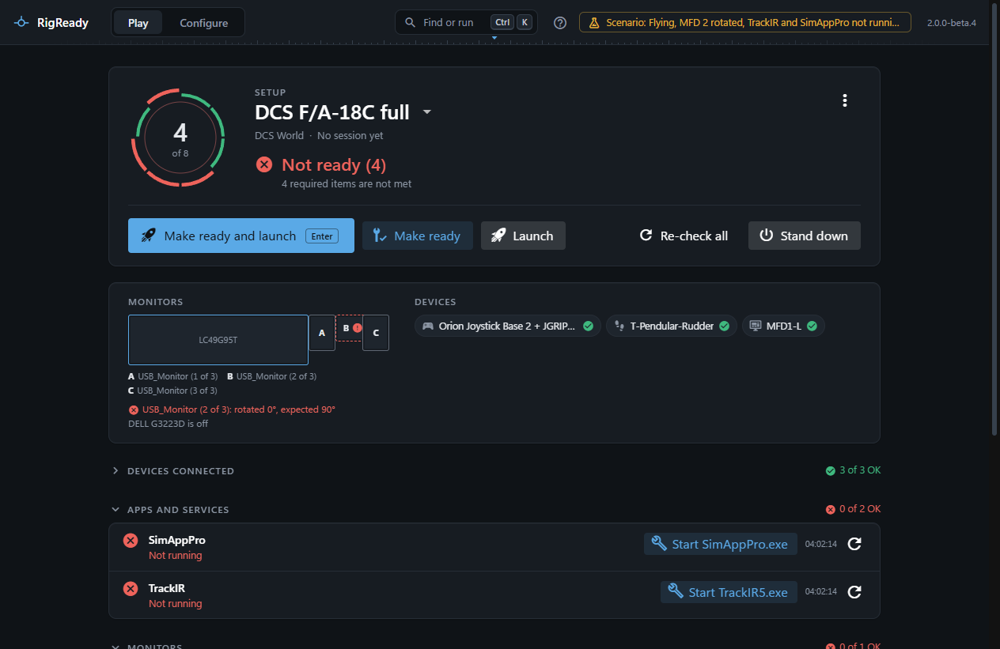
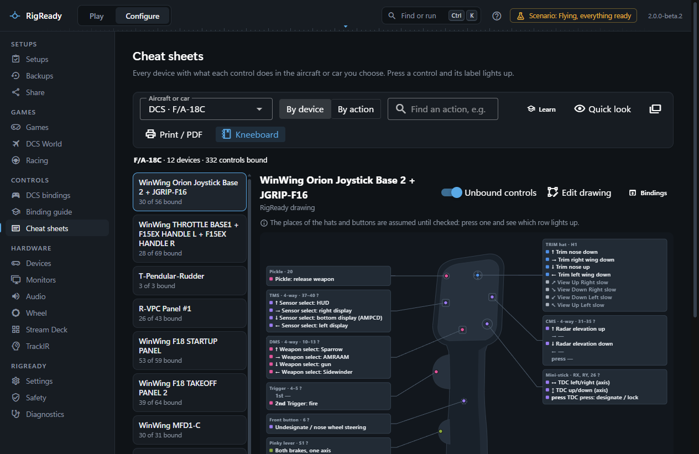
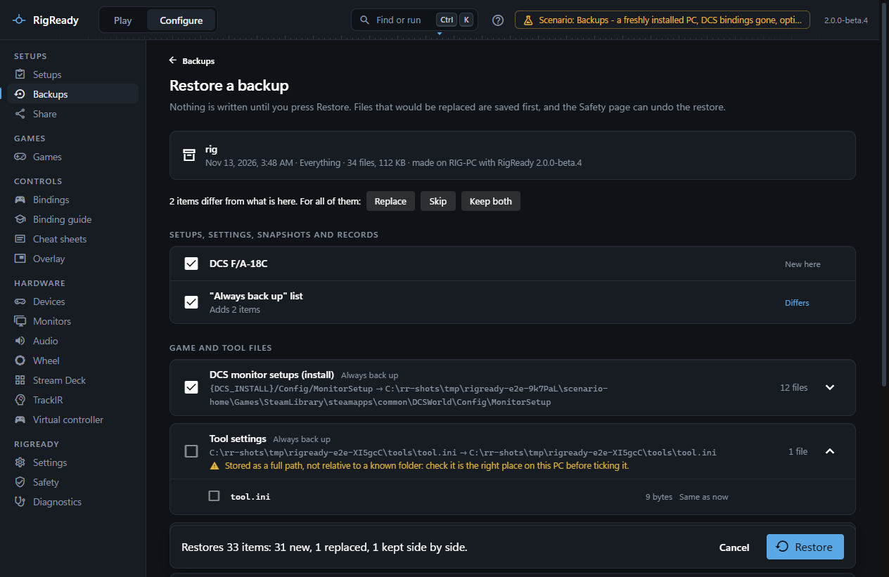
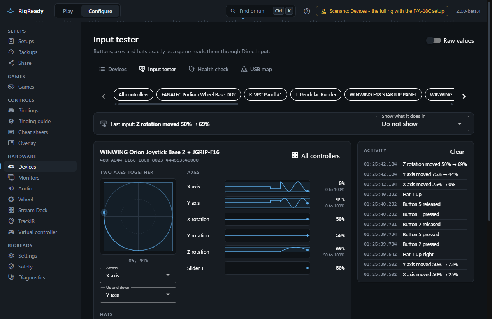
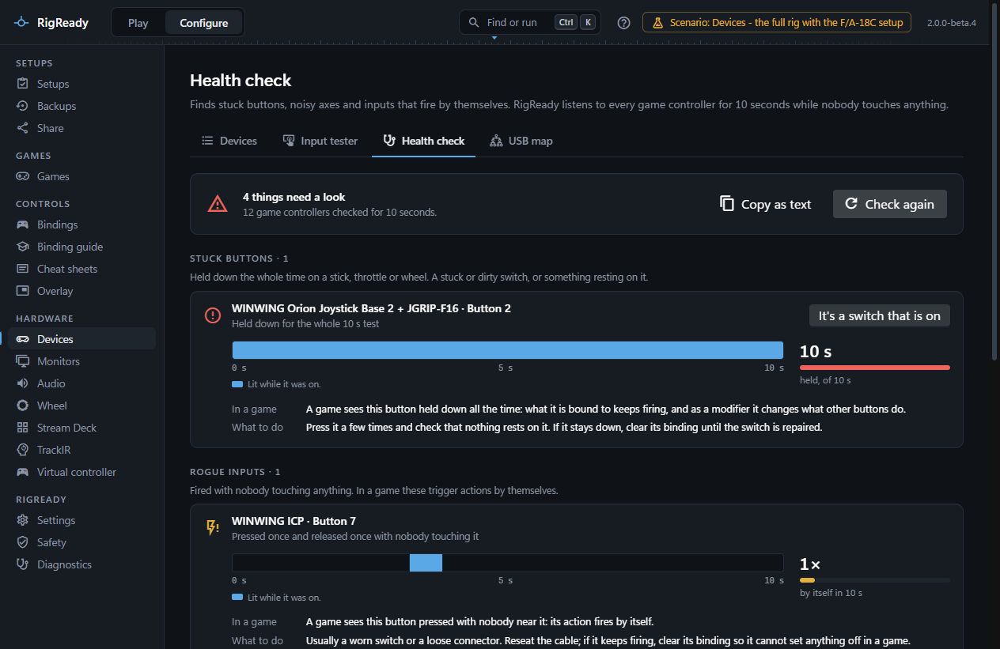

# RigReady

**Get the rig ready, keep your controls, find what is wrong.**

RigReady is a free Windows app for flight and racing sim rigs. It checks the rig before you launch and fixes what it can, helps you set up, save and bring back your bindings, and shows what every controller is doing when something is off. It does three jobs:

| | |
|---|---|
| **Ready to launch** *(before a session)* | Checks the rig for the setup you are about to use, fixes what is off, and starts the game. |
| **Controls, set up and saved** *(setting up)* | Bindings, cheat sheets and backups, so a new aircraft or a new PC does not start from nothing. |
| **See what the rig is doing** *(when something is off)* | Every button, axis and USB port the way a game sees them, so a fault has a name. |

Website: [rigready.io](https://rigready.io) · Manual: [rigready.io/docs](https://rigready.io/docs/) · License: MIT



## Who it is for

People with a flight or racing rig on a PC that is also used for other things. Getting it ready means the right controllers are plugged in, the helper apps are running, the monitors are arranged and the game's files are intact; when one of those is off, you usually find out after the game has loaded. Setting up bindings for a rig full of controllers takes hours, and a reinstall or a new PC can mean doing it again. And when a view creeps or a button does nothing, it is hard to tell which device is at fault. RigReady helps with all three.

## Status

Version 2.0.0 is a rebuild from the ground up. It is **pre-release**: nothing has been published yet, there is no installer to download, and the only way to run it today is from source (below). `docs/requirements/ledger.yaml` lists every requirement with its status and the evidence for it; `CHANGELOG.md` summarises what 2.0.0 contains and what is still open.

## What it does

### Ready to launch

A setup records how the rig looks when it works. Before each session RigReady checks the rig against it, fixes what is off, and launches the game. Launch on its own is never blocked, only warned.

- **The Play screen.** One screen for the setup you used last: a readiness dial, the rig drawn with its monitors and devices, and a checklist of controllers, helper apps, monitors, audio and game files with a fix beside every failing item. **Make ready and launch** runs every fix in order (starts apps, applies the monitor layout, restores files) and starts the game once everything required is in place. **Stand down** closes the helper apps and puts the monitors back to the desk layout. [The Play screen](docs/manual/play/index.md)
- **Without the window.** A desktop shortcut per setup, the tray menu, the taskbar button and a hotkey, so a session can start with one double-click. Inside the app, Ctrl+K runs any action. [Starting without the window](docs/manual/one-click/index.md)
- **Monitors and audio.** Named layouts for flying, racing and the desk, with identify; a layout you apply goes back by itself unless you keep it. Default audio devices. [Monitors and audio](docs/manual/monitors-and-audio/index.md)
- **Flying and racing on one PC.** One setup per aircraft or car, each with its own devices, apps and layout. [Setups](docs/manual/setups/index.md)

### Controls, set up and saved

Setting up bindings for a rig full of controllers takes hours. RigReady helps you get them right, shows what every control does, and keeps a copy so a reinstall or a new PC does not mean starting again.

- **Capture a setup.** Record the controllers, apps, layout and audio as they are now, then edit. [Capture](docs/manual/setups/capture.md)
- **DCS bindings.** See the bindings in effect, edit them with a preview, clear the defaults DCS adds to every device, and copy controls between aircraft. [DCS bindings](docs/manual/dcs/bindings.md)
- **Cheat sheets.** Each device drawn with what every control does, for DCS aircraft and the racing games, printable and exportable as DCS kneeboard pages. [Cheat sheets](docs/manual/dcs/cheat-sheets.md)
- **Learn them.** A trainer names an action and you press the control; binding guides for the F/A-18C and UH-1H walk through what to bind first. [Trainer](docs/manual/dcs/trainer.md)
- **Back up and restore.** One click backs up setups, game files and settings; a restore shows what will change before it does. [Backups](docs/manual/protect/backups.md), [moving to a new PC](docs/manual/protect/new-pc.md)
- **Share it.** Share a setup as a file with personal details reviewed and removed, or make a picture of the rig to show people. [Sharing](docs/manual/protect/sharing.md)

### See what the rig is doing

A view that creeps, a button that does nothing, a panel the game no longer knows. These tools show what each controller sends and where it is plugged in.

- **Input tester.** Buttons and axes the way a game sees them, one device or all at once, with a live trace per axis. [Input tester](docs/manual/hardware/input-tester.md)
- **Find a device.** Press a button on it and RigReady opens it: its IDs, its port, and a name you choose. [Devices](docs/manual/hardware/devices.md)
- **Health check.** Hands off for ten seconds: stuck buttons, inputs that fire by themselves and noisy axes. [Health check](docs/manual/hardware/health-check.md)
- **USB map.** Which hub each device hangs off, how close you are to the limits, and what to unplug. [USB map](docs/manual/hardware/usb-map.md)
- **New device IDs.** When Windows gives a controller a new ID, RigReady moves the DCS bindings, or points iRacing's files at it (the iRacing repair is not yet tried on real hardware). [Device IDs](docs/manual/dcs/device-ids.md)
- Fanatec wheel bases, Stream Deck and TrackIR have pages of their own, and RigReady notices when HidHide is hiding a device. [Hardware](docs/manual/hardware/index.md)

### Optional AI help with setup and bindings

AI is off until you turn it on, and nothing else in RigReady needs it. It comes in two forms, and either works without the other. Either way, every change is backed up first and can be undone on the Safety page.

- **With your own Anthropic API key**, the binding guide can suggest a plan for your controllers, answer questions about the aircraft, and explain any action in the walkthrough. Suggestions are checked against your devices, and only the ones you tick and review are written. You see what will be sent before each request, and it goes only to Anthropic.
- **With an assistant you already use** (Claude Desktop, Claude Code, Cursor or another MCP client), it can check the rig, read the manual and propose changes, and by default RigReady asks you before anything is changed or launched. What it reads goes to that assistant, never to RigReady's author.

See [AI assistants](docs/manual/ai/index.md).

| | |
|---|---|
|  |  |
| Cheat sheets: what every control does | A restore shows what will change before it does |
|  |  |
| The input tester: what a game sees | The health check: a stuck button and a rogue input |

## Games and hardware

Any game works with a checklist, launch, tracked files and backups. These get more; the manual has a section on [DCS World](docs/manual/dcs/index.md) and a page per [game](docs/manual/games/index.md).

| | Support |
|---|---|
| DCS World | The deepest: installs (Steam and standalone), MFD screen setup (MonitorSetup), Export.lua, options, bindings (view, edit, clean up, device ID repair, copy between aircraft, snapshots), cheat sheets, kneeboard pages, binding guides for the F/A-18C and UH-1H. |
| iRacing, Le Mans Ultimate, BeamNG.drive, Assetto Corsa | A page per game with its bindings and controllers as the game's files have them, cheat sheets and the trainer, backup and restore, and checks for a racing setup. |
| Microsoft Flight Simulator 2024, Assetto Corsa EVO, Assetto Corsa Rally | A game module: detection, config locations, backup suggestions, launch. |
| Any other game | Works generically: a checklist, launch, tracked files, backup. |
| Hardware | Any USB game controller, monitor and audio device Windows sees. Dedicated pages for a Fanatec wheel base, Stream Deck and TrackIR; HidHide is noticed when it hides a device. WinWing devices work as controllers; features that need WinWing's own protocol (backlight sync, UFC/ICP displays, vibration) still need SimAppPro, and RigReady checks that it is running when a setup uses them. |

RigReady was built on one real rig. Nothing in the code is tied to it (a test enforces that), but most of the above has been proven only on recorded data from that rig and on generic test PCs. See the known limitations in `CHANGELOG.md`.

## How it keeps your PC safe

RigReady reads your hardware and changes game files, so it should say exactly what it does. These rules hold everywhere in the app:

- It installs for your Windows user only and never asks for administrator rights: not to install, not to run, not for a fix or an update.
- Every change to a file outside RigReady's own data folder is backed up first, with a visible description of the change. Each one is listed on the Safety page, where it can be undone.
- Only two things leave your PC: the update check to GitHub, and AI requests you send yourself with your own Anthropic key. There is no account, no telemetry and no crash reporting.
- A shared setup never carries scripts or launch commands, nothing from a setup is ever placed into a command line, and an imported file cannot write outside the game and document folders.
- Updates come only from the project's GitHub releases and are checked against their published checksum before they install.
- A monitor layout you apply goes back by itself unless you keep it.
- It never reports success for something that did not happen.

How these are kept, what the app touches and how to report a security problem: [`SECURITY.md`](SECURITY.md), and the [security page](docs/manual/app/security.md) of the manual.

## Run from source

Windows 10 or 11, Node.js 22.12 or newer.

```
git clone https://github.com/MCheli/rigready.git
cd rigready
npm ci
npm run dev:scenario -- flying-all-good   # the app on a recorded rig; touches nothing real
```

To run against your own PC:

```
npm run setup:python   # once: the small Python runtime the controller reader needs
npm run dev            # uses the real machine and the real data folder
```

## Commands

| Command | What it does |
|---|---|
| `npm run dev:scenario -- <scenario>` | The app on a recorded rig in a temp folder. Without a name it lists the scenarios. |
| `npm run dev` | The app on the real machine and the real `~/.rigready`. |
| `npm run check` | Typecheck, lint, format check, unit tests with coverage, ledger check. |
| `npm run test:e2e` | Builds, then drives the app on recorded scenarios; screenshots go to `artifacts/screens/`. |
| `npm run rig:smoke` | Read-only checks against real hardware. |
| `npm run smoke:packaged` | Builds the unpacked app and tests it. |
| `npm run smoke:installer` | Builds a test installer, installs, updates and uninstalls it. |
| `npm run dist` | Builds the installer into `release/`. Never publishes. |

## Where data lives

Everything RigReady keeps is in `%USERPROFILE%\.rigready` (`~/.rigready`): setups (`profiles\*.yaml`), `settings.json`, monitor layouts, backups (`backups\`), the automatic copies made before each change (`backups\auto\`), the change journal and the log (`logs\rigready.log`). Set the environment variable `RIGREADY_HOME` to use another folder. Uninstalling keeps this folder unless you choose to remove it.

## Documents

| | |
|---|---|
| [`docs/manual/`](docs/manual/index.md) | The manual: how to use the app, section by section. Published at [rigready.io/docs](https://rigready.io/docs/). |
| [`CHANGELOG.md`](CHANGELOG.md) | What each version contains. |
| [`docs/PRODUCT.md`](docs/PRODUCT.md) | What the product is. Source of truth. |
| [`docs/ARCHITECTURE.md`](docs/ARCHITECTURE.md) | Layers, ports, test harness, safety rules. |
| [`docs/CONTRIBUTING-FEATURES.md`](docs/CONTRIBUTING-FEATURES.md) | How to add a feature, everything the shared foundation provides, and the audits a feature must pass. |
| [`CONTRIBUTING.md`](CONTRIBUTING.md) | How to contribute, including contributions written with AI tools. |
| [How this was built](https://rigready.io/how-it-was-built/) | An AI disclosure: written with AI coding agents, how the work was checked, what it was tested on, and what is not verified yet. Source: `site/pages/built.html`. |
| [`docs/RELEASING.md`](docs/RELEASING.md) | How a version is released, the checklist before it is, and the runbook for a security fix. |
| [`SECURITY.md`](SECURITY.md) | Reporting a vulnerability, supported versions, what the app touches, how a fix reaches users. |
| [`docs/requirements/ledger.yaml`](docs/requirements/ledger.yaml) | Requirements, status, evidence. |
| [`site/README.md`](site/README.md) | The rigready.io website: how it is built, and what updates by itself. |
| [`docs/research/`](docs/research/) | Findings on game file formats and hardware. |

## License

MIT. See [`LICENSE`](LICENSE).
