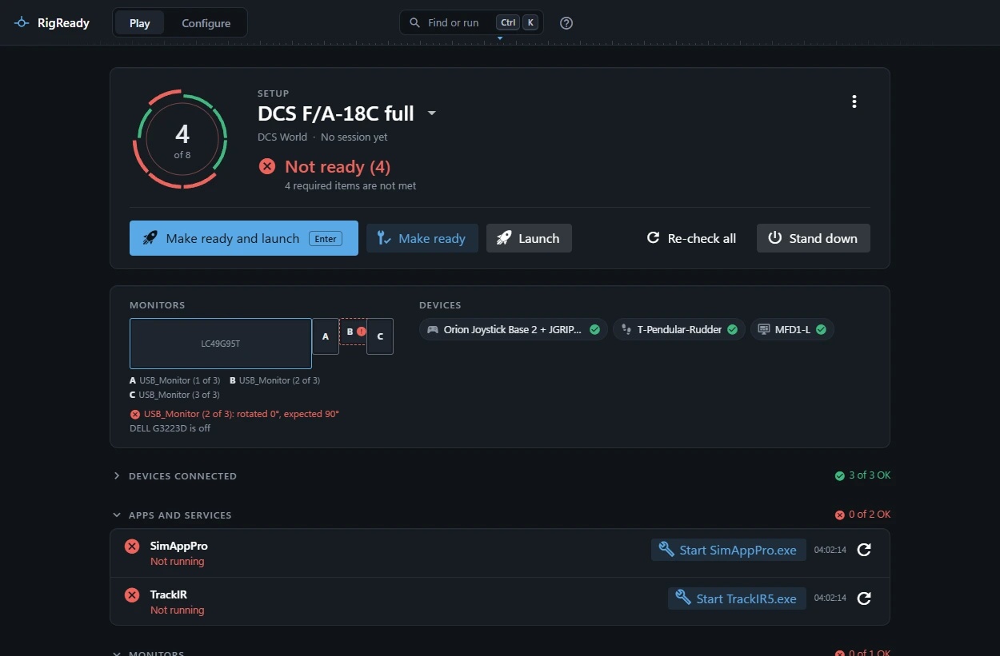
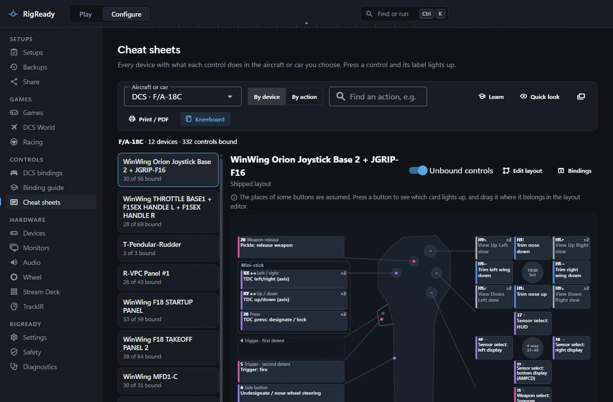
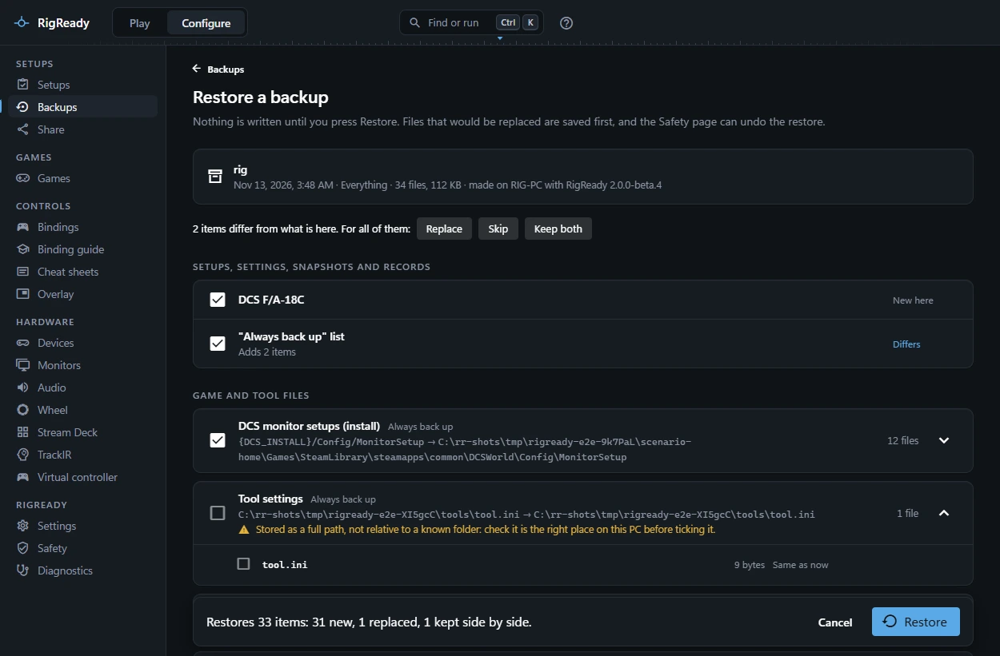
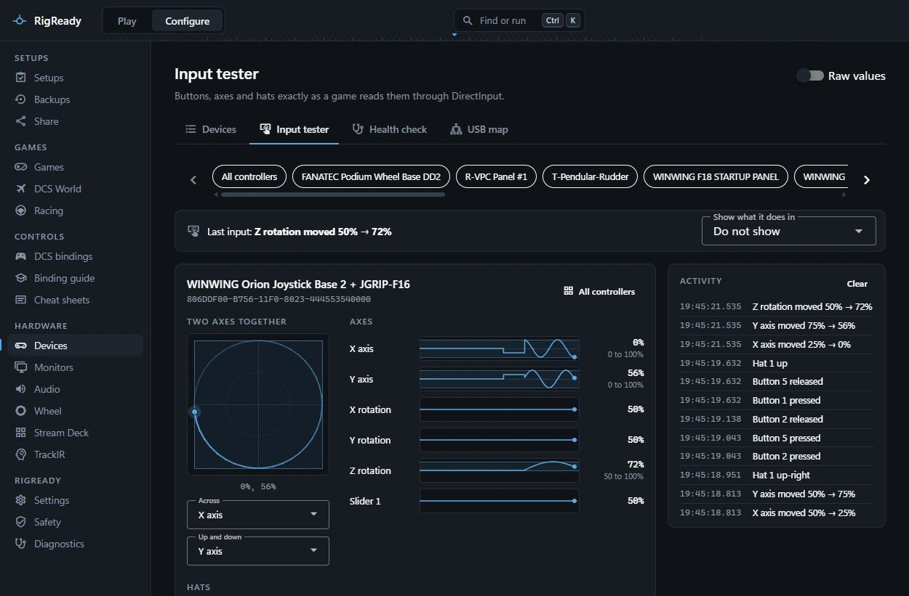
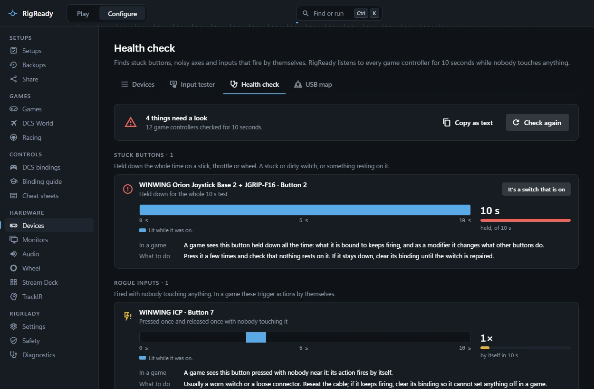

# RigReady

**Less time on rig chores. More time flying and racing.**

RigReady is a free Windows app for flight and racing sim rigs. It does the work around the game: setting up your controls and screens, learning what every button does, getting everything running before you launch, and putting your desk back after.

| | |
|---|---|
| **Set it up** *(once, and for each new aircraft or car)* | Bind your controls for DCS and iRacing, with a preview first and Undo after, helped by binding guides for DCS aircraft and iRacing car classes. It also sets up monitor layouts, DCS's MFD screens and Export.lua without SimAppPro, and iRacing's control profiles. |
| **Learn it** *(before and during a session)* | Cheat sheets show what every control on your stick, throttle, wheel or button box does, on paper or as DCS kneeboard pages. The trainer names an action and you press its control. The overlay lists each button you press and what it does in that aircraft or car. |
| **Launch** *(before each session)* | One check before the session covers the stick and throttle or wheel and pedals, helper apps, monitors and MFD screens, audio and game files. Make ready fixes what is off, in order, and starts the game. When a control acts up, the input tester, health check and USB map help find out why. |
| **Put it away** *(after the session)* | After the session, Stand down closes the helper apps and puts your monitors back in the desk layout. It can run by itself when the game closes, after a countdown you can cancel. |

Website: [rigready.io](https://rigready.io) · Manual: [rigready.io/docs](https://rigready.io/docs/) · License: MIT



## Who it is for

People with a flight or racing rig on a PC that is also used for other things. Getting it ready means the right controllers are plugged in, the helper apps are running, the monitors are arranged and the game's files are intact; when one of those is off, you usually find out after the game has loaded. Setting up bindings for a rig full of controllers takes hours, and a reinstall or a new PC can mean doing it again. And when a view creeps or a button does nothing, it is hard to tell which device is at fault. RigReady helps with all three.

## Status

Version 2.0.0 is a rebuild from the ground up, and it is what this page describes. It is in final testing and **not published yet**: there is no 2.0 installer to download, and the only way to run it today is from source (below). When it is published, the installer will be on the [download page](https://rigready.io/download/) and under [Releases](https://github.com/MCheli/RigReady/releases).

The installer on the Releases page today is version 1.1.0, the first RigReady, from February 2026. Version 2.0 replaces it. It does not use version 1's setups as they are, but lists them apart and can bring one over as a new setup; 1.1.0 does not update itself to 2.0.

`docs/requirements/ledger.yaml` lists every requirement with its status and the evidence for it; `CHANGELOG.md` summarises what 2.0.0 contains and what is still open.

## What it does

### Ready to launch

A setup records how the rig looks when it works. Before each session RigReady checks the rig against it, fixes what is off, and launches the game. Launch on its own is never blocked, only warned.

- **The Play screen.** One screen for the setup you used last: a readiness dial, the rig drawn with its monitors and devices, and a checklist of controllers, helper apps, monitors, audio and game files with a fix beside every failing item. **Make ready and launch** runs every fix in order (starts apps, applies the monitor layout, restores files) and starts the game once everything required is in place. **Stand down** closes the helper apps and puts the monitors back to the desk layout. [The Play screen](docs/manual/play/index.md)
- **Without the window.** A desktop shortcut per setup, the tray menu, the taskbar button and a hotkey, so a session can start with one double-click. Inside the app, Ctrl+K runs any action. [Starting without the window](docs/manual/one-click/index.md)
- **Monitors and audio.** Named layouts for flying, racing and the desk, with identify; a layout you apply goes back by itself unless you keep it, and once you have kept a layout, Make ready applies it without asking again. Default audio devices. [Monitors and audio](docs/manual/monitors-and-audio/index.md)
- **Flying and racing on one PC.** One setup per aircraft or car, each with its own devices, apps and layout. [Setups](docs/manual/setups/index.md)

### Controls, set up and saved

Setting up bindings for a rig full of controllers takes hours. RigReady helps you get them right, shows what every control does, and keeps a copy so a reinstall or a new PC does not mean starting again.

- **Capture a setup.** Record the controllers, apps, layout and audio as they are now, then edit. [Capture](docs/manual/setups/capture.md)
- **Bindings.** For DCS: see the bindings in effect, edit them with a preview, clear the defaults DCS adds to every device, and copy controls between aircraft. For iRacing: every action and what it is bound to, for all cars and for each car with custom controls, and binding an action to a button or a key with a preview (axes and hat switches are still bound in iRacing). One Bindings page with a game picker. [DCS bindings](docs/manual/dcs/bindings.md), [iRacing bindings](docs/manual/games/iracing-bindings.md)
- **Cheat sheets.** Each device drawn with what every control does, for DCS aircraft and the racing games, printable and exportable as DCS kneeboard pages. A controller with no drawing gets a sheet from your own photo of it. [Cheat sheets](docs/manual/controls/cheat-sheets.md)
- **Learn them.** A trainer names an action and you press the control; twenty binding guides, from the F/A-18C, F-16C, A-10C and F-14 to the Ka-50, UH-1H and P-51D, walk through what to bind first, and you can write or import your own. iRacing has guides by car class, from GT3 and GT4 to formula, oval and dirt. [Trainer](docs/manual/controls/trainer.md), [Binding guide for iRacing](docs/manual/games/iracing-binding-guide.md)
- **Overlay.** A small see-through list over the game of each button you press and what it does there, fading after a few seconds. Off until you turn it on. [The overlay](docs/manual/play/overlay.md)
- **Back up and restore.** One click backs up setups, game files and settings; a restore shows what will change before it does. [Backups](docs/manual/protect/backups.md), [moving to a new PC](docs/manual/protect/new-pc.md)
- **Share it.** Share a setup as a file with personal details reviewed and removed, or make a picture of the rig to show people. [Sharing](docs/manual/protect/sharing.md)

### See what the rig is doing

A view that creeps, a button that does nothing, a panel the game no longer knows. These tools show what each controller sends and where it is plugged in.

- **Input tester.** Buttons and axes the way a game sees them, one device or all at once, with a live trace per axis. [Input tester](docs/manual/hardware/input-tester.md)
- **Find a device.** Press a button on it and RigReady opens it: its IDs, its port, a name you choose, and what it is and what you use it for when RigReady cannot tell. [Devices](docs/manual/hardware/devices.md)
- **Health check.** Hands off for ten seconds: stuck buttons, inputs that fire by themselves and noisy axes. [Health check](docs/manual/hardware/health-check.md)
- **USB map.** Which hub each device hangs off, how close you are to the limits, and what to unplug. [USB map](docs/manual/hardware/usb-map.md)
- **New device IDs.** When Windows gives a controller a new ID, RigReady moves the DCS bindings, points iRacing's and Assetto Corsa's files at it, follows a renamed controller in Le Mans Ultimate, and copies BeamNG maps to a replacement. Other games: not yet. The iRacing and Assetto Corsa repairs are not yet tried on real hardware. [Device IDs](docs/manual/dcs/device-ids.md)
- Wheel bases (Fanatec, Moza, Logitech, Simagic, Thrustmaster, Simucube, Asetek, Cammus; tested on a real wheel for Fanatec only), Stream Deck and TrackIR have pages of their own, and RigReady notices when HidHide is hiding a device. [Hardware](docs/manual/hardware/index.md)

### Optional AI help with setup and bindings

AI is off until you turn it on, and nothing else in RigReady needs it. It comes in two forms, and either works without the other. Either way, every change to a file is backed up first and can be undone on the Safety page.

- **With your own key from Anthropic, OpenAI, Google or a local model**, the built-in assistant helps anywhere in RigReady, for any game: it finds where helper programs such as SimAppPro, TrackIR, SRS or Stream Deck are installed, proposes the checks and launch steps of a ready check, and writes scripts for what no check covers. Changes it asks for go through the same questions and the same Safety page as an MCP assistant, and nothing it drafts is saved until you press Save. In the binding guide the same key suggests a plan for your controllers, answers questions about the aircraft and explains any action. You see what will be sent before each request, and it goes only to the provider you chose (or nowhere, with a model on your PC).

- **With an assistant you already use** (Claude Desktop, Claude Code, Cursor or another MCP client), it can check the rig, read the manual and propose changes, and by default RigReady asks you before anything is changed or launched. What it reads goes to that assistant, never to RigReady's author.

See [AI assistants](docs/manual/ai/index.md).

| | |
|---|---|
|  |  |
| Cheat sheets: what every control does | A restore shows what will change before it does |
|  |  |
| The input tester: what a game sees | The health check: a stuck button and a rogue input |

## Games and hardware

Any game works with a checklist, launch, tracked files and backups. These get more; the manual has a section on [DCS World](docs/manual/dcs/index.md) and a page per [game](docs/manual/games/index.md).

| | Support |
|---|---|
| DCS World | The deepest: installs (Steam and standalone), MFD screen setup (MonitorSetup), Export.lua, options, bindings (view, edit, clean up, device ID repair, copy between aircraft, snapshots), cheat sheets, kneeboard pages, twenty binding guides (F/A-18C, F-16C, A-10C, F-14, F-15E, Ka-50, UH-1H, the Flaming Cliffs jets, warbirds and more). |
| iRacing, Le Mans Ultimate, BeamNG.drive, Assetto Corsa | A page per game with its bindings and controllers as the game's files have them, cheat sheets and the trainer, backup and restore, and checks for a racing setup. iRacing also has a bindings page with every action, for all cars and per car, where a button or key can be bound with a preview, and binding guides by car class. |
| Microsoft Flight Simulator 2024 and 2020, X-Plane 12 and 11, IL-2 Sturmovik: Great Battles, Falcon BMS | A game module: detection, config locations, backup suggestions, launch. |
| Assetto Corsa EVO, Assetto Corsa Rally, Assetto Corsa Competizione, rFactor 2, Automobilista 2, EA SPORTS WRC, F1 25 and F1 24, DiRT Rally 2.0, RaceRoom | The same game module: detection, config locations, backup suggestions, launch. |
| ACE COMBAT 8, and other games that read only a gamepad | A game module for ACE COMBAT 8, and a [virtual controller](docs/manual/hardware/virtual-controller.md): a virtual Xbox 360 controller or DualShock 4 driven by your stick, wheel, pedals or throttle. It needs the ViGEmBus driver, which you install yourself. |
| Any other game | Add it on the Games page (its program, settings folders and kind) and it is found, launched, offered in new setups and backed up like the others. Or use it generically: a checklist, launch, tracked files, backup. |
| Hardware | Any USB game controller, monitor and audio device Windows sees. Dedicated pages for a wheel base of any major brand (tested on a real Fanatec; the other brands on recorded data only), Stream Deck and TrackIR; HidHide is noticed when it hides a device. WinWing devices work as controllers; features that need WinWing's own protocol (backlight sync, UFC/ICP displays, vibration) still need SimAppPro, and RigReady checks that it is running when a setup uses them. Device drawings so far cover the gear RigReady was built on (WinWing) and the Thrustmaster Warthog, T.16000M and TWCS; the Saitek X52 Pro has its controls named, without a drawing, and any controller can get a sheet from your own photo. Other brands work fully as controllers, and reports and drawings for them are welcome. |

RigReady was built on one real rig. Nothing in the code is tied to it (a test enforces that), but most of the above has been proven only on recorded data from that rig and on generic test PCs. See the known limitations in `CHANGELOG.md`.

## How it keeps your PC safe

RigReady reads your hardware and changes game files, so it should say exactly what it does. These rules hold everywhere in the app:

- It installs for your Windows user only and never asks for administrator rights: not to install, not to run, not for a fix or an update.
- Every change to a file outside RigReady's own data folder is backed up first, with a visible description of the change. Each one is listed on the Safety page, where it can be undone.
- RigReady itself sends only two things off your PC: the update check to GitHub, and AI requests you send yourself, with your own key, to the one AI provider you chose. An assistant you connect over MCP (off by default) reads only what you allow, and sends it wherever that assistant runs. There is no account, no telemetry and no crash reporting.
- A shared setup never carries scripts or launch commands, nothing from a setup is ever placed into a command line, and an imported file cannot write outside the game and document folders.
- Updates come only from the project's GitHub releases and are checked against their published checksum and their code signature before they install.
- A monitor layout you apply goes back by itself unless you keep it.
- It never reports success for something that did not happen.

How these are kept, what the app touches and how to report a security problem: [`SECURITY.md`](SECURITY.md), and the [security page](docs/manual/app/security.md) of the manual.

## How it was built

RigReady is written with AI coding agents. It is a side project by [Mark Cheli](https://www.markcheli.com), a software engineer by profession for more than ten years, built for his own flight and racing rig and shared because other people have the same problem. The code, the tests, the manual and the website were written by AI coding agents (Anthropic's Claude, in Claude Code), working from his direction. He decided what the product is and what it must and must not do, set the safety rules, reviewed the results and the screenshots, tested it on his own PC, and decides what is released. He did not write the code by hand, and not every line has been read by a person.

Care went into how the work was checked. Every feature is a written requirement with its acceptance criteria, and counts as done only with a test of the real code and, for anything on screen, a screenshot from a test run. Unit tests, and scenario tests that start the real app on a recorded copy of a rig, run on a clean Windows machine for every change. None of this makes it free of mistakes. It is how they are kept small and found early.

[How this was built](https://rigready.io/how-it-was-built/) says more, with what it was tested on and what is not verified yet.

## Reporting a problem

Open an issue with one of the [forms](https://github.com/MCheli/RigReady/issues/new/choose): one for something that went wrong, one for a report of how RigReady does on your hardware, working or not, and one each to ask for support for your hardware or your game. Paste the diagnostics report (Configure > Diagnostics > Copy diagnostics), which has personal details removed. RigReady has been used on one rig, so reports from other hardware help most.

A security problem is reported privately, through the Security tab of this repository. [`SECURITY.md`](SECURITY.md) says how.

## Contributing

Clone the repository, open [Claude Code](https://claude.com/claude-code) in it, and describe your hardware or game: "Add support for my Thrustmaster TCA Quadrant", or "I play Automobilista 2, can RigReady read its bindings?". The skills in `.claude/skills/` walk you through it one step at a time, from the research to a proof on your own rig and the pull request. [Add your hardware or game](docs/contributing/README.md) is the same for a person, and [Build and run your own copy](docs/contributing/local-build.md) shows how to use a change on your own PC without sending it in. [`CONTRIBUTING.md`](CONTRIBUTING.md) has the rules.

## Run from source

Windows 10 or 11, Node.js 22.12 or newer.

```
git clone https://github.com/MCheli/rigready.git
cd rigready
npm ci
npm run dev:scenario -- flying-all-good   # the app on a recorded rig; touches nothing real
```

To run against your own PC:

```
npm run setup:python   # once: the small Python runtime the controller reader needs
npm run dev            # uses the real machine and the real data folder
```

## Commands

| Command | What it does |
|---|---|
| `npm run dev:scenario -- <scenario>` | The app on a recorded rig in a temp folder. Without a name it lists the scenarios. |
| `npm run dev` | The app on the real machine and the real `~/.rigready`. |
| `npm run check` | Typecheck, lint, format check, unit tests with coverage, ledger check. |
| `npm run test:e2e` | Builds, then drives the app on recorded scenarios; screenshots go to `artifacts/screens/`. |
| `npm run rig:smoke` | Read-only checks against real hardware. |
| `npm run smoke:packaged` | Builds the unpacked app and tests it. |
| `npm run smoke:installer` | Builds a test installer, installs, updates and uninstalls it. |
| `npm run dist` | Builds the installer into `release/`. Never publishes. |

## Where data lives

Everything RigReady keeps is in `%USERPROFILE%\.rigready` (`~/.rigready`): setups (`profiles\*.yaml`), `settings.json`, monitor layouts, backups (`backups\`), the automatic copies made before each change (`backups\auto\`), the change journal and the log (`logs\rigready.log`). Set the environment variable `RIGREADY_HOME` to use another folder. Uninstalling keeps this folder unless you choose to remove it.

## Documents

| | |
|---|---|
| [`docs/manual/`](docs/manual/index.md) | The manual: how to use the app, section by section. Published at [rigready.io/docs](https://rigready.io/docs/). |
| [`CHANGELOG.md`](CHANGELOG.md) | What each version contains. |
| [`docs/PRODUCT.md`](docs/PRODUCT.md) | What the product is. Source of truth. |
| [`docs/ARCHITECTURE.md`](docs/ARCHITECTURE.md) | Layers, ports, test harness, safety rules. |
| [`docs/CONTRIBUTING-FEATURES.md`](docs/CONTRIBUTING-FEATURES.md) | How to add a feature, everything the shared foundation provides, and the audits a feature must pass. |
| [`CONTRIBUTING.md`](CONTRIBUTING.md) | How to contribute, including contributions written with AI tools. |
| [`docs/contributing/`](docs/contributing/README.md) | Adding your hardware or game, with Claude Code or by hand, and building your own copy. |
| [How this was built](https://rigready.io/how-it-was-built/) | An AI disclosure: written with AI coding agents, how the work was checked, what it was tested on, and what is not verified yet. Source: `site/pages/built.html`. |
| [`docs/RELEASING.md`](docs/RELEASING.md) | How a version is released, the checklist before it is, and the runbook for a security fix. |
| [`SECURITY.md`](SECURITY.md) | Reporting a vulnerability, supported versions, what the app touches, how a fix reaches users. |
| [`CODE_OF_CONDUCT.md`](CODE_OF_CONDUCT.md) | How people are expected to treat each other here. |
| [`docs/requirements/ledger.yaml`](docs/requirements/ledger.yaml) | Requirements, status, evidence. |
| [`site/README.md`](site/README.md) | The rigready.io website: how it is built, and what updates by itself. |
| [`docs/research/`](docs/research/) | Findings on game file formats and hardware. |
| [`docs/archive/`](docs/archive/README.md) | The planning documents of version 1, from early 2026. History only: they do not describe this version. |

## License

MIT. See [`LICENSE`](LICENSE).
