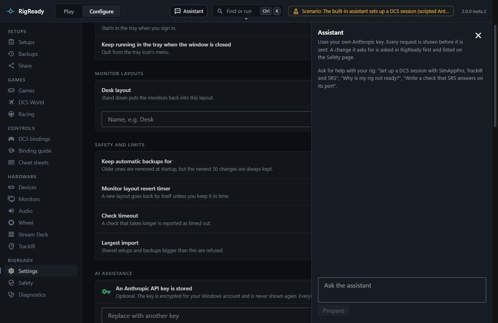
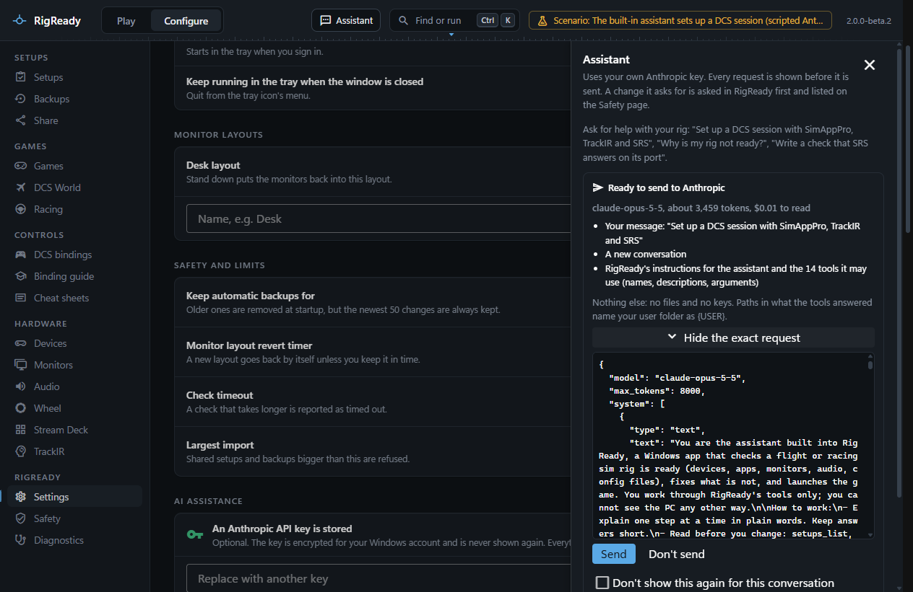
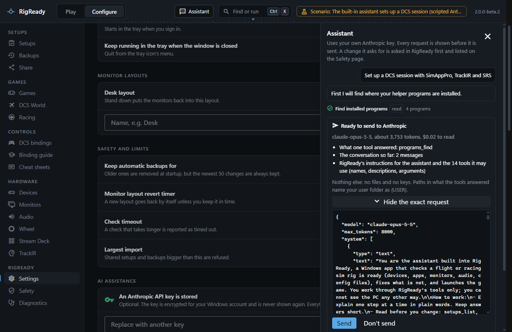
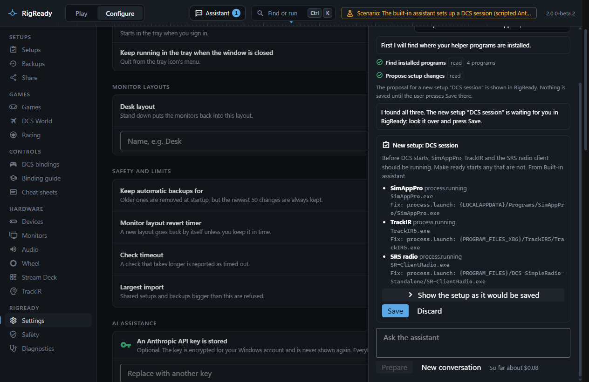
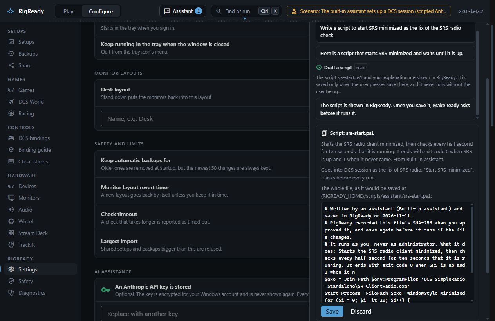
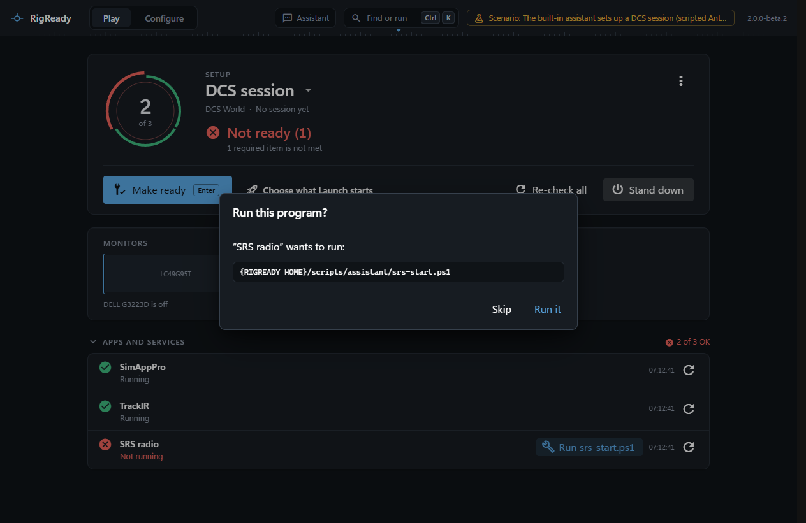
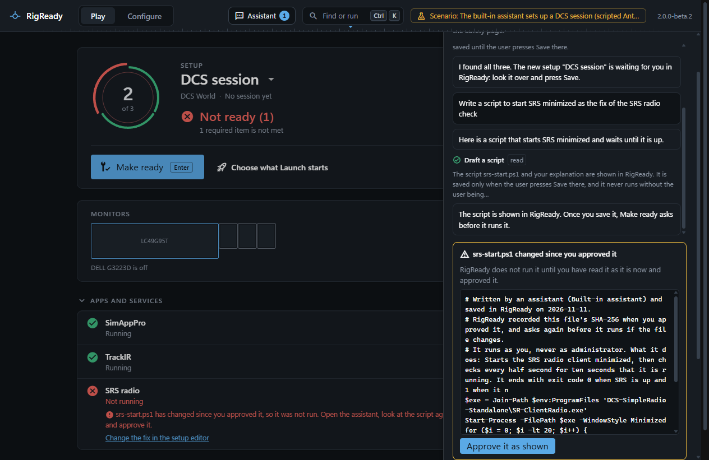

The built-in assistant is a panel at the side of RigReady's window. It talks to Claude with an Anthropic API key of your own, and it works through the same tools an [assistant connected over MCP](mcp-server.md) gets, with [the same safeguards](safety.md).

## Turn it on

Store your Anthropic API key in **Configure > Settings**, under **AI**. The **Assistant** button then appears at the top of the window, beside **Find or run**. Without a key there is no button; **Open the assistant** in the [command palette](../app/command-palette.md) says a key is needed and takes you to Settings. The [binding guide](../dcs/binding-guide-and-ai.md) has a link to the panel too.

## Every request is shown first

Type a message and press **Prepare** (or Enter). RigReady builds the request and shows what it carries, in a line each: your message, what the tools answered since the last request, how long the conversation is, and RigReady's instructions and tool list. **Show the exact request** shows the whole text. Nothing is sent until you press **Send**; **Don't send** throws it away.

When the model uses a tool, its answer goes back with the next request, and that request is shown again before it goes. Tick **Don't show this again for this conversation** and the rest of the conversation goes without stopping; **Stop after this** ends that, and **New conversation** starts over with the preview on again.

What a request never carries: your API key (it is the request's credential, sent in a header to `api.anthropic.com` and nowhere else), files of yours other than what a tool answered, and the name of your Windows user folder, which is written as `{USER}`. Anthropic's terms and privacy policy apply to what is sent. The panel shows roughly what each request costs to read and what the conversation has cost so far.

## Build a ready check

Ask in plain words: "Set up a DCS session with SimAppPro, TrackIR and SRS". The assistant:

1. **Finds where the programs are installed** with the tool `programs_find`. It looks at the folder names under Program Files, Program Files (x86), the Programs folder of LocalAppData and your Steam libraries, and at the uninstall entries in the registry, and only reads. It knows the folders the usual names hide (SRS is DCS-SimpleRadio-Standalone, TrackIR may be under NaturalPoint, G HUB is LGHUB). Paths come back with [path variables](../setups/path-variables.md), as a setup keeps them: `{PROGRAM_FILES_X86}/TrackIR5/TrackIR5.exe`.

   

2. **Proposes the setup** with `setup_propose`: a new setup, or checks and launch steps added to one you have. The proposal appears in the panel with every check, its fix and every step. **Show the setup as it would be saved** shows all of it. **Save** writes it the way the setup editor does (backed up, on the Safety page); **Discard** throws it away. Nothing is saved before you press **Save**, and a setup that changed after the assistant read it is not overwritten.

   

After saving, **Open in the setup editor** takes you to the setup, where you can change anything, for example what **Launch** starts.

It can also explain why the rig is not ready (`rig_check`, `check_explain`), run **Make ready** or **Launch** (asked in RigReady first, see [Safety](safety.md)), and reach every other action of RigReady through `rigready_call`.

## Scripts

When no check type does what is needed, ask for a script: "Write a script to start SRS minimized as the fix of the SRS radio check". The assistant drafts a PowerShell (`.ps1`) or batch (`.cmd`) file with `script_draft`, with an explanation in plain words. The panel shows the whole file exactly as it would be saved, the explanation, where it goes in the setup, and a warning for anything worth a second look (it reaches the internet, deletes files, closes programs, changes the registry). A script that asks for administrator rights is refused before you see it.

**Save** writes it into RigReady's data folder, in `scripts\assistant`, with a header that says an assistant wrote it, and records its SHA-256 as your approval. Then it is added to the setup with **Ask before running** on, which cannot be switched off for a script an assistant wrote. From then on:

- Before it runs, RigReady asks **Run this program?** with its path and arguments, every time.

  

- If the file changes after you approved it (edited by hand, or by another program), RigReady does not run it: the fix or check says it "has changed since you approved it". The panel shows the script as it is now, and **Approve it as shown** approves exactly that text.

  

- No assistant can run it. A script an assistant wrote runs only from RigReady's window, after you were asked.
- It runs as you, never as administrator.
- It is never part of a setup you [share](../protect/sharing.md).

More on how scripts run in [Scripts](../setups/scripts.md).

## What it cannot do

It cannot see your API key or any other secret, change the AI or MCP settings, open file dialogs, use your clipboard, answer RigReady's questions for you, save a proposal or a script, or run a script it wrote. It does nothing while you are not using the panel.
