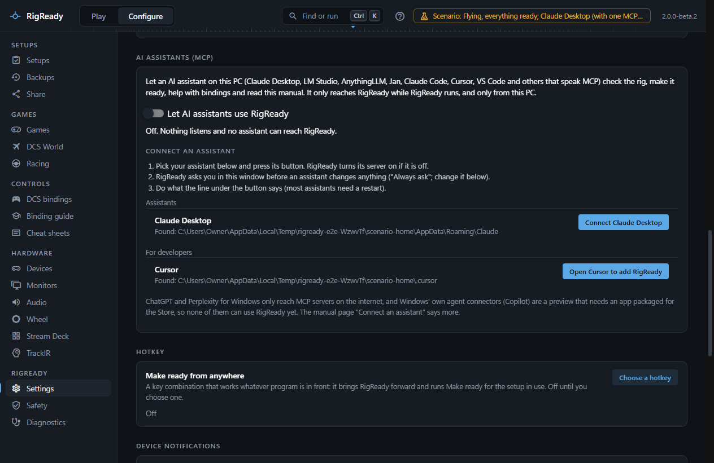
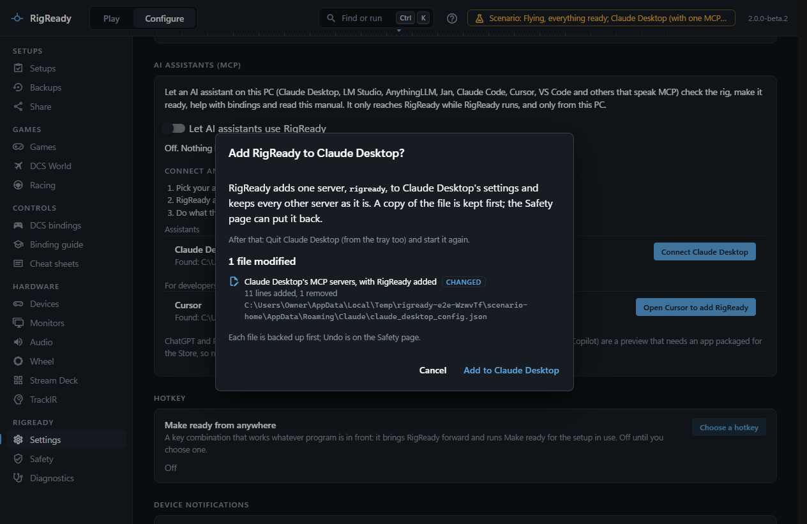
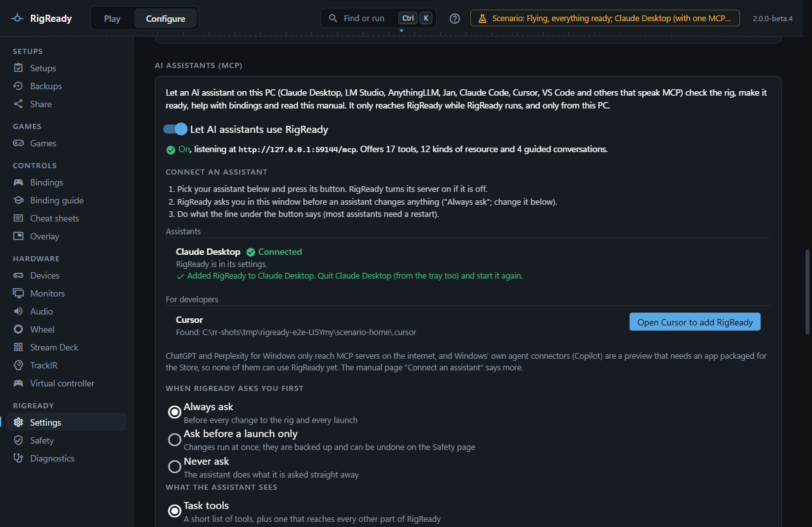
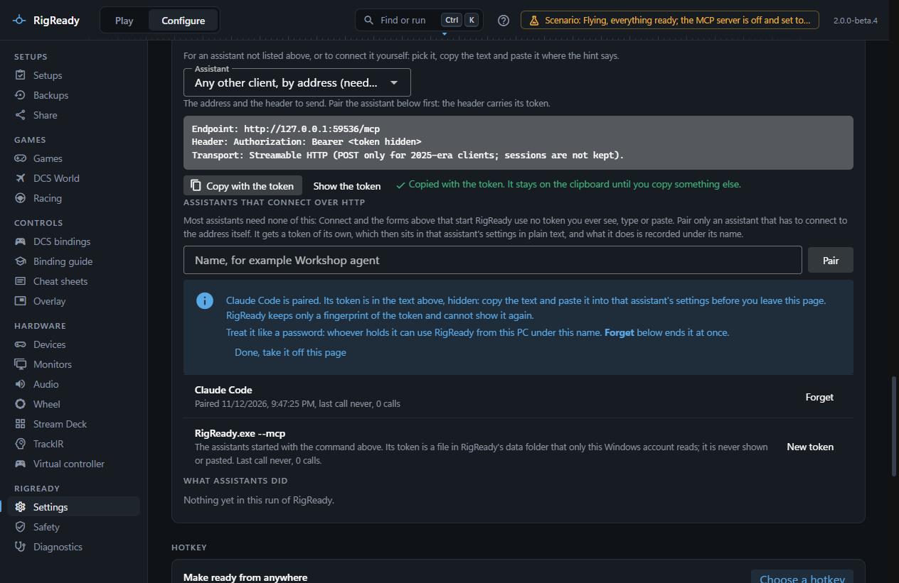

RigReady's MCP server runs inside RigReady while it is open. It listens only on this PC (`127.0.0.1`), and only an assistant you connected can reach it. It is off until you connect an assistant or turn it on.

## Connect with one button

1. Open **Configure > Settings** and go to **AI assistants (MCP)**. (On the welcome screen of a new install, **Connect an assistant** takes you there. It is optional; **Not now** puts it away.)
2. Under **Connect an assistant**, RigReady lists the assistants it found on this PC: everyday assistants first, developer tools after.
3. Press the button beside yours. If the server is off, RigReady turns it on, with **Always ask** as the rule for changes (see [Safety](safety.md)).
4. Do what the line under the button says. Most assistants need a restart.



What each button does:

| Assistant | The button | Then |
|---|---|---|
| **Claude Desktop** | **Connect Claude Desktop**: RigReady adds itself to Claude Desktop's settings file, after showing you the change | Quit Claude Desktop (from the tray too) and start it again |
| **AnythingLLM** | **Connect AnythingLLM**: the same, in AnythingLLM's MCP settings file | Restart AnythingLLM, or press Refresh on its Agent Skills page |
| **LM Studio** | **Open LM Studio to add RigReady**: LM Studio's own install link | Confirm in LM Studio |
| **Cursor** | **Open Cursor to add RigReady**: Cursor's install link | Press Install in Cursor |
| **VS Code** | **Open VS Code to add RigReady**: VS Code's install link | Press Install, then Start in the chat's tools list |
| **Claude Code** | **Show the command** and **Copy**; **Run it** when RigReady finds the `claude` program | Start a new Claude Code session; `/mcp` lists RigReady |
| **Jan**, **Msty Studio**, **Goose**, **Windsurf** | **Show what to paste** and **Copy** | Paste it where the line says; these keep their servers in their own screens or files |

**A settings file is changed only the safe way.** Before RigReady writes Claude Desktop's or AnythingLLM's file it shows you the change: one server named `rigready` is added, every other server and setting stays as it was. A copy of the file is kept first, and the change is listed on the [Safety page](../protect/safety-page.md) as "Connect Claude Desktop to RigReady", where **Undo** puts the file back. A file that is not valid JSON is never touched: RigReady says so and you can fix it or connect by hand. Pressing the button again when RigReady is already there changes nothing.





**An install link** opens the assistant, which shows you what it is about to add and asks first. RigReady cannot see what the assistant did with it, so it says it asked, not that it is done. The row says **Connected** once RigReady finds itself in that assistant's settings.

When RigReady is not running, the assistant gets an answer that says so. Start RigReady and ask again; nothing needs restarting.

## Assistants that cannot connect yet

- **ChatGPT** (the desktop app too) connects only to MCP servers on the internet, over HTTPS. RigReady's server is only on this PC, on purpose; putting the rig on the internet would need a public address and a tunnel, which RigReady does not do.
- **Perplexity** on Windows has connectors to servers on the internet only; local servers are a Mac feature.
- **Microsoft Copilot and Windows' agent connectors** are a preview. Windows lists a server only for an app packaged for the Store with a certificate, with a fixed list of tools; RigReady is a normal installed program.

## Set it up by hand

For an assistant not in the list, or to do it yourself: under **Set it up by hand**, pick the assistant, press **Copy**, and paste the text where the hint says. The text has the right path to `RigReady.exe` on your PC. Assistants that start a program get `RigReady.exe --mcp`, which passes everything on to the RigReady that is running.

**Claude Desktop.** In Claude Desktop, open **Settings > Developer > Edit Config**, paste the text into `claude_desktop_config.json` (merge it into `mcpServers` if the file has other servers), save, and restart Claude Desktop. The text looks like this:

```json
{
  "mcpServers": {
    "rigready": {
      "command": "C:\\Users\\you\\AppData\\Local\\Programs\\RigReady\\RigReady.exe",
      "args": ["--mcp"]
    }
  }
}
```

If you installed Claude Desktop from the Microsoft Store, the file it reads is in `%LOCALAPPDATA%\Packages\Claude_...\LocalCache\Roaming\Claude`. The button above writes that one.

**Claude Code.** Run the command the page gives in a terminal, once. `--scope user` makes RigReady available in every folder:

```
claude mcp add --transport stdio --scope user rigready -- "C:\Users\you\AppData\Local\Programs\RigReady\RigReady.exe" --mcp
```

**Cursor.** Paste the text into `~/.cursor/mcp.json` for every project, or `.cursor/mcp.json` in one project. It has the same shape as Claude Desktop's.

**VS Code.** Paste the text into `.vscode/mcp.json`, or run **MCP: Open User Configuration** for every workspace.

## Assistants that connect to the address

Most assistants need none of this: **Connect** and the texts under **Set it up by hand** that start `RigReady.exe --mcp` use no token you ever see, type or paste, and they come first in the list. Pair only an assistant that has to connect to an address instead of starting a program. Such an assistant needs a token of its own:

1. Turn on **Let AI assistants use RigReady**. The line under it says where it listens, for example `http://127.0.0.1:29170/mcp`.
2. Under **Assistants that connect over HTTP**, type a name for it ("Claude Code", "My laptop's Cursor") and press **Pair**.
3. Under **Set it up by hand**, choose **Claude Code, by address (needs a token)**, **Cursor, by address (needs a token)** or **Any other client, by address (needs a token)**. The text now carries the token, drawn as `<token hidden>`. **Copy with the token** puts the whole text on the clipboard, where it stays until you copy something else. **Show the token** draws it on the page and **Hide the token** hides it again.
4. Paste the text into the assistant's settings before you leave the page: RigReady keeps only a fingerprint of the token, so it cannot show it again. **Done, take it off this page** removes it from the page.
5. The pairing is listed with its last call. **Forget** stops its token from working at once.



Everything that assistant does is recorded under the name you gave it.

Treat the token like a password: whoever holds it can use RigReady from this PC under that name, and it sits in that assistant's settings in plain text. RigReady itself never writes a token to its log, to a [diagnostics](../app/diagnostics.md) export or into a notice on screen; where a line would carry one it says `rr_***`.

## Turning it off

Turning **Let AI assistants use RigReady** off stops the server at once. RigReady remembers the choice, so the server is back the next time RigReady starts only if you left it on. The assistants keep RigReady in their settings; while the server is off they get an answer that says so.

## The port

The server listens on port 29170. If another program already uses it, the line under the switch says so.

## What the assistant sees

**What the assistant sees** has two choices. **Task tools** (the default) gives a short list: check, make ready, launch, stand down, list and create setups, explain a check, find a device by a button press, search the manual, and one tool that reaches every other part of RigReady by name. **Every channel as its own tool** lists over 200 tools, one for every action of every page; choose it only for an assistant that handles long tool lists well. Both reach the same things under the same rules. See [What the assistant can do](what-the-assistant-can-do.md).
