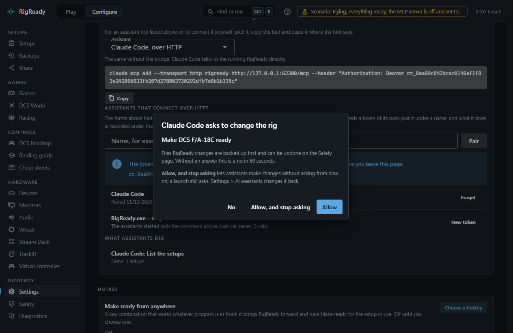
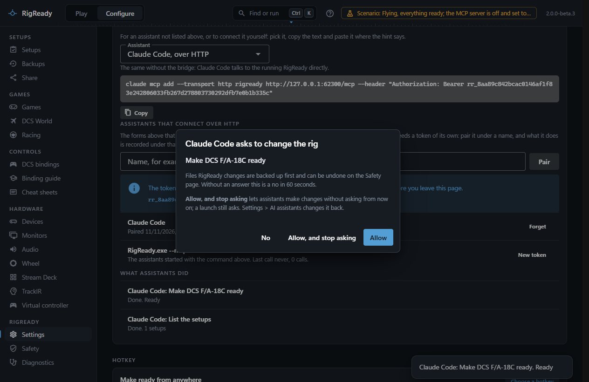
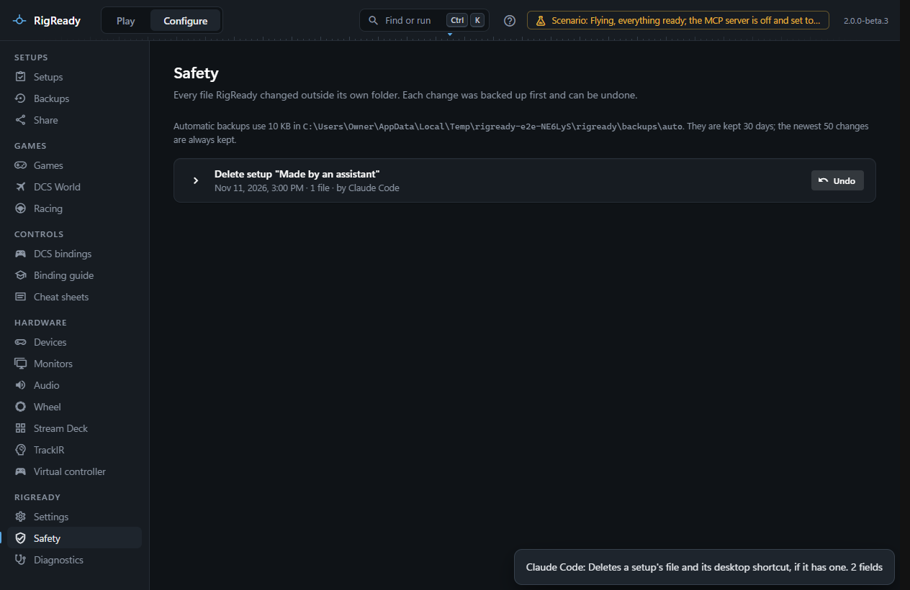

An assistant works in your name, on your rig. RigReady keeps the same safeguards for it as for you, and adds a few of its own. Everything on this page holds for the [built-in assistant](built-in-assistant.md) and for an assistant connected over MCP alike: both go through one gate in RigReady, with the same questions, the same limits and the same record. The built-in assistant is named "Built-in assistant" wherever a name is shown.

## RigReady asks you, in its own window

When an assistant wants to change the rig or launch a game, RigReady's window comes forward and asks: "Claude Code asks to change the rig: Make DCS F/A-18C ready". A setup is named by its name, whichever way the assistant named it. When an assistant calls one of the app's channels directly, the question says in a sentence what that channel does, with the call itself in small type under it. **Allow** runs it; **No** stops it, and the assistant is told you said no. A question nobody answers within a minute is a no. The assistant cannot answer for you.

**When RigReady asks you first** on the Settings page decides when it asks:

| Choice | Changes to the rig | Launching a game |
|---|---|---|
| **Always ask** (the default) | Asks | Asks |
| **Ask before a launch only** | Runs at once | Asks |
| **Never ask** | Runs at once | Runs at once |

When an assistant is setting the rig up, it makes many changes in a row. The question it raises has a third answer for that: **Allow, and stop asking** allows the change and switches to **Ask before a launch only**, so the next changes run at once and a launch still asks. Choose **Always ask** in Settings to go back.

Reading never asks: checks, previews, the bindings, the log and this manual.

## The same safeguards as in the window

- Every file RigReady changes is backed up first and listed on the [Safety page](../protect/safety-page.md), where **Undo** puts it back.
- A monitor layout goes back by itself unless you press **Keep** in RigReady.
- Binding files are not written while DCS is running.
- One change at a time: while one runs, another assistant's change is refused with "RigReady is still busy".

## Scripts an assistant writes

- You read the whole script and its explanation in the assistant panel before it is saved, and only your **Save** saves it.
- A script that asks for administrator rights is refused. Scripts run as you, never elevated.
- It is saved in RigReady's data folder (`scripts\assistant`) with a header that says an assistant wrote it, and RigReady records its SHA-256 as your approval.
- It always asks **Run this program?** before it runs, whatever the setup says.
- If the file changes after you approved it, it is not run until you have read it again and approved it in the panel.
- No assistant can run it, not even with **Never ask**: it runs only from RigReady's window.
- A setup you share never carries it.

See [Scripts](../setups/scripts.md#scripts-an-assistant-wrote).

## What is never offered

Your AI provider's API key and anything that spends it (the binding guide's AI help, the built-in assistant's own requests), the AI assistant settings themselves (turning the server on or off, pairing, tokens), saving a proposal or a script, approving a script, file dialogs, the clipboard, and RigReady's own window controls.

## See what was done

**What assistants did** on the Settings page lists every call of this run, the built-in assistant's too: who asked, what, and how it ended. A call that changed files says so, and the change is on the Safety page under the action it caused. RigReady also shows a short line at the bottom right after an assistant changed something or launched a game.

On the Safety page, an action an assistant caused carries its name, for example "by Claude Code", or "by RigReady.exe --mcp" for an assistant started through the bridge. The name is kept in the change journal, so it is still there after RigReady restarts, when **What assistants did** has started over. **Undo** works the same as for a change you made yourself. A change you made in RigReady shows no name.

## Who can connect

The server listens only on this PC and is off until you turn it on. Every request needs a token: the one RigReady keeps in its data folder for `RigReady.exe --mcp`, or one you made with **Pair**. A web page in your browser cannot reach it. **Forget** a pairing, or **New token** for `RigReady.exe --mcp`, and the old token stops working at once.
