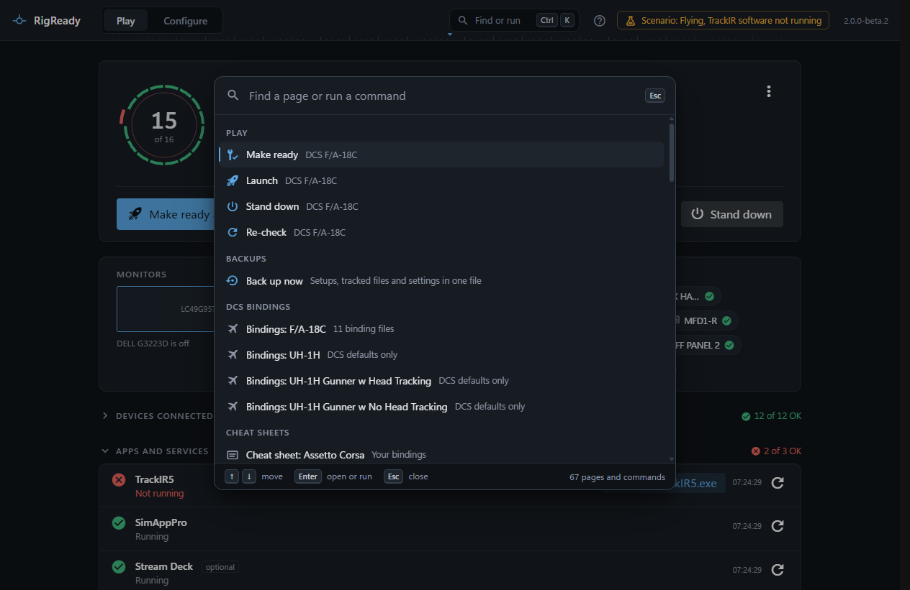
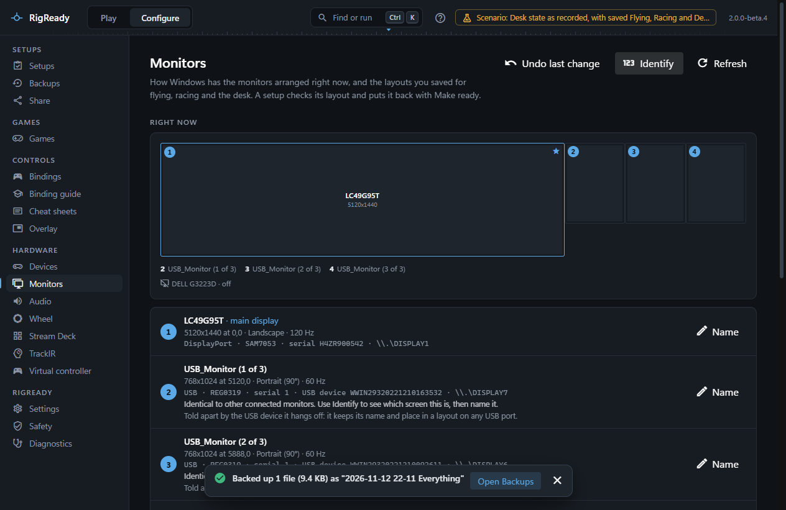

Press **Ctrl+K**, or the search button at the top right, and one field opens over whatever page you are on. Type a few letters of a page or an action, press Enter, and you are there or it is done. Esc closes it and leaves you where you were.

The palette lists every page of the app, and the actions features contribute, so a thing you do often is two keys away from any screen.

## What it lists

With nothing typed:

- **Recent**: the five commands you used last.
- The actions, under the heading of the area they belong to (Play, Backups, Monitors, Devices and so on), six per heading; the rest are found by typing.
- **Go to**: every page, in the order of the side navigation. A page reached from inside another is named after it, for example "DCS World: Screens".

Type, and the list becomes the matches, best first; letters you typed are highlighted in the names. A command you used recently gets a small head start in a near tie, never in a clear one. Pages are also found by other words: "undo" finds [Safety](../protect/safety-page.md), "restore" and "new pc" find Backups, "bug" finds the diagnostics report.

## Actions

Among the actions:

- **Make ready**, **Launch** and **Stand down** ([Make ready and launch](../play/make-ready-and-launch.md), [Stand down](../play/stand-down.md)) for the setup in use, and [switching to another setup](../play/switching-setups.md).
- **Apply a monitor layout** by name. The layout is applied and the "Keep this monitor layout?" question is asked, as on the Monitors page ([Monitor layouts](../monitors-and-audio/layouts.md)).
- **Back up now**: the same full backup as the button on the [Backups page](../protect/backups.md).
- **Find a device**: press a button on any controller and RigReady names it ([Devices](../hardware/devices.md#find-a-device-by-pressing-a-button)).
- Open the [bindings](../dcs/bindings.md) or the [cheat sheet](../dcs/cheat-sheets.md) of an aircraft.
- **Copy the diagnostics report**: the report on the clipboard without opening the [page](diagnostics.md).
- **Keyboard shortcuts** ([the whole list](keyboard-shortcuts.md)) and **About RigReady**.

A page opens and nothing more is said. An action reports what happened in a toast at the bottom of the window, in the feature's own words: "Backed up 340 files (12.4 MB) as "2026-10-03 14-05 Everything"", with a second line for what was skipped and a button to the page it concerns. An action that takes more than a moment shows that it is running, with its progress, until the result replaces it.

A toast goes away by itself after a few seconds, longer for a warning or a failure, and stays while the pointer or the keyboard focus is on it. Something that went wrong is never shown by colour alone: the words and the icon say it.

## Keys inside the palette

- Up and Down move through the list, going round at the ends.
- Enter opens the page or runs the command.
- Esc closes the palette and goes back to where you were.

If a feature's commands could not be listed, the palette says so at the bottom with the reason, and lists everything else.
