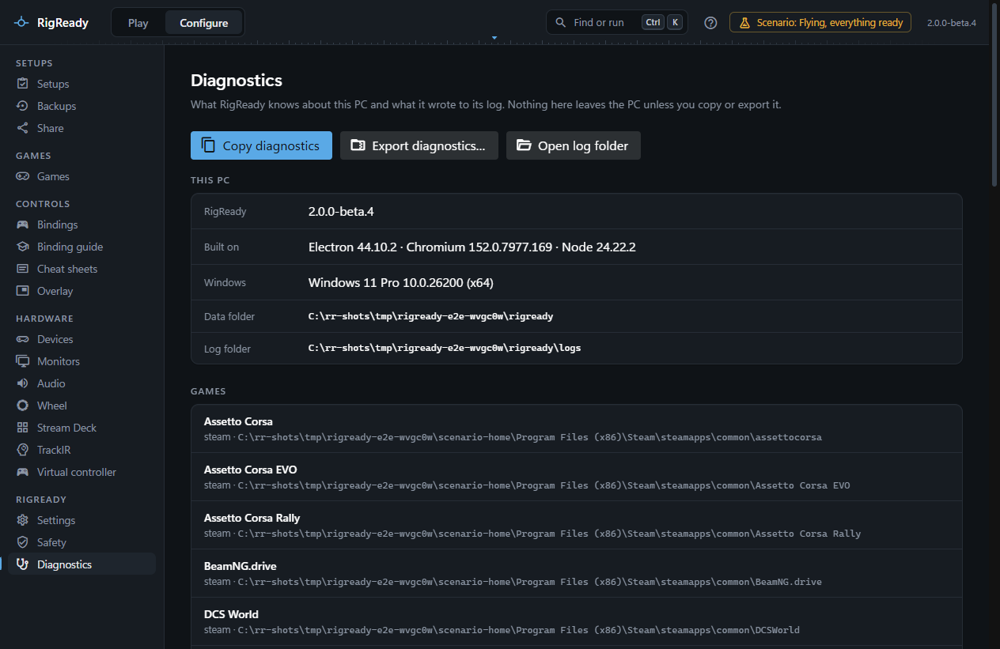
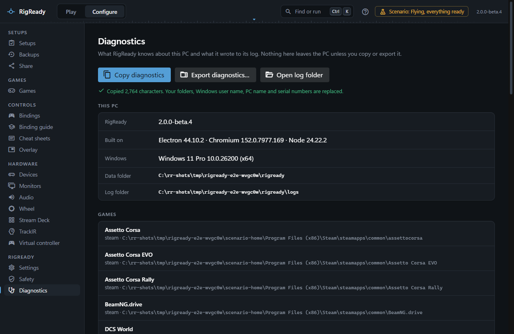
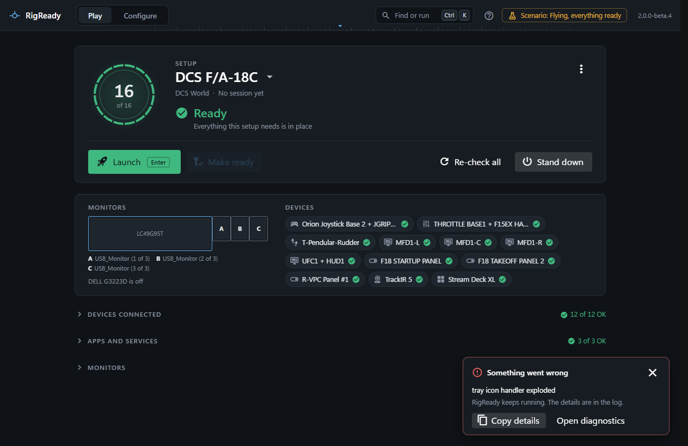

**Configure > Diagnostics** is where you look when something is wrong, and what you send when you ask for help. It shows what RigReady knows about this PC, the state of its own files, and the recent log. Nothing on it leaves the PC unless you copy or export it ([Privacy](privacy.md)).

Unexpected errors are shown on every screen as a small notice; this page keeps them and the log.

## What the page shows

**This PC**: the RigReady version, what it is built on (Electron, Chromium, Node), the Windows version, the data folder and the log folder.

**Games**: every game RigReady found ([Games](../games/index.md)), from which source (Steam or standalone) and where; the games it knows that are not on this PC; and a game whose detection itself failed, with the reason.

**Devices and monitors**: every game controller and input device with its vendor and product ID, how many USB devices there are in all and how many are hubs, and every monitor with its size, position, rotation and whether it is the main one. When the devices or the monitors could not be read, the page says so with the reason instead of showing nothing.

**RigReady's own files**: the settings, the setups, the monitor layouts and the change journal, each with "Readable", a count, or what is wrong with it. See [when the app will not start or a data file is damaged](../troubleshooting/app-will-not-start-or-data-folder.md).

**Recent log**: the newest 400 entries, newest first, with a filter for everything, info and above, warnings and errors, or errors only, and **Refresh**. The count under it says how many older entries are in the log folder. The **Detailed log** switch turns on the debug level, which records much more; it is greyed out when the environment variable `RIGREADY_LOG_LEVEL` sets the level for this run.

## Copy diagnostics

**Copy diagnostics** puts a text report on the clipboard: the versions, the data folder and log level, the games, the devices and monitors, RigReady's own files, every unexpected error of this run, and the newest 200 log entries. The same report is available from the [command palette](command-palette.md) as **Copy the diagnostics report**.

Before it is copied, personal details are removed the same way as for a [shared setup](../protect/sharing.md#the-privacy-review): your folders become variables such as `{DOCUMENTS}`, your Windows user name, the PC name, device serial numbers, device instance paths and audio device IDs are replaced, and anything that looks like a key or a password is masked. The confirmation says how many characters were copied and that this was done.

**Export diagnostics…** writes the same report as a zip, together with every log file and the settings file, all scrubbed the same way. The default name is `RigReady-diagnostics-<date>.zip` in Documents. **Open log folder** opens the folder in Explorer; the files there are the raw log, which already writes your user folder as `~` and masks keys and pairing tokens, but is not scrubbed of serial numbers and device paths.

## The log

The log is `logs\rigready.log` in the [data folder](index.md). When it reaches 5 MB it is rotated, and four older files are kept beside it. Each line has the time, the level, the feature it came from and the message. A check that fails is reported on the screen that asked and is not an error. A request RigReady could not carry out (a file that cannot be read, a program that is missing, an AI provider that says no) is reported on the screen that asked and also leaves one line in the log: the part of RigReady that was asked, the error's code and the message you were shown. The same error from the same place is written at most once a minute, with a count of the ones in between. A failed request to an AI provider adds the host, the model, the HTTP status, the provider's own reason and error code, and the id the provider gave the request. Never in these lines: what you typed, the text of a request, an API key or a pairing token. With them, an export tells whoever helps you what happened without the detailed log having been on.

## Unexpected errors

When something fails that nothing expected, an error in RigReady's own code, a window that stopped working, or a helper process that died, a notice appears at the bottom right of the window: "Something went wrong", with the message, **Copy details** and **Open diagnostics**. RigReady keeps running; the notice does not block the app. The same error happening again only counts up. A window that stopped working is loaded again by itself, up to three times a minute ([The window stopped working](../troubleshooting/app-will-not-start-or-data-folder.md#the-window-stopped-working)).

## Reporting a problem

Problems are reported on GitHub. Open the **About** panel from the version number at the top right and follow **Report a problem**, or use the address of the project's issues page. Paste the copied diagnostics into the report, or attach the exported zip, and say what you did and what you expected. Read the report before sending it if you prefer; it is plain text.
