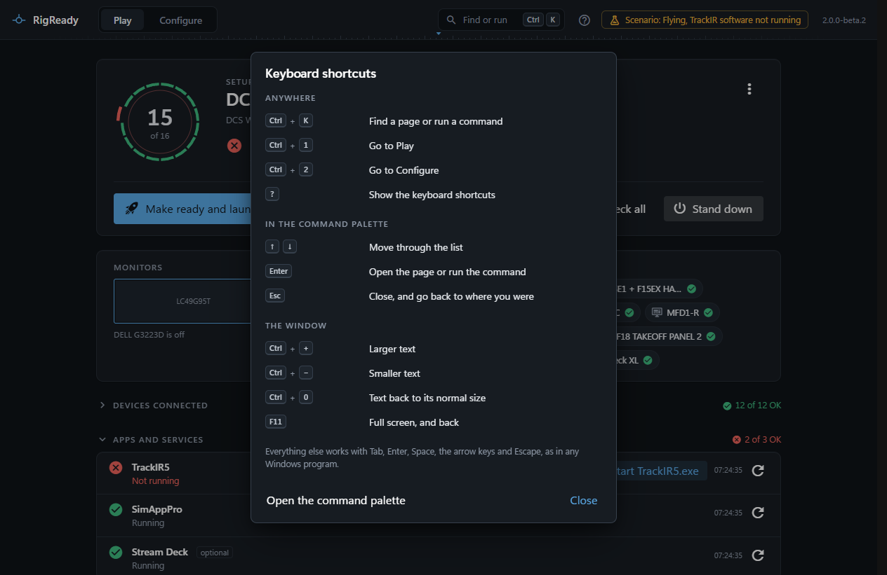

RigReady can be used from the keyboard alone. Press **?** anywhere outside a text field and the list below appears in the app, so the list can never promise a key that does nothing.

The optional system-wide hotkey, which works when another program is in front, is set up in [Settings](settings.md) and described under [the hotkey](../one-click/hotkey.md).

## Anywhere in the app

| Keys | What it does |
|---|---|
| Ctrl+K | Find a page or run a command: opens [the command palette](command-palette.md) |
| Ctrl+1 | Go to Play |
| Ctrl+2 | Go to Configure |
| ? | Show the keyboard shortcuts |

A "?" typed in a text field is a question mark; the Ctrl shortcuts work there too.

## In the command palette

| Keys | What it does |
|---|---|
| Up, Down | Move through the list |
| Enter | Open the page or run the command |
| Esc | Close, and go back to where you were |

## The window

| Keys | What it does |
|---|---|
| Ctrl and + | Larger text |
| Ctrl and - | Smaller text |
| Ctrl+0 | Text back to its normal size |
| F11 | Full screen, and back |

See [text size](text-size.md).

## On the Play screen

Enter presses the main action: **Make ready and launch** when something needs fixing, **Launch** when the rig is ready. Every control on the screen can be reached with Tab, and the groups of the checklist open with Enter. See [make ready and launch](../play/make-ready-and-launch.md).

