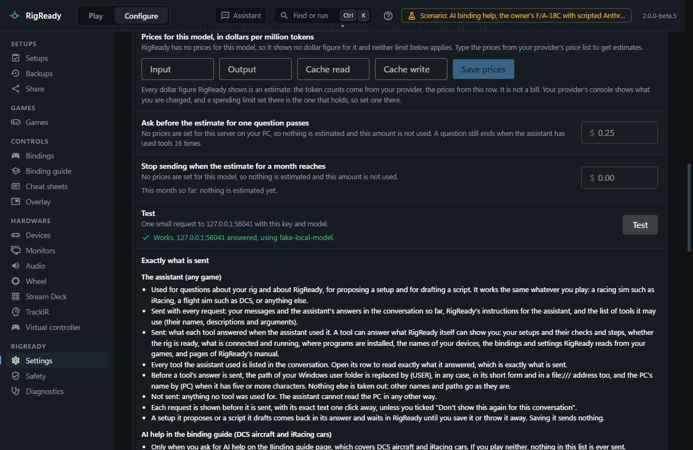

**Configure > Settings** holds everything about how RigReady itself behaves. Each setting is saved the moment you change it, and the page says "Saved". A switch changes with a click on it or on its name; with the keyboard, Tab to it and press Space. A change that cannot be made is refused with the reason, and the control goes back to what is stored.

The settings are kept in `settings.json` in RigReady's [data folder](index.md). A full [backup](../protect/backups.md) includes them, and a [restore](../protect/restore.md) brings back the desk layout, the retention and the limits; Start with Windows and the API key are never restored, because they belong to one PC and one Windows account.

## Startup

**Start with Windows.** RigReady starts in the tray when you sign in, without opening its window. It is off by default. The switch shows what Windows actually has: when Windows will not accept the entry, or has it switched off, the page says so. See [Start with Windows is off](../troubleshooting/start-with-windows-off.md).

**Keep RigReady in the tray when you close the window.** On by default: closing the window hides it, and RigReady keeps running with its icon in the [tray](../one-click/tray.md), next to the clock. Windows may keep that icon under the ^ arrow. **Quit** in the icon's menu ends RigReady. Off: closing the window quits RigReady, and its tray icon goes away too. The line under the switch says which of the two closing the window does now. From anywhere, Ctrl+K and "tray" finds this switch.

## Monitor layouts

**Desk layout.** The saved layout that [Stand down](../play/stand-down.md) puts the monitors back into. "None" means Stand down only puts back the arrangement from before Make ready changed it, and leaves the monitors alone when nothing was changed. The layouts are listed under it, each with how many monitors it switches on and off, with **Rename** and **Delete**; deleting the desk layout clears the choice. **Save current monitors as a layout** stores the arrangement as it is now under a name. The same layouts are managed on **Configure > Monitors**; see [layouts](../monitors-and-audio/layouts.md).

## Safety and limits

**Keep automatic backups for.** How many days the automatic copies of changed files are kept (30 by default, 1 to 3650), and how many of the newest changes are always kept whatever their age (50 by default). Older copies are removed when RigReady starts. See [the Safety page](../protect/safety-page.md).

**Monitor layout revert timer.** How many seconds a newly applied layout waits for you to keep it before it goes back by itself: 15 by default, 5 to 120. When an AI assistant asked for the change, the wait is at least 60 seconds. Make ready and Stand down do not ask at all about a layout you kept before ([Monitor layouts](../monitors-and-audio/layouts.md#when-rigready-asks-and-when-it-does-not)).

**Check timeout.** How many seconds one check may run before it is reported as timed out: 5 by default, 1 to 60. A check can have its own limit in [the setup editor](../setups/editor.md).

**Largest import.** The biggest [shared setup](../protect/sharing.md) or backup file RigReady will open, in megabytes: 200 by default, up to 4096. Larger files are refused before they are read.

## AI assistance

Optional; everything except the built-in assistant and the AI help in the binding guide (DCS aircraft) works without it. See [Choose who answers](../ai/providers.md) for every provider.

**Who answers.** Anthropic (Claude), the default; OpenAI; or OpenAI-compatible. For OpenAI-compatible, **Service** offers Google Gemini, OpenRouter, Mistral, Ollama and LM Studio, which fill in the **API address** and suggest a model, or **Other** to type the address of any service that speaks OpenAI's API. The address must start with `https://`; plain `http://` is accepted only for this PC. **Structured answers** says whether the service is held to a JSON schema or asked for JSON in the text (for services that refuse a schema).

**API key.** Paste a key and press **Store key**; the page then says, for example, "An Anthropic API key is stored", shows the last four characters, and offers **Remove key**. The key is never shown again, and the field only accepts a replacement. Each provider keeps its own key. A key for an OpenAI-compatible service is kept for that host only and removed when the address moves to another host. A server on this PC needs no key.

The key is encrypted with Windows' own data protection (DPAPI, through Electron's safeStorage) and written to `secrets\` in the data folder. Only your Windows account on this PC can decrypt it; the file is useless on another PC or to another user. The key is never written to the settings file, the log, a backup, a shared setup or a picture. If Windows cannot encrypt for your account at that moment, the key is refused rather than stored in plain text.

**Model.** Pick from the list or type any model id the service offers. **Test** sends one small request to the chosen host and says whether the key, the address and the model work, and why not. **Prices for this model** are the four prices per million tokens (input, output, cache read, cache write) from which every dollar figure for that model is estimated. For the Anthropic and OpenAI models RigReady lists they start as its built-in prices, shown with the month they were recorded; for any other model they are empty until you type them, and no dollar figure is shown until then. **Save prices** keeps your own numbers, and **Reset to built-in** goes back. **Ask before the estimate for one question passes** is the amount at which the [built-in assistant](../ai/built-in-assistant.md#estimates-prices-and-limits) stops and asks before it sends another request for the same question; 0 means it never stops on its estimate. **Stop sending when the estimate for a month reaches** is a monthly budget for the assistant and the binding guide: RigReady warns from 80 percent of it and then sends nothing more that month; 0, as it starts, means no budget. Both limits work on RigReady's estimates, not on your provider's bill, so turning one on asks you to acknowledge that first, and both are switched off for a model without prices. The limit that holds is the one you set in your provider's console. **Exactly what is sent** lists, use by use, what a request contains and what never leaves the PC, and the one host that receives it: first the assistant, which works the same whatever you play, then AI help in the binding guide, which is for DCS aircraft and iRacing cars. See [the binding guide and AI](../dcs/binding-guide-and-ai.md) and [privacy](privacy.md).

## AI assistants (MCP)

**Let AI assistants use RigReady.** Off by default. When on, an AI assistant on this PC that speaks the Model Context Protocol (Claude Desktop, Claude Code, Cursor, VS Code and others) can check the rig, make it ready, help with bindings and read this manual, while RigReady runs. Below the switch: **When RigReady asks you first** (always, before a launch only, or never), **What the assistant sees**, the text to paste into each assistant with **Copy**, **Pair** for an assistant that connects to the address, the paired assistants with **Forget**, and **What assistants did** in this run. See [Connect an assistant](../ai/mcp-server.md) and [Safety with an assistant](../ai/safety.md).

## Hotkey

**Make ready from anywhere.** A key combination that works whatever program is in front: it brings RigReady forward and runs **Make ready** for the setup in use, and never launches. Off until you choose one with **Choose a hotkey** (later **Change**); **Turn off** removes it. The combination needs Ctrl, Alt or the Windows key, and the page shows it as active only when Windows has registered it for RigReady. Which keys are allowed, what a press does and what it does not do are on [The hotkey](../one-click/hotkey.md).

## Device notifications

While RigReady is in the tray, which plug and unplug events it tells you about: **Game controllers** (sticks, throttles, pedals, panels, wheels, and anything a setup needs), **Only what the current setup needs**, **Every USB device**, or **Off**. The same choice is on the Devices page; see [devices](../hardware/devices.md).

## Apps offered in new setups

The programs you asked RigReady to offer in every new setup, with **Always offer this app** on [New setup from this rig](../setups/capture.md#apps-rigready-does-not-know). Each shows the path it ran from when you added it. **Shown as** is the name a new setup gives it; **Close at Stand down** (off at first) makes [Stand down](../play/stand-down.md) close it again; **Stop offering** takes it off the list. Setups you made already keep their checks.

The list is the file `processes/known.json` in the [data folder](index.md), and it can be edited by hand. RigReady reads it again every time and leaves out, under **Not used** with the reason, any entry that names RigReady itself, a program of Windows (Explorer, the Command Prompt, PowerShell and the like) or one in the Windows folder, a path that is not on a drive of this PC, or a program it offers already. **Remove from the list** takes such an entry out. A list that is not valid JSON is never overwritten: the page says so, and adding to it is refused until the file is fixed or removed.

## Updates

**Check for updates automatically** (on by default) and the **Channel**, Stable or Beta, with a status line and **Check now** or **Restart to install**. All of it is explained on [updates](updates.md).

## About

The version, the update channel it follows, and that RigReady is open source under the MIT licence. The fuller **About** panel opens from the version number at the top right of the window, with the licence, the website, the source code, where to report a problem, and the data folder.

## Not on this page

- **The log level.** The **Detailed log** switch is on the [Diagnostics](diagnostics.md) page. The environment variable `RIGREADY_LOG_LEVEL` (debug, info, warn or error) overrides it for a run.
- **How many backups are kept.** On the [Backups](../protect/backups.md) page, above the list.
- **Play screen options** such as hiding RigReady after launch and the ready tone are in the Play screen's own menu; see [The Play menu](../play/the-menu.md).
- **Standing down when the game closes.** Each setup has its own switch and countdown length, in [the setup editor](../setups/editor.md#when-the-game-closes).
