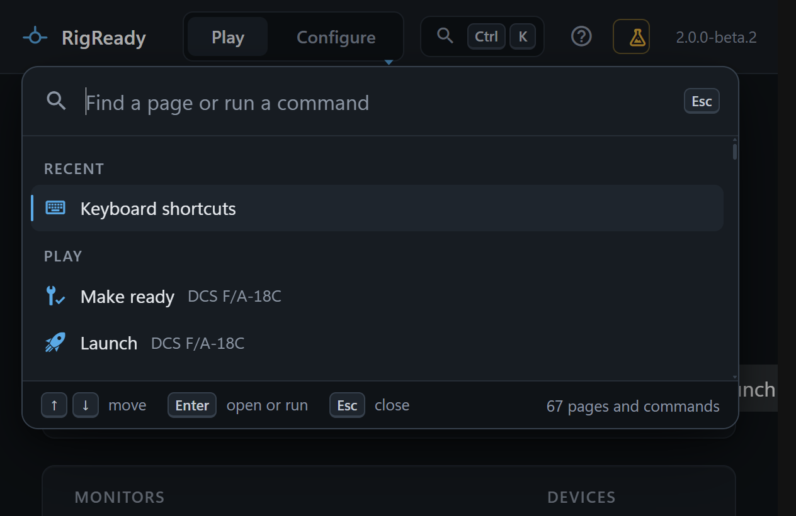

On a big monitor, or a monitor across the room, the text can be too small. RigReady uses the keys every Windows program uses for this, and everything in the window scales together: text, icons, the rig drawing, the checklist.

The keys work on every screen, including the pop-out panels such as the [quick look](../dcs/cheat-sheets.md#quick-look) of a cheat sheet.

## The keys

| Keys | What it does |
|---|---|
| Ctrl and + | Larger |
| Ctrl and - | Smaller |
| Ctrl+0 | Back to the normal size |
| F11 | Full screen, and back |

The page gets narrower as the text gets larger and lays itself out again; nothing is cut off. The size is the window's and is not on the [Settings](settings.md) page; Ctrl+0 is the way back.

## Motion

Animations in RigReady are short, and they are switched off when Windows is asked to reduce motion (Settings > Accessibility > Visual effects > Animation effects).
