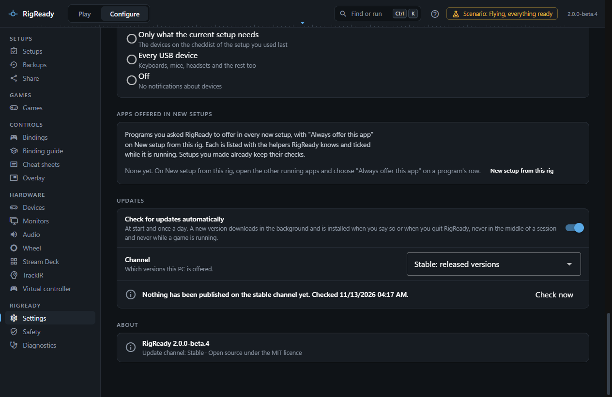
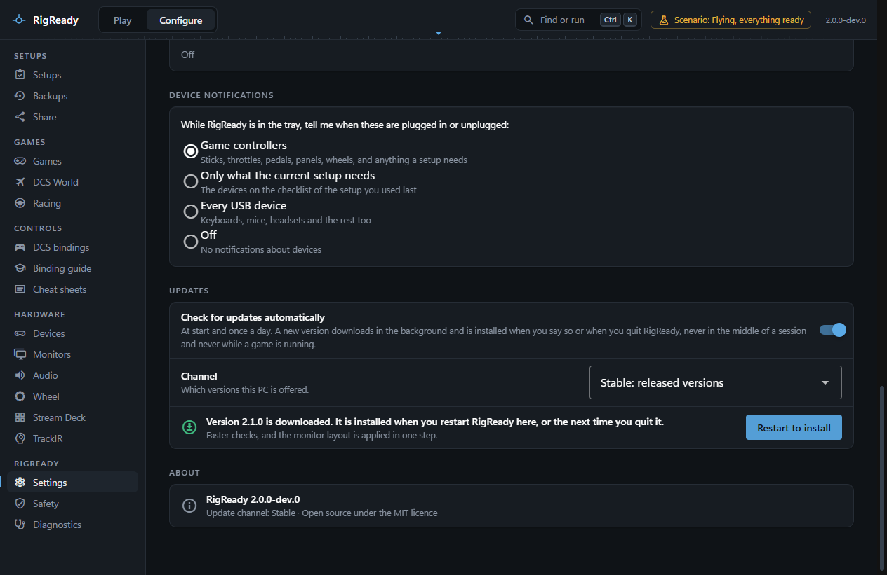
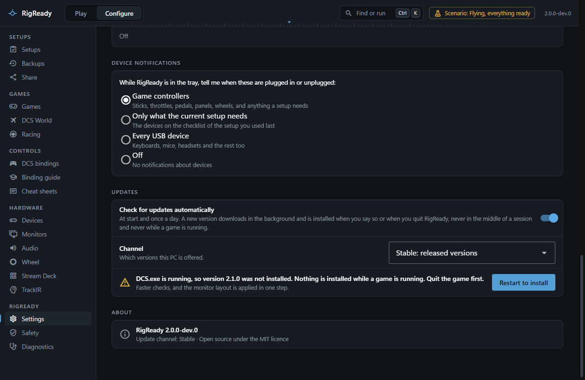
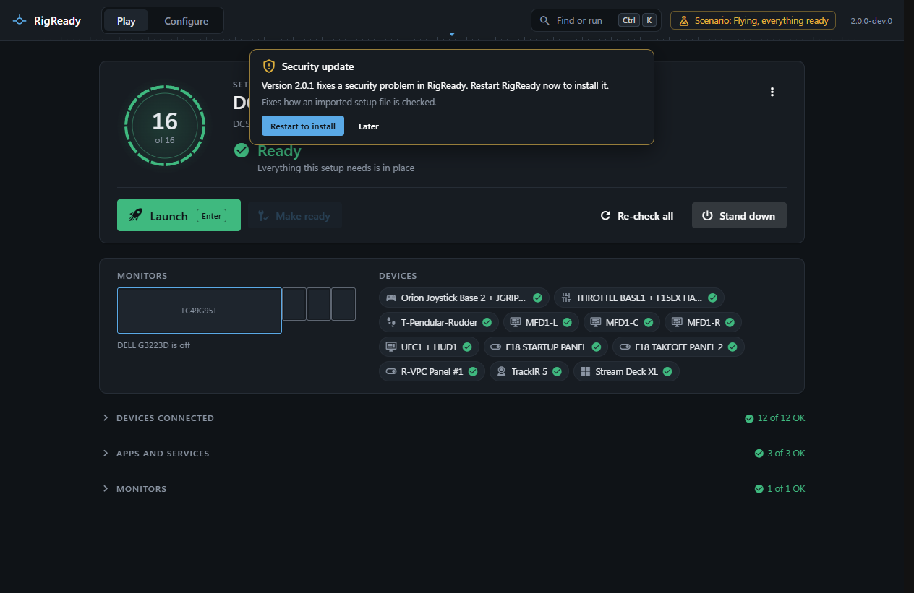
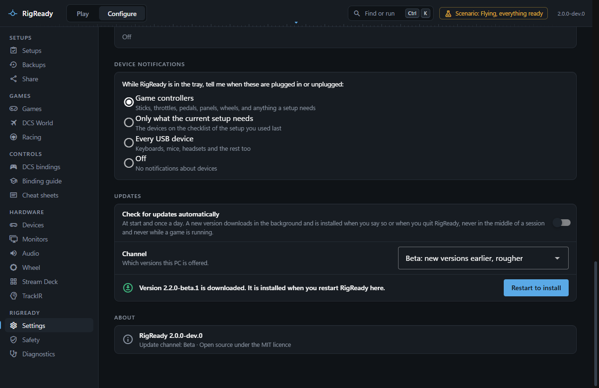

RigReady updates itself from its releases on GitHub. It never installs anything in the middle of a session: a new version is downloaded while you work and installed when you say so, or quietly when you quit, and only when no game is running.

Everything about it is under **Settings > Updates** ([Settings](settings.md#updates)). The version you run is under **Settings > About** and in the About panel.

## When it checks

With **Check for updates automatically** on (the default), RigReady asks the feed a few seconds after it starts, after the Play screen is up, and then once a day while it runs. **Check now** asks at once, and works with automatic checks off as well.

What the check found is said in one line: the newest version on your channel is the one you run, nothing is published on the channel yet, a version is being downloaded with its percentage, a version is downloaded and waiting, or the check failed and why, each with the time of the last check.

## Download and install

A newer version that fits your channel is downloaded in the background. Nothing else happens by itself during the session.

It is installed in one of two ways:

- **Restart to install**: RigReady quits, the update is installed, and RigReady starts again.
- On quit: when automatic checks are on and a version is downloaded, it is installed quietly when you quit RigReady. The status line says which applies: "installed when you restart RigReady here, or the next time you quit it".

With automatic checks off, nothing is checked, downloaded or installed on quit; **Check now** and **Restart to install** still work.

The update is the same per-user [installer](../getting-started/install.md) run silently. It needs no administrator rights and keeps [the data folder](index.md), the shortcuts and the Start with Windows entry.

## Never while a game runs

An update is never installed while a game is running, whether RigReady launched it or you did. **Restart to install** is refused with the game's name, and the quit leaves the update for next time. A game here is any program a [game module](../games/index.md) knows or that one of your setups [launches](../setups/launch.md); Steam itself does not count.

## Security releases

A release that fixes a security problem is marked as one, and RigReady treats it differently in one way: it says so on every screen, not only under Settings, as soon as the version is found, with **Restart to install** right there. **Later** puts the notice away for this run; Settings > Updates still says "Security update" until it is installed. The rules do not change otherwise: it is downloaded in the background, installed only when you restart or quit, and never while a game is running.

## What is checked before an update is installed

The download's SHA-512 checksum is compared with the release feed's, and a file that does not match is discarded and fetched again at the next check. The installer's Authenticode signature is checked against the publisher name built into the app, Mark Cheli: an unsigned installer, or one signed by someone else, is refused and never run. See [security](security.md).

## Channels

- **Stable** offers released versions only.
- **Beta** also offers versions marked beta (`2.2.0-beta.1`), which come earlier and may be rougher. A beta user is moved on to the release of the same version when it appears.

Development builds are never offered on any channel. RigReady never installs an older version than the one running, and never the same one again. Changing the channel drops whatever was found or downloaded for the other channel and checks the new one at once.

## When a release is withdrawn

A release that is taken down from GitHub stops being offered. An app that has not updated yet sees only the previous release, which is not newer than what it runs, and does nothing. An app that already updated stays on that version until a newer one is published; there is no way back.

## Where the updates come from

RigReady's releases are published on GitHub, and the installed app reads the release feed there and nowhere else. A development run (not the installed app) cannot update and says so in the status line.
