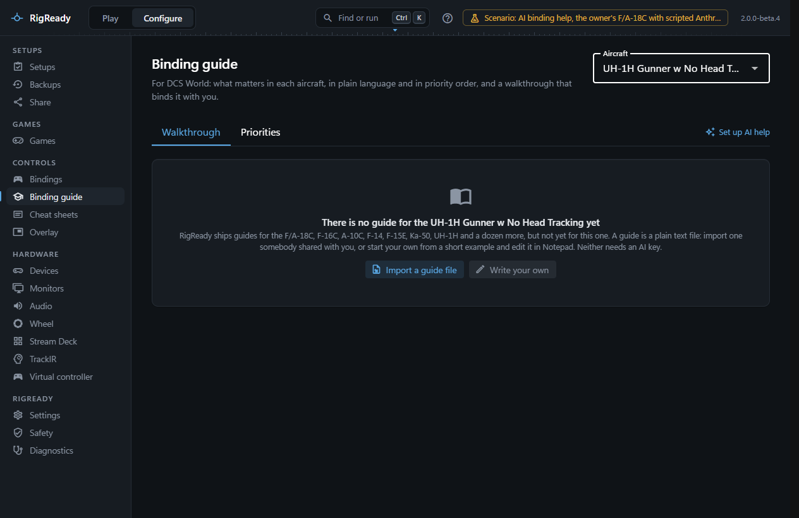
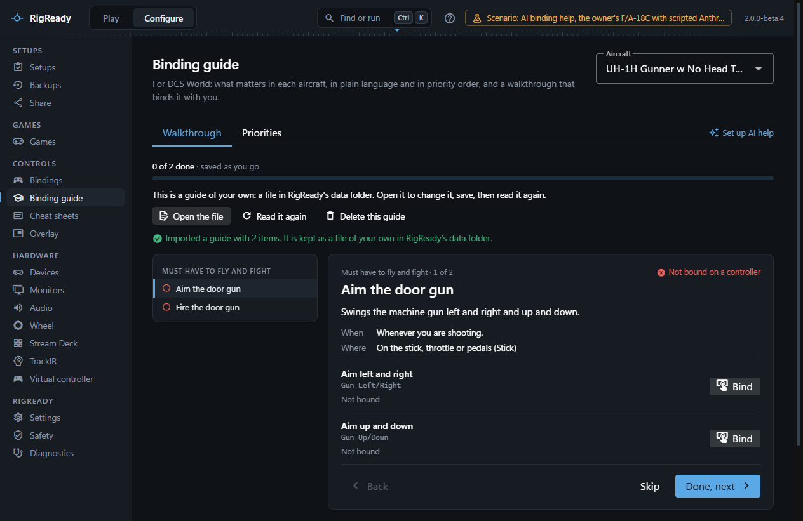
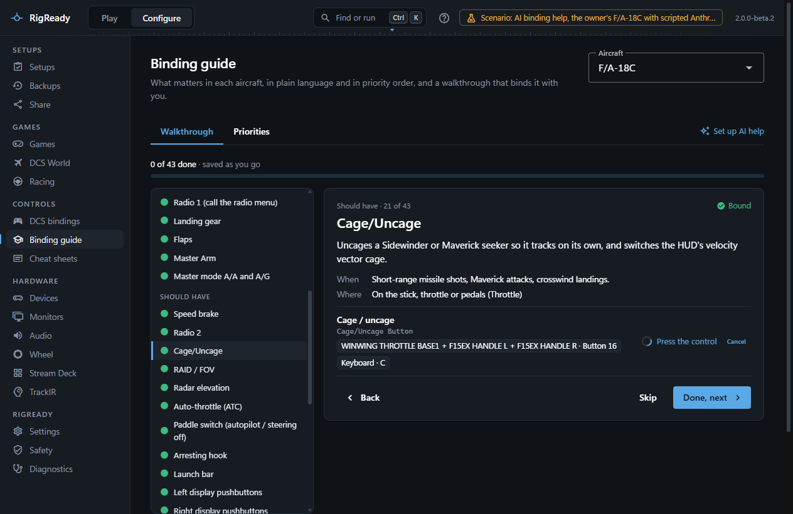
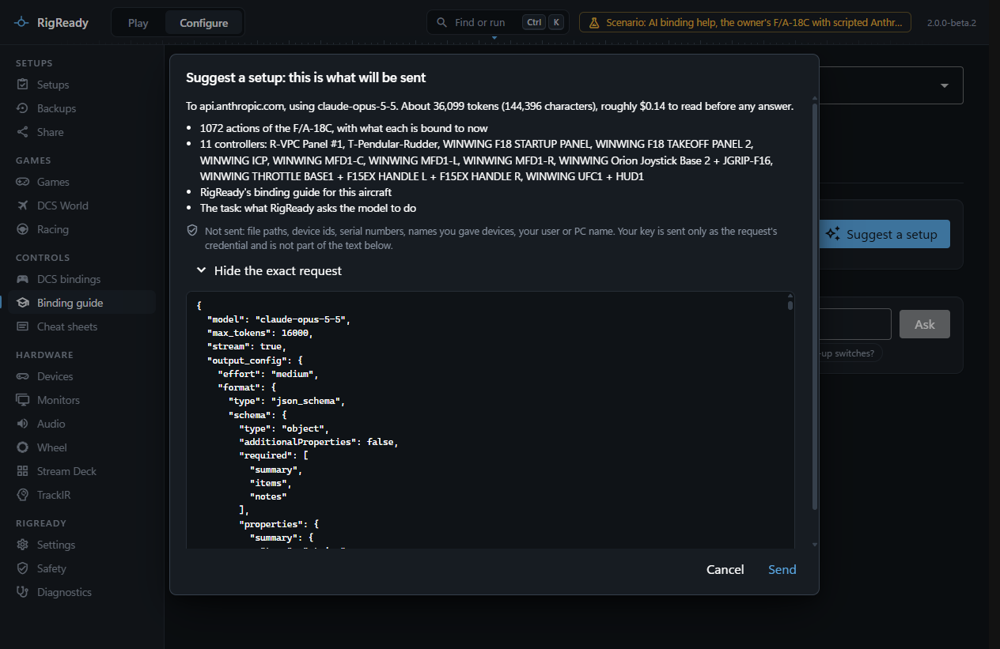
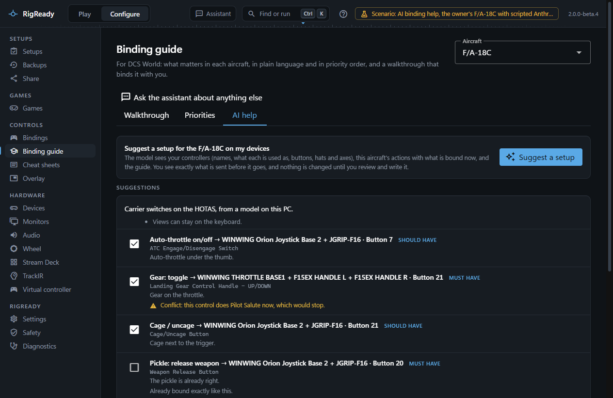

**Configure > Binding guide** explains, for an aircraft you do not know yet, what the important controls do, when you use them and where they belong, and walks you through binding them. Everything on the Walkthrough and Priorities tabs works without any key. AI help is optional and needs your own key from Anthropic, OpenAI, Google Gemini, OpenRouter or Mistral, or a model on your own PC.

Choose the aircraft at the top right; each one says **Guide included**, **Your own guide**, **Guide drafted by AI** or **No guide yet**.

An AI assistant of your own (Claude Desktop, Claude Code, Cursor and others) can also help with bindings through RigReady's MCP server, without an API key in RigReady; see [AI assistants](../ai/index.md).

## The guides

RigReady ships guides for these aircraft:

| Kind | Aircraft |
|---|---|
| Fighters and strike jets | F/A-18C Hornet, F-16C Viper, F-14A/B Tomcat (pilot, and a separate guide for the RIO), F-15E Strike Eagle (pilot, and a separate guide for the WSO) |
| Attack jets | A-10C II Warthog and A-10C (one guide for both), A-10A, Su-25T, Su-25 |
| Flaming Cliffs fighters | F-15C, MiG-29 (A, S and G, one guide), Su-27 and J-11A (one guide), Su-33 |
| Helicopters | Ka-50 III and Ka-50 Black Shark (one guide), UH-1H Huey (pilot) |
| Warbirds and trainers | P-51D Mustang, TF-51D, F-86F Sabre, Christen Eagle II |

An aircraft without a guide, such as a gunner's seat or a module not on this list, says **No guide yet**. You can [import a guide file or write your own](#a-guide-of-your-own), with no key; with your own key, AI help can also draft one (see below).

A guide is a plain data file in RigReady's source (`packs/`, one file per aircraft, for example `FA-18C_hornet.yaml`); anyone can add an aircraft by writing one in the same format. Each item in a guide has a title, what it does, when you use it, a tier (**Must have to fly and fight**, **Should have**, **Nice to have**), where it belongs (**On the stick, throttle or pedals**, **On a panel or button box**, **Fine on the keyboard**), and the DCS actions it stands for, each with a plain-language label. The guide also has a plan per kind of device: what to put on the stick, the throttle, the pedals, the MFD frames, the panels and the keyboard, in order.

The guides were written from general knowledge of the aircraft and of how their switches work in DCS. They have not been reviewed by a pilot and are not affiliated with Eagle Dynamics. What is checked, by a test, is that every action name in a guide exists in DCS's own input files for the aircraft, so a DCS update that renames an action is caught. **Where this guide comes from** at the bottom of the Priorities tab says the same.

The plain labels from the guide are also what the [bindings page](bindings.md) and the [cheat sheets](cheat-sheets.md) show first, with DCS's name beside them.

## A guide of your own

For an aircraft RigReady has no guide for, the Walkthrough and Priorities tabs offer two ways to add one. Neither needs a key, and neither sends anything.

- **Import a guide file** opens the Windows file dialog for a guide somebody shared with you: a `.yaml` file in the format described above. RigReady checks it and keeps a copy in its own data folder; the file you picked is left as it is. A file that is not a guide, that was written for another aircraft or that is larger than 512 KB is refused, with the reason.
- **Write your own** writes a short starter guide: an example on two real actions of the aircraft, with the format explained in its first lines.

The aircraft then says **Your own guide**, and the guide is used wherever a guide is: the walkthrough, the priorities, and the plain labels on the bindings page and the cheat sheets.

- **Open the file** opens the kept file in Notepad. Change it, save, and press **Read it again**.
- An edit that does not fit the format is reported with what is wrong, and the guide is not used until the file is fixed or deleted.
- **Delete this guide** asks first, then removes the file: the aircraft has no guide again. A copy is kept: the change is listed on [the Safety page](../protect/safety-page.md), where **Undo** puts the file back. No assistant can delete a guide of your own.

The file is `ai-assist\guides\<aircraft>.yaml` under [the data folder](../app/index.md). RigReady writes nothing anywhere else for it.

An action in a guide is named exactly as DCS names it, or matched by a pattern (`re`). A pattern is at most 100 characters, repeats no group (`(…)+` is refused), and uses `*`, `+` or `{…}` at most twice; a guide holds at most 40 patterns. The same rules hold for the guides RigReady ships and for a guide drafted by AI.

A guide of your own is never replaced without you: importing or starting one is refused while a guide file is kept, and **Draft a guide** is not offered for that aircraft. If you ask for AI help for the aircraft, the guide's summary and items are part of the request, and the preview names it as your own guide.

## Priorities tab

The whole guide at a glance: the summary, each tier with its items and a dot for the state of each (bound on a controller, partly bound, not bound, or not in this version of DCS), how many of the tier are bound, and the plan per device.

## Walkthrough tab

The items in order of importance, one at a time. For the current item you see what it does, when you use it, where it belongs, a tip when there is one, and each of its actions with what it is bound to now (your bindings and DCS defaults, keyboard included; a binding on a device marked as not used in DCS is shown struck through and does not count).

**Bind** on an action starts listening: press the control you want on any controller and the change is staged. An axis action needs an axis and a button action a button or a hat; a press of the wrong kind is refused with a note. Actions RigReady cannot write yet say **Bind in DCS**; see [DCS bindings](bindings.md#actions-marked-bind-in-dcs). **Done, next** and **Skip** move on and are remembered, so the walkthrough carries on where you left it after a restart; **Mark not done** reopens an item.

The bar at the bottom lists the staged changes, with what each one would replace and whether two of them use the same control. **Review and write** shows exactly what will be written to DCS's binding files, the same review as on the bindings page, and **Write the change** writes it, backed up first and with Undo on [the Safety page](../protect/safety-page.md). Nothing is written before that.

## AI help

AI help needs a provider: Anthropic (the default), OpenAI, or an OpenAI-compatible service such as Google Gemini, OpenRouter, Mistral, or Ollama and LM Studio on your own PC. Under **Configure > Settings**, the **AI assistance** section chooses who answers and takes the key; the key is stored encrypted for your Windows account and never written to settings, logs, backups, shared setups or screenshots. **Test** makes one small request that only succeeds when the key, the address and the model work, **Model** offers the provider's models (any other id can be typed), and **Exactly what is sent** lists what every request contains and which host receives it. See [Choose who answers](../ai/providers.md) and [Settings](../app/settings.md).

Once a provider is set up the Binding guide page gets an **AI help** tab, and the walkthrough gets an **Explain** button on each action.

- **Suggest a setup** asks for a binding plan for this aircraft on your controllers.
- **Ask about this setup** takes a question of up to 600 characters, for example "What am I missing for carrier landings?", and answers in plain text.
- **Explain** on an action in the walkthrough asks what it does in the real aircraft and in DCS, when you use it and where it belongs.
- **Draft a guide**, for an aircraft without one, has the model write a guide in the same format from the aircraft's own action list. It is saved under RigReady's folder, marked as drafted by AI wherever it is shown, and every action in it was checked against the aircraft's real action list; nobody checked the advice. **Delete the drafted guide** removes it, with a copy kept and Undo on the Safety page. A draft is not offered while a guide file of your own is kept for the aircraft.

### What is sent

Before each request a dialog shows what will be sent: the host it goes to, the model, the size in characters and tokens, what reading it is estimated at and from which prices (where prices are set for the model; it is an estimate, not a bill), what is in it, and under **Show the exact request** the request body itself. Sent are the aircraft's name, DCS's list of its actions with what each is bound to now, for each controller used in DCS its product name, role, number of buttons and hats and axis names, the guide for the aircraft when there is one (RigReady's, one drafted by AI, or your own: its summary and its items), and your question. Never sent are file paths, device IDs, serial numbers, the names you gave devices, your Windows user or PC name, or any other content of your files. All of this is for DCS aircraft; the [built-in assistant](../ai/built-in-assistant.md), which works the same whatever you play, has its own list. The key goes only to the chosen provider's host (api.anthropic.com by default), in a request header; with Ollama or LM Studio nothing leaves the PC. Nothing leaves the PC until you press **Send**. A [monthly budget](../ai/built-in-assistant.md#the-monthly-budget) set in Settings holds these requests back as well. [Privacy](../app/privacy.md) lists everything that ever leaves the PC.

A suggestion or a drafted guide arrives as a stream: the dialog says how far it is and offers **Cancel the request**; nothing of an answer is used before it is complete and has been checked. A refused, cut-off or unreadable answer is reported, and nothing from it is used. A service that cannot be held to a JSON schema is asked for JSON in the text instead; the dialog then says that an answer that does not check out is asked for once more with the same request.

### Nothing is applied without a tick and a review

Every line of a suggested plan is checked against what exists: an action that is not in this aircraft, a controller or input that is not there, an axis action on a button, an action RigReady cannot write, or a line suggested twice is dropped and listed with the reason. The suggestions that remain each have a tick, a priority, the model's reason, and flags: **Already bound exactly like this**, a conflict with what the control does now, or a clash with another suggestion using the same control. **Review N changes** opens the file-change review, and only **Write** writes, backed up first and with Undo. A question's answer is text only and changes nothing.
