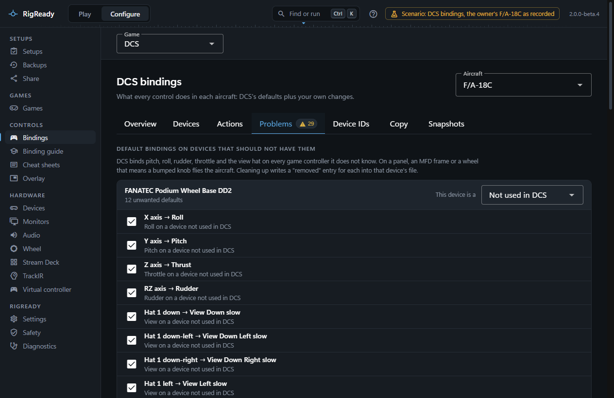
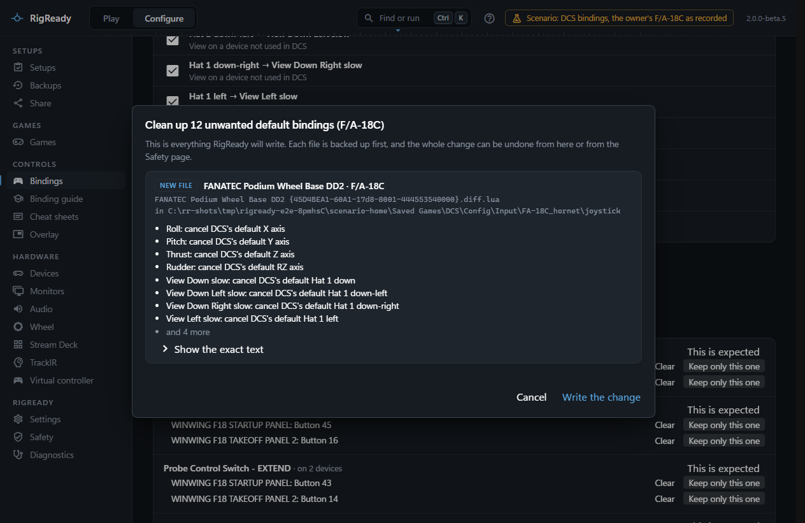

The **Problems** tab of **Configure > DCS bindings** looks through an aircraft's bindings for four kinds of trouble and offers a fix for each. Every fix is shown as the exact file change before it is written. The tab's badge and the four tiles on the Overview tab count the problems.

## Default bindings on devices that should not have them

DCS binds pitch, roll, rudder and throttle, and the view hat, on every game controller it does not know; the UH-1H also puts the radio trigger, weapon release and trim on the first buttons of every device. On a panel, an MFD frame or a wheel that means a bumped knob flies the aircraft.

Which defaults are unwanted follows from what each device is, as set on the Overview tab or in the dropdown beside the device here:

- a **Panel or button box**, an **MFD frame** or a device **Not used in DCS** should have none of them;
- a **Stick** keeps pitch, roll, the views and the default buttons, and keeps rudder when there are no pedals and throttle when there is no throttle;
- a **Throttle** keeps the throttle, and **Pedals** keep rudder and wheel brakes;
- **Something else** keeps everything.

Each unwanted default is listed with its reason, for example "Pitch on an MFD frame", and a tick. **Clean up N for <aircraft>** writes a cancellation for each ticked one into that device's file for this aircraft. **Clean up every aircraft** does the same for every aircraft DCS has defaults for, in one change. A default whose action RigReady cannot write yet is skipped.

## One input does several things

The same control with the same modifiers is bound to more than one action on one device, so one press fires them all. Each action is listed with **Keep only this**, which clears the others.

## One action is bound more than once

An action is on several devices, or twice on one device. That is fine when you mean it, a second trim hat for example, and a problem when two devices fight over an axis. **Clear** removes one occurrence, **Keep only this one** removes the others, and **This is expected** marks the action as intended so it stops counting; the mark is kept per aircraft in RigReady's own folder, and **Show N expected** brings the marked ones back into view.

## Important actions that are not on any controller

RigReady ships a priority list for the F/A-18C and the UH-1H, in tiers: for the Hornet, fly and fight (the HOTAS essentials), sensors and defence, communications, systems and view; for the Huey, flight controls, weapons, communications, systems and view. Other aircraft get a short generic list: flight controls, gear and flaps, radio, view. An item is listed here when none of its actions is on a controller, with one line on why it matters and the keyboard shortcut that does work when there is one. **Bind** opens the bind dialog limited to the actions that would satisfy it.

The longer, plain-language guides on the [Binding guide](binding-guide-and-ai.md) page cover the same ground in more depth.
