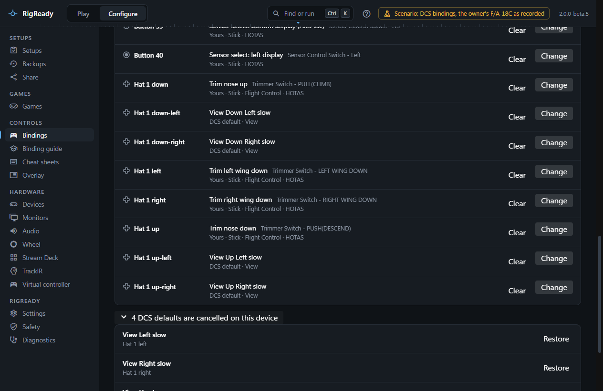
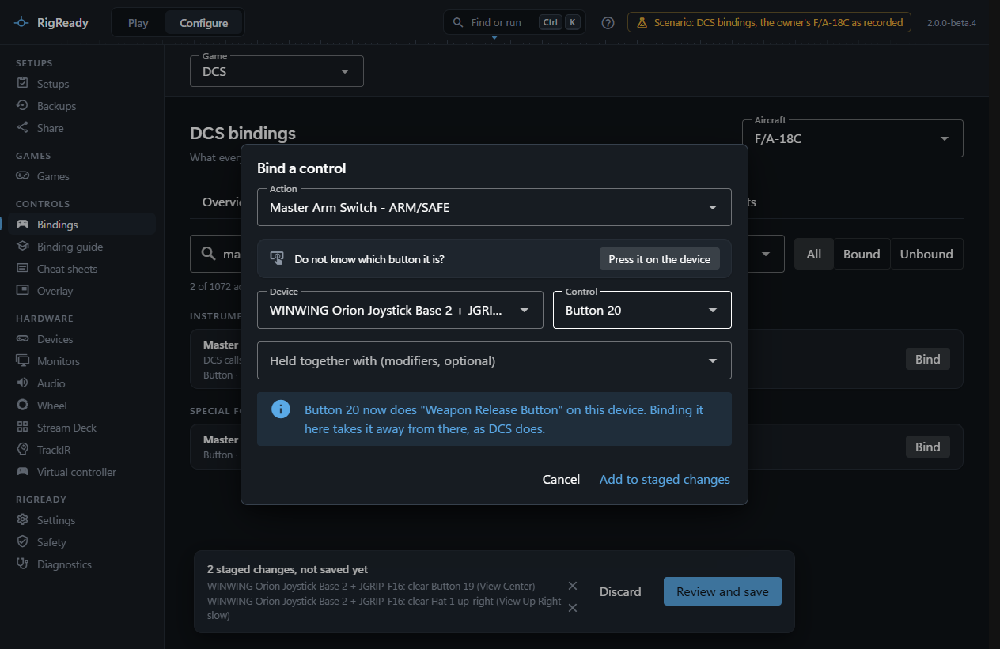
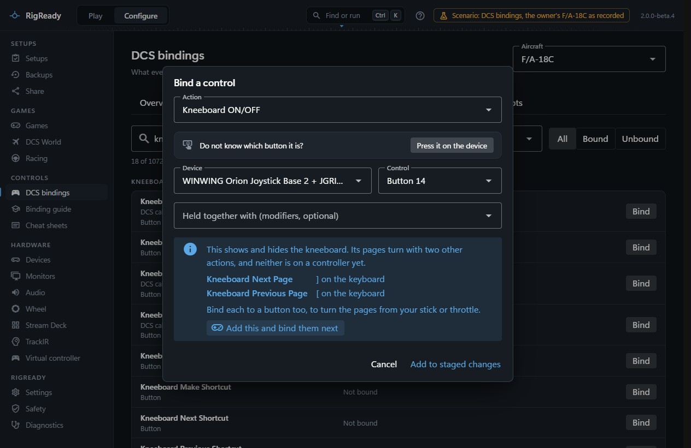
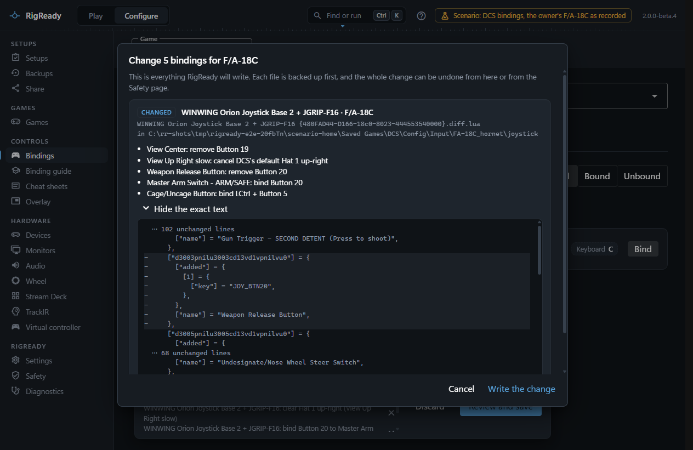

**Configure > Bindings** with **DCS** chosen as the game shows what every control does in each aircraft and lets you change it, without opening DCS. RigReady reads the DCS bindings you already have from DCS's own files, so there is nothing to import. This page covers the Devices and Actions tabs, binding by pressing a control, and how the changes reach DCS's files. The other tabs have their own pages: [Binding problems](binding-problems.md), [Device IDs changed](device-ids.md), and [Copy between aircraft and snapshots](copy-and-snapshots.md).

Choose the aircraft at the top right. Each one says how many binding files of your own it has, or **DCS defaults only**.

## What is shown: defaults plus your changes

DCS does not keep a full list of your bindings. For each device it starts from the default bindings the aircraft ships, then applies one file of changes: your `.diff.lua` file for that device if there is one, otherwise a template DCS ships for the device model, otherwise nothing. RigReady reads the defaults the same way DCS does, applies the same one file, and shows the result. Every binding is marked where it comes from: **DCS default**, **Yours**, or **DCS template**, and **with your curve** when a default axis has a changed curve.

Defaults on controls the device does not have, a hat on a panel without one for example, can never fire; they are counted separately and folded away.

## Overview tab

Four tiles count the problems (see [Binding problems](binding-problems.md)). Under **Controllers attached now** each device shows how many bindings are yours and how many are DCS defaults, and a dropdown for what the device is: **Stick**, **Throttle**, **Pedals**, **Panel or button box**, **MFD frame**, **Not used in DCS** or **Something else**. RigReady guesses from the name and says so; the role decides which defaults count as unwanted, and is remembered per device model. Devices that have a binding file but are not attached are listed below, with a way to the Device IDs tab. The names shown are the ones you gave on the [Devices page](../hardware/devices.md). The keyboard and mouse are listed for reference; they are changed in DCS. Modifiers that live on a device button are listed last.

## Devices tab

Pick a device. There is one row per control it has, axes first, then buttons, then hat directions, each with what it does: the plain-language name from the binding guide where there is one, with DCS's own name beside it, the source, and the category. **Only bound controls** hides the empty rows.

- **Bind** or **Change** opens the bind dialog for that control.
- **Clear** stages the removal of one binding. For a DCS default this writes a cancellation into your file, so the default does not come back.
- **Curve** on an axis opens the curve settings.
- **Clear all on this device** removes everything on the device for this aircraft, yours and DCS's defaults, after a confirmation and a preview.
- The folds below list the DCS defaults that are cancelled on this device (each with **Restore**) and the defaults on controls the device does not have.

## Actions tab

Every action of the aircraft, grouped by DCS's categories, with a chip for each device it is bound on. Search by words, pick a category, and filter **All**, **Bound** or **Unbound**. The × on a chip stages clearing that binding; **Bind** opens the dialog with the action chosen.

## Binding by pressing a control

The bind dialog takes an action and a control. Either press **Press it on the device** and then press the button or hat, or move the axis most of the way, on any attached controller; RigReady fills in the device and the control. Or pick them from the lists. **Held together with** adds modifiers: DCS's keyboard modifiers, or any modifier you set up on a device.

For an axis the dialog also has the curve: curvature from -100 to 100, deadzone, saturation X and Y, invert and slider, with a drawing of the resulting curve. An existing user curve with several points is kept unless you set a curvature.

When the control already does something else on that device, the dialog says so: binding it here takes it away from there, as DCS's own controls screen does. **Add to staged changes** closes the dialog without writing anything.

### Show or hide the kneeboard

**Kneeboard ON/OFF** shows and hides the kneeboard and does nothing else. Its pages turn with two more actions, **Kneeboard Next Page** and **Kneeboard Previous Page**, which DCS puts on the keyboard (`]` and `[`) and on no stick or throttle. Bind only the first to a button and in the cockpit you have the first page and no way to turn it without the keyboard.

So when the action in the dialog is the one that shows or hides the kneeboard, and a page action is on no controller, the dialog says so. It names each such action and where it is now ("] on the keyboard", or "Not bound"). **Add this and bind them next** stages the binding you made and opens the dialog again on the first page action, on the same device, then on the second; **Cancel** stops there and keeps what is already staged.

The note counts what is staged as well as what is saved: a page action you have staged onto a button is not named, and one whose button you are giving to something else is. Once both page actions are on a controller the dialog has nothing to add. If RigReady cannot write a binding for a page action yet, the note says to bind that one in DCS's own controls screen.

For the pages themselves and the three keys, see [Kneeboard pages](kneeboard.md#keys-in-the-cockpit).

## Staged changes and the review

Changes are staged, not written. The bar at the bottom lists them in plain words, with a way to drop one, **Discard** for all, and **Review and save**.

The review shows exactly what will be written, file by file: whether a file is new, changed, deleted or renamed, the device and aircraft it is for, each change in plain language (for example "Gun Trigger - SECOND DETENT: bind Button 5" or "View Left slow: cancel DCS's default Hat 1 left"), and under **Show the exact text** the lines that are added and removed. Notes say what could not be done. **Write the change** writes every file as one change, backed up first, and reads it back. A line at the bottom then says what was saved, with **Undo**; the change is also under **Configure > Safety** ([The Safety page](../protect/safety-page.md)).

Nothing can be saved while DCS runs, because DCS writes the bindings back when you press OK in its controls screen; see [Close DCS before writing](index.md#close-dcs-before-writing).

## The .diff.lua files

DCS keeps your changes per aircraft and device in `Saved Games\DCS\Config\Input\<aircraft>\joystick\<Device name> {device ID}.diff.lua`. Each entry is keyed by the action's command hash and lists the controls added, the defaults removed, and the default axes whose curve changed. RigReady writes the file in DCS's own format, with the same ordering, indentation and number format, so a file read and written back is byte for byte the same. When a device has no file yet and DCS ships a template for it, the new file starts from the template, because DCS stops using the template the moment your file exists. When nothing is left in a file, RigReady deletes it, as DCS does, and the device is back on its defaults.

A binding written by RigReady has been used in DCS: on the rig RigReady was built on, "Kneeboard show / hide" for the F/A-18C was bound here to a stick button, and in the cockpit that button opened the kneeboard. Undo put the file back byte for byte. The first time on your own rig, bind one action to a free button, save, then start DCS and open its controls screen for the aircraft: the button should be shown in that device's column for that action, with no new conflict marking. If it is not, the file as it was before the change is on the Safety page.

## Actions marked "bind in DCS"

Some actions, mostly general and view commands used from the keyboard, are engine commands whose internal number RigReady has not seen yet. They are shown with their names but marked **can only be bound in DCS for now**, and their Bind button is disabled. RigReady learns a number the moment one of your binding files, or one of DCS's templates, uses it: bind the action once in DCS and it becomes editable here.
