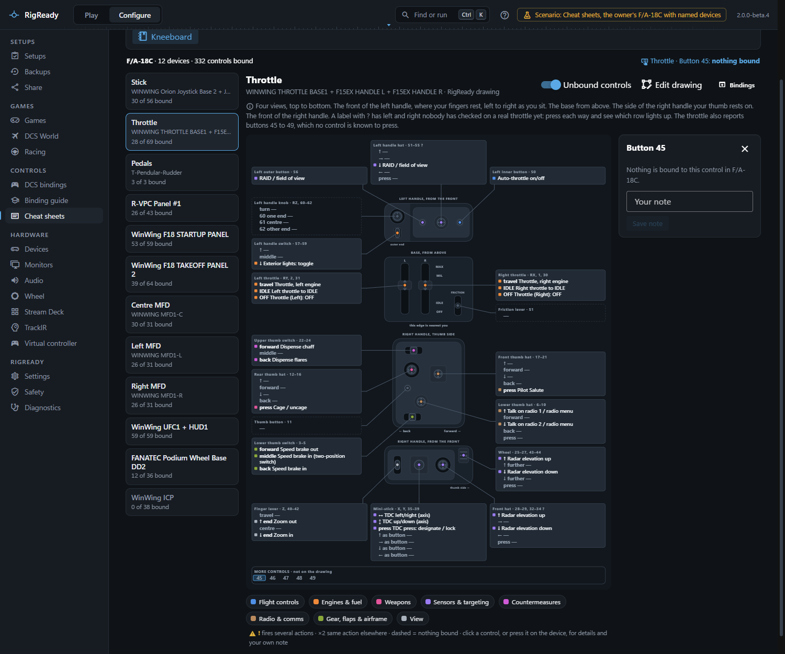
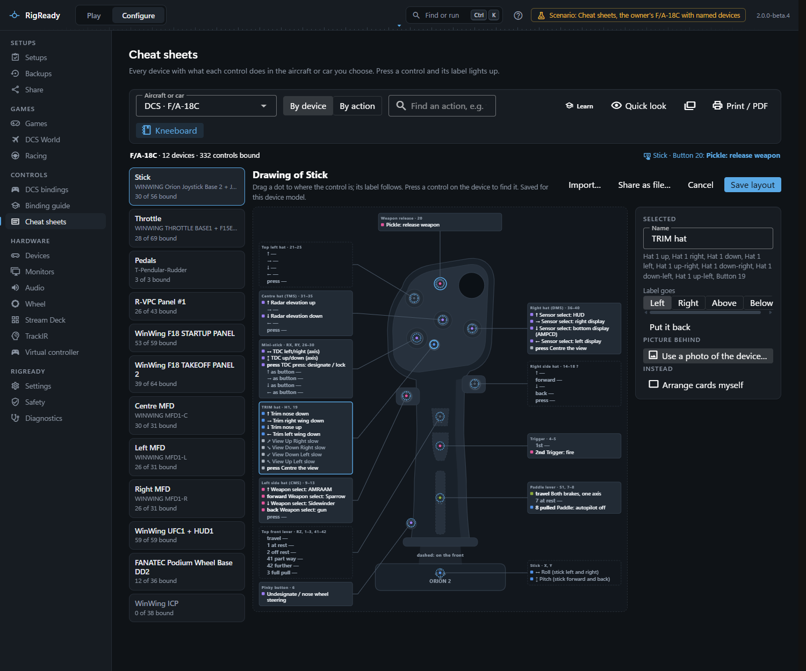
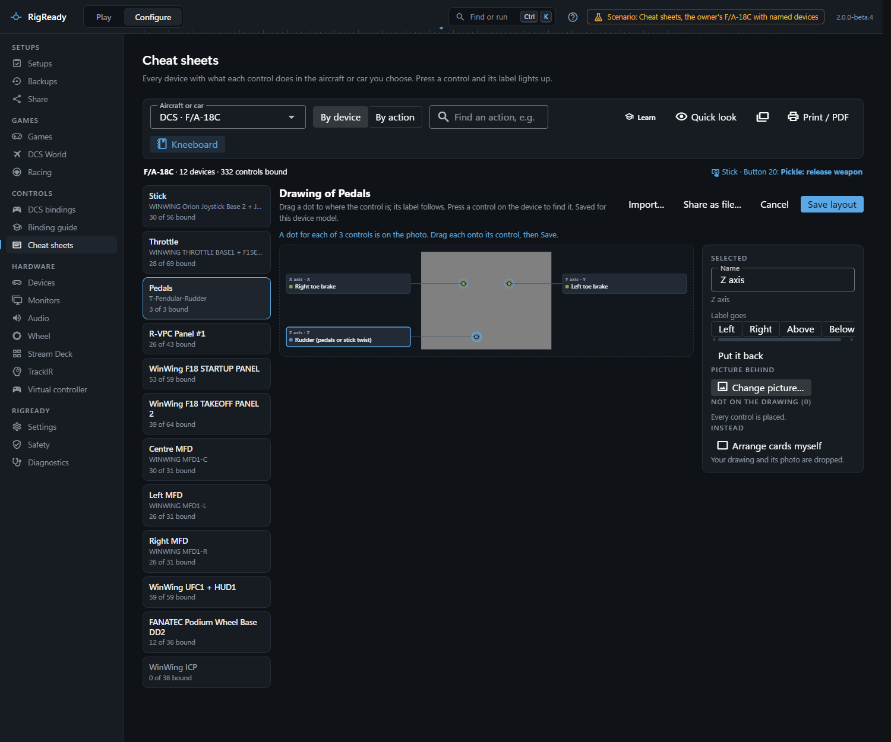

**Configure > Cheat sheets** draws every controller with what each control does in the aircraft you choose. For DCS the labels come from the same effective bindings as the [bindings page](bindings.md), with the plain-language names of the [binding guide](binding-guide-and-ai.md) where it has one. The same page serves the [racing games](../games/index.md); this page is about using it for DCS.

Choose the aircraft under **Aircraft or car**. The page opens on the game of the [setup in use](../play/switching-setups.md).

## By device

The devices are listed on the left, with the name you gave each one on the [Devices page](../hardware/devices.md), how many of its controls are bound, and a warning count. What the picture is depends on the device; the line under its name says which:

- **RigReady drawing**: these devices have a simple outline drawing:
  - WinWing Orion stick with the F-16EX (ViperAce) grip or the F/A-18 grip, and the Orion throttle with the F-15EX handles
  - WinWing MFD1 frames, UFC1 with its HUD1, ICP, startup panel and take-off panel 2
  - Thrustmaster HOTAS Warthog joystick (the grip seen from behind)
  - Thrustmaster T.16000M stick (the base buttons by bank: left 5–10, right 11–16; the three head buttons as one group)

  Each has one label block per control you put your hand on (a hat is one block with a line per direction) and a leader line from the block to the control. The labels place themselves beside the drawing so that no two lines cross. A block's head names the control and its input numbers; a **?** there means nobody has checked on a real device which number or direction is which: press each way and see which row lights up. A device has a drawing only where the drawing is known to match the real thing: where each control is and which numbers it gives were checked against the maker's own number maps and the game's default bindings. The Thrustmaster controls are named the way the maker names them ("H2 TMS hat", "S2 weapon release"), numbered as the device reports them without a TARGET profile or other remapping software. If a control is not where your own device has it, drag the dot in **Edit drawing**. The outlines are schematic, not pictures of the real hardware, and only these devices have one so far. For a picture that looks like your own device, use a photo of it (see [A drawing of your own](#a-drawing-of-your-own) below, or **Choose a photo or drawing…** in the editor).
- **Shipped layout**: the other devices RigReady knows (pedals, the Virpil control panel, the Fanatec wheel) are drawn as cards on a simple outline: buttons, hats as crosses, and axes with a bar that follows the real axis.
- **Controls named for the device**: a controller RigReady knows the buttons of but has no drawing of (the Thrustmaster HOTAS Warthog throttle, the Saitek / Logitech X52 Pro) is a list with one block per control, named the way the maker names it, a hat as one block and the axes named. The list claims no places: it does not say where on the device a control is. Devices are found by their USB id, or by the name they report; press a control to check that its row lights.
- **Controls list**: a device RigReady knows nothing about is a list of its controls, in blocks (the axes, each hat, buttons in runs of eight).
- **Your layout** or **Your drawing**: what you made in the editor, see below.

Every label reads what the control does, with the plain name where the binding guide has one; the colour says the kind of action, and the legend under the picture names the kinds and filters by one. A control that fires several actions on one press is outlined in amber, **×2** marks an action that is also somewhere else, and a dashed block or card has nothing bound; **Unbound controls** hides those. Bound controls a drawing has no place for are listed under it, so nothing you bound is ever left off.

Press a control on the device and its label lights up and is selected. Clicking a label does the same. The panel on the right shows every binding on it: the plain name, what DCS calls it, modifiers, category, whether it is yours or a default, and where else the action is. **Your note** keeps up to 120 characters of your own words for that control, for example "hold for weapon release"; notes live in [RigReady's folder](../app/index.md) and appear on the printed and kneeboard pages. **Bindings** opens the bindings page on that device.

Controls the device reports that are not on the picture are counted, and bindings on inputs that have no place on a controller picture are listed under the picture. On a drawing, a button, hat direction or axis the device reports that the drawing has no place for and nothing is bound to gets a small cell with its number under the drawing ("More controls · not on the drawing"), so a press always lights something; **Unbound controls** hides those cells with the other empty controls. The search box finds a control by action, label or note, and shows how many matches each device has.

## By action

**By action** turns the sheet around: every bound action, grouped by kind, with where it is. Clicking a place jumps to that control on its device.

## Quick look

**Quick look** is just the sheet, filling the window, for a glance while flying: a device dropdown, a search box that answers "which control does…" with the places that match, **Follow my hands** to switch to whatever device you touch, and a line with the last control pressed and what it does. **Pop out** opens it as a small window that stays on top, for a second monitor. **Full page** goes back.

## Edit drawing

**Edit drawing** opens a device that has a drawing. The labels still place themselves; you correct the drawing:

- Click a label or the dot of a control, or press the control on the device, to select it. Drag its dot to where the control really is; the arrow keys nudge it. Its label and leader follow.
- **Name** renames the control, **Label goes** puts its label left, right, above or below the drawing, and **Put it back** undoes your changes to it.
- **Use a photo of the device…** puts a photo in place of the drawing, with a strength slider; drag the dots onto the real controls.
- **Arrange cards myself** switches to the card layout described below.

### A drawing of your own

For a device RigReady has no drawing of, **Make a drawing from a photo…** (in the layout editor, under **Drawing**) turns a photo of it into a drawing: a dot for every axis and hat it reports and every button that does something is set out on the photo, and you drag each onto its control. **Not on the drawing** adds any other control. From then on its sheet, kneeboard pages and printouts have labels placed around your photo like a RigReady drawing. **Import…** also reads a drawing file (a picture plus the controls and where they are, described in `LAYOUT-FORMAT.md` in the source), for example one someone made for the same device.

## Edit layout

A layout says where the label cards of one device model sit on the picture. **Edit layout** opens a device drawn as cards (and **Arrange cards myself** in the drawing editor); your layout is kept for that device model, and a layout you made before RigReady 2.0 keeps its places.

- Drag cards, their pointers and group frames into place; the arrow keys nudge the selected one. Press a control on the device to find its card.
- The field **Printed on the device** is the label on the card, such as "OSB 6". **Add pointer** draws a line from the card to a spot on the picture.
- **Add a group frame** draws a labelled frame; a control inside carries the frame's name, and the frame moves its contents with it.
- **Choose a photo or drawing…** puts a PNG, JPEG, WebP or SVG picture of about 6 MB at most behind the cards, with a strength slider.
- **Not on the layout** lists every control the device reports that is not placed; a dot marks one that has a binding. Click one to add it. A control with a binding is never left off a sheet: unplaced ones are added below the picture under "More controls".
- **Import…** reads a RigReady layout or drawing file, or a Joystick Diagrams SVG template, which becomes the background with a card at each placeholder. **Share as file…** saves your layout or drawing as a file to give to someone else. **Discard my layout** goes back to what RigReady ships.

Nothing is stored until **Save layout**, in either editor.

## Print or PDF

**Print / PDF** makes one page per chosen device, on white, with the aircraft and device name on top, and a summary page of the most important actions when ticked, on A4 or US Letter. **Print…** uses the system print dialog; **Save as PDF…** writes a file and says where.

The **Kneeboard** button is described on [Kneeboard pages](kneeboard.md), and **Learn** on [Learn your controls](trainer.md).
