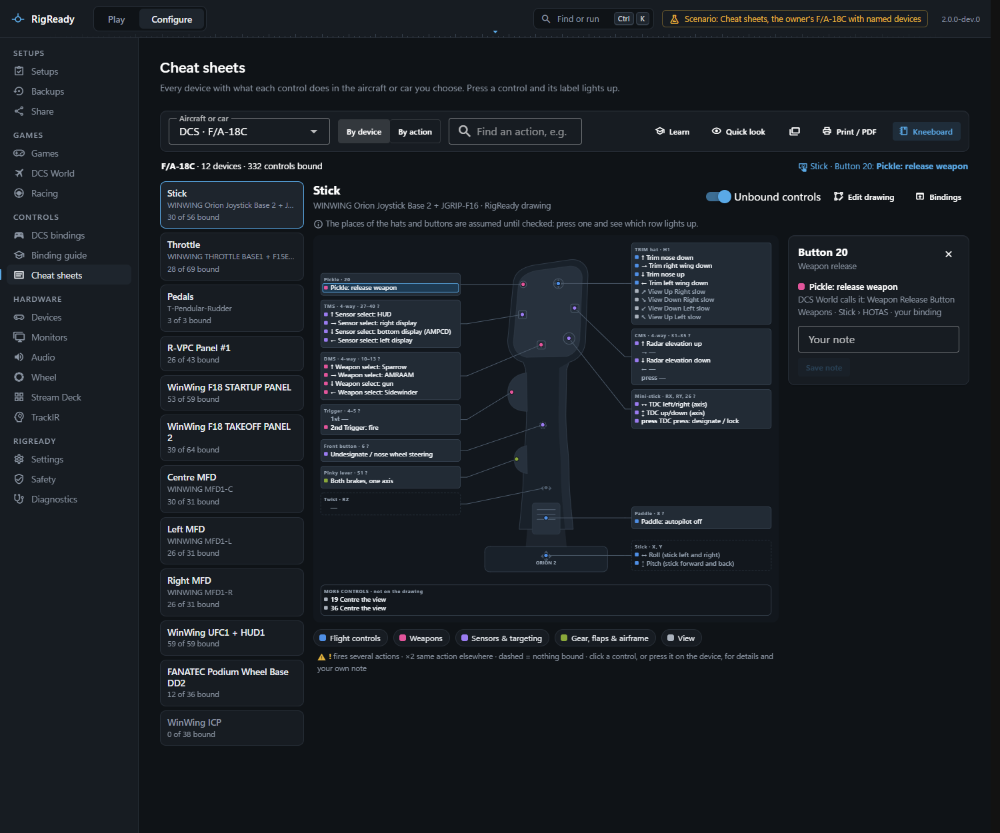
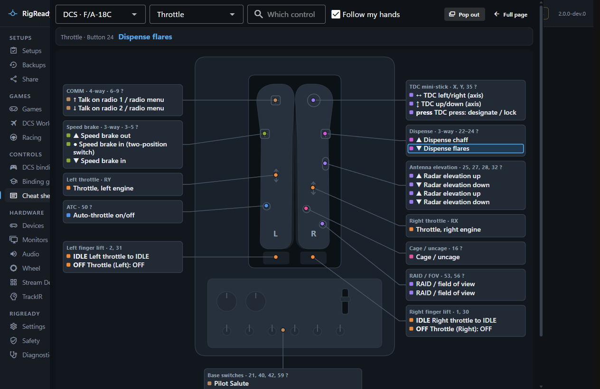

**Configure > Cheat sheets** draws every controller with what each control does in the aircraft you choose. For DCS the labels come from the same effective bindings as the [bindings page](bindings.md), with the plain-language names of the [binding guide](binding-guide-and-ai.md) where it has one. The same page serves the racing games; this page is about using it for DCS.

Choose the aircraft under **Aircraft or car**. The page opens on the game of the setup in use.

## By device

The devices are listed on the left, with the name you gave each one, how many of its controls are bound, and a warning count. The picture shows a card for every control: buttons, hats as crosses, and axes with a bar that follows the real axis. A card reads the control's number, what is printed on the device where the layout knows it, and the action; the colour says the kind of action, and the legend under the picture names the kinds and filters by one. An exclamation mark marks a control that fires several actions on one press, **×2** an action that is also somewhere else, and a dashed card a control with nothing bound; **Unbound controls** hides those.

Press a control on the device and its card lights up and is selected. Clicking a card does the same. The panel on the right shows every binding on it: the plain name, what DCS calls it, modifiers, category, whether it is yours or a default, and where else the action is. **Your note** keeps up to 120 characters of your own words for that control, for example "hold for weapon release"; notes live in RigReady's folder and appear on the printed and kneeboard pages. **Bindings** opens the bindings page on that device.

Controls the device reports that are not on the picture are counted, and bindings on inputs that have no place on a controller picture are listed under the picture. The search box finds a control by action, label or note, and shows how many matches each device has.

## By action

**By action** turns the sheet around: every bound action, grouped by kind, with where it is. Clicking a place jumps to that control on its device.

## Quick look

**Quick look** is just the sheet, filling the window, for a glance while flying: a device dropdown, a search box that answers "which control does…" with the places that match, **Follow my hands** to switch to whatever device you touch, and a line with the last control pressed and what it does. **Pop out** opens it as a small window that stays on top, for a second monitor. **Full page** goes back.

## Edit layout

A layout says where the controls of one device model sit on the picture. RigReady ships layouts for some devices and generates a plain one otherwise; **Edit layout** lets you make your own, kept for that device model.

- Drag cards, their pointers and group frames into place; the arrow keys nudge the selected one. Press a control on the device to find its card.
- The field **Printed on the device** is the label on the card, such as "OSB 6". **Add pointer** draws a line from the card to a spot on the picture.
- **Add a group frame** draws a labelled frame; a control inside carries the frame's name, and the frame moves its contents with it.
- **Choose a photo or drawing…** puts a PNG, JPEG, WebP or SVG picture of about 6 MB at most behind the cards, with a strength slider.
- **Not on the layout** lists every control the device reports that is not placed; a dot marks one that has a binding. Click one to add it. A control with a binding is never left off a sheet: unplaced ones are added below the picture under "More controls".
- **Import…** reads a RigReady layout file or a Joystick Diagrams SVG template, which becomes the background with a card at each placeholder. **Share as file…** saves your layout as a file to give to someone else. **Discard my layout** goes back to the shipped or generated one.

Nothing is stored until **Save layout**.

## Print or PDF

**Print / PDF** makes one page per chosen device, on white, with the aircraft and device name on top, and a summary page of the most important actions when ticked, on A4 or US Letter. **Print…** uses the system print dialog; **Save as PDF…** writes a file and says where.

The **Kneeboard** button is described on [Kneeboard pages](kneeboard.md), and **Learn** on [Learn your controls](trainer.md).
