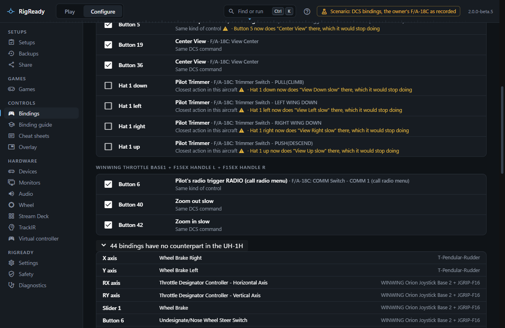
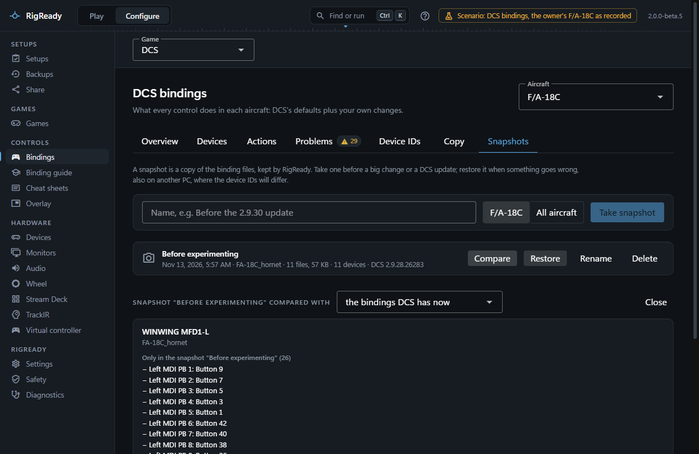

Two tabs of **Configure > DCS bindings** work across aircraft and across time: **Copy** takes the controls you set up once to another aircraft, and **Snapshots** keeps named copies of the binding files.

## Copy

Choose the aircraft to copy to and tick the devices to copy from; the stick, throttle and pedals are ticked to begin with, because those are where the controls people share between aircraft live. **Find controls to copy** looks at every binding of yours on those devices (your own bindings, and default axes whose curve you changed) and finds the matching action in the other aircraft:

- **Same DCS command**: both aircraft have the very same command, as with the view and zoom commands shared by every aircraft.
- **Same kind of control**: pitch, roll, rudder, throttle or collective, the wheel brakes, the four trim directions, view centre, zoom, the radio, the trigger and the kneeboard, matched by what the action is.
- **Closest action in this aircraft**: a loose match you have to opt into, such as the Huey's force trim for a trim hat.

Each proposal shows the control, the action it would get in the other aircraft, the match kind, **Already bound like this** when it is, and what the control does there now and would stop doing. Bindings with no counterpart are listed separately. Tick what you want and **Preview copying N controls** shows the file change before it is written.

## Snapshots

A snapshot is a copy of the binding files, kept under RigReady's own folder (`snapshots\dcs` under the data folder): every `.diff.lua` file plus `modifiers.lua`, `disabled.lua` and `wizard.lua`, for one aircraft or for all of them. With it RigReady records the date, the DCS version from the log, and the devices with their IDs. Take one before a big change or a DCS update.

- **Take snapshot** needs a name and a scope: this aircraft (only when it has files of its own) or all aircraft.
- **Compare** sets a snapshot against the bindings DCS has now, or against another snapshot. Devices are matched by name, so a changed device ID alone is not a difference. For each device that differs it lists what is only on one side and which axes changed their curve.
- **Restore** puts the files of the covered aircraft folders back as they were and removes files in those folders that were not in the snapshot. **Put files under the device IDs the attached devices have now** is on by default: a device whose ID changed since the snapshot gets its file under the current ID, so DCS finds it; when several attached devices share a name, those files stay under the old ID for the [Device IDs](device-ids.md) tab. You see every file before anything is written, and the change can be undone.
- **Rename** and **Delete** do what they say; deleting a snapshot never touches the current bindings.

A snapshot is narrower than a [backup](../protect/backups.md): it holds the binding files only, and lives on this PC in RigReady's folder.
