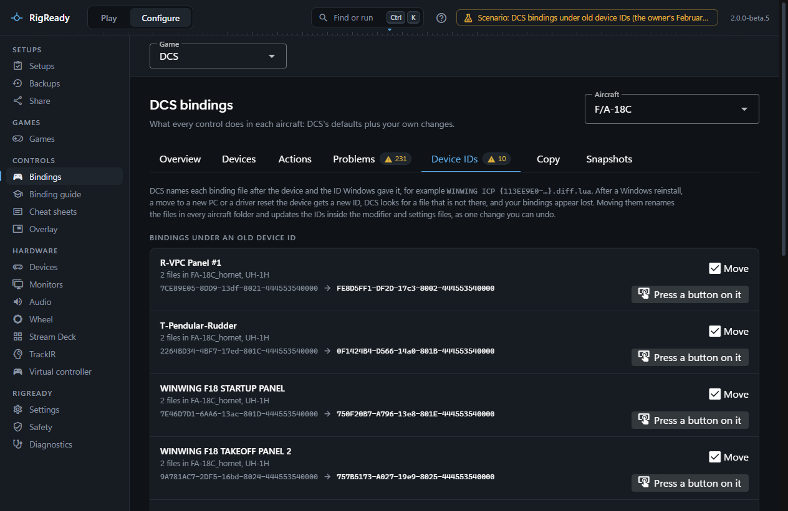
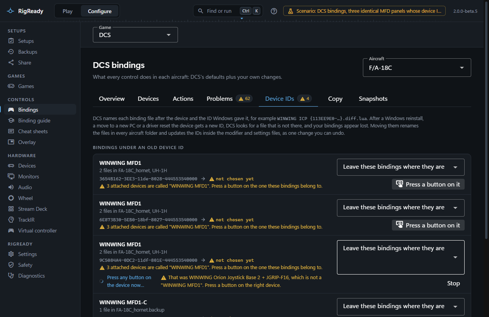

DCS names every binding file after the device and an ID Windows gave it, for example `WINWING ICP {113EE9E0-E314-11c7-8020-444553540000}.diff.lua`. When that ID changes, DCS looks for a file that is not there and your bindings seem lost. The **Device IDs** tab of **Configure > Bindings** with **DCS** chosen moves them to the new ID.

## Why the ID changes

The ID is the instance GUID DirectInput assigned when Windows first registered that controller model. Windows gives a device a new one after a reinstall of Windows, on a new PC, after a driver reset, and when the firmware or a grip change gives the device a new product name or ID. Plugging the device into another USB port does not by itself change it.

A changed ID breaks two things: the binding files for that device in every aircraft folder are no longer found, and a modifier defined on a button of that device (in `modifiers.lua`) points at the old ID.

## How you notice

- The bindings page shows a warning at the top: bindings for one or more devices belong to an old device ID, with **Fix device IDs**.
- The Overview tab lists the files under **Binding files for devices that are not attached**, and marks a modifier that points at a device ID that is not attached.
- A setup made from the rig carries the check **DCS bindings match the connected devices** ([Checks and fixes](../setups/checks.md)) for its aircraft. It warns on the Play screen, never blocks a launch, and its fix, **Review device ID changes**, opens this tab. See [Make ready and launch](../play/make-ready-and-launch.md).

## The tab

Under **Bindings under an old device ID** each entry is one old ID: the device name, how many files it has and in which aircraft folders, whether modifier or settings files name it, and the old and the new ID.

RigReady works out which attached device the files belong to from the vendor and product IDs the registry still holds for the old ID, or by the device name when the registry has forgotten it. Then one of three things is true:

- Exactly one attached device can be meant. The move is proposed, with a **Move** box you can untick.
- Several devices could be meant, so you choose. This happens when several attached devices have the same name (three MFD frames, two panels), when several old IDs could belong to one device, or when the device's name changed (a grip or firmware change, after which some buttons may have moved). RigReady never guesses between identical devices.
- No attached device has this name. The entry is listed under **Binding files for devices that are not attached** with nothing to do: plug the device in and DCS finds its bindings.

To choose, pick the device from the dropdown or press **Press a button on it** and press any button on the device the bindings belong to. A press on another device is reported, and a device already chosen for another old ID is refused, so two sets of files cannot end up on one device by a slip of the hand. The names you gave devices on the [Devices](../hardware/devices.md) page are shown, which is what tells identical devices apart at a glance.

When the chosen device already has a binding file under its current ID in the same aircraft folder, a dropdown asks what to do: **Keep the file that is there** (the old file stays where it is), **Add the old bindings to it where they do not clash**, or **Replace it with the old bindings**.

## The move

**Preview moving N devices** shows every file that will be renamed, in every aircraft and device type folder, and every `modifiers.lua`, `disabled.lua` and `wizard.lua` whose references are rewritten to the new ID. Writing it is one change, backed up first, with Undo on [the Safety page](../protect/safety-page.md); it is refused while DCS runs ([Close DCS before writing](index.md#close-dcs-before-writing)), and nothing is written if a file changed after the preview was made.

## Modifiers

A modifier or switch defined on a device button ties `modifiers.lua` to that device's ID. The move rewrites it along with the files, so the modifier works again. The Overview tab shows the modifiers on devices and whether their device is attached.

## A backup from an older PC

A backup or a snapshot taken on another PC, or before a Windows reinstall, holds files under that PC's IDs. After a [restore](../protect/restore.md) this tab finds them and moves them as above. Restoring a [snapshot](copy-and-snapshots.md) can put the files under the current IDs straight away.
