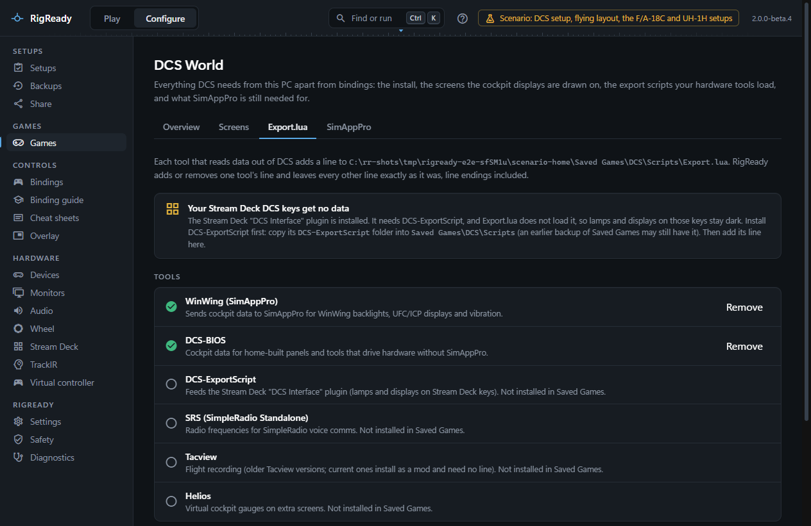
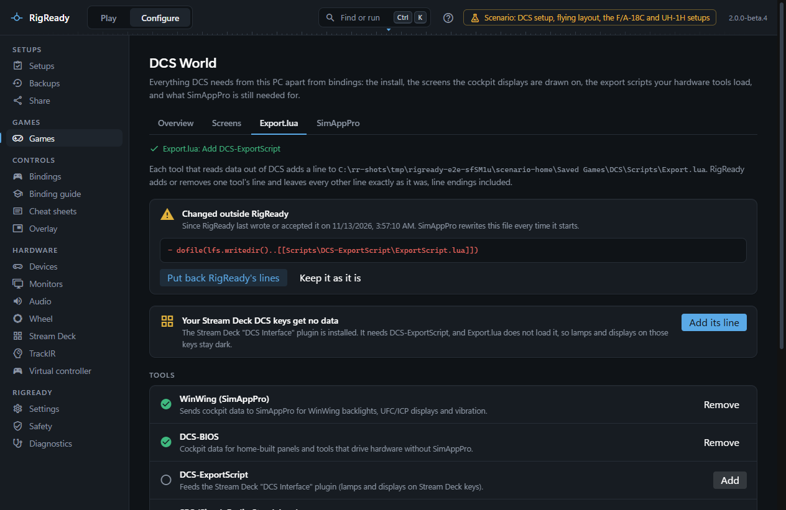

Every tool that reads data out of DCS while you fly adds one line to `Saved Games\DCS\Scripts\Export.lua`, which loads the tool's own script. The **Export.lua** tab of **Configure > DCS World** shows the file line by line, says which tool each line belongs to, and adds or removes one tool's line without touching anything else.

## The tools

| Tool | What it is for | The script it needs under Saved Games\DCS |
|---|---|---|
| **WinWing (SimAppPro)** | Sends cockpit data to SimAppPro for WinWing backlights, UFC and ICP displays and vibration | `Scripts\wwt\wwtExport.lua` (installed by SimAppPro) |
| **DCS-BIOS** | Cockpit data for home-built panels and tools that drive hardware without SimAppPro | `Scripts\DCS-BIOS\BIOS.lua` |
| **DCS-ExportScript** | Feeds the Stream Deck "DCS Interface" plugin, so lamps and displays work on Stream Deck keys | `Scripts\DCS-ExportScript\ExportScript.lua` |
| **SRS (SimpleRadio Standalone)** | Radio frequencies for SimpleRadio voice comms | `Mods\Services\DCS-SRS\Scripts\DCS-SimpleRadioStandalone.lua` (or the older `Scripts\DCS-SimpleRadioStandalone.lua`) |
| **Tacview** | Flight recording with older Tacview versions; current ones install as a mod and need no line | `Scripts\TacviewGameExport.lua` |
| **Helios** | Virtual cockpit gauges on extra screens | `Scripts\Helios\HeliosExport16.lua` |

RigReady recognises a tool's line by the script it loads, whichever way the line is written. A line that loads something no tool owns is tagged **Unknown** and left alone.

## Adding and removing

Under **Tools**, each tool shows whether it is loaded, commented out, or loaded more than once.

- **Add** appends the tool's own line, as its installer writes it, at the end of the file. The button is only there when the tool's script is installed under Saved Games, because a line that loads a missing script stops every tool listed after it. Adding creates Export.lua when it does not exist.
- **Remove** deletes every line of that tool, active or commented out, and a `local x=require('lfs')` helper line that nothing else uses.
- **Remove duplicates** keeps the first active line of a tool and deletes the others.

Every change is shown first as the file before and after, line by line. Only then does **Change Export.lua** write it, with a backup; the line endings of every other line stay what they were, and a line that starts with `--` is never touched. The list under **The file** shows each line with its tool and its ending (CRLF or LF).

When the Stream Deck "DCS Interface" plugin is installed and Export.lua does not load DCS-ExportScript, the tab says so at the top and offers **Add its line**; when DCS-ExportScript itself is not installed, it says to copy its folder into `Saved Games\DCS\Scripts` first.

## When another program rewrites the file

RigReady remembers Export.lua as it last wrote it, or as you last accepted it. SimAppPro rewrites the file every time it starts, and installers of other tools edit it too. When the file differs from what RigReady remembers, the tab shows **Changed outside RigReady** with the lines that went away and the lines that came. A line that only moved does not count: SimAppPro puts its own line at the top on every start, and RigReady compares the lines as a set.

- **Put back RigReady's lines** adds the lines of the tools that were loaded when RigReady last saw the file and are missing now, after a preview. Lines other tools added stay.
- **Keep it as it is** accepts the file as the new version to remember.

## In a setup

Capturing a setup offers the check **Export.lua loads the tools this setup needs**, with the tools that are loaded at that moment. Before you fly, the check says which of them is missing, and its fix, **Put back the missing Export.lua lines**, adds them. A tool whose script is not installed under Saved Games cannot be added by the fix; the check names it. The same change also shows through the **DCS files RigReady manages are unchanged** check, described on [SimAppPro](simapppro.md). See [checks](../setups/checks.md).

## While DCS runs

DCS reads Export.lua when a mission starts. The buttons are disabled while DCS runs, and a fix reports that DCS must be closed first.
