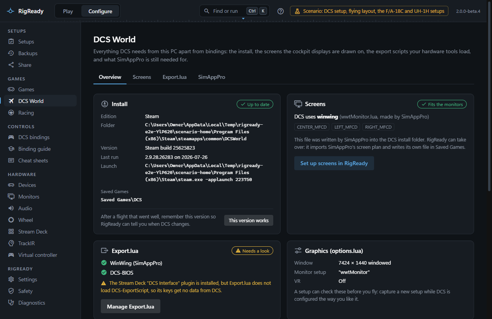

For DCS World RigReady goes further than for any other game: it finds the installs, reads DCS's own files, shows what they say in plain language, and writes them for you when you ask it to. This section covers everything RigReady does with DCS: installs and aircraft, the MFD screens, Export.lua, the bindings and their problems, kneeboard pages, the binding guide, and what still needs SimAppPro. The cheat sheets and the trainer work for the racing games too, so they have their place in [Controls](../controls/index.md).

## The DCS World page

**Configure > Games > DCS World** has four tabs. It opens from its card on the Games page, which is there when DCS is found on this PC, and from **Set up DCS World** on the DCS World game page.

- **Overview**: the installs with their version and whether an update is waiting, the Saved Games folders, the aircraft, and the state of the screens, Export.lua, the graphics options and SimAppPro at a glance. A warning at the top says when a file RigReady manages was changed by something else, and a note says when DCS is running.
- **Screens**: the monitor setup, described on [MFD screens and the monitor setup](screens.md).
- **Export.lua**: the export scripts, described on [Export.lua](export-lua.md).
- **SimAppPro**: what RigReady does in SimAppPro's place and which setups still need it running, described on [SimAppPro](simapppro.md).

The bindings have their own page, **Configure > Bindings** with **DCS** chosen in its game picker, and the binding guide is under **Configure > Binding guide**, which the menu has when DCS is found. The [cheat sheets](../controls/cheat-sheets.md) under **Configure > Cheat sheets** serve DCS aircraft and racing cars alike. All of them find DCS the same way, through the installs described on [Installs and aircraft](installs.md).

Binding guides are included for the F/A-18C, F-16C, A-10C II, A-10C, A-10A, F-14 (pilot and RIO), F-15E (pilot and WSO), F-15C, MiG-29, Su-27, J-11A, Su-33, Su-25T, Su-25, Ka-50 III, Ka-50, UH-1H, P-51D, TF-51D, F-86F and Christen Eagle II. Any other aircraft can have one drafted by AI with your own key; see [Binding guide and AI help](binding-guide-and-ai.md).

## Close DCS before writing

RigReady refuses to write DCS's files while DCS is running. DCS reads options.lua and the monitor setup when it starts and Export.lua when a mission starts, rewrites options.lua when it exits, and keeps the bindings in memory and writes them back when you press OK in its controls screen. A change made while it runs would be lost or half read.

While DCS runs you can still look at everything. The buttons that write are disabled, the bindings page says that nothing can be saved, and a fix that would write a DCS file reports that DCS must be closed first. RigReady looks for DCS.exe among the running processes. The message each page shows, and what to do, are on [RigReady will not write DCS files](../troubleshooting/dcs-files-refused.md).

[Kneeboard pages](kneeboard.md) are the exception: writing them is not blocked, because DCS reads that folder when a mission starts, so new pages simply appear in the next mission.

## Where DCS keeps things

DCS writes everything of yours into a folder under Saved Games: `Saved Games\DCS` for the Steam edition and for a standalone install without a variant, or `Saved Games\DCS.<variant>` when a standalone install has a `dcs_variant.txt` file. RigReady calls this the user folder; in a setup it is the path variable `{DCS_USER}` (see [path variables](../setups/path-variables.md)). The install folder, `{DCS_INSTALL}`, is only ever read.

| What | Where under Saved Games\DCS | What RigReady does with it |
|---|---|---|
| Graphics and other options | `Config\options.lua` | Reads the window size, full screen, VR and the monitor setup; changes single keys and nothing else when you write a screen setup or a setup fixes the options |
| Bindings | `Config\Input\<aircraft>\joystick\<Device name> {ID}.diff.lua`, plus `modifiers.lua`, `disabled.lua` and `wizard.lua` | Reads them together with DCS's defaults to show what is bound; writes edits, cleanups, copies and restores; renames them when a device ID changed |
| Monitor setup | `Config\MonitorSetup\RigReady.lua` | Writes its own file and selects it in options.lua; never edits a file it did not write |
| Export scripts | `Scripts\Export.lua` | Adds or removes one tool's line and leaves every other line as it was |
| Kneeboard pages | `Kneeboard\<aircraft>\RigReady - 01 - ....png` | Writes cheat sheet pages; replaces or removes only pages it wrote itself |
| The log | `Logs\dcs.log` | Reads the version and date of the last run; never writes it |
| Aircraft and their default bindings | `<install>\Mods\aircraft\...` | Reads the aircraft list and the default input files; the install folder is never written |

The aircraft folder names are DCS's input profile keys, for example `FA-18C_hornet` and `UH-1H`, not the display names.

## Every change is backed up

Nothing outside RigReady's own folder is written without a copy being kept first and the change being described. Every DCS file RigReady writes is listed under **Configure > Safety** ([The Safety page](../protect/safety-page.md)) with Undo, and before a write you see what will change, as a plain-language list and as the exact text. See [Backups](../protect/backups.md) for the whole-rig backup that includes the DCS files.

## Seen in DCS

Two things were checked inside DCS itself on the rig RigReady was built on:

- A binding written by RigReady was used in the cockpit. See [DCS bindings](bindings.md).
- With SimAppPro closed, DCS drew the MFD displays from RigReady's monitor setup, each on its own screen. See [MFD screens and the monitor setup](screens.md).

Both pages say what to look at the first time on your own rig.
