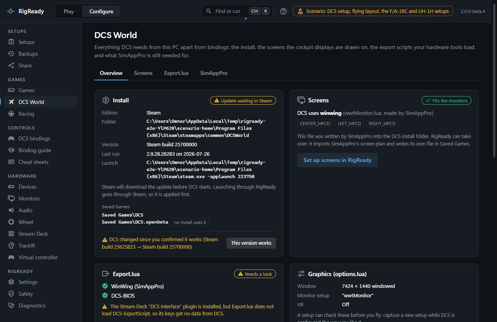
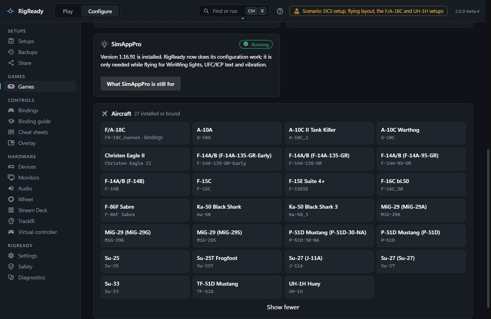

RigReady finds DCS World on its own. This page says where it looks, what the **Overview** tab of **Configure > DCS World** shows about the install, and how the aircraft list is made.

## Steam edition

RigReady reads the list of Steam libraries from Steam's own files and looks in every one of them. Steam's app manifest for DCS World (app 223750) names the install folder; when the manifest cannot be read, `steamapps\common\DCSWorld` in each library is tried. A folder counts only when `bin\DCS.exe` is in it.

A Steam install is launched through Steam (`steam.exe -applaunch 223750`), so that Steam authorises the game and applies a queued update first. Only when steam.exe cannot be found is `bin\DCS.exe` started directly.

The version shown is the Steam build number. When Steam's manifest says a newer build is waiting, the Overview shows **Update waiting in Steam** instead of **Up to date**, with a note that Steam downloads the update before DCS starts.

## Standalone edition

A standalone install is found through the registry keys the Eagle Dynamics installer writes (`Software\Eagle Dynamics\DCS World` and `DCS World OpenBeta`, for the current user and for the machine). A key whose folder no longer holds `bin\DCS.exe` is ignored. The version and branch come from `autoupdate.cfg` in the install folder.

If a standalone install is somewhere RigReady does not find on its own, for example on another drive after the registry entry was lost, open **Configure > Games > DCS World** and use **Choose folder…** to point at the DCS World folder, the one that contains the `bin` folder. RigReady treats it as a standalone install from then on; the same page lets you forget the choice.

## Several installs

Every install found is listed: Steam installs first, then standalone ones, then a folder you chose. The Overview shows the first in full and the others under **Also installed**. The Configure pages work on the first install. A setup, however, remembers which install it was made for, and every check and fix of that setup uses that install's folders; when that install is gone, the check says **DCS install not found** rather than quietly using another one.

## Saved Games folders

Each install writes to its own folder under Saved Games: `DCS` for the Steam edition and for a standalone install without a variant, `DCS.<variant>` when the install folder has a `dcs_variant.txt` file. The Overview lists every `Saved Games\DCS*` folder that exists. A folder no install uses, left over from an earlier install, is marked **no install uses it**; its bindings can still be read, which helps after a reinstall.

## Last run and the version that works

**Last run** comes from the first lines of `Logs\dcs.log`: the DCS version and the date DCS was last started. After a flight that went well, **This version works** remembers the installed version. When DCS later changes, the Overview says **DCS changed since you confirmed it works**, with the old and the new version, so a problem after an update is easier to place.

## The aircraft list

The **Aircraft** card lists every aircraft module found under `Mods\aircraft` in the install, read from each module's `entry.lua`, plus every aircraft that only has a binding folder under `Saved Games\DCS\Config\Input` (marked **not installed**). An aircraft with a binding folder is marked **bindings**; those come first. Twelve are shown; **Show all** lists the rest.

The identifier under each name, such as `FA-18C_hornet`, is the folder name DCS uses for its bindings, its kneeboard pages and the per-aircraft sections of a monitor setup.

## In a setup

When you create a setup from the rig (see [Your first setup](../getting-started/first-setup.md)), RigReady offers a **DCS World installed** check for the install, together with the checks for Export.lua, the graphics options and the monitor setup described on the other pages of this section. A setup for DCS can also use the path variables `{DCS_INSTALL}` and `{DCS_USER}` in its tracked files and launch targets; see [path variables](../setups/path-variables.md) and [checks](../setups/checks.md).

When DCS is not found at all, every DCS page says so and names where it looked: every Steam library, the standalone install folders and Saved Games\DCS.
