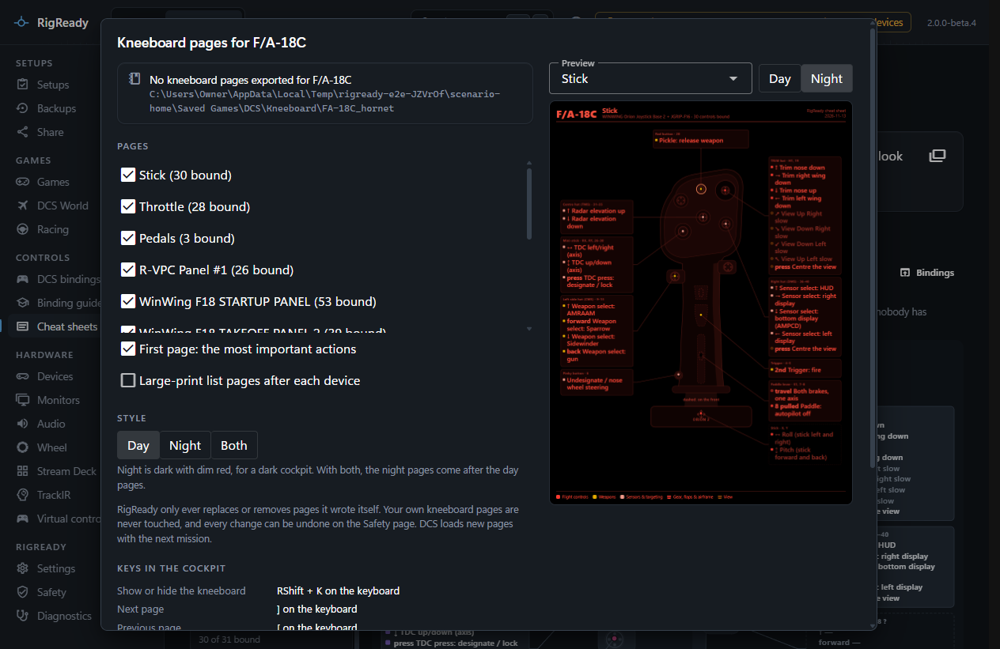
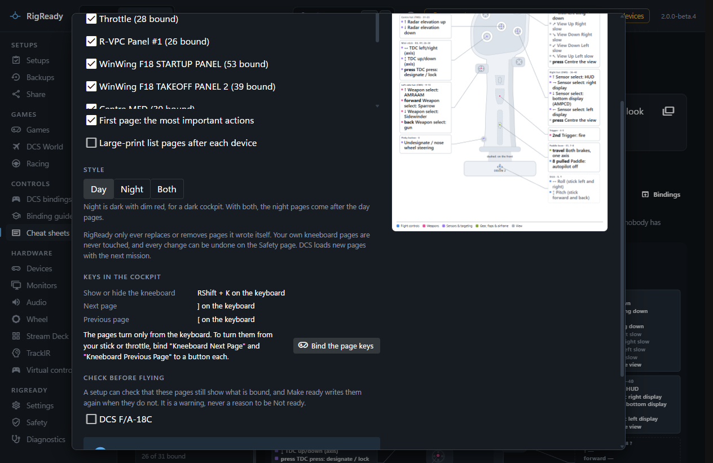
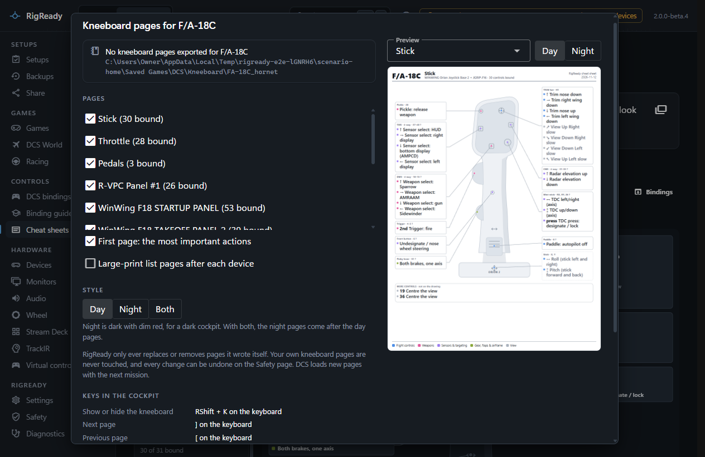
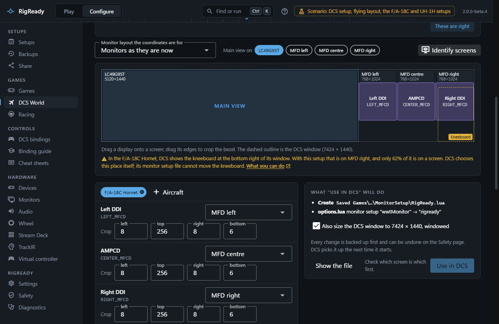
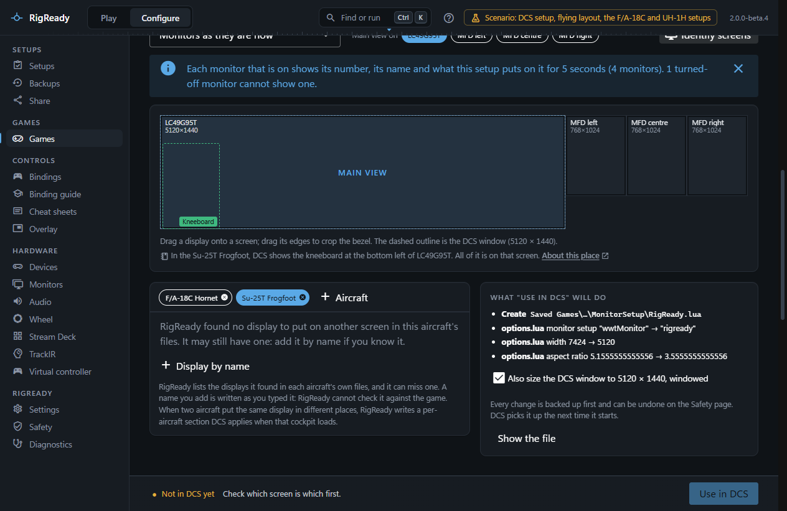
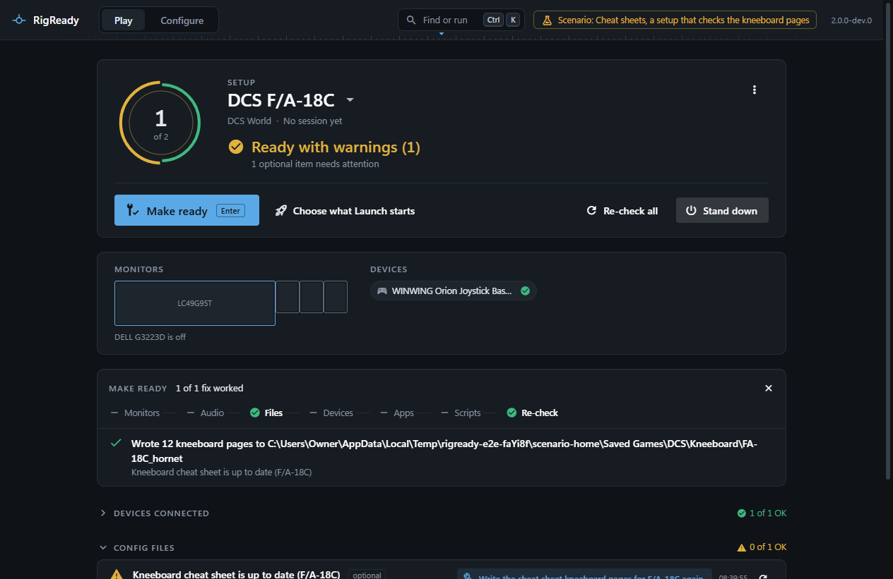

The **Kneeboard** button on [Cheat sheets](cheat-sheets.md) writes the sheet of a DCS aircraft as kneeboard pages, so what each control does is there in the cockpit. This is a DCS feature; the button is only shown for DCS aircraft.

## The dialog

The dialog shows the state of the pages for this aircraft, where they go, and the options:

- **Pages**: tick the devices to export; those with something bound are ticked to begin with. **First page: the most important actions** adds a summary page of your own bindings, hands-on controls first. **Large-print list pages after each device** adds pages that list the device's actions in type large enough for the cockpit.
- **Style**: **Day**, **Night** (dark with dim red, for a dark cockpit) or **Both**; with both, the night pages come after the day pages.
- The preview on the right shows any page exactly as it will be written, in either style. A device page shows only what does something, with the text as large as the page allows: a drawn device grows to fill the page, and its labels are made as large as they can be while they still sit beside the drawing, so the leader lines stay short.
- **Keys in the cockpit**: where the three keys the kneeboard needs are bound for this aircraft; see below.
- **Check before flying**: the setups the up-to-date check can go into; see below.

**Export to kneeboard** (or **Write the pages again** once pages exist) first shows what will be written and removed in the Kneeboard folder, then writes. **Remove RigReady's pages** takes them out again, also with a preview.

While DCS is running (`DCS.exe` or `DCS_mt.exe`), neither is done: the dialog says "DCS is running. Close DCS first: it reads the Kneeboard folder when a mission starts, and RigReady changes no DCS file while it runs", the confirmation's button stays off, and the up-to-date check's fix reports the same. This is the one rule every DCS write follows; see [RigReady will not write DCS files](../troubleshooting/dcs-files-refused.md).

## The files

Pages go into `Saved Games\DCS\Kneeboard\<aircraft type>\`, for example `Kneeboard\FA-18C_hornet`, whichever spelling of the Kneeboard folder DCS made. DCS shows every image in that folder in name order and stretches it onto the kneeboard, so each page is a portrait 768 × 1024 PNG named `RigReady - 01 - <title>.png`, with `(night)` and `(day)` in the name when the style calls for it, and the lower-case `.png` DCS insists on. DCS reads the folder when a mission starts, so new pages appear in the next mission.

A list never drops a row to fit. When the key actions or a device's list need more than one page, the list goes on to the next page: the header says which rows are on it ("Actions 1 to 12 of 20"), a group that carries over is marked "continued", and a short bar under the last row of each page shows that the page was written whole. The extra pages take the same number with a letter, so DCS shows them straight after:

| File | Page |
| --- | --- |
| `RigReady - 01 - Key actions.png` | The most important actions |
| `RigReady - 01b - Key actions 2.png` | The same list, second page |
| `RigReady - 02 - Stick.png` | The first device, as a picture |
| `RigReady - 02b - Stick list.png` | Its large-print list |
| `RigReady - 02c - Stick list 2.png` | The list, second page |

RigReady looks at every list page after rendering it. If a list still does not end on its page, nothing is written and the dialog names the page. Pages written before RigReady did this are reported as stale ("made by an older RigReady and can have a list cut off"); write them again.

**Page numbers stay put.** A device keeps the number it had in the last export, even when a change of bindings moves it up or down the cheat sheet, so "the pedals are on page 4" stays true. A device you export for the first time gets the number after the ones that already have a page. The numbers have no gaps: leaving out a device, or the first page, moves the pages after it up by one.

When a setup names a DCS install, a fix run for that setup writes into that install's Saved Games folder.

## Keys in the cockpit

Pages are of use only if you can open the kneeboard and turn its pages from where your hands are. DCS gives every aircraft these keys on the keyboard and none on a stick or throttle:

| Key | DCS's name for the action |
| --- | --- |
| `RShift + K` | Kneeboard ON/OFF |
| `]` | Kneeboard Next Page |
| `[` | Kneeboard Previous Page |

The dialog shows where each of the three is bound for this aircraft now, controllers first. When the two page keys are on no controller it says so, because binding only "show or hide" to a button leaves you with the first page and no way to turn it without the keyboard. **Bind the page keys** opens [DCS bindings](bindings.md) on this aircraft with the kneeboard's actions found; bind each to a button there. When both are on a controller the dialog has nothing more to say. The bind dialog of DCS bindings says the same when you bind **Kneeboard ON/OFF** there, and offers to bind the page actions next; see [Show or hide the kneeboard](bindings.md#show-or-hide-the-kneeboard).

## Where DCS shows the kneeboard

DCS decides where the kneeboard is drawn, and it does not ask the monitor setup file. From DCS's own scripts: the kneeboard goes in a bottom corner of the whole DCS window, half the window's height wide and about three quarters of it tall. Which corner is the aircraft's choice, made in the aircraft's own scripts:

- **Bottom right:** A-10C and A-10C II, F-14A and F-14B, F-15C, F-15E, F-16C, F-86F, F/A-18C, Ka-50 (2 and 3), P-51D and TF-51D, Su-25, UH-1H.
- **Bottom left, 32 pixels in from the edge:** A-10A, MiG-29A, MiG-29G and MiG-29S, Su-25T, Su-27 and J-11A, Su-33, Christen Eagle II.
- **Any other aircraft: RigReady does not know.** These lists are the aircraft whose scripts were read, in one DCS install. Another module may use either corner, or bring a kneeboard of its own.

With one screen that is a readable panel in a lower corner. With MFD screens to the right of the main screen, the DCS window spans all of them, and its bottom right corner is on the last small screen, or below it when that screen is shorter than the main one. On a 5120 × 1440 screen with three 768 × 1024 screens to its right, the kneeboard of the F/A-18C is 720 × 1085 and only its top 62% is on a screen.

The **Screens** tab of **Configure > DCS World** draws this place on its map as a dashed box marked **Kneeboard**, for the aircraft whose displays the tab is showing, and says under the map which screen it is on and how much of it shows. The line names the aircraft. For an aircraft in neither list above the map draws no box, and the line says that RigReady does not know where this aircraft shows the kneeboard: a place nobody has read from the game is not drawn. With no aircraft in the setup there is no box either, because the corner depends on the aircraft. See [MFD screens and the monitor setup](screens.md).

For an aircraft that shows it on the left, here the Su-25T with the main view alone:

RigReady has no control that moves the kneeboard, because no setting that stock DCS reads for this is known. A `KNEEBOARD` entry in a monitor setup file is read by nothing in an unchanged DCS, so RigReady writes none. What you can do:

- **Arrange the screens so the corner is on a screen.** The kneeboard follows its corner of the DCS window. On the rig above, with the F/A-18C, small screens that line up with the bottom of the main screen in Windows' display settings, not with its top, would have 94% of the kneeboard on the last of them, over whatever display is drawn there. The Screens tab shows the box for the layout you choose before anything is written.
- **Move it in the game.** DCS's scripts allow the kneeboard to be dragged with the mouse while it is shown. This has not been tried with RigReady, and where DCS keeps the new place, or whether it keeps it at all, is not known.
- **A changed game script.** Players give the kneeboard a place in the monitor setup by editing one of DCS's own scripts. RigReady does not do this: the file is part of the install, every DCS update or repair puts the original back, and whether a changed file passes a multiplayer server's file check has not been established.

None of this section has been checked in the game itself yet: it comes from reading DCS's scripts, and it matches what was seen on one rig.

## Only its own pages

RigReady keeps a record of the pages it wrote, with a fingerprint of each file, and only ever replaces or removes those. A page of yours that happens to have the same name is left alone and RigReady's gets a number added. A page RigReady wrote but you changed since is left alone too, and named. Pages from an earlier export that this one no longer writes, or that were written into another folder when DCS moved, are removed. Every write and removal is backed up and listed under **Configure > Safety** with Undo.

## The up-to-date check

The pages show the bindings as they were when written. The check **Cheat sheet kneeboard pages are up to date** says whether they still do: it passes when nothing changed, says the pages are stale when a binding, a note, a layout or an export option changed since, and says they are missing when some of the files are gone from the folder. Its fix, **Write the kneeboard pages again**, writes them again with the options of the last export. The check is a warning, never a reason for a setup to be Not ready.

Add it to a setup from the dialog's **Check before flying** list, or let capturing a setup offer it for every aircraft that has exported pages. With it in place, **Make ready** rewrites the pages whenever a binding changed; see [Make ready and launch](../play/make-ready-and-launch.md) and [checks](../setups/checks.md).

