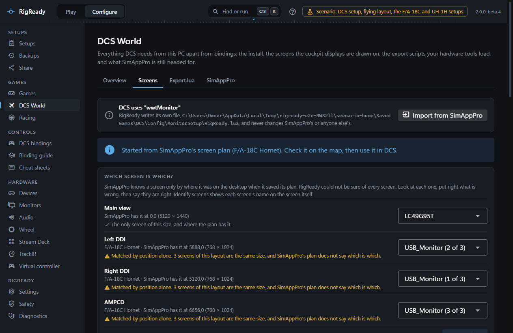
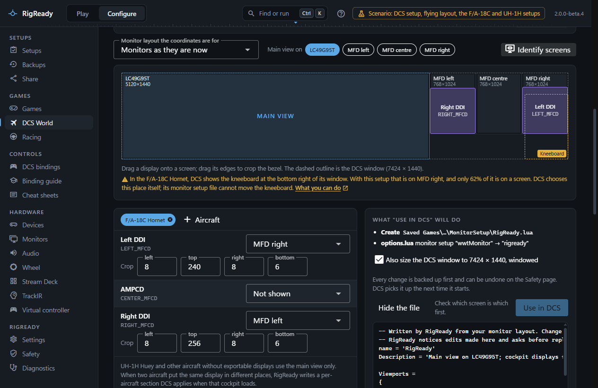
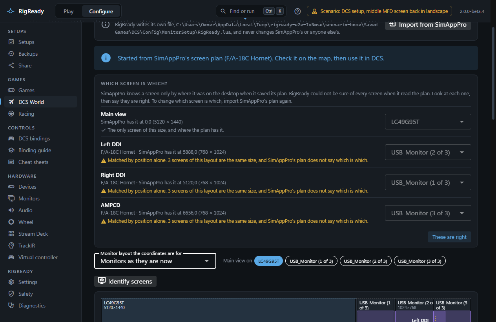
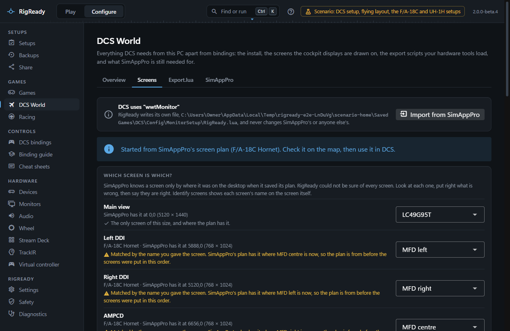
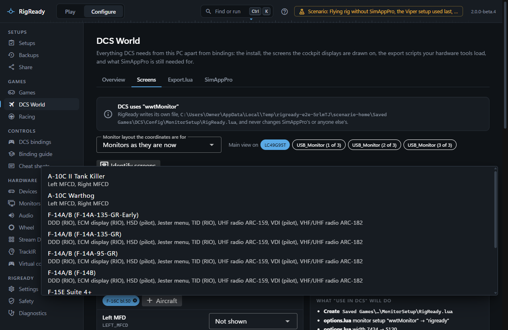
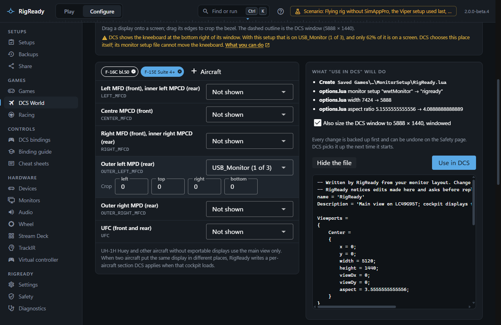
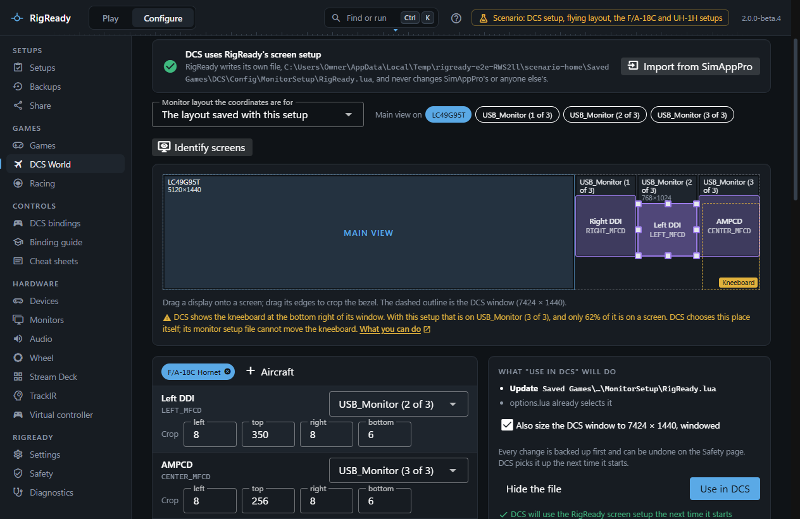

DCS can draw the cockpit displays of some aircraft, the DDIs and the AMPCD of the F/A-18C for example, on separate screens. Which screen each display lands on is set in a monitor setup file. The **Screens** tab of **Configure > DCS World** makes that file from your monitor layout, so you need neither SimAppPro nor a text editor for it.

## How DCS does it

A monitor setup is a Lua file in `Config\MonitorSetup`, either in the DCS install folder or under `Saved Games\DCS`. It names a rectangle for the main 3D view and one for each exported display, in pixels counted from the top left corner of the DCS window. DCS opens its window at the top left of the main Windows display with the size from options.lua, and the `graphics.multiMonitorSetup` key in options.lua says which file to use.

RigReady writes its own file, `Saved Games\DCS\Config\MonitorSetup\RigReady.lua`, and sets options.lua to use it. It never edits a monitor setup file it did not write, so a file made by SimAppPro or by hand stays as it is.

## Starting from SimAppPro's plan

When SimAppPro has an MFD plan on this PC, RigReady reads it, and only it (SimAppPro's settings file, which holds your WinWing account password, is never read), and starts from it: which screens the displays were on and how the bezels were cropped. The first time the tab opens without a saved setup it imports the plan into the first monitor layout that has all of its screens, and says so. **Import from SimAppPro** does the same later, into the layout chosen at the top. Screens the plan uses that are not in the chosen layout are listed, so you can pick the layout you fly with.

### Which screen is which?

SimAppPro knows a screen only by where it was on the desktop when it saved its plan. If the screens have been put in another order since, or three of them are the same size, the plan's positions do not say which of your screens it meant. So after an import the tab shows a list, **Which screen is which?**, with one row per screen of the plan: what the plan shows on it, where the plan has it, the monitor RigReady paired it with, and why.

RigReady pairs them in this order:

1. **By the name you gave the screen.** A screen whose displays are for one side (the Left DDI, `LEFT_MFCD`) goes to the monitor of its size that you named for that side ("MFD left") on the [Monitors](../monitors-and-audio/identify.md) page. Your names say which screen is which today, so they win over the plan's positions. When the two disagree the row says so: "SimAppPro's plan has it where MFD centre is now, so the plan is from before the screens were put in this order."
2. **By position**, when no name helps: the monitor at exactly the plan's place and size.
3. **The one left over**: the last monitor of the right size for the last screen of the plan.

A pairing counts as sure only when the name and the plan's position agree, or when the position fits and no other monitor has that size. For anything else the row carries a warning, and **Use in DCS** stays off ("Check which screen is which first.") until you have looked: change any row with its list, then press **These are right**. Choosing a monitor that another row has makes the two change places. A choice of your own shows as "You chose this screen."

Changing a row changes only the pairing. What you did to the setup since the import stays: a crop you set goes with its display to the newly paired screen when that screen is the same size, and a display you moved to another monitor or set to **Not shown** stays where you put it. If the newly paired screen is another size, the crop cannot mean the same there; it starts again from zero and a line in the list says which display to set again.

The rule is RigReady's own, not only the page's. Nothing that asks RigReady to use an imported setup gets it written while a pairing is unsure and nobody has said it is right, and that includes an [AI assistant](../ai/mcp-server.md) connected to RigReady: it gets the refusal with the screens in doubt named, and has to show them to you first. If you choose another monitor layout after the import, the question is asked again with the rows RigReady was not sure of. In that case the rows cannot be changed in the list; press **Import from SimAppPro** again to change one.

A setup that is already in use in DCS is not asked about again.

**Identify screens** (next to the main view's monitors) puts each monitor's number and name on the monitor itself for five seconds, with what this setup would draw there, so you can check the list against the desk without leaving the tab. Name the small screens once on the Monitors page and the import pairs them without help from then on.

## Building the setup

Every monitor is shown by the name you gave it on the Monitors page, on the map, in the lists and in the layout saved with the setup. A monitor without a name of yours keeps Windows' name.

- **Monitor layout the coordinates are for**: the monitors as they are now, the layout of any setup, any saved layout from [Monitors](../monitors-and-audio/layouts.md), or the layout saved with this screen setup. The coordinates only fit one arrangement, so choose the one you fly with.
- **Main view on**: tick one or more monitors. The 3D view spans them.
- **Aircraft**: one chip per aircraft. **+ Aircraft** lists every aircraft installed in DCS that can draw a display on another screen, with the displays it can export. RigReady reads them from each module's own cockpit scripts (the names a display asks the monitor setup for, such as `LEFT_MFCD`, `EHSI`, `F14_TID` or the Ka-50's `ABRIS` and `Shkval`), so a module you install later appears on its own. The scripts are only read, never run. An aircraft without exportable displays, such as the UH-1H, is not listed and uses the main view only. If a module's scripts cannot be read, RigReady falls back to what it knows of the F/A-18C, F-16C, A-10C and A-10C II, F-15E, F-14 and Ka-50, and adds whatever SimAppPro's plan knows about installed aircraft.
- A new setup starts on the aircraft of the setup you used last, when its name says which one (a setup called "DCS F-16C" starts on the Viper), and otherwise on the first aircraft in the list. A saved setup or SimAppPro's plan starts with the aircraft it already has.
- For each display, choose the monitor or **Not shown**, then set the **Crop** in pixels from the left, top, right and bottom edges to leave out the bezel. On the map you can also drag a display onto a screen and drag its edges.
- Choosing another monitor for a display keeps its crop when the new monitor has the same size as the old one, so moving a display between identical MFD screens costs nothing. On a monitor of another size the crop would not mean the same thing; it starts again from zero and a line under the display says so ("The crop was not kept: …"). A display set to **Not shown** and then put back on a monitor gets its crop back.
- The dashed outline on the map is the DCS window: the box around every monitor the setup uses. Its size is what options.lua must say.
- The dashed box marked **Kneeboard** is where DCS will draw the kneeboard for the aircraft whose displays are shown: a bottom corner of that window, the right one for some aircraft and the left one for others. The line under the map names the aircraft and the screen, and says how much of the kneeboard shows. For an aircraft whose corner RigReady does not know, no box is drawn and the line says so. DCS chooses this place itself and the monitor setup file cannot move it; see [Where DCS shows the kneeboard](kneeboard.md#where-dcs-shows-the-kneeboard).

When two aircraft put the same display in different places, RigReady writes a per-aircraft section that DCS applies when that cockpit loads.

The page refuses to write a setup with a problem (a display placed twice, a monitor that is not in the layout, a crop that leaves almost nothing) and warns about things that work but are worth knowing: a display drawn over the main view, or monitors that do not start at the top left of the main Windows display.

## Writing it

**What "Use in DCS" will do** lists the change before it happens: create, update or keep RigReady.lua, and which options.lua keys change (the monitor setup, and with **Also size the DCS window to W × H, windowed** ticked, the width, height, aspect ratio and full screen off). **Show the file** shows the Lua that will be written. **Use in DCS** writes both files as one change, reads them back, and reports that DCS will use the setup the next time it starts. The button reads **In use** when nothing needs changing.

If RigReady.lua was changed outside RigReady since it last wrote it, writing shows the differences first and asks whether to keep their version or replace it. The file is backed up either way and can be put back from **Configure > Safety** ([The Safety page](../protect/safety-page.md)).

## The files DCS can choose

**Monitor setups DCS can choose** lists every file in both folders with its name, who made it as far as RigReady can tell (RigReady, SimAppPro, DCS or hand-made), the displays it exports, and **in use** on the one options.lua selects. **Show on map** draws a file's rectangles on the current monitors; a rectangle that lies off the monitors is marked.

## Checks in a setup

A DCS setup can carry three checks about this; capturing a setup offers them. See [checks](../setups/checks.md).

- **DCS monitor setup fits the monitors**: every rectangle of the selected file lies on the monitors as they are arranged now, the DCS window in options.lua is large enough, and the monitors the saved screen setup uses are where it was made for them. A USB screen is recognised by its serial number, so moving it to another port is not a change. The fix, **Write the RigReady screen setup**, writes the saved setup again.
- **DCS graphics options**: the width, height, full screen and VR keys as they were when the setup was captured, with the fix **Set the DCS options**.
- **DCS files RigReady manages are unchanged**: see [SimAppPro](simapppro.md).

## What to check in DCS

The displays drawn by DCS from RigReady's monitor setup, with SimAppPro closed, have not yet been verified in the real game: they passed their tests on recorded data from one rig. The [changelog](../../../CHANGELOG.md) lists this under known limitations. The first time, with the MFD screens connected:

1. Close SimAppPro (its tray icon, then Exit) and keep it closed, because its MFD wizard rewrites options.lua.
2. Under **Configure > Monitors**, apply the flying layout and keep it. Use **Identify** ([Identify and which way is up](../monitors-and-audio/identify.md)) to tell identical USB screens apart and to say which way is up on a sideways screen.
3. On the Screens tab, choose that layout, place the displays, and use the setup in DCS.
4. Start DCS and a mission with the aircraft powered. Each display should appear on its own screen, upright and not cut off.

If a display is on the wrong screen, upside down or missing, come back to the tab: swap the monitor in the display's dropdown, adjust the crop, or choose another layout. Nothing in DCS needs to be edited by hand.
