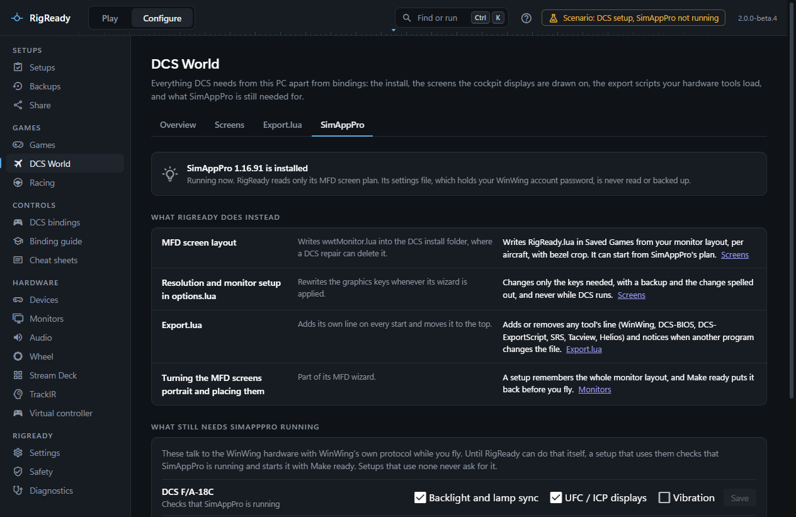
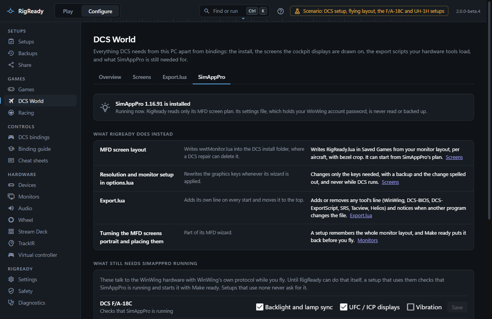

SimAppPro is WinWing's own app. It configures DCS for the WinWing MFD screens and talks to the WinWing hardware while you fly. RigReady's aim is to do the configuration part itself, so a setup does not depend on SimAppPro's wizards, and to say plainly what still needs SimAppPro running. The **SimAppPro** tab of **Configure > Games > DCS World** is where that stands.

## What RigReady knows about SimAppPro

The tab says whether SimAppPro is installed, which version, and whether it is running now. RigReady reads one file of SimAppPro's: its MFD screen plan, to start the screen setup from. SimAppPro's settings file, which holds your WinWing account password, is never read, copied or backed up.

## What RigReady does instead

| SimAppPro | RigReady |
|---|---|
| Writes `wwtMonitor.lua` into the DCS install folder, where a DCS repair can delete it | Writes `RigReady.lua` under Saved Games from your monitor layout, per aircraft, with bezel crops; it can start from SimAppPro's plan. See [MFD screens and the monitor setup](screens.md) |
| Rewrites the graphics keys of options.lua whenever its wizard is applied | Changes only the keys needed, with a backup and the change spelled out, never while DCS runs |
| Adds its own line to Export.lua on every start and moves it to the top | Adds or removes any tool's line and notices when another program changes the file. See [Export.lua](export-lua.md) |
| Turns the MFD screens portrait and places them as part of its wizard | A setup remembers the whole monitor layout, and Make ready puts it back before you fly. See [Monitor layouts](../monitors-and-audio/layouts.md) |
| Backs up WinWing bindings in its own format | The binding files are plain DCS files, covered by [backups](../protect/backups.md) and [snapshots](copy-and-snapshots.md) |

Without SimAppPro installed, all of this works the same. Two things to know on a PC that never had it: the WinWing export script (`Scripts\wwt\wwtExport.lua`) is installed by SimAppPro and RigReady does not ship it, so the WinWing line can only be added to Export.lua when the script is there (a backup of Saved Games may hold it); and the device names DCS puts into binding file names come from registry values SimAppPro writes, so on such a PC a name may differ, which the [Device IDs](device-ids.md) tab treats as a renamed device.

## What still needs SimAppPro running

Three things talk to the WinWing hardware with WinWing's own protocol while you fly, and RigReady cannot do them yet:

- **Backlight and lamp sync**: the panel, throttle and stick backlights and the indicator lamps following the cockpit.
- **UFC / ICP displays**: the text on the UFC and the ICP.
- **Vibration**: the throttle handles shaking with the aircraft.

For each DCS setup, tick the ones it uses and **Save**. A setup with at least one ticked gets a required check, **SimAppPro running**, with the fix **Start SimAppPro**, so [Make ready](../play/make-ready-and-launch.md) starts it and waits for it; a setup with none ticked never asks for SimAppPro. See [checks](../setups/checks.md).

What replacing these would take is written up in [docs/research/winwing-direct-control.md](../../research/winwing-direct-control.md) in RigReady's source. In short: the lighting and the displays are reachable over one documented USB channel for most of the devices, but that channel also carries the commands that update firmware and calibration, one wrong byte can disable a device, three of the devices on the first rig have no public documentation, and nothing can be built before the traffic is captured on a real rig. Until then there is no button or setting for it in RigReady.

## The DCS files RigReady manages

Once RigReady has written a screen setup or an Export.lua line, it watches those files: `RigReady.lua`, the options.lua keys it set, and the Export.lua tools it added. The bottom of the tab shows each as **As RigReady left it**, **Changed outside RigReady** or **Deleted**, with what differs. SimAppPro rewrites Export.lua every time it starts and options.lua when its MFD wizard is applied, which is the usual cause.

**Restore RigReady's version…** shows which files would be written and then puts back what RigReady last set. Lines other tools added to Export.lua stay. The same is on the [Play screen](../play/index.md) as the check **DCS files RigReady manages are unchanged** with the fix **Restore RigReady's version**, and as a warning at the top of the [DCS World overview](index.md).

## Seen in DCS

On the rig RigReady was built on, with SimAppPro closed, DCS drew the MFD displays from RigReady's monitor setup, each on its own screen. [MFD screens and the monitor setup](screens.md#what-to-check-in-dcs) says what to check the first time on your own rig.
