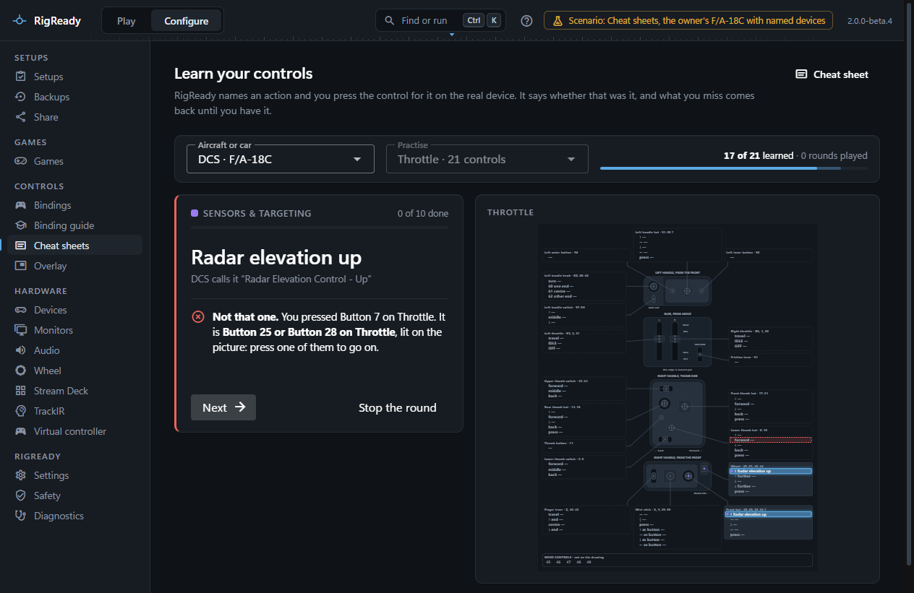
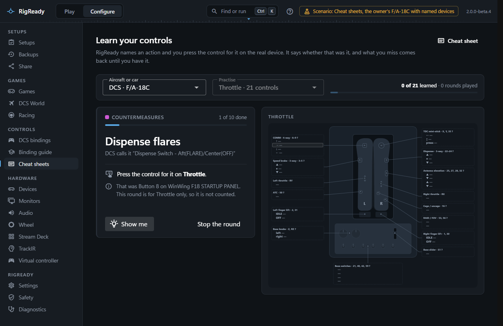
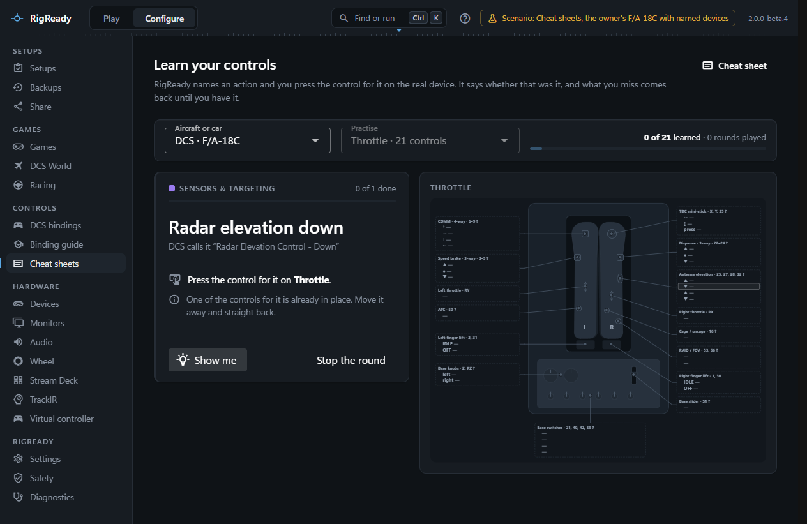

**Learn** on the [Cheat sheets](cheat-sheets.md) page opens **Learn your controls**: RigReady names an action, you press the control for it on the real device, and it says whether that was it, with the control lit on the picture of the device. What you miss comes back until you have it.

## What is asked

A card is one action that a button or a hat direction of a connected controller ([Devices](../hardware/devices.md)) does when pressed on its own. Axes are not pressed, a control that needs a modifier is two things to learn at once, and keyboard keys are not on a controller, so none of those make cards. When you have bindings of your own for the aircraft, only those are asked; what DCS binds by default on every device is not what anyone flies with. Each card shows the plain-language name from the [binding guide](binding-guide-and-ai.md) where there is one, and what DCS calls it.

An action that is bound in more than one place is still one card. Every place is named and lit on the picture, as in "Button 25 or Button 28 on Throttle", and any of them is right. When the places are on two devices, both pictures are shown.

**Practise** narrows a round to one device or takes all of them. A round for one device asks only for the places on that device. A device of the sheet that is not connected is left out and named.

## A round

A round asks ten cards, the ones you know least first: never asked, then missed last time, then right once, then learned, shuffled within each. **Start a round** begins. Keep your hands on the controls.

- **Press the control for it on <device>.** Tap the control or hold it. The right control lights green on the picture: **Right**. Let go of it and the next card comes.
- The wrong control: **Not that one.** RigReady says what you pressed and what that does, lights the right control on the picture, and waits for you to press it. The card comes back three cards later, up to three times in a round.
- **Show me** gives the answer away, which counts as a miss. **Next** moves on by hand; **Stop the round** ends it early.

At the end the page says how many of the cards were right first time and lists the missed ones with where they are. **Practise the missed** starts a round of just those; **Another round** draws afresh. A round stopped before its end does not count as played, but the answers given are kept. A device plugged in or taken out while this is on screen leaves it there; the next round is drawn from the cards as they are then.

## What counts as an answer

A control answers a card when you tap it or hold it for a moment, about a third of a second. While you hold it, a thin line grows across the card until it counts. The next card comes once you have let go of it and the controls are still, so the way back to rest happens before the next card and not on it.

A control that is only passed on the way, like the positions a lever goes through before it stops, is not an answer. Nothing is said of it and it is not a miss.

Some of what a controller reports is not an answer either. RigReady says so under the card, and it is not counted as a miss:

- The control the card asks for, when it was let go too soon to count, as when a lever sweeps through it. Hold it for a moment.
- A control that goes back to where it was earlier in the round, like a lever returning to its stop.
- The control used on the card before, the first time it comes on again.
- In a round for one device, a press on another device.

Where a switch or a lever rests is not a press either. A switch that is on when a card comes up is drawn as held and is not taken for an answer. When a card asks for the position a control is already in, the card says so: move the control away and straight back.

## What is remembered

For each game and aircraft (the [racing games](../games/index.md) have cards too), RigReady keeps in [its own folder](../app/index.md) how often each card was right and wrong, how many times running it was right first time, and how many rounds were played to the end. A card is learned when it was right first time twice running. The bar at the top shows how many of the current cards are learned and how many have been asked at all; it is still there after a restart, and a card whose binding is gone no longer counts.
