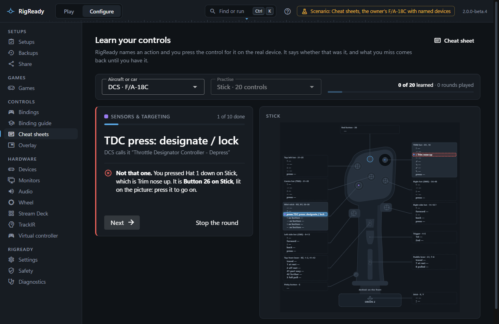
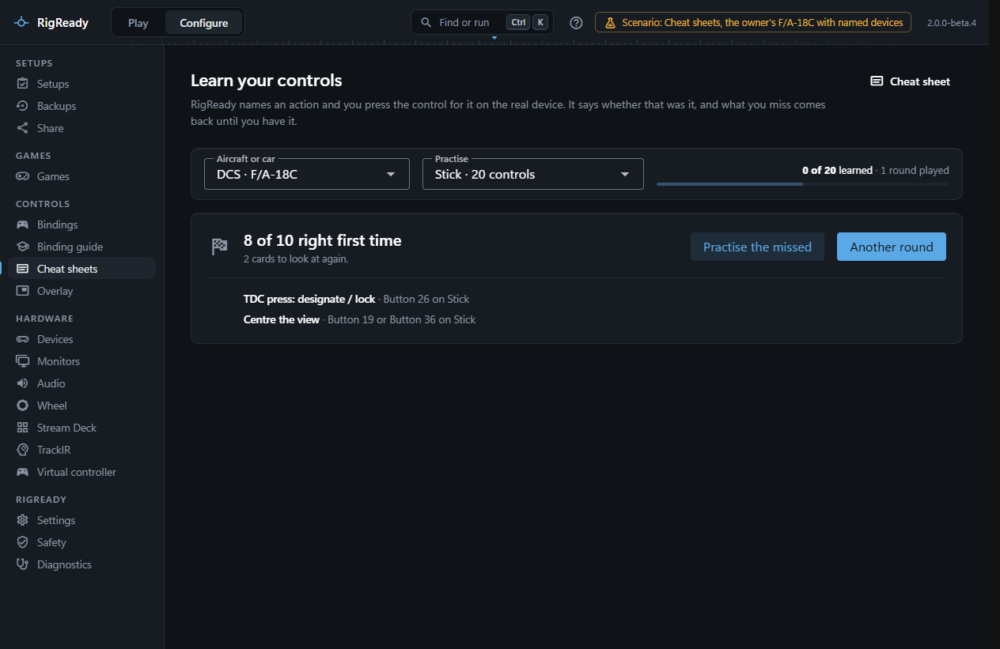

**Learn** on the [Cheat sheets](cheat-sheets.md) page opens **Learn your controls**: RigReady names an action, you press the control for it on the real device, and it says at once whether that was it, with the control lit on the picture of the device. What you miss comes back until you have it.

## What is asked

A card is one action that a button or a hat direction of a connected controller ([Devices](../hardware/devices.md)) does when pressed on its own. Axes are not pressed, a control that needs a modifier is two things to learn at once, and keyboard keys are not on a controller, so none of those make cards. When you have bindings of your own for the aircraft, only those are asked; what DCS binds by default on every device is not what anyone flies with. Each card shows the plain-language name from the [binding guide](binding-guide-and-ai.md) where there is one, and what DCS calls it.

**Practise** narrows a round to one device or takes all of them. A device of the sheet that is not connected is left out and named.

## A round

A round asks ten cards, the ones you know least first: never asked, then missed last time, then right once, then learned, shuffled within each. **Start a round** begins.

- **Press the control for it on <device>.** The right control lights green on the picture: **Right**. Let go of it and the next card comes.
- The wrong control: **Not that one.** RigReady says what you pressed and what that does, lights the right control on the picture, and waits for you to press it. The card comes back three cards later, up to three times in a round.
- **Show me** gives the answer away, which counts as a miss. **Next** moves on by hand; **Stop the round** ends it early.

At the end the page says how many of the cards were right first time and lists the missed ones with where they are. **Practise the missed** starts a round of just those; **Another round** draws afresh. A round stopped before its end does not count as played, but the answers given are kept.

## What is remembered

For each game and aircraft (the [racing games](../games/index.md) have cards too), RigReady keeps in [its own folder](../app/index.md) how often each card was right and wrong, how many times running it was right first time, and how many rounds were played to the end. A card is learned when it was right first time twice running. The bar at the top shows how many of the current cards are learned and how many have been asked at all; it is still there after a restart, and a card whose binding is gone no longer counts.
