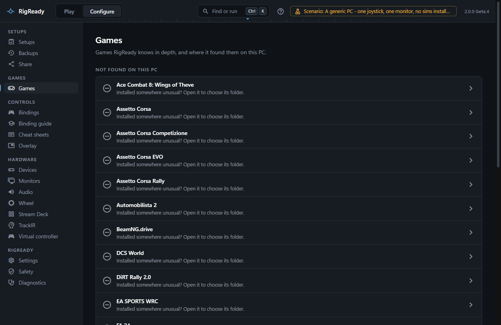

Assetto Corsa EVO and Assetto Corsa Rally are supported as game modules: RigReady finds them, launches them through Steam and names the files worth backing up. Neither has a page of bindings and controllers; their binding files have not been researched (EVO) or are binary (Rally).

## Assetto Corsa EVO

The game is found through Steam (app 3058630), or through **Choose folder…** ([How a game is found](index.md#how-a-game-is-found)) for a folder that contains `AssettoCorsaEVO.exe`. **Launch** asks Steam to start it, and the game counts as running when `AssettoCorsaEVO.exe` is running. The version is the Steam build.

Its settings folder is `Saved Games\ACE`, offered for [backup](../protect/tracked-files.md) as a whole ("Everything in Saved Games\ACE: controls, graphics and saved setups") when it exists. Builds before 0.5.2 kept the same files in `Documents\ACE`; if that folder is still there, it is offered too, after the new one. The files in it (`input_devices.inputdeviceconfiguration` and the others) are binary, so RigReady backs them up but cannot list them. The game page notes that Assetto Corsa EVO is in early access: RigReady detects and launches it and backs up its settings folder, but does not read its bindings yet.

## Assetto Corsa Rally

The game is found through Steam (app 3917090), or through **Choose folder…** for the game folder that contains `acr\Binaries\Win64\acr.exe`. **Launch** asks Steam to start it, and the game counts as running when `acr.exe` or `acr-Win64-Shipping.exe` is running. The version is the Steam build.

It is an Unreal Engine game, and its settings are under `%LOCALAPPDATA%\acr\Saved`:

- `Config\Windows\GameUserSettings.ini` (graphics);
- `SaveGames\EnhancedInputUserSettings.sav` (bindings), a binary Unreal Engine file that RigReady backs up as a whole but cannot list.

## Setups

A setup for either game is a racing setup: by default it keeps the racing gear and helper apps, and the common racing checks apply (the wheel base in PC mode, the helper apps). See [Games](index.md) and [setups](../setups/index.md). Neither game appears on the [Racing overview](index.md#configure-racing), because there is nothing about its bindings to show there.

