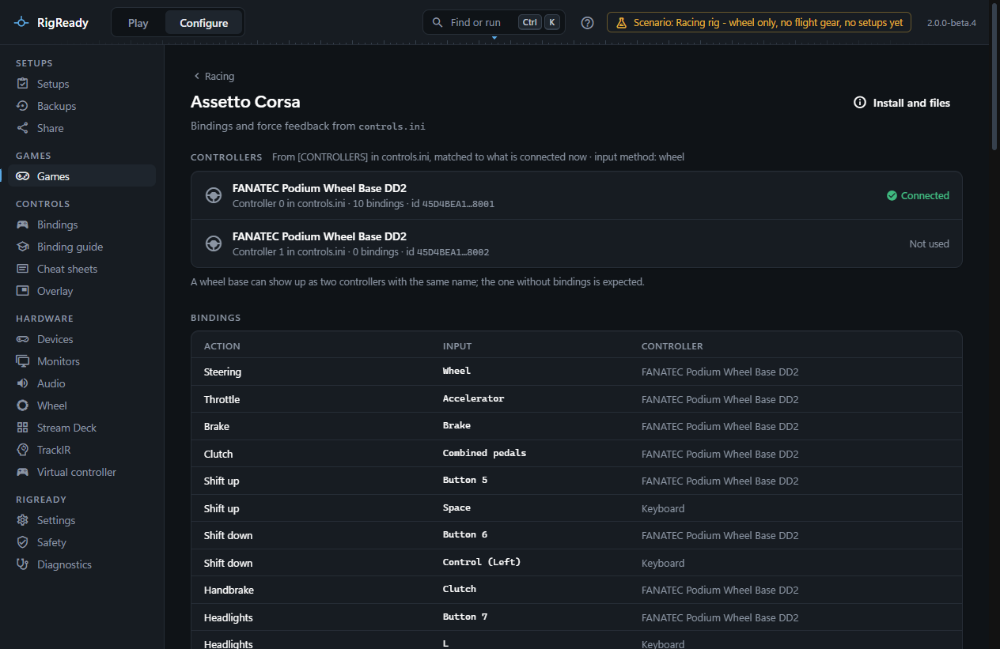
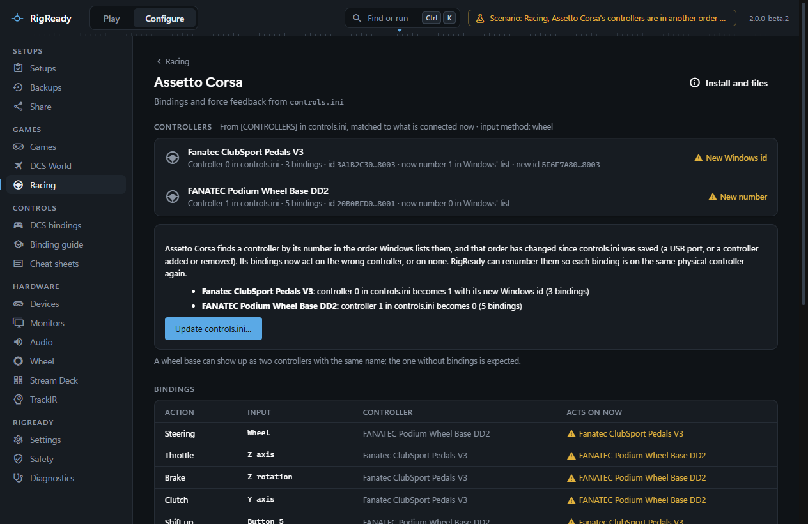

Assetto Corsa keeps its settings as INI files in `Documents\Assetto Corsa\cfg`. RigReady finds the game through Steam, backs up the cfg folder, and reads `controls.ini` to show the controllers the game knows, what is bound to them and the force feedback settings. When Windows lists the controllers in another order than when the file was saved, RigReady can renumber them so every binding is on the right controller again.

## Detection and launch

The game is found through Steam (app 244210) when `AssettoCorsa.exe` is in the folder; otherwise the game page offers **Choose folder…**. **Launch** asks Steam to start it. The game counts as running when `AssettoCorsa.exe`, `acs.exe` (the simulation itself) or `Content Manager.exe` is running. The version is the Steam build.

## Files worth backing up

From `Documents\Assetto Corsa\cfg`, offered on the [Backups page](../protect/tracked-files.md): the whole folder as one item, and separately `controls.ini` (bindings and force feedback), `video.ini`, `gameplay.ini`, `assists.ini`, `audio.ini` and the `controllers\savedsetups` folder with your saved control presets. The Content Manager settings folder under `%LOCALAPPDATA%\AcTools Content Manager` is listed as a settings folder when it exists.

Assetto Corsa and Content Manager write `controls.ini` while they are open, so a [restore](../protect/restore.md) is refused while any of them runs. The [path variables](../setups/path-variables.md) `{AC_USER}` (the `Documents\Assetto Corsa` folder) and `{AC_INSTALL}` are available in a setup.

## The bindings and controllers page

**Configure > Racing > Assetto Corsa** reads `controls.ini`.

**Controllers** lists the `[CONTROLLERS]` section: each controller's number and name as the game stored them, how many bindings use it, a short form of its Windows instance ID (Content Manager stores one; a file saved only by the game has none), and a state matched against the connected controllers:

- **Connected**: attached, at the same number.
- **New number**: attached, but Windows now lists it at another position, so the game will read its bindings from another controller. The row says which number it has now.
- **New Windows id**: no controller has the stored instance ID, but one of the same model is attached.
- **Not connected**: nothing of that model is attached.
- **Cannot tell**: the connected controllers could not be read.

The input method from the file's header is shown beside the heading. A wheel base can show up as two controllers with the same name; the one without bindings is expected.

A controller the bindings use that is not connected gets a notice: connect it, or restore a backup taken while it worked.

**Bindings** lists each action in plain language (Steering, Throttle, Brake, Shift up, Brake balance forward, Look left, and so on, including the sections Content Manager and Custom Shaders Patch add), with its axis or button and the controller, and keyboard bindings where the file has them. While a controller is at a new number, a column **Acts on now** names the controller the game will really use for each binding: the one Windows lists at that number today.

**Force feedback** shows the steering lock in degrees, the force feedback gain and filter, the minimum force, and the kerb, road, slip and ABS effect levels.

## Repair: controllers in another order

Assetto Corsa does not find a controller by its ID. Each binding says `JOY=n`, and the game takes that as the n-th game controller in the order Windows lists them when it starts. That order changes when a controller moves to another USB port, when one is added or removed (a button box plugged in before the wheel), or after Windows is reinstalled. The bindings then act on the wrong controller: the pedals steer, the wheel does nothing. [docs/research/assetto-corsa-controls.md](../../research/assetto-corsa-controls.md) has the details and sources.

When a controller with bindings is at a new number or has a new Windows ID, a panel lists each one ("controller 1 in controls.ini becomes 0") and offers **Update controls.ini…**:

- RigReady matches each listed controller by its instance ID first, then by model. When two identical controllers (two button boxes of the same make) both have new IDs, it does not guess: a list asks which connected controller each one is now, with its number and ID, and the button stays off until you have chosen. Press a button on it in the [Input tester](../hardware/input-tester.md) to tell them apart. One controller cannot be chosen for two.
- A confirmation lists the file that will change. On **Update controls.ini**, every `JOY` number (also `JOY_MODIFICATOR` and Content Manager's second button) is changed to where that controller is now, the `[CONTROLLERS]` list is rewritten at the new numbers with any new Windows ID, and a controller that is not connected gets a number no connected controller has, so its bindings stop acting on another one. Nothing else in the file changes; saved control presets are not touched.
- The file is backed up first and read back afterwards; Undo is on [the Safety page](../protect/safety-page.md). The repair is refused while Assetto Corsa, `acs.exe` or Content Manager runs, because they write `controls.ini`.

Content Manager has a similar option of its own (Settings > Assetto Corsa > Controls, "Check and fix controls order"), off by default; with it on, Content Manager renumbers the file before a race.

This repair has not yet been verified on real hardware: it follows the file format as Content Manager reads and writes it and passed its tests on recorded data, but nobody has yet moved a controller, run the repair and driven. The dialog says so. If a binding is still wrong in the game, undo the change on the Safety page and bind it again in the game or Content Manager. The [changelog](../../../CHANGELOG.md) lists this under known limitations (RACE-AC-001).

**Assetto Corsa Competizione** does not need this repair: its `controls.json` names a device by its product ID (the same for every unit of a model, on any port), not by a number or an instance ID.

## Backups and checks

The **Backups** section keeps quick copies of `controls.ini`, with the preview, Undo and **Use in a setup** described on the [iRacing page](iracing.md). A racing setup for Assetto Corsa gets the common racing checks described under [Games](index.md); there is no [wheel settings](wheel.md#recommended-settings) comparison for this game.
