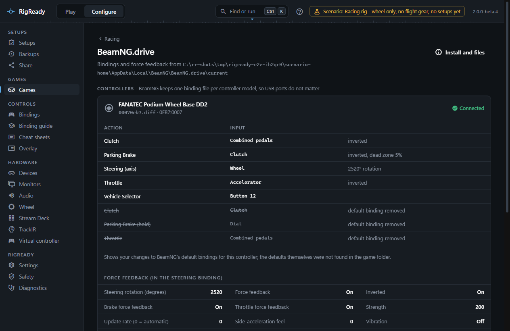
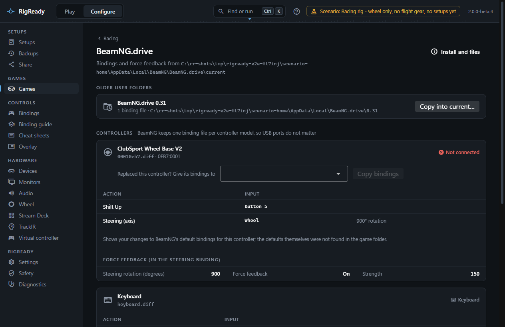

BeamNG.drive keeps one binding file per controller model, named after the controller's vendor and product ID, so moving a wheel to another USB port never breaks its bindings. RigReady finds the game and its user folder, backs up the settings, shows each controller's effective bindings with your changes marked, and copies bindings between user folders and between controllers.

## Detection and launch

The game is found through Steam (app 284160) when its manifest says so and `BeamNG.drive.exe` is in the folder; otherwise the game page offers **Choose folder…**. **Launch** asks Steam to start it. The game counts as running when `BeamNG.drive.exe` is running.

The installed version is read from the game's `integrity.json`, and Steam's "update waiting" is shown when one is queued. The game page compares it with the version that last ran (from `BeamNG.drive.ini`): when a newer version is installed, it says "Last run as 0.38.5; 0.39.4 is installed. The next start updates your user folder, so back it up first."

## The user folder

BeamNG has moved its user folder over the years, and the game page says which one is in use and why:

1. `UserPath` in `startup.ini` next to the game, when set ("set in startup.ini");
2. the old registry override, when set;
3. `%LOCALAPPDATA%\BeamNG\BeamNG.drive\current`, the default since version 0.37;
4. before 0.37, the newest version folder under `%LOCALAPPDATA%\BeamNG.drive\<version>`.

Older version folders that still exist are listed under **Settings folders** as "User folder of 0.32" and so on, with a note that their bindings can be copied into the current one.

The path variables `{BEAMNG_INSTALL}` and `{BEAMNG_USER}` are available in a setup; see [path variables](../setups/path-variables.md).

## Files worth backing up

From the `settings` folder of the current user folder, offered on the [Backups page](../protect/tracked-files.md): the whole folder as one item, and separately `inputmaps` (bindings and force feedback per controller, including per-vehicle maps), `settings.json` (graphics, display and audio), `cloud\settings.json` (gameplay; synced by Steam Cloud, which may overwrite a restore), `game-settings.cs`, `postfxSettings.postfx` and the `ui_apps` layout. The game saves its bindings and settings while it runs and when it exits, so a [restore](../protect/restore.md) is refused while it runs.

## The bindings and controllers page

**Configure > Racing > BeamNG.drive** reads every `.diff` file under `settings\inputmaps`.

**Older user folders** appears when an earlier version's folder still holds binding files. **Copy into current…** shows which files would be created and which replaced, copies them with a backup of each replaced file, and offers Undo on [the Safety page](../protect/safety-page.md).

**Controllers** has one panel per binding file. The title is the name you gave the controller on the [Devices page](../hardware/devices.md), with the game's name for it, "only in <vehicle>" for a per-vehicle map, the file name and the vendor and product ID. The state is **Connected**, **Not connected**, **Compatibility mode** (a Fanatec base is attached in yellow mode, so the game uses the ClubSport V2.5 map instead of this one) or, for the keyboard map, nothing.

The table under it is the effective map: the game's factory bindings for that controller, read from the game folder, merged with your changes. A binding you made or changed is marked "changed by you", a dead zone, inversion or steering rotation is shown as detail, and a default binding you removed is struck through with "default binding removed". Action names come from the game's own labels ("Throttle", "Shift Up"). When the factory map is not in the game folder, the panel shows your changes only and says so.

**Force feedback (in the steering binding)** lists the steering rotation in degrees, whether force feedback is on and inverted, and the force feedback values the game keeps inside the steering binding: Strength, Smoothing, High-speed smoothing, Soft-lock force and the rest, in plain words.

## Copy bindings to a replacement controller

When a map belongs to a controller that is not connected and other controllers are, the panel offers **Replaced this controller? Give its bindings to** with a choice of connected controllers that do not already have a map of their own in that folder. **Copy bindings** shows the bindings that will be copied and the file that will be created (`<new id>.diff` with the same bindings and force feedback), then writes it. RigReady refuses to overwrite a map the new controller already has. Button numbers can differ between controllers, so check the result in the game.

## Backups and checks

The **Backups** section keeps quick copies of every `.diff` under `inputmaps`, with the preview, Undo and **Use in a setup** described on the [iRacing page](iracing.md). A setup's **Racing bindings are the saved set** check ([Checks and fixes](../setups/checks.md)) compares and restores all of them.

A racing setup for BeamNG.drive gets the common racing checks described under [Games](index.md), and optionally **BeamNG.drive wheel settings as recommended**, which checks that force feedback is on in the steering binding and compares the steering rotation with the SEN value of the preset you recorded on the [Wheel page](wheel.md).
