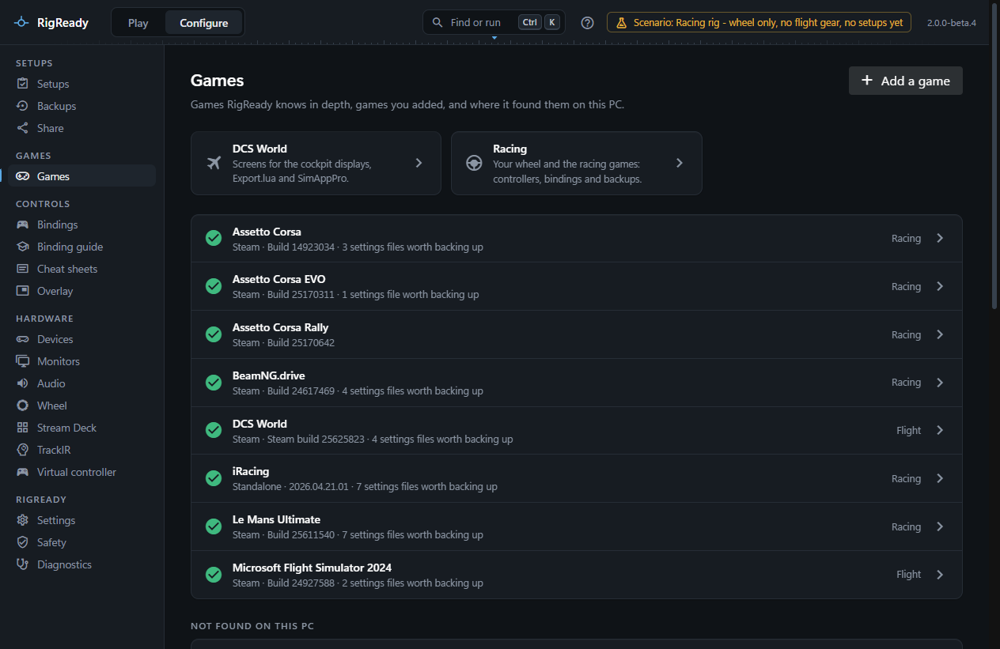
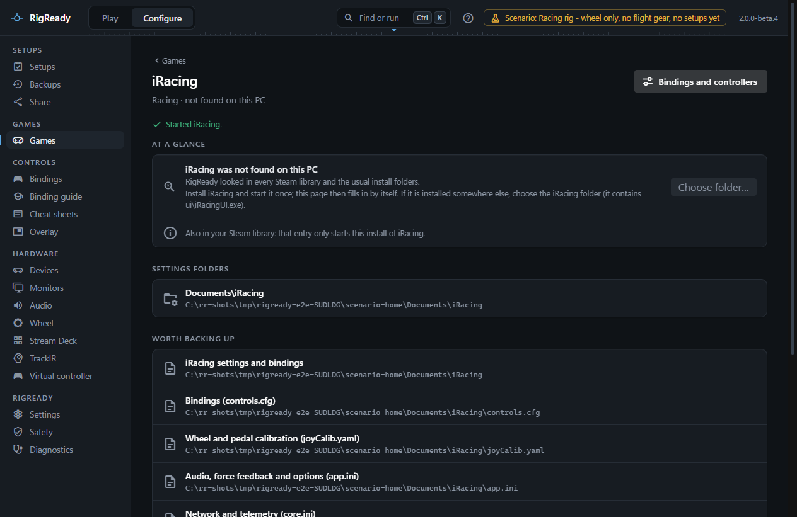

RigReady knows a fixed set of games. For each one it can find the install, read its version, launch it, and name the files worth backing up. For some it goes further: it reads the bindings as the game's files hold them, matches the controllers the game knows to the ones connected now, and repairs or copies binding files. Any other game still works with a setup of its own.

This section covers every game other than DCS World, which has [its own section](../dcs/index.md): this page lists the games and what each gets, describes **Configure > Games** and **Configure > Racing** and the checks a racing setup gets, and the pages that follow cover each game and the Fanatec wheel.

## Support by game

| Game | What RigReady does |
|---|---|
| DCS World | The deepest: installs, the Saved Games folder, screen setup, Export.lua, bindings with editing, cleanup, device ID repair, copying between aircraft and snapshots, cheat sheets, kneeboard pages and binding guides. See [DCS World](../dcs/index.md). |
| [iRacing](iracing.md) | Detection, launch, files to back up, a page with the controllers and bindings from `controls.cfg` and `joyCalib.yaml`, a device ID repair, quick backups, checks for a racing setup. |
| [Le Mans Ultimate](le-mans-ultimate.md) | Detection, launch through Steam, files to back up, a page with controllers, force feedback and bindings from `direct input.json`, a repair for a renamed controller, quick backups, checks. |
| [BeamNG.drive](beamng.md) | Detection, launch through Steam, the versioned user folder, a page with one binding map per controller, copying bindings from an older version or to a replacement controller, quick backups, checks. |
| [Assetto Corsa](assetto-corsa.md) | Detection, launch through Steam, files to back up, a page with the controllers, bindings and force feedback from `controls.ini`, quick backups. |
| [Microsoft Flight Simulator 2024](msfs-2024.md) | Detection of the Steam and Microsoft Store editions, launch of the Steam edition, files to back up. |
| [Assetto Corsa EVO and Assetto Corsa Rally](assetto-corsa-evo-and-rally.md) | Detection, launch through Steam, files to back up. |
| [Microsoft Flight Simulator (2020), X-Plane 12 and 11, IL-2 Sturmovik: Great Battles, Falcon BMS](more-flight-and-racing-games.md#flight) | Detection (Steam, and the Store, standalone or registry install each game has), launch, files to back up. |
| [Assetto Corsa Competizione, rFactor 2, Automobilista 2, EA SPORTS WRC, F1 25 and F1 24, DiRT Rally 2.0, RaceRoom](more-flight-and-racing-games.md#racing) | Detection in Steam (DiRT Rally 2.0 also from the Store), launch through Steam, files to back up. |
| [Any other game](other-games.md) | A setup with a checklist, a launch target you give, and tracked files. |

The four racing games with a bindings page also supply their bindings to the [cheat sheets](../dcs/cheat-sheets.md), the [trainer](../dcs/trainer.md) and the [input tester](../hardware/input-tester.md), so a cheat sheet can show what every button of a wheel does in iRacing or in BeamNG.drive. The wheel is drawn for the Fanatec bases RigReady has layouts for; any other wheel gets a labelled list of its controls.

## How a game is found

RigReady looks in the places a game installs itself and never asks you unless it has to:

- **Steam.** Every Steam library on the PC is read (from Steam's own library list), and a game counts as installed when its manifest says so and, for most games, its program file is there. Steam games are started by asking Steam, with `steam.exe -applaunch`, so anti-cheat and sign-in work. When Steam has an update queued for a game, the page says "Steam has an update waiting" and the Racing overview marks it, because the game may not start until the update is done.
- **Standalone installs.** iRacing is found through its entry in Windows' list of installed programs, or in `Program Files (x86)\iRacing`. DCS World standalone installs are found through their own registry entries ([Installs and aircraft](../dcs/installs.md)).
- **Microsoft Store.** Flight Simulator 2024 and 2020 and DiRT Rally 2.0 from the Store are recognised by their package folders.
- **The game's own records.** Standalone X-Plane installs are found through the install list X-Plane keeps in `%LOCALAPPDATA%`, and Falcon BMS through the registry key its installer writes ([More flight and racing games](more-flight-and-racing-games.md)).
- **Choose folder.** When a game is not found, its page offers **Choose folder…**. You pick the game's folder; RigReady checks that the game's program is in it and refuses a folder without it. The choice is remembered and can be forgotten again with **Forget**.

A game is "running" when one of its known programs is in the process list. For iRacing that is the UI or the simulator; for Assetto Corsa it includes Content Manager.

## Configure > Games

The page lists every game RigReady knows, found games first with where they were found (Steam, Standalone, Microsoft Store), the version, "update waiting" when Steam has one, a **Running** chip, and how many settings files are worth backing up. Games not found are listed under **Not found on this PC**.

Each game's page has the same sections:

- **At a glance**: each install with its folder, the version (or "Version not known"), whether the game is running, what **Launch** starts, and facts about this PC such as "Last run as 0.38.5" or "Also in your Steam library: that entry only starts this install of iRacing."
- **Settings folders**: where the game keeps its per-user files.
- **Worth backing up**: the files and folders RigReady suggests tracking, each with its path. These are what the Backups page offers for the game; see [backups](../protect/backups.md). A game that was found but has not been run yet says "No settings files were found yet; start the game once."
- **Good to know**: plain facts about what RigReady can and cannot do for this game.

**Launch** at the top starts the game from its first install and reports "Started <game>" or "Asked Steam to start <game>". It is disabled while the game runs. For a game with a bindings page, **Bindings and controllers** opens that page.

## Configure > Racing

The Racing page is the overview for the wheel and the racing games:

- **Wheel**: the wheel base of any brand RigReady knows, its mode where the USB ID shows it (Fanatec PC or compatibility mode, the Logitech G29 switch, a Thrustmaster wheel the driver has not switched), how many game controllers Windows makes of it and what it is connected through. It leads to [the Wheel page](wheel.md).
- **Games**: one card per racing game with its version, "update waiting in Steam", a **Running** chip and one line about its bindings: "17 bindings · controllers connected", "1 controller has a new Windows ID", "1 controller not connected", "No bindings yet" or "Default bindings". A card with something to look at is marked. Installed games open their own page.
- **Helper apps**: Fanatec Service, SimHub, Crew Chief and the trophi.ai coach, when they are installed or running, and whether each is running now. To have a setup check or start them, keep them when you create the setup from the rig.

## Checks a racing setup gets

When a setup is created from the rig ([Creating a setup from the rig](../setups/capture.md)) with a racing game chosen, the capture screen proposes, besides the usual devices, apps, monitors and audio:

- **Wheel base in PC mode** (required): the Fanatec base is connected and not in compatibility (yellow) mode.
- Each helper app found, selected when it is running now. Fanatec Service is left running at [Stand down](../play/stand-down.md); the others are closed.
- For iRacing: **iRacing helper service** (the Windows service iRacing needs) and **iRacing knows the wheel** (warns before iRacing asks you to calibrate again).
- For Le Mans Ultimate and BeamNG.drive: **wheel settings as recommended** (optional), which compares the force feedback settings RigReady can read in the game's files with the recommendations on the Wheel page.

A setup can also expect one particular set of bindings, restored by [Make ready](../play/make-ready-and-launch.md): see **Use in a setup** on the game pages. Every check is described under [Checks and fixes](../setups/checks.md), and everything else about setups under [Setups](../setups/index.md).
