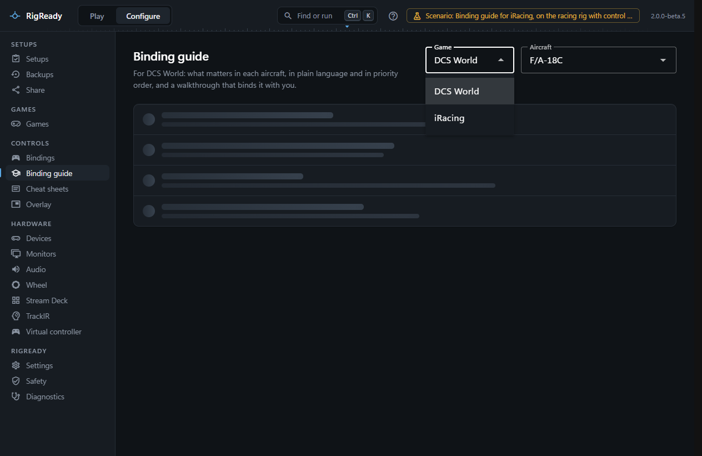
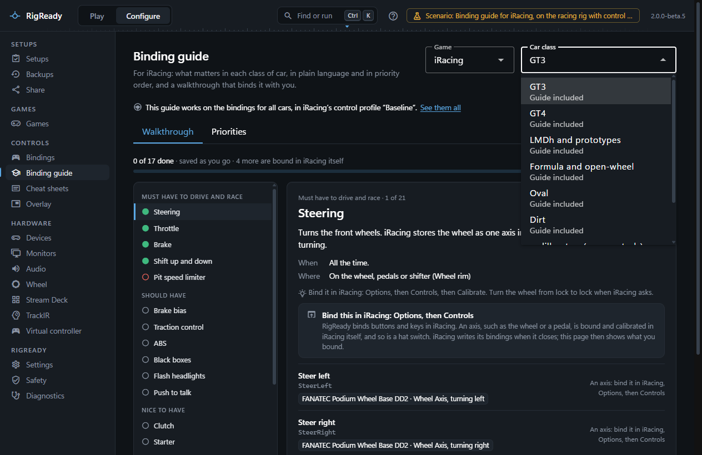
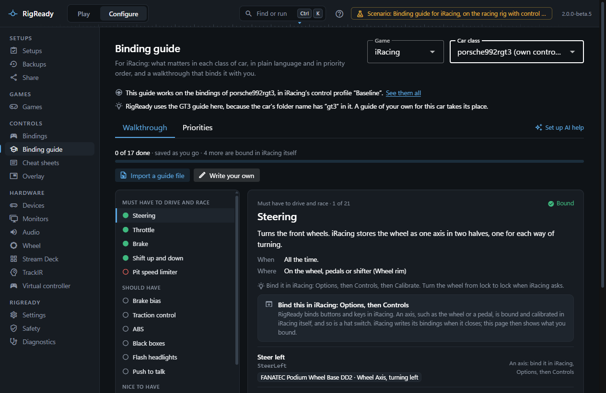
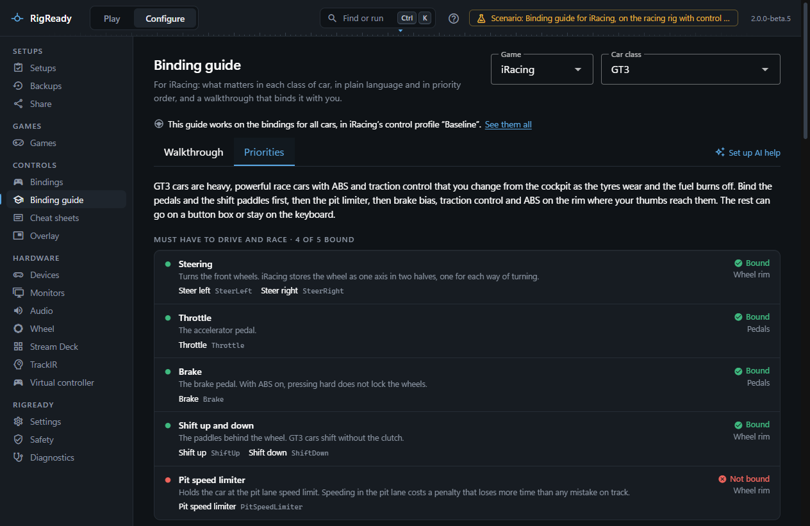
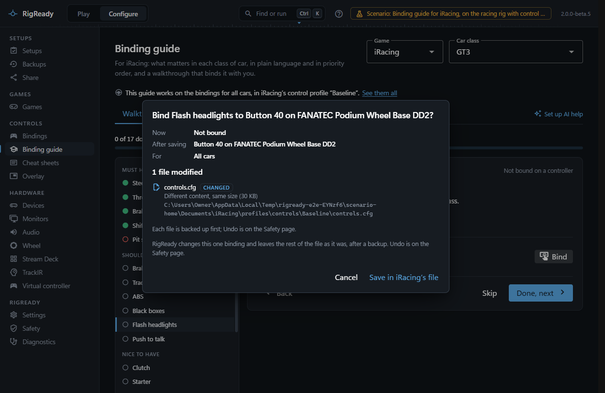
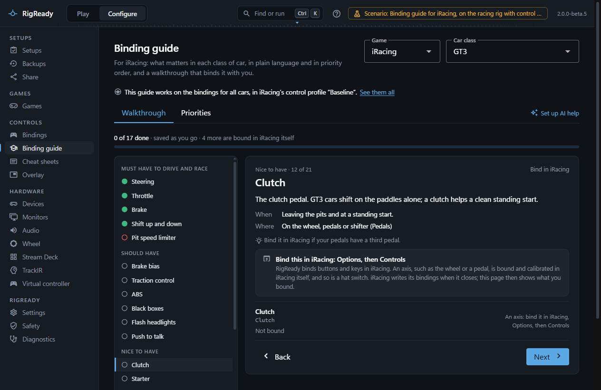
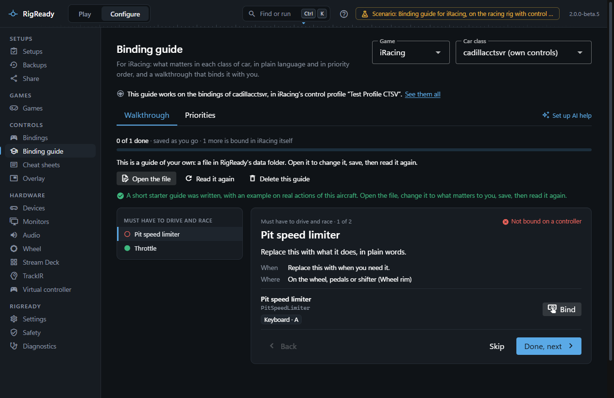

**Configure > Binding guide** explains what matters in a class of car, in plain language and in priority order, and walks you through binding it. For iRacing the guides are by class, not by car: every car in iRacing has the same list of actions, and what matters differs by the kind of racing. The page is in the menu when DCS World or iRacing is found on this PC. Choose **iRacing** in the **Game** picker at the top, then the class. Everything on the Walkthrough and Priorities tabs works without any key.

The guide for DCS aircraft works the same way and is described in [Binding guide and AI help](../dcs/binding-guide-and-ai.md).

## The guides

RigReady ships a guide for each of these classes:

| Class | What it covers |
|---|---|
| GT3 | GT3 cars: the paddles and the pit limiter, then brake bias, traction control and ABS on the rim. |
| GT4 | GT4 cars: as GT3, with fewer settings in the cockpit. |
| LMDh and prototypes | The GTP class, LMP2 and LMP3: brake bias, traction control, the headlight flash for traffic, hybrid and engine settings. |
| Formula and open-wheel | From the junior formulas to IndyCar, Super Formula and the Formula 1 car: DRS and push to pass where the car has them, the hybrid, engine braking and the differential. |
| Oval | Stock cars, trucks and IndyCar on ovals: push to talk for your spotter, the glances left and right, the tear-off, and the adjustments some cars allow in the car (brake bias, the weight jacker, the anti-roll bars, the grille tape). |
| Dirt | Dirt ovals and rallycross: the handbrake for rallycross, the tear-off, the glances left and right. |

Each item has a title, what it does, when you use it, a tier (**Must have to drive and race**, **Should have**, **Nice to have**), where it belongs (**On the wheel, pedals or shifter**, **On a button box**, **Fine on the keyboard**), and the iRacing actions it stands for: each with a plain name and iRacing's own id, as the [iRacing bindings page](iracing-bindings.md) shows it. A car that does not have a control ignores its binding: a guide for a class names everything the class can have.

The guides were written from general knowledge of the cars and of iRacing's controls. They have not been reviewed by a racing driver and are not affiliated with iRacing. What is checked, by a test, is that every action in a guide is in iRacing's own list of actions (the 369 actions of a control profile of November 2026), so an iRacing update that renames an action is caught. **Where this guide comes from** at the bottom of the Priorities tab says the same.

## Which class, and which bindings

**Class or car** lists the six classes, then each car that has controls of its own in iRacing (a control profile of its own in `app.ini`), named by its iRacing folder with "(own controls)".

- **A class** works on the bindings for all cars: the control profile iRacing uses for every car without its own. The line under the title names it, for example "This guide works on the bindings for all cars, in iRacing's control profile “Baseline”." **See them all** opens the iRacing bindings page on the same bindings.
- **A car with controls of its own** works on that car's own bindings. iRacing's folder names are not a list of classes, so RigReady suggests a class only where the folder name itself says so: a name with "gt3", "gt4", "gtp", "lmdh", "lmp1" to "lmp3" or "dirt" in it uses that class's guide, and the page says why ("RigReady uses the GT3 guide here, because the car's folder name has “gt3” in it."). Any other car has no guide until you give it one (below).

## Priorities tab

The whole guide at a glance: the summary, each tier with its items, and for each item its state in words:

- **Bound**: iRacing's file has a binding where it belongs (on a controller; for a keyboard item, anywhere). For the steering and the pedals this is what you bound in iRacing.
- **Not bound on a controller** (**Not bound** for a keyboard item): RigReady can bind it with you in the walkthrough. An item bound only on the keyboard, such as iRacing's default key for the pit limiter, counts here until it is on the wheel or a button box.
- **Bind in iRacing**: not bound, and only iRacing itself can bind it: an axis, such as the clutch.

Then the plan per device: the wheel rim, the pedals, the shifter and handbrake, the button box and the keyboard.

## Walkthrough tab

The items in order of importance, one at a time, each with what it does, when you use it, where it belongs, a tip when there is one, and each of its actions with what iRacing's file binds it to now.

**Bind** on an action starts listening: press a button on a controller or a key on the keyboard (**Esc** stops). What would change is shown first, from the [iRacing bindings page](iracing-bindings.md)'s own preview: what the action has now and would have, whether it is for all cars or one car, what else the same button or key already does, and the file. Nothing is written before **Save in iRacing's file**; the file is backed up first, and **Undo** is on [the Safety page](../protect/safety-page.md). The change goes into the control profile iRacing uses, never into the older `controls.cfg` that iRacing no longer reads. While iRacing is running nothing is saved, because iRacing writes its bindings when it closes; the page and the preview say so.

RigReady binds buttons and keys in iRacing. Three things are bound in iRacing itself, in **Options**, then **Controls**:

- **Axes**: the wheel and the pedals, which iRacing calibrates as it binds them. Their items say "Bind this in iRacing: Options, then Controls", have **Next** instead of **Done, next**, and are never marked done by RigReady: their state comes from iRacing's file once iRacing has closed.
- **Hat switches**: a press on a hat is refused with a note, because the way iRacing stores one has not been seen yet.
- **Number pad keys** and keys a keyboard layout puts somewhere else than a US keyboard: refused with the reason, as on the iRacing bindings page.

**Done, next** and **Skip** move on and are remembered, as for DCS. The count at the top is of the items RigReady binds with you, and says how many more are set up in iRacing itself.

## Plain names on the other pages

The plain names from the guides are also what the [iRacing bindings page](iracing-bindings.md) and the [cheat sheets](../controls/cheat-sheets.md) show for iRacing, with iRacing's own id beside them (for example "Next dash page", `DashPageInc`). One action has the same plain name in every class guide, so the class you look at changes no name. Where no guide names an action, the page keeps its own wording.

## A guide of your own, and one drafted by AI

A car with controls of its own can have a guide of its own: **Import a guide file**, or **Write your own**, which writes a short starter guide on two real actions (the pit limiter and the throttle) with the format explained in its first lines. It is used instead of a suggested class guide, and works in the walkthrough, the priorities and the plain names of that car's bindings. The file is `ai-assist\guides\iracing_car_<folder>.yaml` under [the data folder](../app/index.md). An iRacing guide names what it is for as `car:` and has `game: iracing`; a guide for DCS is refused for an iRacing car, with the reason. The six classes keep the guides RigReady ships.

With your own key, the **AI help** tab can, for iRacing:

- **Explain** an action of the walkthrough, and answer **Ask about this setup**.
- **Draft a guide** for a car with controls of its own that has no guide of its own. Every action in the draft is checked against iRacing's list; an item the model names with an action iRacing does not have, or with a place or role of a DCS guide, is left out and counted. Items the model marks as an axis are bound in iRacing, as in the shipped guides.

**Suggest a setup** is for DCS aircraft only: for iRacing the walkthrough binds with you, one control at a time. Before a request is sent, the same dialog as for DCS shows exactly what goes: the class or car's name, iRacing's list of actions (ids and groups) with what each is bound to now in those bindings, the product name of each connected controller they name, the guide, and your question. Never file paths, device IDs, the names you gave your devices, or your Windows user or PC name. See [What is sent](../dcs/binding-guide-and-ai.md#what-is-sent).

## When there is nothing to show

- On a PC with neither DCS World nor iRacing, the page says so and the menu has no Binding guide entry.
- When iRacing is installed but its bindings cannot be read (no control profile named for all cars, or none written yet), the page shows the reason from the iRacing bindings page.
- In a run of RigReady where changing iRacing bindings is off, the page says so, shows what is bound, and every item that is not bound says **Bind in iRacing**.
