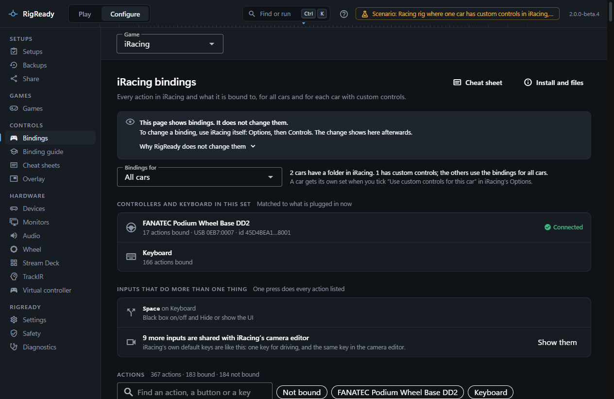
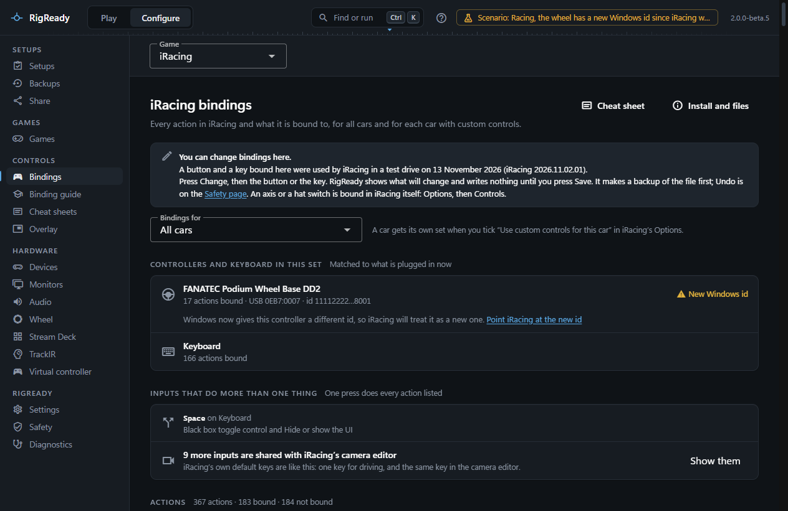
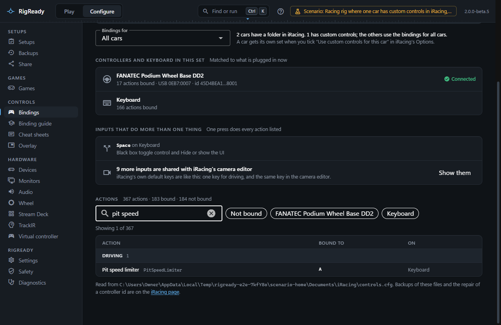
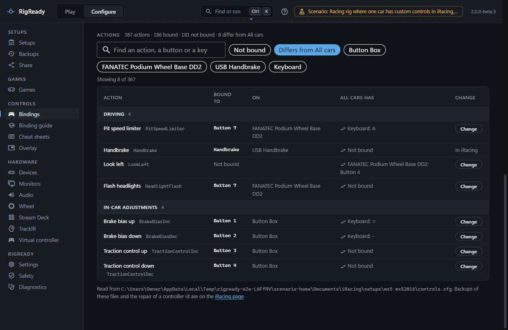
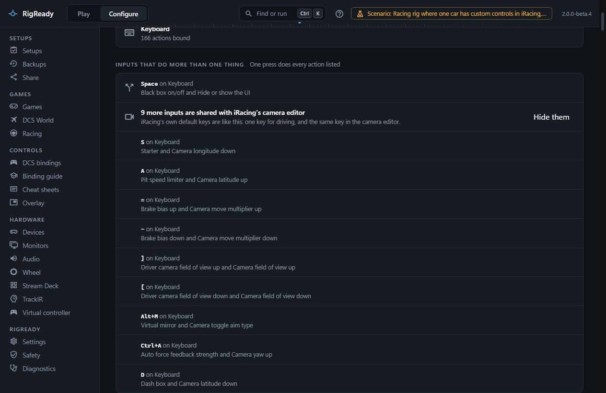
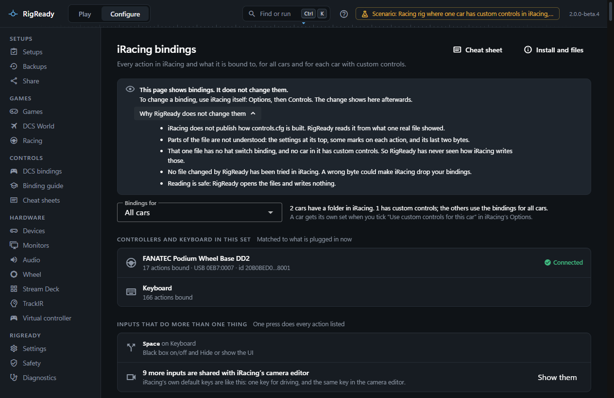
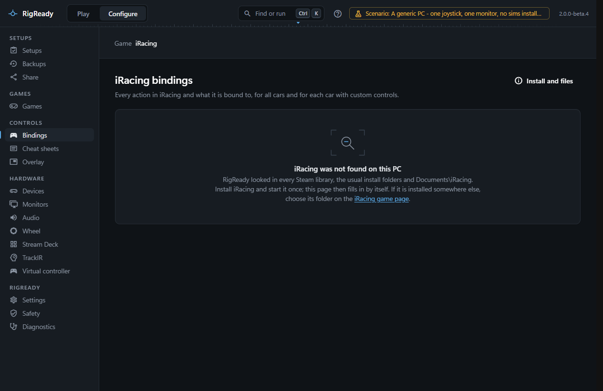

The iRacing bindings page lists every action iRacing has, bound or not, and what is bound to it. It reads `controls.cfg` in `Documents\iRacing`, and the `controls.cfg` of each car that uses "Use custom controls for this car". It shows bindings. It does not change them.

Open it with **Configure > Bindings** and choose **iRacing** in the **Game** picker above the page, or with [the command palette](../app/command-palette.md): press **Ctrl+K** and type "iRacing bindings". Bindings opens the game you looked at last, so the next time it is iRacing straight away.

## Which bindings you are looking at

**Bindings for** chooses the set. **All cars** is the file every car uses unless it has its own. A car is in the list only when its folder under `Documents\iRacing\setups` holds a `controls.cfg`, which iRacing writes when you tick "Use custom controls for this car". Such a car shows as its iRacing folder name with "(custom controls)", for example "mx5 mx52016 (custom controls)".

The line under the field says how many cars have a folder and how many have custom controls. The path of the file being shown is at the bottom of the page. The address of the page keeps the chosen car, so opening the page again by its address shows the same car.

## The controllers

**Controllers and keyboard in this set** lists every controller the file names, and the keyboard, each with the number of actions bound on it. A controller shows the name you gave it on the [Devices page](../hardware/devices.md), or the name iRacing stored in `joyCalib.yaml`, or its USB ids when nothing else knows it. Each controller has a state:

- **Connected**: the controller the file names is attached now.
- **New Windows id**: no controller has the stored id, but one of the same model is attached. iRacing will treat it as new. **Point iRacing at the new id** opens the repair on the [iRacing page](iracing.md).
- **Not connected**: no controller of that model is attached. The page says how many bindings do nothing until it is plugged in.
- **Cannot tell**: Windows did not list the connected controllers.

Above the list of actions there is a button for each of them; it shows only the actions bound on that device.

## The list of actions

The list has every action in the file, in four groups: Driving, In-car adjustments, Cameras and replay, and Interface and chat. Each row has the action in plain words with iRacing's own id next to it, what is bound ("Accelerator", "Button 13", "Wheel Axis, turning right", a key with its modifiers) and the device. An action with nothing bound says "Not bound". The heading counts the actions, the bound and the not bound.

- The field **Find an action, a button or a key** searches the name, iRacing's id, the input and the device.
- **Not bound** shows only the actions with nothing bound.
- For a car, **Differs from All cars** shows only what that car changes, and the column **All cars has** shows what the same action is bound to for every other car.

If a file holds a kind of binding RigReady has not seen before, the row says "A binding RigReady cannot read", and the heading counts such rows. Nothing is guessed.

## Inputs that do more than one thing

**Inputs that do more than one thing** lists every button, axis or key that is bound to two or more actions in the set you are looking at. A wheel button that does two things comes first. iRacing's own defaults give several keys a second job in its camera editor; those are counted in one line and shown with **Show them**, because they do not clash while you drive.

## The cheat sheet

**Cheat sheet** opens the [cheat sheets](../dcs/cheat-sheets.md) for iRacing with the set you were looking at.

## Why the page does not change bindings

To change a binding, use iRacing itself: **Options**, then **Controls**. The change shows on this page afterwards. iRacing writes its files when the simulator closes, so while the simulator runs the page says that a binding changed in this session may not show yet.

RigReady does not write bindings into `controls.cfg`, and the page has no edit buttons. **Why RigReady does not change them** gives the reasons on the page:

- iRacing does not publish how `controls.cfg` is built. RigReady reads it from what one real file showed.
- Parts of the file are not understood: the settings at its top, some marks on each action, and its last two bytes.
- That one file has no hat switch binding, and no car in it has custom controls. So RigReady has never seen how iRacing writes those.
- No file changed by RigReady has been tried in iRacing. A wrong byte could make iRacing drop your bindings.
- Reading is safe: RigReady opens the files and writes nothing.

The one change RigReady does make to these files is the repair of a wheel with a new Windows id, on the [iRacing page](iracing.md). It replaces one id with another of the same length, backs the files up first, and says in its own dialog that it has not yet been verified on real hardware.

## When there is nothing to show

- On a PC without iRacing the page says "iRacing was not found on this PC" and links to the iRacing game page.
- When iRacing is installed but has not written a `controls.cfg` yet, the page says "iRacing has no bindings file yet". Set up your controls in iRacing once, and the page fills in.
- A file that is damaged or cut short is refused with a plain message, and nothing of it is shown.

