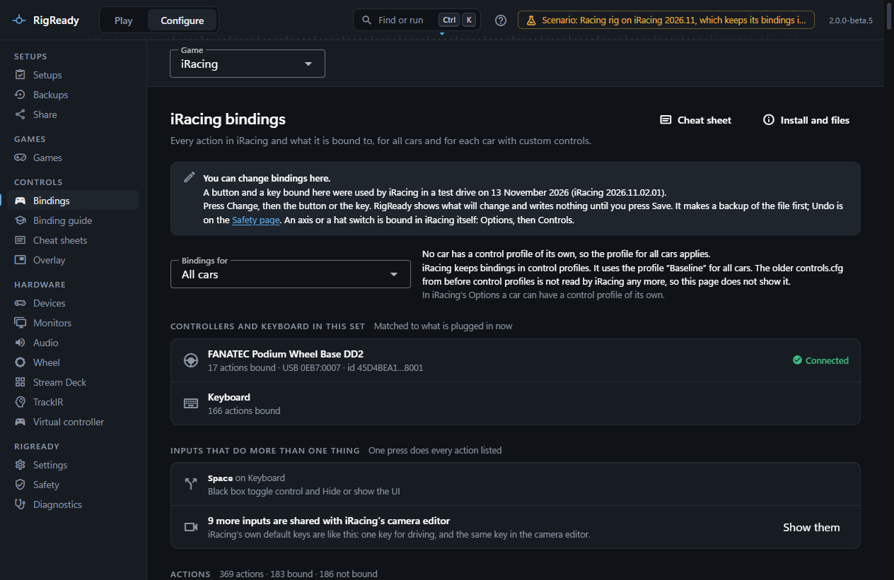
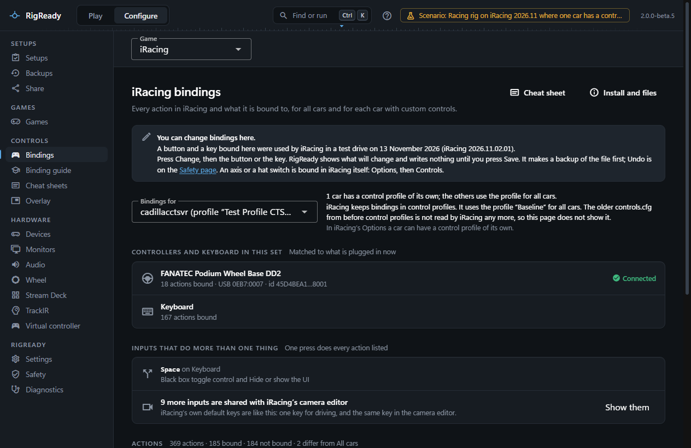
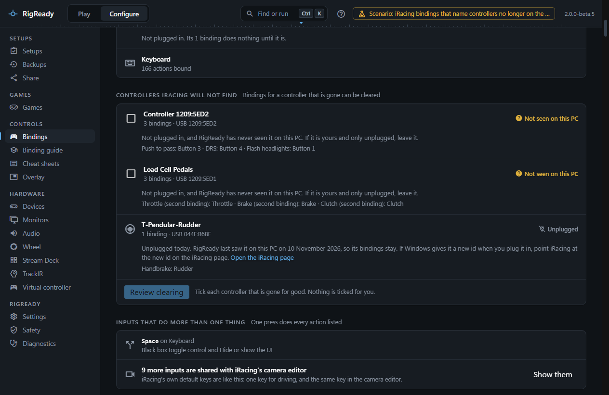
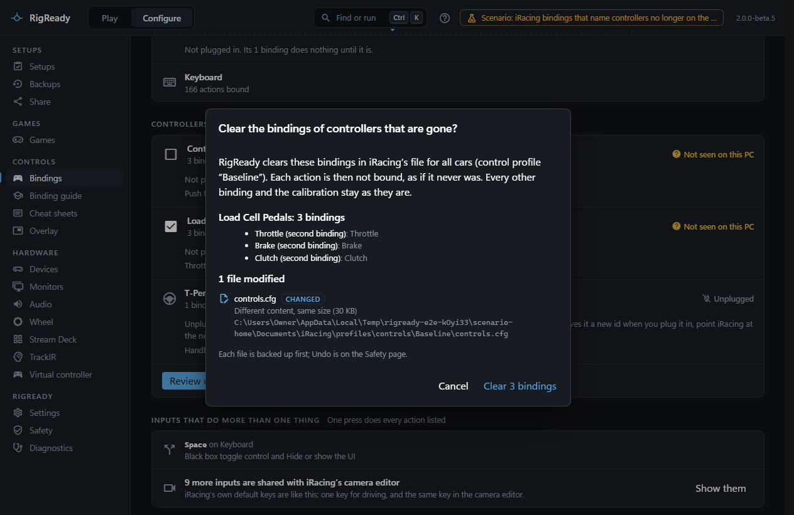
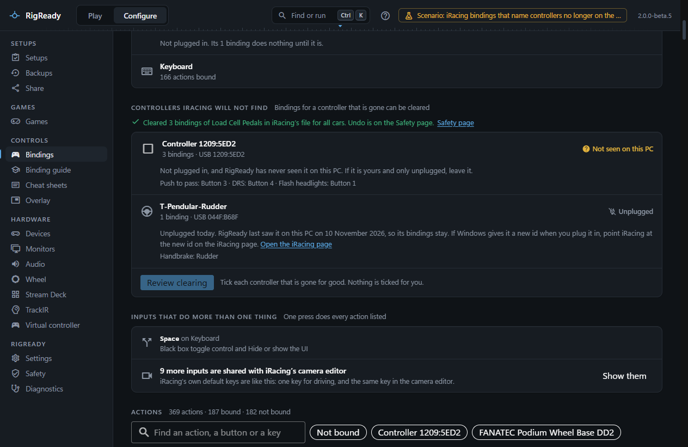
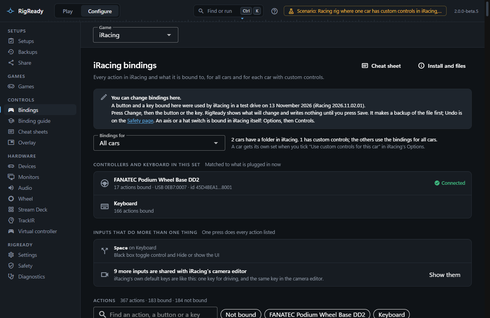
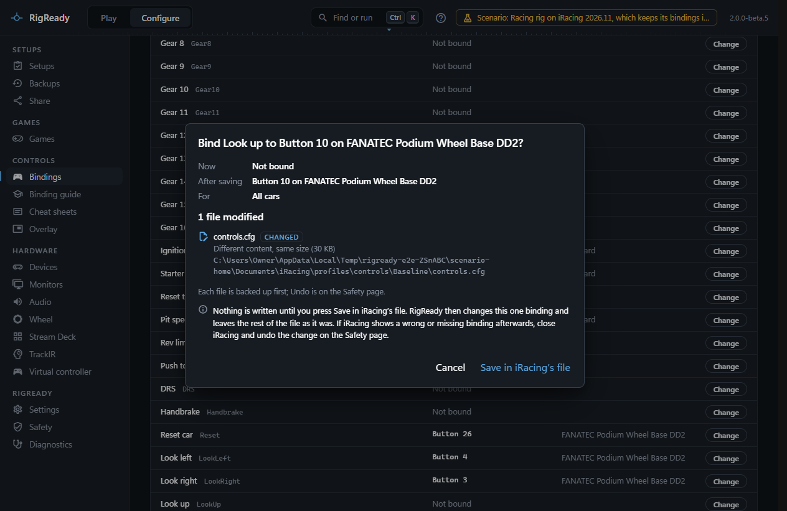

The iRacing bindings page lists every action iRacing has, bound or not, and what is bound to it. It reads the file iRacing itself uses: the control profile iRacing loads, or on an older iRacing, `controls.cfg` in `Documents\iRacing`. It can also bind an action to a controller button or a key, or clear a binding, one at a time; see [Changing a binding](#changing-a-binding).

Open it with **Configure > Bindings** and choose **iRacing** in the **Game** picker above the page, or with [the command palette](../app/command-palette.md): press **Ctrl+K** and type "iRacing bindings". Bindings opens the game you looked at last, so the next time it is iRacing straight away.

## Where iRacing keeps its bindings

Since 2026 Season 3, iRacing keeps bindings in **control profiles**, each a folder under `Documents\iRacing\profiles\controls` with its own `controls.cfg` and `joyCalib.yaml`. The first time a newer iRacing starts, it copies your bindings into a profile called "Baseline", and `app.ini` says which profile it loads. From then on iRacing reads the profile and leaves the older `Documents\iRacing\controls.cfg` as it was.

RigReady reads the profile `app.ini` names, and says so beside **Bindings for**: "iRacing keeps bindings in control profiles. It uses the profile “Baseline” for all cars." When the older `controls.cfg` is still there, the same line says that iRacing does not read it any more, so the page does not show it. The older files are read only on an iRacing from before control profiles, which has no `profiles` folder.

## Which bindings you are looking at

**Bindings for** chooses the set. **All cars** is the file every car uses unless it has its own.

- On an iRacing with control profiles, a car is in the list when you gave it a profile of its own in iRacing's Options. `app.ini` names the car only by iRacing's short name for it, so that is what the list shows, with the profile: for example "cadillacctsvr (profile “Test Profile CTSV”)" for the Cadillac CTS-V. When two or more cars use the same profile, each is listed with the others named, because a change for one of them is a change for all of them; the review before saving and the message after it name every car it reaches.
- On an older iRacing, a car is in the list when its folder under `Documents\iRacing\setups` holds a `controls.cfg`, which iRacing writes when you tick "Use custom controls for this car". Such a car shows as its folder name with "(custom controls)", for example "mx5 mx52016 (custom controls)".

The line under the field says how many cars have bindings of their own. The path of the file being shown is at the bottom of the page. The address of the page keeps the chosen car, so opening the page again by its address shows the same car.

## The controllers

**Controllers and keyboard in this set** lists every controller the file names, and the keyboard, each with the number of actions bound on it. A controller shows the name you gave it on the [Devices page](../hardware/devices.md), or the name iRacing stored in `joyCalib.yaml`, or its USB ids when nothing else knows it. Each controller has a state:

- **Connected**: the controller the file names is attached now.
- **New Windows id**: no controller has the stored id, but one of the same model is attached. iRacing will treat it as new. **Point iRacing at the new id** opens the repair on the [iRacing page](iracing.md).
- **Not connected**: no controller of that model is attached. The page says how many bindings do nothing until it is plugged in.
- **Cannot tell**: Windows did not list the connected controllers.

Above the list of actions there is a button for each of them; it shows only the actions bound on that device.

## Controllers iRacing will not find

A set of bindings often still names a wheel, pedals or a button box you sold or swapped long ago. **Controllers iRacing will not find** lists every controller of the set that is not plugged in under the id the file names, with its bindings and what RigReady makes of it:

- **Not seen on this PC**: no controller of that model is plugged in, and RigReady has never seen one on this PC. RigReady knows the devices it has seen from the [Devices page](../hardware/devices.md)'s history of where and when each device was plugged in, and from the names and answers you gave there. Only these can be cleared.
- **Unplugged**: not plugged in today, but RigReady has seen it on this PC (it says when), or you named it, or another controller of the same model is plugged in. Its bindings stay. If Windows gives it a new id when you plug it back in, the [iRacing page](iracing.md) points iRacing at the new id.
- **New Windows id**: the same model is plugged in under another id. Clearing is never offered: **Open the iRacing page** leads to the repair, which makes its bindings work again.
- **Cannot tell**: Windows did not list the controllers, or RigReady cannot read its list of the devices it has seen. Nothing is offered.

To clear the bindings of a controller that is gone, tick it (nothing is ticked for you), then **Review clearing**. The review lists every binding that goes, device by device, and the file that changes: the `controls.cfg` of the set, in the control profile iRacing uses. **Clear** writes it after a backup, as one change you can undo on the [Safety page](../protect/safety-page.md). Each action is then not bound, exactly as iRacing has an action that was never bound; every other binding and `joyCalib.yaml` stay as they are. Nothing is written while the iRacing simulator runs, or when the file changed after the review.

## The list of actions

The list has every action in the file, in four groups: Driving, In-car adjustments, Cameras and replay, and Interface and chat. Each row has the action in plain words with iRacing's own id next to it, what is bound ("Accelerator", "Button 13", "Wheel Axis, turning right", a key with its modifiers) and the device. An action with nothing bound says "Not bound". The heading counts the actions, the bound and the not bound.

- The field **Find an action, a button or a key** searches the name, iRacing's id, the input and the device.
- **Not bound** shows only the actions with nothing bound.
- For a car, **Differs from All cars** shows only what that car changes, and the column **All cars has** shows what the same action is bound to for every other car.

If a file holds a kind of binding RigReady has not seen before, the row says "A binding RigReady cannot read", and the heading counts such rows. Nothing is guessed.

## Inputs that do more than one thing

**Inputs that do more than one thing** lists every button, axis or key that is bound to two or more actions in the set you are looking at. A wheel button that does two things comes first. iRacing's own defaults give several keys a second job in its camera editor; those are counted in one line and shown with **Show them**, because they do not clash while you drive.

## The cheat sheet

**Cheat sheet** opens the [cheat sheets](../controls/cheat-sheets.md) for iRacing with the set you were looking at.

## Changing a binding

Every action that takes a button or a key has **Change** in the last column. A button and a key bound this way were used by iRacing 2026.11.02.01 in a test drive on 13 November 2026, and the notice at the top of the page says so.

1. Press **Change** on the action. The box shows the action, the set it is in, and what it has now.
2. Press **Press the button or the key**, then press a button on any controller, or a key with or without Shift, Ctrl and Alt. **Esc** stops listening.
3. RigReady shows what will change: what the action has now, what it would have, whether it is for all cars or one car, the file, and every other action the same button or key already does. Nothing is written yet. Pressing the button again, or holding it, changes nothing.
4. Press **Save in iRacing’s file** to write it, or **Cancel** to leave everything as it was. RigReady backs up the whole file first, changes that one action and nothing else, and reads the file back before it says "Saved". Each change is one entry on the [Safety page](../protect/safety-page.md), with **Undo**.

**Clear this binding** in the same box removes a binding, with the same review first.

Some things stay with iRacing, and the page says so where they come up:

- An axis: iRacing calibrates an axis as it binds it. An action on an axis shows "In iRacing" instead of **Change**.
- A hat switch, and the number pad keys.
- A binding RigReady cannot read.

Close the iRacing simulator before you change a binding: it writes its own bindings when it closes and would undo the change. While it runs, the page says so and **Save** is not offered. Changes go into the file iRacing reads: the control profile for all cars, or a car's own set when you chose that car. The older `controls.cfg` beside a profile is never written.

The other change RigReady makes to these files is the repair of a wheel with a new Windows id, on the [iRacing page](iracing.md). It replaces one id with another of the same length, backs the files up first, and says in its own dialog that it has not yet been verified on real hardware. It changes the control profile iRacing uses, the same files this page shows, never the older `controls.cfg`.

## When there is nothing to show

- On a PC without iRacing the page says "iRacing was not found on this PC" and links to the iRacing game page.
- When iRacing is installed but has not written a `controls.cfg` yet, the page says "iRacing has no bindings file yet". Set up your controls in iRacing once, and the page fills in.
- When iRacing keeps control profiles but `app.ini` names none for all cars, or names one that has no `controls.cfg`, the page says it cannot tell which bindings iRacing uses and shows no list, not even a car's own profile. It never shows the older `controls.cfg` in their place, because iRacing does not read it.
- A file that is damaged or cut short is refused with a plain message, and nothing of it is shown.

