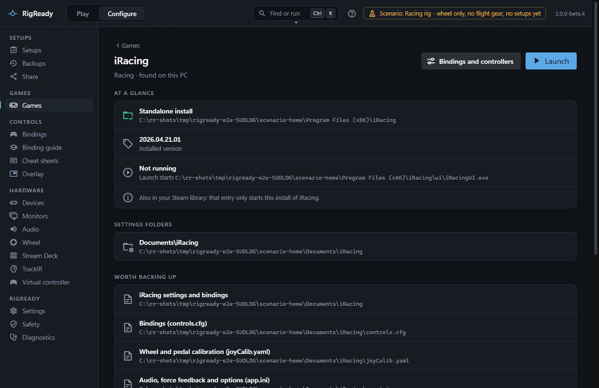
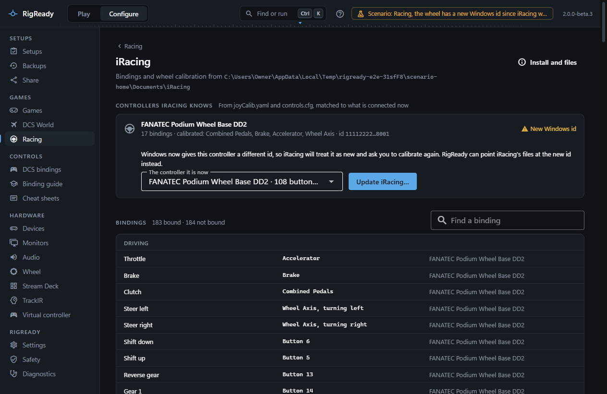

iRacing is a standalone install, not a Steam game, even when it is in your Steam library. RigReady finds the real install, reads the bindings and the wheel calibration from `Documents\iRacing`, matches the controllers iRacing knows to the ones connected now, and can point iRacing at a wheel whose Windows id has changed.

## Detection and install locations

RigReady looks for `ui\iRacingUI.exe` in the folder named by iRacing's entry in Windows' installed programs, then in `Program Files (x86)\iRacing`. If neither has it, the game page offers **Choose folder…** and asks for the iRacing folder that contains `ui\iRacingUI.exe`.

The Steam entry for iRacing is a small stub that starts the standalone install. RigReady never counts it as an install; when it is there, the game page notes "Also in your Steam library: that entry only starts this install of iRacing."

**Launch** starts `ui\iRacingUI.exe`, the iRacing UI, where you sign in and start a session. The simulator itself is started by the UI. iRacing counts as running when either the UI or the simulator is running.

The version comes from `version_system.txt` in the install folder (or `updater\version.txt`). iRacing updates itself from its UI, so RigReady shows the installed build but cannot tell whether an update is waiting; it does show "Last updated <date> (updater log)" from the newest updater log.

## Files worth backing up

The settings live in `Documents\iRacing`. The game page and the [Backups page](../protect/tracked-files.md) offer:

- the whole folder as one item, limited to bindings, calibration, `.ini` options, HUD profiles, radio scripts and car setups (replays, telemetry, logs and paint are left out);
- `controls.cfg` (bindings), `joyCalib.yaml` (wheel and pedal calibration), `app.ini` (audio, force feedback and options), `core.ini`, `camera.ini`, `fueldata.ini`, the `profiles` and `scripts` folders, and every `rendererDX11*.ini` graphics file;
- for every car that uses "Use custom controls for this car", its own `controls.cfg` and `joyCalib.yaml` under `setups\<car>`.

The simulator rewrites its `.ini` files when it exits, so a restore is refused while `iRacingSim64DX11.exe` runs. The UI may stay open. See [restore](../protect/restore.md).

The setup path variables `{IRACING_USER}` (the Documents folder) and `{IRACING_INSTALL}` are available for your own tracked files and launch steps; see [path variables](../setups/path-variables.md).

## The bindings and controllers page

**Configure > Racing > iRacing** (also reached with **Bindings and controllers** on the game page) reads two files and shows them matched to what is connected now.

**Controllers iRacing knows** comes from `joyCalib.yaml` and `controls.cfg`. Each controller shows the name you gave it on the [Devices page](../hardware/devices.md), the name iRacing stored, how many bindings use it, whether it is calibrated and which axes, a short form of its id, and a state:

- **Connected**: the stored id is a controller attached now.
- **New Windows id**: no controller has the stored id, but one of the same model is attached. iRacing will treat it as new and ask you to calibrate again. The repair below applies.
- **Not connected**: no controller of that model is attached.
- **Unknown**: the connected controllers could not be read.

**Bindings** lists every bound action in plain language, grouped as Driving, In-car adjustments, Cameras and replay, and Interface and chat, with the input ("Accelerator", "Button 13", "Wheel Axis, turning right", a key) and the controller. A field filters the list; the heading counts bound and not bound actions. The file is binary; RigReady reads it and lists what it finds, and never edits bindings in it.

**Custom controls per car** lists the cars that have their own `controls.cfg`, or says that every car uses the bindings above.

**Force feedback options in app.ini** is read only. It shows the `[Force Feedback]` keys with their values and iRacing's own comment for each. Strength and wheel force are kept by iRacing per car and are not in this file.

## Repair: a wheel with a new Windows id

Windows gives every game controller an instance id. When it changes, usually after the wheel was moved to another USB port or the PC was reinstalled, iRacing's files still name the old id, and iRacing asks you to calibrate everything again.

A controller in the **New Windows id** state shows a panel with the connected controllers it could now be. When exactly one controller of that model is attached (or exactly one with the same collection number, for a base that Windows lists as two controllers with the same name), it is suggested; otherwise you choose, and RigReady does not guess. **Update iRacing…** opens a confirmation that lists the files that will change. On **Update iRacing**, the old id is replaced by the new one, 16 bytes at a time, in `controls.cfg`, as text in `joyCalib.yaml`, and in any per-car copies, as one journaled change with a backup of each file first. The files are read back afterwards, and Undo is on [the Safety page](../protect/safety-page.md). The repair is refused while the simulator runs.

This repair has not yet been verified on real hardware: it follows the file layout decoded from a real `controls.cfg` and passed its tests on recorded data from one rig, but nobody has yet moved a wheel, run the repair and started iRacing. The dialog says so. If iRacing still asks to calibrate afterwards, undo the change on the Safety page and calibrate in iRacing. The [changelog](../../../CHANGELOG.md) lists this under known limitations (RACE-IRACING-005).

## Backups

The **Backups** section at the bottom of the page keeps quick copies of `controls.cfg`, `joyCalib.yaml`, `app.ini` and the per-car files, named if you like ("Formula rim"). **Restore…** shows, file by file, whether each is new, changed or the same as now, backs up the current files first, and is refused while the simulator runs. **Use in a setup** makes a setup expect exactly the bindings of a backup: the setup then has a required check **Racing bindings are the saved set** ([Checks and fixes](../setups/checks.md)), and [Make ready](../play/make-ready-and-launch.md) restores the binding files when they differ. Deleting a backup leaves your game files alone.

## Checks

A racing setup for iRacing gets, when captured from the rig:

- **Wheel base in PC mode** ([Wheel](wheel.md)) and the helper apps, as for every racing game (see [Games](index.md)).
- **iRacing helper service running**: the Windows service `iRacingService`, which iRacing needs to start a session. RigReady cannot start it, because that needs administrator rights; the check says to start it from Windows Services.
- **iRacing knows the connected controllers**: fails when a controller iRacing uses has a new Windows id ("new Windows id, iRacing will ask to recalibrate") or is not connected, and sends you to this page.
