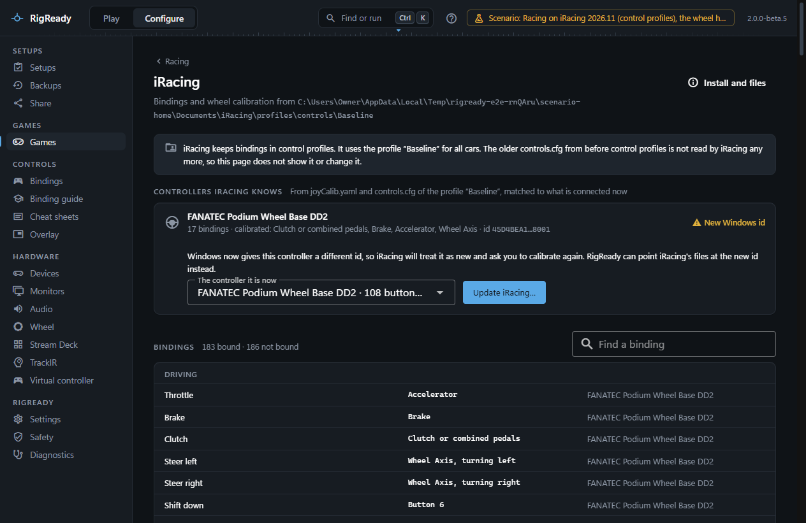
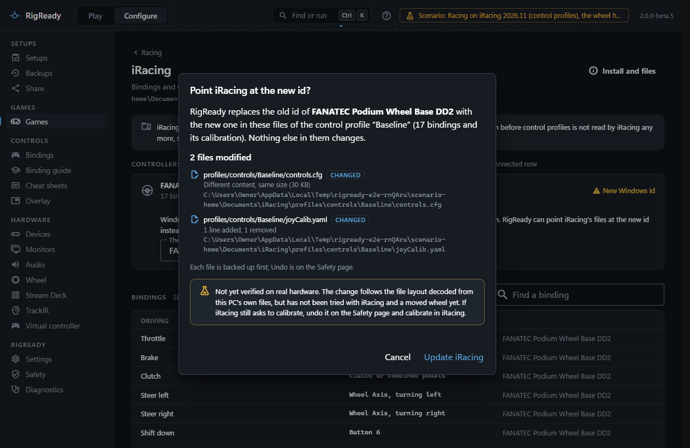
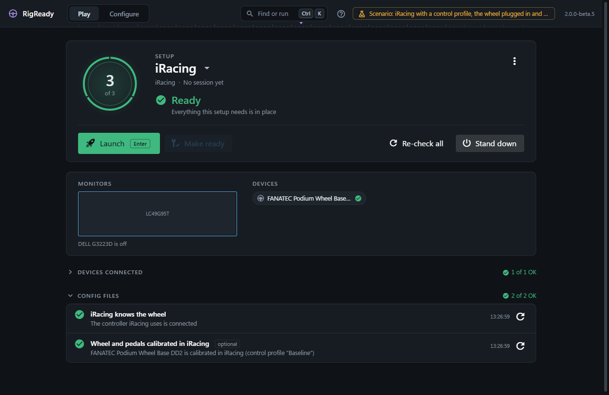
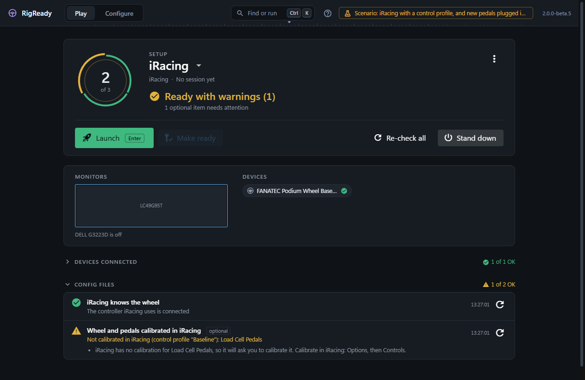

iRacing is a standalone install, not a Steam game, even when it is in your Steam library. RigReady finds the real install, reads the bindings and the wheel calibration from the control profile iRacing uses, matches the controllers iRacing knows to the ones connected now, and can point iRacing at a wheel whose Windows ID has changed.

## Control profiles

Since 2026 Season 3, iRacing keeps its bindings in control profiles: each profile is a folder `Documents\iRacing\profiles\controls\<name>` with its own `controls.cfg` and `joyCalib.yaml`. You switch profiles in iRacing under Options, then Controls. The `[ControlProfiles]` section of `app.ini` says which profile is in use: `Global=<name>` for all cars, and a line such as `cadillacctsvr=<name>` for a car with a profile of its own. On its first run after the update iRacing copied your bindings into a profile called "Baseline".

Every part of RigReady that reads or changes iRacing's bindings uses the profile `app.ini` names: this page, the check, the [cheat sheets](../controls/cheat-sheets.md), the [iRacing bindings page](iracing-bindings.md), the repair, the backups and the files offered for tracking. The older `Documents\iRacing\controls.cfg` and `joyCalib.yaml` stay on your PC, but iRacing no longer reads them, so RigReady neither shows them as your bindings nor changes them. When `app.ini` names no profile, or one whose folder has no `controls.cfg`, RigReady says so and shows no bindings rather than the older file. RigReady changes only the profile in use; another profile you switch to later is left as it is.

On an iRacing from before control profiles (no `profiles\controls` folder), the bindings are `Documents\iRacing\controls.cfg` and `joyCalib.yaml`, and `setups\<car>\controls.cfg` for a car with "Use custom controls for this car".

## Detection and install locations

RigReady looks for `ui\iRacingUI.exe` in the folder named by iRacing's entry in Windows' installed programs, then in `Program Files (x86)\iRacing`. If neither has it, the game page offers **Choose folder…** and asks for the iRacing folder that contains `ui\iRacingUI.exe`.

The Steam entry for iRacing is a small stub that starts the standalone install. RigReady never counts it as an install; when it is there, the game page notes "Also in your Steam library: that entry only starts this install of iRacing."

**Launch** starts `ui\iRacingUI.exe`, the iRacing UI, where you sign in and start a session. The simulator itself is started by the UI. iRacing counts as running when either the UI or the simulator is running.

The version comes from `version_system.txt` in the install folder (or `updater\version.txt`). iRacing updates itself from its UI, so RigReady shows the installed build but cannot tell whether an update is waiting; it does show "Last updated <date> (updater log)" from the newest updater log.

## Files worth backing up

The settings live in `Documents\iRacing`. The game page and the [Backups page](../protect/tracked-files.md) offer:

- the whole folder as one item, limited to bindings, calibration, `.ini` options, HUD and control profiles, radio scripts and car setups (replays, telemetry, logs and paint are left out);
- `controls.cfg` (bindings) and `joyCalib.yaml` (wheel and pedal calibration) of the control profile in use, named with the profile ("Bindings (controls.cfg, profile “Baseline”)"); `app.ini` (audio, force feedback and options, and which profile is in use), `core.ini`, `camera.ini`, `fueldata.ini`, the `profiles` and `scripts` folders, and every `rendererDX11*.ini` graphics file;
- for every car with bindings of its own, its `controls.cfg` and `joyCalib.yaml`: its control profile, or on an older iRacing its folder under `setups\<car>`.

The simulator rewrites its `.ini` files when it exits, so a restore is refused while `iRacingSim64DX11.exe` runs. The UI may stay open. See [restore](../protect/restore.md).

The setup path variables `{IRACING_USER}` (the Documents folder) and `{IRACING_INSTALL}` are available for your own tracked files and launch steps; see [path variables](../setups/path-variables.md).

## The bindings and controllers page

**Configure > Games > Racing > iRacing** (also reached with **Bindings and controllers** on the game page) reads two files of the control profile in use and shows them matched to what is connected now. The line under the title gives the folder they come from, and a note names the profile: "iRacing keeps bindings in control profiles. It uses the profile “Baseline” for all cars." When the older `controls.cfg` is still there, the note adds that iRacing no longer reads it and that this page does not show it or change it.

When the profile cannot be found, a yellow notice says why (for example "iRacing uses the control profile “Gone” for all cars, but RigReady found no controls.cfg in it."), and the page shows no controllers and no bindings until iRacing has a profile again. iRacing shows its bindings in Options, then Controls.

**Controllers iRacing knows** comes from `joyCalib.yaml` and `controls.cfg` of the profile. Each controller shows the name you gave it on the [Devices page](../hardware/devices.md), the name iRacing stored, how many bindings use it, whether it is calibrated and which axes, a short form of its id, and a state:

- **Connected**: the stored ID is a controller attached now.
- **New Windows id**: no controller has the stored ID, but one of the same model is attached. iRacing will treat it as new and ask you to calibrate again. The repair below applies.
- **Not connected**: no controller of that model is attached.
- **Unknown**: the connected controllers could not be read.

**Bindings** lists every bound action in plain language, grouped as Driving, In-car adjustments, Cameras and replay, and Interface and chat, with the input ("Accelerator", "Button 13", "Wheel Axis, turning right", a key) and the controller. A field filters the list; the heading counts bound and not bound actions. The file is binary; RigReady reads it and lists what it finds, and never edits bindings in it.

The black box actions carry iRacing's own names: "Next black box" and "Previous black box" switch between the boxes (iRacing's Next Black Box and Previous Black Box), while "Black box next control", "Black box previous control" and "Black box toggle control" (the arrows and Space) work inside the box shown. Every action has the same name here, on the cheat sheets and on the iRacing bindings page.

**Custom controls per car** lists the cars with bindings of their own (a profile of their own in `app.ini`, or on an older iRacing their own `controls.cfg`), or says that every car uses the bindings above. A car whose line in `app.ini` names the profile for all cars has no bindings of its own and is not listed. The [iRacing bindings page](iracing-bindings.md) lists every action, bound or not, for all cars and for each of those cars, and shows what a car changes.

**Force feedback options in app.ini** is read only. It shows the `[Force Feedback]` keys with their values and iRacing's own comment for each. Strength and wheel force are kept by iRacing per car and are not in this file.

## Repair: a wheel with a new Windows ID

Windows gives every game controller an instance ID. The ID can change when the wheel is moved to another USB port, and after Windows or the wheel's driver is installed again. It does not change every time: a wheel moved to another port often keeps its ID. When the ID does change, iRacing's files still name the old one, and iRacing asks you to calibrate everything again.

A controller in the **New Windows id** state shows a panel with the connected controllers it could now be. When exactly one controller of that model is attached (or exactly one with the same collection number, for a base that Windows lists as two controllers with the same name), it is suggested; otherwise you choose, and RigReady does not guess. **Update iRacing…** opens a confirmation that names the control profile and lists the files that will change (`profiles/controls/Baseline/controls.cfg` and `joyCalib.yaml`). On **Update iRacing**, the old ID is replaced by the new one, 16 bytes at a time, in `controls.cfg`, and as text in `joyCalib.yaml`, of the profile for all cars and of each car's own profile (a file two of them share is changed once), as one journaled change with a backup of each file first. The older files beside the profiles are not changed. The repair writes only what the confirmation showed: if, in the meantime, `app.ini` points at another profile, a car gets a profile of its own or one of the files changes, nothing is written and RigReady says "iRacing’s files changed after the change was shown, so nothing was written. Look at the change again." The message names the profile: "Updated 17 bindings in the control profile “Baseline” and the calibration of FANATEC Podium Wheel Base DD2."

On an iRacing from before control profiles the same is done to `Documents\iRacing\controls.cfg`, `joyCalib.yaml` and the per-car copies under `setups`.

 The files are read back afterwards, and Undo is on [the Safety page](../protect/safety-page.md). The repair is refused while the simulator runs.

This repair has not yet been verified on real hardware: it follows the file layout decoded from a real `controls.cfg` and passed its tests on recorded data from one rig, but nobody has yet moved a wheel, run the repair and started iRacing. The dialog says so. If iRacing still asks to calibrate afterwards, undo the change on the Safety page and calibrate in iRacing. The [changelog](../../../CHANGELOG.md) lists this under known limitations (RACE-IRACING-005).

## Backups

The **Backups** section at the bottom of the page keeps quick copies of `controls.cfg` and `joyCalib.yaml` of the profile in use, `app.ini` and the files of each car's own profile, named if you like ("Formula rim"). **Restore…** shows, file by file, whether each is new, changed or the same as now, backs up the current files first, and is refused while the simulator runs. **Use in a setup** makes a setup expect exactly the bindings of a backup: the setup then has a required check **Racing bindings are the saved set** ([Checks and fixes](../setups/checks.md)), and [Make ready](../play/make-ready-and-launch.md) restores the binding files when they differ. Deleting a backup leaves your game files alone.

A saved set is the bindings iRacing loads only while `app.ini` gives all cars, and each car, the same control profiles as when it was saved. When you have switched profile in iRacing since, the check fails and lists what differs ("All cars: iRacing uses the profile “Formula” now; these bindings were saved with the profile “Baseline”."), and its fix writes nothing: putting `app.ini` back would also undo iRacing's other options. Choose the same profiles in iRacing, or back up the bindings again and use that backup.

A backup saved before iRacing moved to control profiles holds the older `controls.cfg`, which iRacing no longer reads. A setup that expects it fails its check with "“GT3 rim” holds iRacing bindings from before control profiles", and its fix restores nothing: back up the bindings again and choose **Use in a setup** on the new backup.

## Checks

A racing setup for iRacing gets, when captured from the rig:

- **Wheel base in PC mode** ([Wheel](wheel.md)) and the helper apps, as for every racing game (see [Games](index.md)).
- **iRacing helper service running**: the Windows service `iRacingService`, which iRacing needs to start a session. RigReady cannot start it, because that needs administrator rights; the check says to start it from Windows Services.
- **iRacing knows the connected controllers**: fails when a controller iRacing uses has a new Windows ID ("new Windows ID, iRacing will ask to recalibrate") or is not connected, and sends you to this page. It reads the control profile in use, and fails with "RigReady cannot tell which control profile iRacing uses" when `app.ini` names none that RigReady can find. The iRacing card on the Racing page says the same.
- **Wheel and pedals calibrated in iRacing**: an optional check, so it warns and never blocks a launch. See [Calibration](#calibration).

### Calibration

iRacing keeps the calibration of each controller in `joyCalib.yaml`, beside `controls.cfg` in the control profile it uses: the controller's name, its Windows IDs, and for each axis the lowest, middle and highest value it measured. A controller that has no entry there is new to iRacing, and iRacing asks you to calibrate it.

The check **Wheel and pedals calibrated in iRacing** looks at the wheel and pedals plugged in now and finds each one in that file by its Windows ID. It passes when each has an entry with at least one measured axis: "FANATEC Podium Wheel Base DD2 is calibrated in iRacing (control profile “Baseline”)". When one has none, it warns: "Not calibrated in iRacing: Load Cell Pedals", and says that iRacing will ask you to calibrate it, which you do in iRacing: **Options**, then **Controls**. When the file knows the same model under an older Windows ID, it says so and points to [the repair](#repair-a-wheel-with-a-new-windows-id), which keeps the calibration you have.

Which devices count: what you said a device is on the [Devices page](../hardware/devices.md) comes first ("This is a: Wheel", "Pedals"; a device you marked as flight gear is left out); then the wheel bases and pedals RigReady knows by their USB IDs; then the name. Rudder pedals for flying are left out. Pedals plugged into the wheel base are axes of the base, so the base's entry covers them. A base that Windows shows as two controllers of one USB device counts once; two identical pedal sets count as two, and each must be calibrated.

