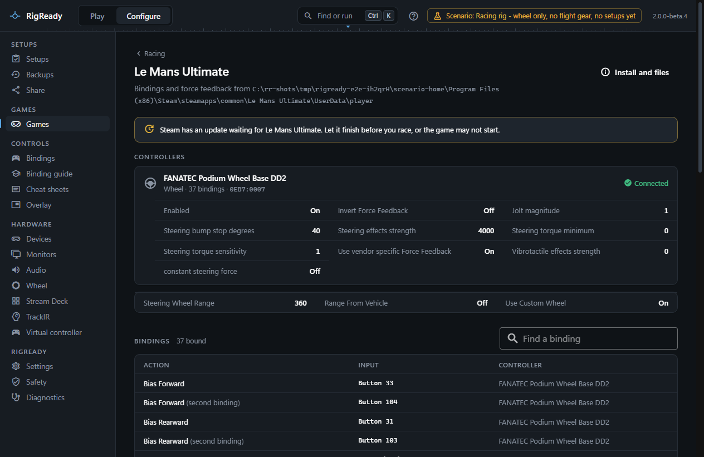
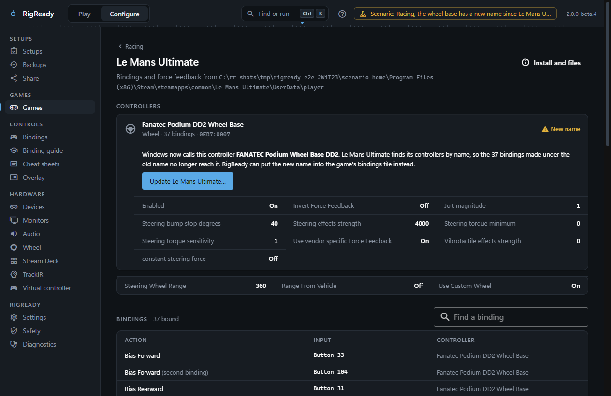

Le Mans Ultimate is a Steam game whose settings live inside the game folder, in `UserData`, rather than in Documents. RigReady finds it in your Steam libraries, launches it through Steam, backs up the player files, and reads the bindings and force feedback settings from `direct input.json`.

## Detection and launch

The game is found through Steam (app 2399420) when its manifest says it is installed and `Le Mans Ultimate.exe` is in the folder. Otherwise the game page offers **Choose folder…**.

**Launch** asks Steam to start it, so Easy Anti-Cheat and the Steam sign-in work. The game counts as running when `Le Mans Ultimate.exe` or `start_protected_game.exe` is running. The version is the Steam build; when Steam has an update queued, the page and the [Racing overview](index.md#configure-racing) say "update waiting", because the game may not start until it is done. The game page also says "Last run as version 1.3000 (game log)" from the newest trace log.

## Files worth backing up

Because `UserData` is inside the game folder, uninstalling the game can delete it. The game page and the [Backups page](../protect/tracked-files.md) offer:

- the whole of `UserData` as one item, limited to the player files, the car setups and the display mode (logs left out);
- `player\direct input.json` (bindings and force feedback), `player\current controls.json` (control options), `player\Settings.JSON` (game, graphics and sound), `player\Multiplayer.JSON`, `player\CustomPluginVariables.JSON`, `player\FavoriteAndFixedSetups.gal`, the `player\Settings` folder (car setups per track), any `keyboard*.json`, and every `Config_DX11*.ini` (display mode).

The game rewrites its player files every time it starts and exits, so a [restore](../protect/restore.md) is refused while it runs. After a restore, start the game once and check that the bindings are still there; the restore confirmation says so too.

The path variables `{LMU_INSTALL}` and `{LMU_USER}` are available in a setup; see [path variables](../setups/path-variables.md).

## The bindings and controllers page

**Configure > Racing > Le Mans Ultimate** reads `direct input.json` and `current controls.json`.

**Controllers** lists each controller the game has set up, with the name you gave it on the [Devices page](../hardware/devices.md), the game's name for it, its type ("Wheel"), how many bindings use it, its vendor and product ID, and a state:

- **Connected**: a controller with the same vendor and product ID is attached.
- **New name**: the controller is attached, but Windows now gives it another name than the game stored. The repair below applies.
- **Not connected**: no controller of that model is attached.
- **Compatibility mode**: a Fanatec base is attached, but in compatibility (yellow) mode, where it reports itself as a ClubSport V2.5 and the stored entry does not match it.

Under each controller are its force feedback settings as the file names them (for example Enabled, Steering effects strength, Steering torque minimum and sensitivity, Use vendor specific Force Feedback, Vibrotactile effects strength) and its options. A panel below shows the steering settings from `current controls.json`: Steering Wheel Range, Range From Vehicle and Use Custom Wheel.

**Bindings** lists every action by the name the game uses ("Throttle", "Shift Up", "Pit Menu Up"), with its input and controller, and a marker for a second binding of the same action. The input is decoded from the game's numbering: axis halves ("Accelerator (Z−)", with Fanatec axis names when the controller is a Fanatec base), the D-pad and hats, and buttons numbered as games number them. A field filters the list.

## When a controller is not connected as it was

Le Mans Ultimate names each controller with a key that ends in a code whose origin is not known, so when a controller is missing or in another mode the page says that RigReady does not rewrite it: restore a backup taken while the controller worked, or bind it again in the game. There is no repair for a USB port move.

## Repair: a renamed controller

A driver or firmware update can change the name Windows gives a controller. The game finds controllers by name, so the bindings made under the old name stop reaching it, while the vendor and product ID stay the same. That is the one case RigReady repairs.

A controller in the **New name** state shows the name Windows uses now and offers **Update Le Mans Ultimate…**. The confirmation lists what changes in `direct input.json`. There are two cases:

- The game has already made an entry under the new name (it ran once since the rename). RigReady points the bindings at that entry; the key is the game's own, and nothing else in the file changes.
- There is no such entry. RigReady replaces the old name with the new one in the controller's key, in its "product name" and "instance name" fields and in every binding. The code at the end of the key is kept exactly as it was.

The change is made to the text of the file, so every other byte stays as it was, and the result is only written when reading it back gives exactly the intended change. The file is backed up first, read back after, and Undo is on [the Safety page](../protect/safety-page.md). The repair is refused while the game runs. The message afterwards asks you to start the game once and check the bindings.

The second case is marked "Not yet verified in the game": if the code at the end of the key turns out to depend on the name, the game will show the controls as not bound, exactly as before the repair. Undo it on the Safety page and bind them in the game. Anything else, such as two connected controllers of one model with different names, or a key not built from the product name, is left alone and no repair is offered.

## Backups and checks

The **Backups** section keeps quick copies of `direct input.json`, `current controls.json` and `Settings.JSON`, with the same preview, Undo and **Use in a setup** as on the [iRacing page](iracing.md). Only the two binding files are compared and restored by a setup's **Racing bindings are the saved set** check; `Settings.JSON` changes with normal play and is left alone there.

A racing setup for Le Mans Ultimate gets the common racing checks described under [Games](index.md), and optionally **Le Mans Ultimate wheel settings as recommended**, which compares the smoothing (Steering torque filter), the minimum torque and "rotation from the wheel driver" settings in the files with the recommendations on the [Wheel page](wheel.md).
