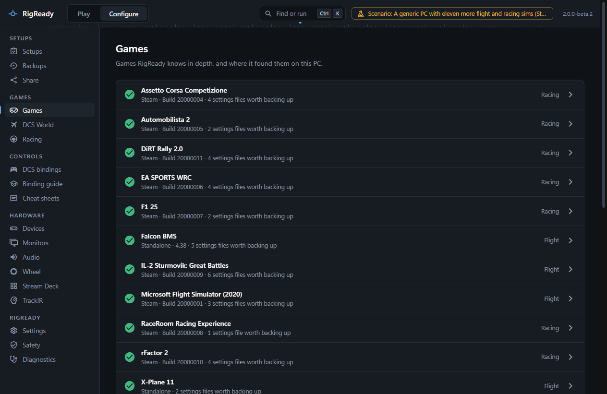
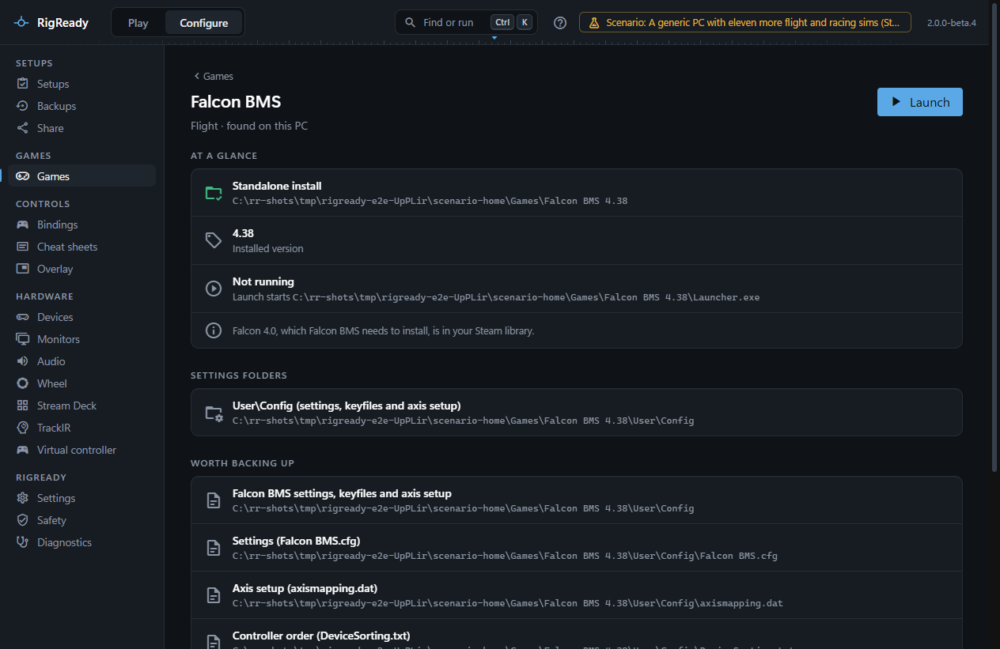
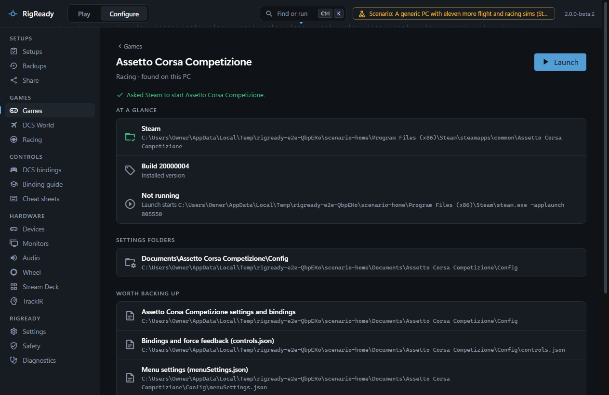

For each game on this page RigReady finds the install, shows the version where it can read one, launches the game, tells whether it is running, and names the settings files worth backing up. It does not read or change the bindings of these games, and it has no game-specific checks for them. A setup for one of them gets the usual checks for devices, apps, monitors and audio ([Setups](../setups/index.md)).

Steam games are found in every Steam library and started by asking Steam (`steam.exe -applaunch <app id>`), with "update waiting" when Steam has one queued. When a game is not found, its page offers **Choose folder…** for a folder that contains the program named below ([How a game is found](index.md#how-a-game-is-found)). Restore the files only while the game is closed: the restore screen refuses while the game's program runs ([Restore](../protect/restore.md)).

Where each id and folder comes from is recorded in `docs/research/game-modules-2026-11.md` in the repository.

## Flight

| Game | Found | Launch | Worth backing up | Good to know |
|---|---|---|---|---|
| Microsoft Flight Simulator (2020) | Steam (app 1250410); Microsoft Store by its `Microsoft.FlightSimulator_8wekyb3d8bbwe` package folder | Steam edition through Steam; the Store edition from the Start menu, not by RigReady | `UserCfg.opt` and `FlightSimulator.CFG` in `%APPDATA%\Microsoft Flight Simulator` (or the Store package's `LocalCache`); the Steam Cloud folder `userdata\<account>\1250410\remote`, which holds the controller profiles | The controller profiles are backed up as files; RigReady cannot list what is bound. The Store edition's controller profiles are kept by the Xbox app and are not backed up. The page says where the Community folder is. |
| X-Plane 12 and X-Plane 11 | Steam (apps 2014780 and 269950); standalone installs from the list X-Plane keeps in `%LOCALAPPDATA%\x-plane_install_12.txt` (or `_11.txt`) | Steam installs through Steam; standalone installs by starting `X-Plane.exe` | `Output\preferences`: every `*.prf` file (joystick, keys, graphics) and the `control profiles` folder | The preferences live inside the X-Plane folder, so deleting it deletes them. |
| IL-2 Sturmovik: Great Battles | Steam (app 307960, which holds every Great Battles title), when `bin\game\Il-2.exe` is there; a standalone install through **Choose folder…** | Through Steam | `data\input` (bindings, axis responses and curves, the controller list `devices.txt`), `data\startup.cfg`, `storeddevices.txt` | The bindings live inside the game folder. RigReady does not repair `devices.txt` when Windows renumbers a controller. |
| Falcon BMS | The registry key its installer writes (`Benchmark Sims\Falcon BMS <version>`), newest version first, when `Bin\x64\Falcon BMS.exe` is in the folder | Starts `Launcher.exe` in the BMS folder | `User\Config`: the settings files, every keyfile, `axismapping.dat`, `joystick.cal`, `DeviceSorting.txt` and the pilot files; the launcher's own `Backup` folder is left out | The version is the one in the registry key. The page says when Falcon 4.0, which BMS needs to install, is in the Steam library. |

## Racing

| Game | Found | Launch | Worth backing up | Good to know |
|---|---|---|---|---|
| Assetto Corsa Competizione | Steam (app 805550), when `AC2\Binaries\Win64\AC2-Win64-Shipping.exe` is there | Through Steam | `Documents\Assetto Corsa Competizione\Config` (`controls.json`, `menuSettings.json` and the rest), `Customs\Controls`, `Setups` | A major update can reset the menu settings: keep a backup from before it. |
| rFactor 2 | Steam (app 365960) | Through Steam | In the game's `UserData`: the player files (`Controller.JSON` with the bindings, `player.JSON`), `Config.ini`, controller profiles and car setups; logs and replays are left out | The settings live inside the game folder, so uninstalling the game can delete them. |
| Automobilista 2 | Steam (app 1066890), when `AMS2AVX.exe` is there | Through Steam | `Documents\Automobilista 2`, and each `default.controllersettings` file in the profile folders | |
| EA SPORTS WRC | Steam (app 1849250), when `WRC\Binaries\Win64\WRC.exe` is there | Through Steam | The INI files in `%LOCALAPPDATA%\WRC\Saved\Config\WindowsNoEditor`, and the telemetry settings `Documents\My Games\WRC\telemetry\config.json` | Where the game keeps your controller bindings is not known to RigReady, so they are not in the backup. Saves are left out. |
| F1 25 and F1 24 | Steam (apps 3059520 and 2488620) | Through Steam | `Documents\My Games\F1 25\hardwaresettings` (or `F1 24`) | Where the game keeps your controller bindings is not known to RigReady, so they may not be in the backup. Saves are left out. |
| DiRT Rally 2.0 | Steam (app 690790); Microsoft Store by its package folder | Steam edition through Steam; the Store edition from the Start menu | `Documents\My Games\DiRT Rally 2.0\hardwaresettings`; the binding maps in the game's `input\actionmaps` and `input\devices\device_defines.xml` | Verifying the game files in Steam can replace an edited binding map with the shipped one: keep a backup. |
| RaceRoom Racing Experience | Steam (app 211500) | Through Steam | `Documents\My Games\SimBin\RaceRoom Racing Experience\UserData`, as a whole | |

These games have no page under **Configure > Games > Racing** and no bindings for the [cheat sheets](../dcs/cheat-sheets.md) or the [trainer](../dcs/trainer.md); those cover the games listed with a bindings page in [Games](index.md).
