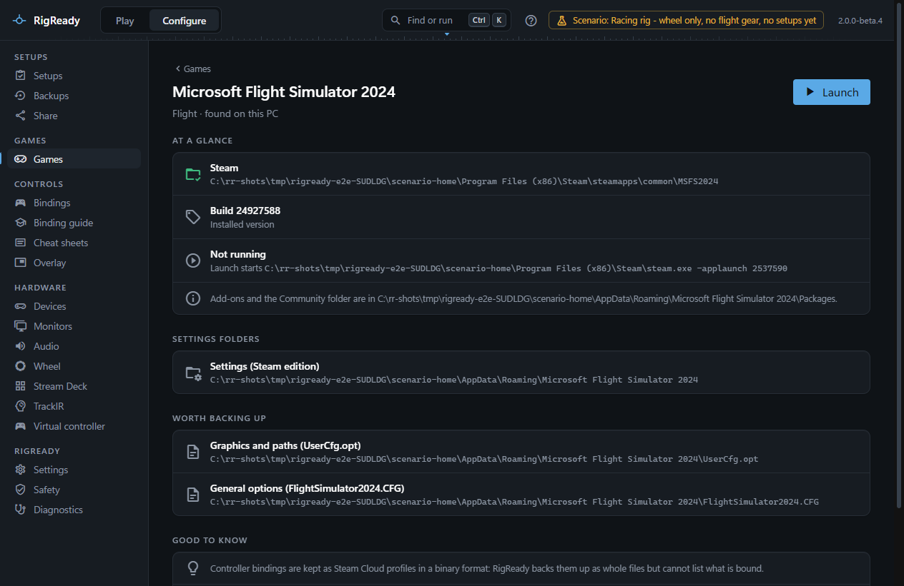

Microsoft Flight Simulator 2024 is supported as a game module: RigReady finds it, launches the Steam edition, and names the files worth backing up. It does not read the bindings, because the game keeps them in a binary format.

## Detection and launch

Two editions are recognised:

- **Steam** (app 2537590). The Steam manifest is enough to count the game as installed, because the Steam edition streams most of its content and the program file may not be where a manifest alone would suggest. **Launch** asks Steam to start it. The version is the Steam build, with "update waiting" when Steam has one queued.
- **Microsoft Store**. The edition is recognised by its package folder under `%LOCALAPPDATA%\Packages`. Store apps are started by Windows from their package, so the game page says "RigReady cannot start this edition directly"; start it from the Start menu. Its version is not known.

When neither is found, the game page offers **Choose folder…** for a folder that contains `FlightSimulator2024.exe`. The game counts as running when that program is running.

The game page also says where add-ons and the Community folder are, read from `InstalledPackagesPath` in `UserCfg.opt`.

## Files worth backing up

For each edition's settings folder (`%APPDATA%\Microsoft Flight Simulator 2024` for Steam, the package's `LocalCache` for the Store):

- `UserCfg.opt` (graphics and paths), `FlightSimulator2024.CFG` (general options), `Cameras.CFG` and `SimConnect.xml`.

Controller bindings of the Steam edition are Steam Cloud files, `inputprofile_*` under Steam's `userdata\<account>\2537590\remote`, one folder per Steam account on the PC. They are listed under **Settings folders** as "Controller profiles (Steam Cloud)" and each profile is offered for backup as a whole file. They are binary, so RigReady backs them up but cannot list what is bound.

The game writes its options when it exits, and Steam Cloud syncs the controller profiles while it runs, so restore only while the game is closed. The path variable `{MSFS2024_USER}` points at the settings folder of the edition found.

A setup for Flight Simulator 2024 is a flight setup: by default it keeps the flight gear and helper apps and leaves racing gear out. See [setups](../setups/index.md) for everything a setup can check.
