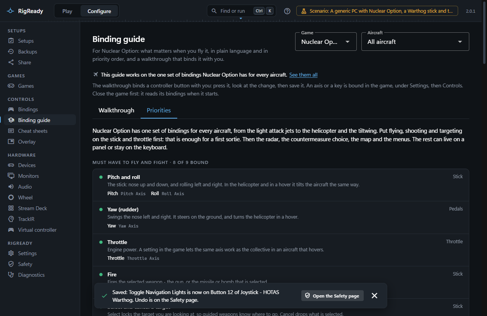
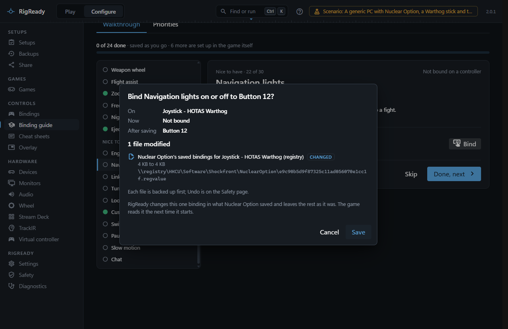
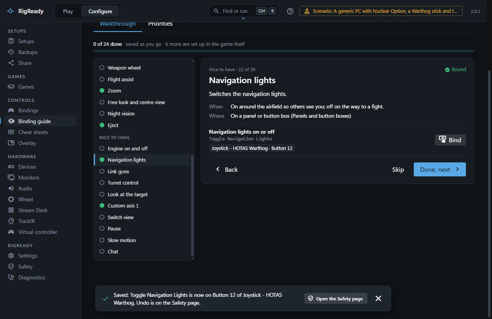

**Configure > Binding guide** explains what matters when you fly Nuclear Option, in plain language and in priority order, and walks you through binding it. The page is in the menu when DCS World, iRacing or Nuclear Option is found on this PC. Choose **Nuclear Option** in the **Game** picker at the top. Nothing on it needs an AI key.

The guides for DCS aircraft and for iRacing are described in [Binding guide and AI help](../dcs/binding-guide-and-ai.md) and [Binding guide for iRacing](iracing-binding-guide.md).

## One guide for every aircraft

Nuclear Option has one set of bindings for every aircraft, so there is one guide, **All aircraft**, and nothing to choose. It has thirty items in three tiers:

| Tier | What is in it |
|---|---|
| **Must have to fly and fight** | Pitch and roll, yaw, the throttle, Fire, selecting and cancelling a target, the next weapon, countermeasures, the landing gear and the brakes. |
| **Should have** | The radar, the choice of countermeasure, the previous weapon, the map, the radial menu and the weapon wheel, flight assist, zoom, free look, night vision and Eject. |
| **Nice to have** | The engine, the navigation lights, linking the guns, the turret, looking at the target, the game's extra axis, and what is fine on the keyboard: the view, pause, slow motion and chat. |

Each item has a title, what it does, when you use it, where it belongs (**On the stick, throttle or pedals**, **On a panel or button box**, **Fine on the keyboard**), and the game's actions it stands for, each with a plain name and the name the game's own controls screen gives it.

The guide was written from general knowledge of the game and from the names on its controls screen (Early Access 0.34.6). It has not been reviewed by the game's developers or by an experienced player, and it is not affiliated with Shockfront Studios. What is checked, by a test, is that every action the guide names is one RigReady reads from the game. **Where this guide comes from** at the bottom of the Priorities tab says the same.

## What is bound

The guide reads what the game saved, the same bindings the [Nuclear Option bindings page](nuclear-option-bindings.md) shows; **See them all** at the top opens that page. An item is **Bound** when the game has it on a controller (or anywhere, for an item that is fine on the keyboard), **Partly bound** when some of its actions are, and **Not bound on a controller** otherwise. The **Priorities** tab shows the whole guide at a glance, with a plan for the stick, the throttle, the pedals, a panel and the keyboard.

## Binding from the walkthrough

The walkthrough goes through the items one at a time. Close Nuclear Option first: the game reads its bindings when it starts and saves them itself, so RigReady saves nothing while it runs, and says so.

Press **Bind** beside an action, then press the button you want on a controller. RigReady shows the change before anything is written: the controller, what the action is on now and will be on, anything else that button already does ("one press does both"), and the saved bindings it will change. **Save** writes it; **Cancel** writes nothing.

The save is the same one the Nuclear Option bindings page makes: the controller's saved bindings are copied first, the change is one entry on the [Safety page](../protect/safety-page.md), and **Undo** there puts them back. The game picks the change up the next time it starts.

What is bound in the game itself, under Settings, then Controls, and the walkthrough says so beside it:

- **An axis**: the stick, the throttle, the rudder, a toe brake. An item made only of these has no **Bind** and is never marked done; its state is what the game saved.
- **One side of an axis on a button**: Zoom In, Apply Brakes.
- **A key or a hat switch.** A hat pressed while the walkthrough listens is said to be a hat, and nothing is offered.

A controller the game has saved no bindings for yet cannot be bound from RigReady: start the game once with it plugged in.

**Done, next** and **Skip** keep your place, and the progress is saved as you go.

## What RigReady does not do here

- **Bind an axis, a key or a hat switch.** Those are bound in the game.
- **AI help.** Suggest a setup, Explain and the questions are for DCS aircraft and iRacing cars. The built-in assistant in the app bar is not affected.
- **A guide of your own.** RigReady uses the guide it includes; importing or writing one is for a DCS aircraft or an iRacing car without a guide.
- **Plain names on the cheat sheets.** The game's own action names are already plain, so the cheat sheets keep them.
