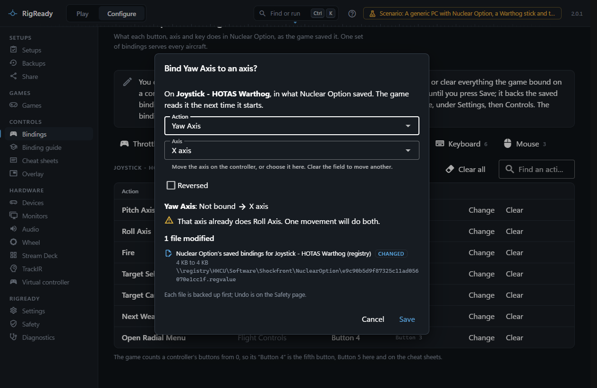
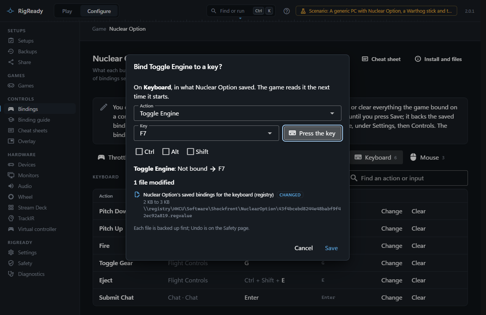
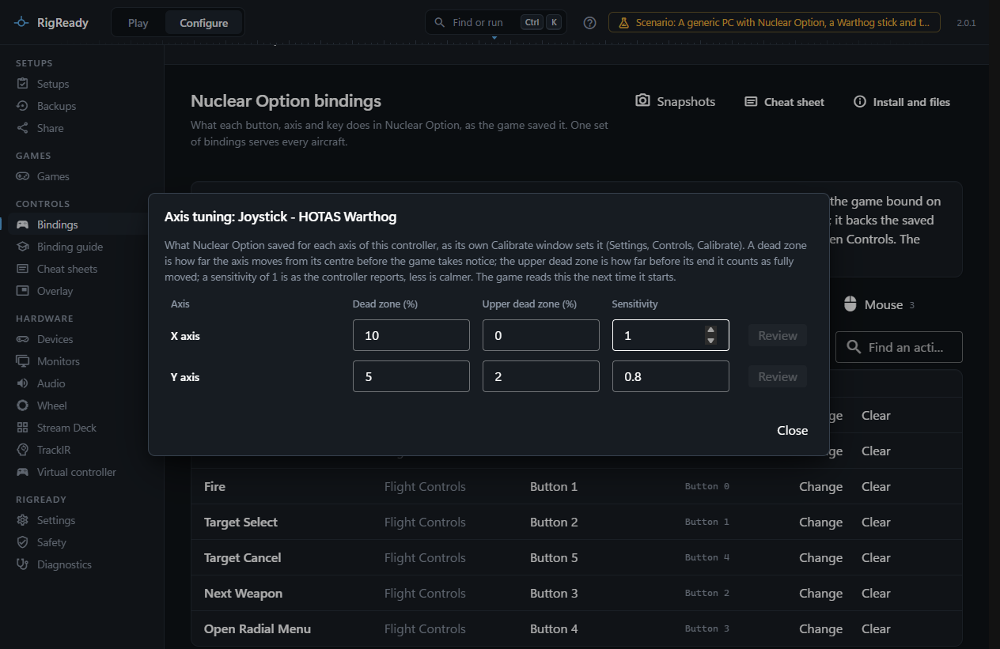
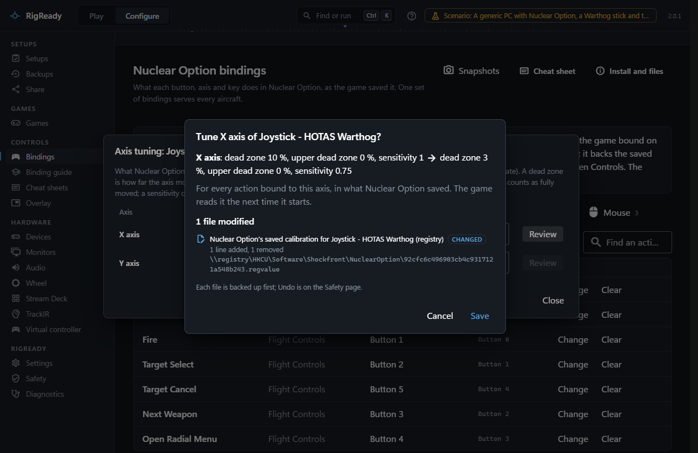
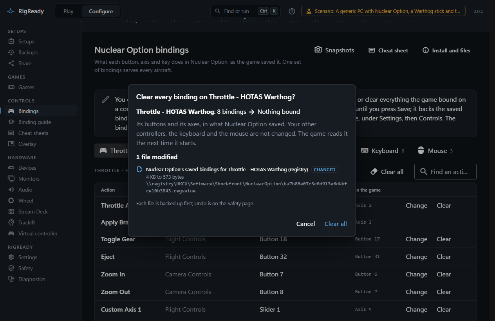
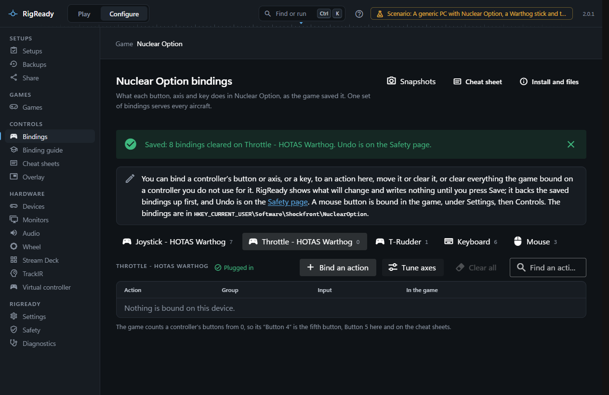
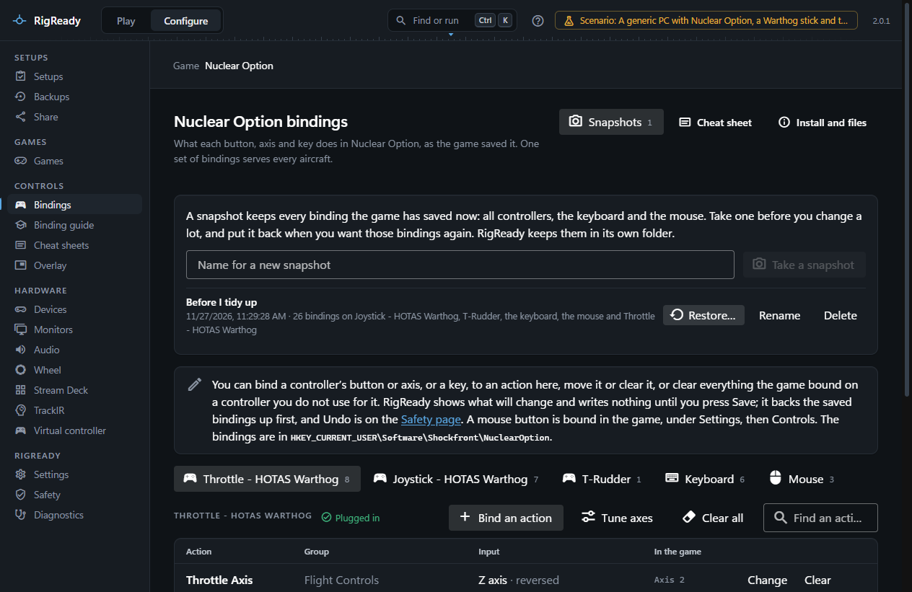
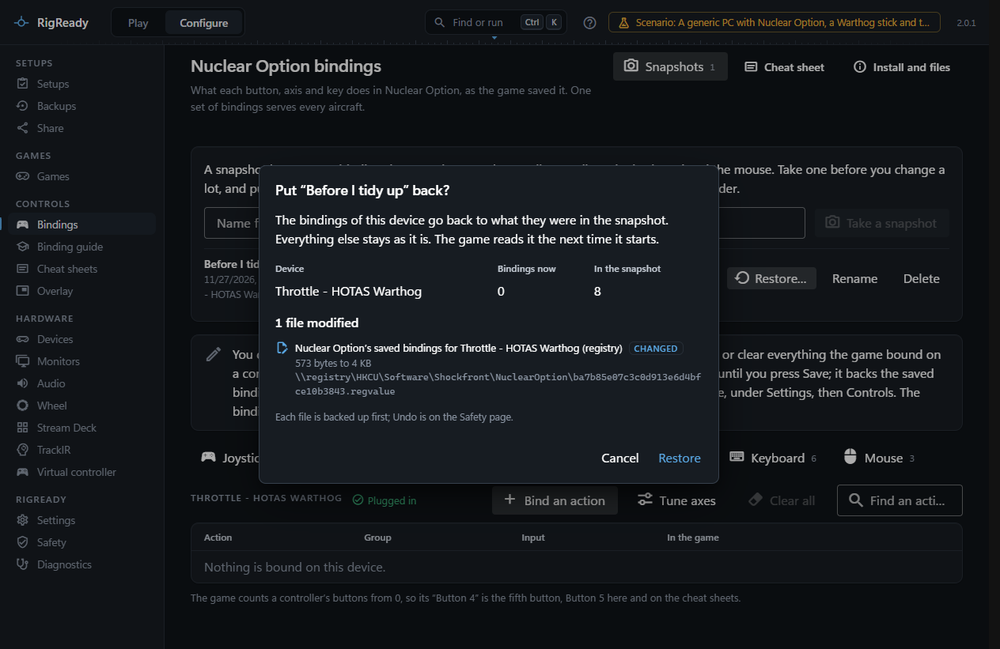

The Nuclear Option bindings page shows what the game has bound on each controller, on the keyboard and on the mouse. RigReady reads this from what the game itself saved. It can bind a button or an axis of a controller, or a key of the keyboard, to an action, move it or clear it, and clear everything on one controller at once; a mouse button is bound in the game's own Settings, then Controls.

Open it with **Configure > Bindings** and choose **Nuclear Option** in the **Game** picker above the page, or with [the command palette](../app/command-palette.md): press **Ctrl+K** and type "Nuclear Option bindings".

## Where the game keeps its bindings

Nuclear Option keeps its settings and bindings in the Windows registry, under `HKEY_CURRENT_USER\Software\Shockfront\NuclearOption`, not in files. It writes them the first time it runs. Until then the page says that the game has saved no bindings yet.

The game has one set of bindings for every aircraft, so there is no aircraft to choose.

## What the page shows

A button for each device the game has bindings for, with the number of bindings on it: the controllers first, plugged-in ones before the others, then the keyboard and the mouse. Choose one to see its bindings:

| Column | What it is |
|---|---|
| **Action** | The action by the name the game's controls screen gives it. Where a button or a key drives one side of an axis, it is that side's name: "Zoom In", "Pitch Down". |
| **Group** | The heading the game lists the action under: Flight Controls, Camera Controls, Gameplay. A binding from another tab of the game's screen (Chat, Mission Editor, Debug) names the tab too. |
| **Input** | The control in RigReady's words, the same as on the cheat sheets and in the input tester: "Button 5", "Y axis", "Ctrl + Shift + E". An axis the game reverses says "reversed". |
| **In the game** | The same input as the game's own screen shows it. |

The game counts a controller's buttons from 0, and RigReady, like Windows, from 1. So the game's "Button 4" is Button 5 here.

**Find an action or input** narrows the list: every word you type must be in the action, its group or the input.

A controller that is not plugged in is still listed, marked **Not plugged in**. Its axes are then named in the usual order (X, Y, Z, then the rotations), because RigReady cannot ask the controller for their names.

## Binding a controller's buttons and axes

Close Nuclear Option first: the game reads its bindings when it starts and saves them itself, so RigReady refuses the change while the game runs, and says so.

- **Change** on a row moves that action to another button, or another axis, of the same controller.
- **Clear** on a row takes the binding away.
- **Bind an action** above the list binds an action that has none on this controller: choose the action, then the button or the axis.

An axis action is offered three ways, as on the game's own controls screen: as a whole, for an axis of the controller ("Zoom View"), and by each of its two sides, for a button each ("Zoom In", "Zoom Out").

Press the button on the controller, or type its number: the one on the controller's [cheat sheet](../controls/cheat-sheets.md) and in the **Input** column (the first button is 1). A press on another controller is not taken; the dialog says which controller it was. A controller that is not plugged in can only have the number typed. RigReady shows the change before anything is written: what the action is on now and will be on, anything else that button already does ("One press will do both"), and the saved bindings it will change. Only **Save** writes.

RigReady copies the saved bindings of that controller first. The change is one entry on the [Safety page](../protect/safety-page.md), named for example "Nuclear Option bindings: Toggle Navigation Lights bound to Button 12 on Joystick - HOTAS Warthog", and **Undo** there puts the bindings back as they were. Undo is refused when the game has changed them again since, so that it cannot throw away something you did in the game.

The game picks the change up the next time it starts; its own controls screen then shows it. The game counts buttons from 0, so Button 12 here is "11" there.

### An axis

For an axis action the dialog asks for the axis instead of a button. Move the axis on the controller, or choose it in the list; the names are the ones on the controller's cheat sheet and in the **Input** column ("X axis", "Z rotation"). Tick **Reversed** to have the game turn it round. **Change** on an axis row opens on what the action has, so that reversing an axis is one tick. The review says what else that axis already does: one movement will do both.

The controller must be plugged in to bind an axis: the game numbers a controller's axes in the controller's own order, and RigReady asks the controller for it. For one that is not plugged in the review says so and nothing can be saved; clearing an axis binding works either way. Once an axis is chosen, moving another does not change it: clear the field to move another.

### A key

On the **Keyboard** tab, **Change**, **Clear** and **Bind an action** work on keys. Choose the key in the list, or press **Press the key** and then the key itself (Esc stops waiting); tick **Ctrl**, **Alt** or **Shift** for a key that is held with them (pressing the key with them held ticks them for you). The review says what else that key, with those modifier keys, already does. An axis action is bound on the keyboard by its two sides (Pitch Up, Pitch Down), a key each; the axis as a whole is for a controller.

An action can have two keys, as on the game's controls screen. **Change** and **Clear** on a row work on that row's key and leave the action's other key alone. **Bind an action** gives an action that has one key a second one; for one that already has two it says so, and you change one of them from its row.

The keys RigReady can bind are the letters and digits, the numeric keypad, F1 to F12, the arrows and the keys above them, Space, Enter, Tab, Backspace, Esc, Delete, the punctuation keys of a US keyboard, and Shift, Ctrl and Alt on either side. For another key it says that it does not know how the game numbers it.

What RigReady will not do here, and says so when asked: bind a mouse button; bind half an axis to one side of an action; bind a hat switch; change a binding it does not understand, such as an axis the controller does not report; bind anything on a controller the game has saved no bindings for yet.

## Tuning an axis

**Tune axes**, above a controller's list, shows what the game saved for each of the controller's axes: its dead zone, its upper dead zone and its sensitivity. These are the settings of the game's own **Calibrate** window (Settings, Controls, Open Control Bindings Menu, Calibrate), and they hold for every action bound to the axis.

- **Dead zone**: how far the axis moves from its centre before the game takes notice, in percent. The game gives every axis of a new controller 10 percent. A stick that rests exactly at its centre can do with less; a worn one that drifts needs more.
- **Upper dead zone**: how far before its end the axis already counts as fully moved, in percent. For a lever that does not quite reach its stop.
- **Sensitivity**: 1 is as the controller reports. Less makes the same movement do less; more makes it do more.

Change the numbers of one axis and press **Review**. RigReady shows the settings before and after, and writes nothing until you press **Save**:

The limits are the ones of the game's own sliders: each dead zone 0 to 80 percent, the two together at most 90, and the sensitivity 0.1 to 2. The save is one entry on the **Safety** page with Undo, the calibration is backed up first, and nothing is written while the game runs. The game reads the change the next time it starts.

What stays in the game's Calibrate window: the zero and the range of an axis, which the game measures while you move it, and reversing an axis for everything bound to it (a single binding is reversed on this page, under **Change**). An axis the game saved with a setting RigReady does not know is shown and not changed. A calibration saved by an earlier version of the game has no upper dead zone; the dead zone and the sensitivity are still set. With two controllers of the same model, RigReady cannot tell which of them a saved calibration is for, and leaves both to the game. With the controller unplugged, its axes go by the game's own numbers.

## Clearing a controller

The first time Nuclear Option sees a controller it binds its own defaults to it: pitch and roll on the first two axes, Fire on the first button, and so on. It does that for every controller, so a button box, a panel or a set of racing pedals ends up flying the aircraft too. **Clear all**, beside **Bind an action**, takes every binding off the controller you are looking at: its buttons and its axes, in every tab of the game's controls screen.

Close the game first, as for one binding. RigReady shows how many bindings will go and which saved bindings it will change; nothing is written until you press **Clear all** in that dialog. Your other controllers, the keyboard and the mouse are not changed.

It is one entry on the [Safety page](../protect/safety-page.md), named for example "Nuclear Option bindings: all 8 bindings cleared on Throttle - HOTAS Warthog", and **Undo** there puts every one of them back.

The game leaves a cleared controller alone: at its next start its controls screen shows the controller with nothing bound, and it does not put its defaults back. The controller stays in the game's list, so you can bind it again there or here. **Restore Defaults** in the game binds every controller again.

## Snapshots

A snapshot is a named copy of every binding the game has saved: all controllers, the keyboard and the mouse. Take one before you change a lot, or when the bindings are as you like them; put it back when you want those bindings again. **Snapshots** at the top of the page opens the panel.

- **Take a snapshot** needs a name. It only reads what the game saved and keeps the copy in RigReady's own folder.
- **Restore…** shows first what would change: each device whose bindings differ now, with how many bindings it has now and in the snapshot. Nothing is written until **Restore** in that dialog. Close the game first, as for every change here.
- **Rename** and **Delete** work on RigReady's copy only.

A restore is one entry on the [Safety page](../protect/safety-page.md), and **Undo** there takes it out again. Only what differs is written; a device whose bindings are as in the snapshot is not touched.

Two things a restore does not do, and the review and the result say so when they apply. It does not bring back the bindings of a controller the game no longer has saved bindings for under the name the snapshot holds (RigReady replaces what the game saved; it cannot make it). And it leaves alone a controller the game has bindings for now that the snapshot does not hold. A snapshot keeps the bindings the game uses; a map an earlier version of the game left behind is not among them.

A snapshot whose file was changed or cut short is listed as damaged. RigReady writes nothing from it; it can be deleted.

## Cheat sheets, the trainer and the overlay

The same bindings are what the [cheat sheets](../controls/cheat-sheets.md) draw for Nuclear Option, what the [trainer](../controls/trainer.md) asks, and what the [overlay](../play/overlay.md) names when you press a control. **Cheat sheet** at the top of the page opens the sheet.

## The binding guide

**Configure > Binding guide** has a guide for Nuclear Option: what to bind first, in plain language, with what is bound now. See [Binding guide for Nuclear Option](nuclear-option-binding-guide.md).

## What RigReady does not do

- **Bind a mouse button or a hat switch.** Those are bound in the game.
- **Put the bindings back from a full backup.** Every full backup keeps the game's registry values, bindings included, as a record you can read on the backup's page ([Backups](../protect/backups.md)); a restore of a backup does not include them. To keep bindings and put them back, use a snapshot on this page.
- **Show a binding on a hat switch by its direction.** How the game saves one is not known to RigReady yet; such a binding may be shown as a button.
- **Know an action a game update added.** It is listed as "Action" and its number until RigReady learns its name.

When the game saved a map RigReady cannot read, the page says so above the list and shows the rest.
