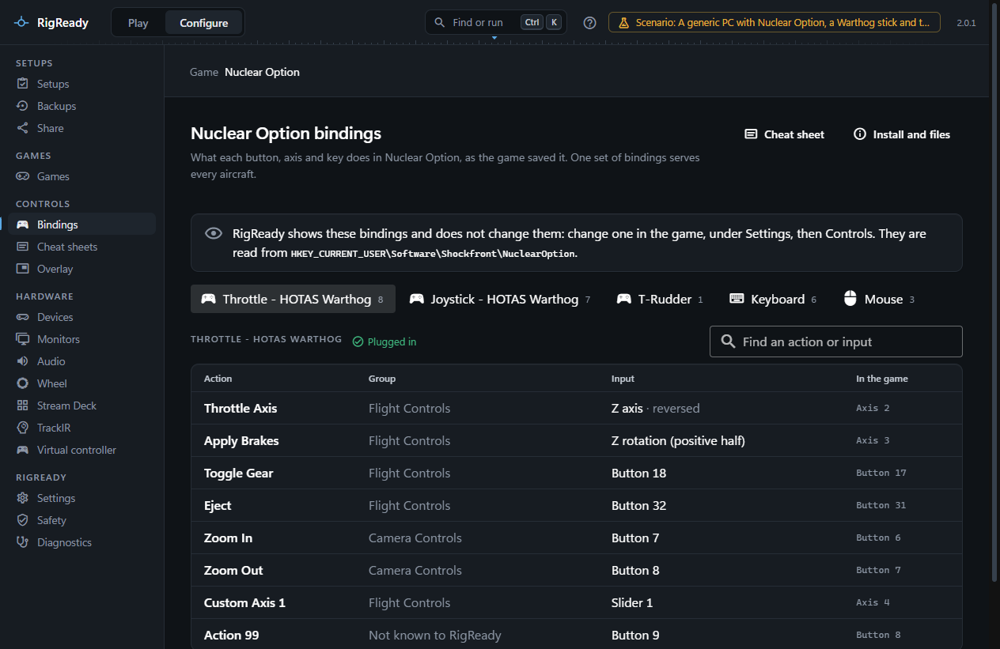
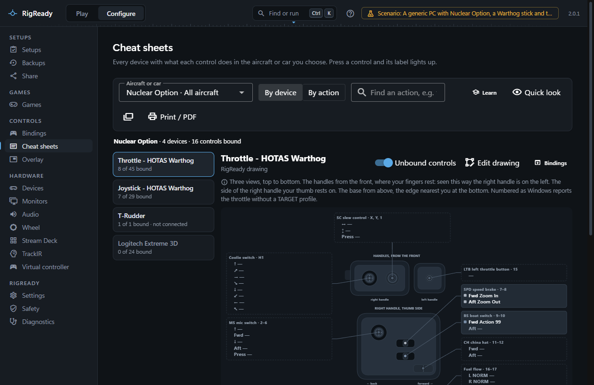

The Nuclear Option bindings page shows what the game has bound on each controller, on the keyboard and on the mouse. RigReady reads this from what the game itself saved, and does not change it: to change a binding, use the game's own Settings, then Controls.

Open it with **Configure > Bindings** and choose **Nuclear Option** in the **Game** picker above the page, or with [the command palette](../app/command-palette.md): press **Ctrl+K** and type "Nuclear Option bindings".

## Where the game keeps its bindings

Nuclear Option keeps its settings and bindings in the Windows registry, under `HKEY_CURRENT_USER\Software\Shockfront\NuclearOption`, not in files. It writes them the first time it runs. Until then the page says that the game has saved no bindings yet.

The game has one set of bindings for every aircraft, so there is no aircraft to choose.

## What the page shows

A button for each device the game has bindings for, with the number of bindings on it: the controllers first, plugged-in ones before the others, then the keyboard and the mouse. Choose one to see its bindings:

| Column | What it is |
|---|---|
| **Action** | The action by the name the game's controls screen gives it. Where a button or a key drives one side of an axis, it is that side's name: "Zoom In", "Pitch Down". |
| **Group** | The heading the game lists the action under: Flight Controls, Camera Controls, Gameplay. A binding from another tab of the game's screen (Chat, Mission Editor, Debug) names the tab too. |
| **Input** | The control in RigReady's words, the same as on the cheat sheets and in the input tester: "Button 5", "Y axis", "Ctrl + Shift + E". An axis the game reverses says "reversed". |
| **In the game** | The same input as the game's own screen shows it. |

The game counts a controller's buttons from 0, and RigReady, like Windows, from 1. So the game's "Button 4" is Button 5 here.

**Find an action or input** narrows the list: every word you type must be in the action, its group or the input.

A controller that is not plugged in is still listed, marked **Not plugged in**. Its axes are then named in the usual order (X, Y, Z, then the rotations), because RigReady cannot ask the controller for their names.

## Cheat sheets, the trainer and the overlay

The same bindings are what the [cheat sheets](../controls/cheat-sheets.md) draw for Nuclear Option, what the [trainer](../controls/trainer.md) asks, and what the [overlay](../play/overlay.md) names when you press a control. **Cheat sheet** at the top of the page opens the sheet.

## What RigReady does not do

- **Change a binding.** The page only shows them.
- **Back the bindings up.** RigReady's backups hold files, and these are registry values.
- **Show a binding on a hat switch by its direction.** How the game saves one is not known to RigReady yet; such a binding may be shown as a button.
- **Know an action a game update added.** It is listed as "Action" and its number until RigReady learns its name.

When the game saved a map RigReady cannot read, the page says so above the list and shows the rest.
