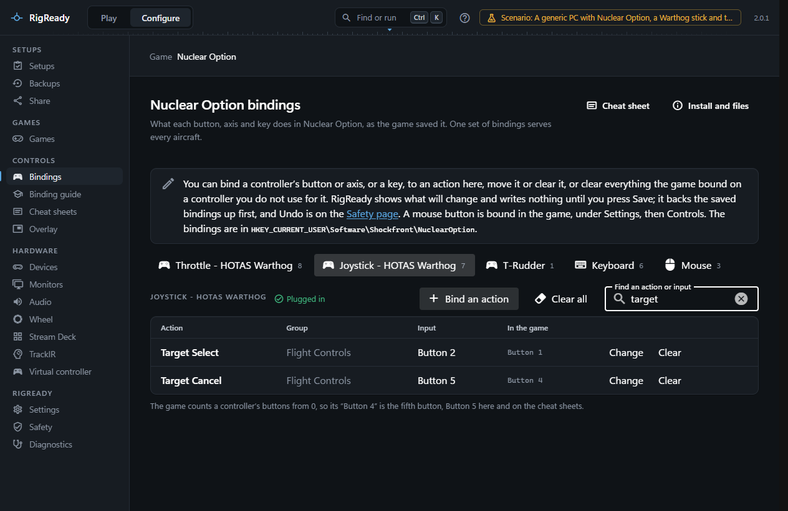
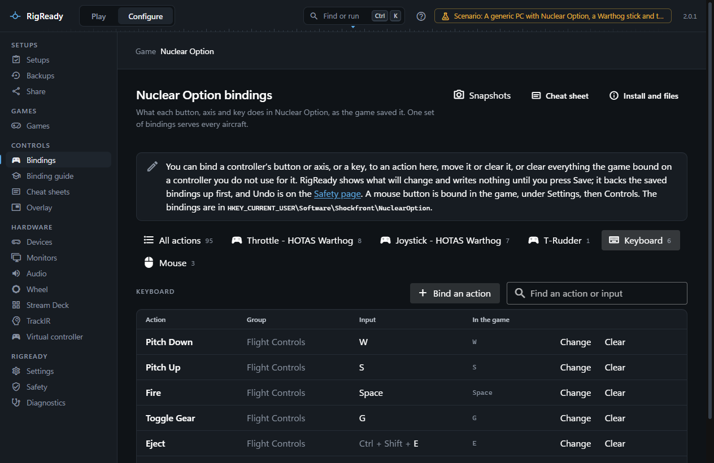
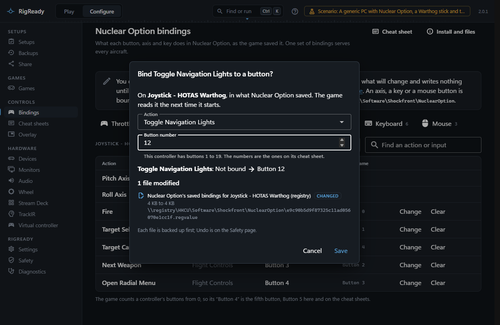
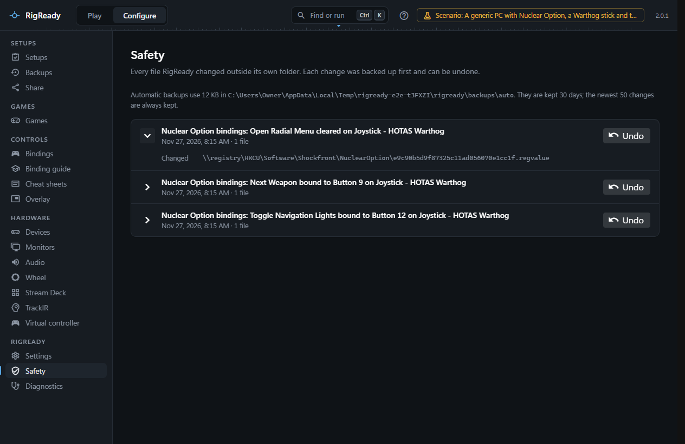

The Nuclear Option bindings page shows what the game has bound on each controller, on the keyboard and on the mouse. RigReady reads this from what the game itself saved. It can bind a button of a controller to an action, move it or clear it; an axis, a key or a mouse button is bound in the game's own Settings, then Controls.

Open it with **Configure > Bindings** and choose **Nuclear Option** in the **Game** picker above the page, or with [the command palette](../app/command-palette.md): press **Ctrl+K** and type "Nuclear Option bindings".

## Where the game keeps its bindings

Nuclear Option keeps its settings and bindings in the Windows registry, under `HKEY_CURRENT_USER\Software\Shockfront\NuclearOption`, not in files. It writes them the first time it runs. Until then the page says that the game has saved no bindings yet.

The game has one set of bindings for every aircraft, so there is no aircraft to choose.

## What the page shows

A button for each device the game has bindings for, with the number of bindings on it: the controllers first, plugged-in ones before the others, then the keyboard and the mouse. Choose one to see its bindings:

| Column | What it is |
|---|---|
| **Action** | The action by the name the game's controls screen gives it. Where a button or a key drives one side of an axis, it is that side's name: "Zoom In", "Pitch Down". |
| **Group** | The heading the game lists the action under: Flight Controls, Camera Controls, Gameplay. A binding from another tab of the game's screen (Chat, Mission Editor, Debug) names the tab too. |
| **Input** | The control in RigReady's words, the same as on the cheat sheets and in the input tester: "Button 5", "Y axis", "Ctrl + Shift + E". An axis the game reverses says "reversed". |
| **In the game** | The same input as the game's own screen shows it. |

The game counts a controller's buttons from 0, and RigReady, like Windows, from 1. So the game's "Button 4" is Button 5 here.

**Find an action or input** narrows the list: every word you type must be in the action, its group or the input.

A controller that is not plugged in is still listed, marked **Not plugged in**. Its axes are then named in the usual order (X, Y, Z, then the rotations), because RigReady cannot ask the controller for their names.

## Binding a controller button

Close Nuclear Option first: the game reads its bindings when it starts and saves them itself, so RigReady refuses the change while the game runs, and says so.

- **Change** on a row moves that action to another button of the same controller.
- **Clear** on a row takes the binding away.
- **Bind an action** above the list binds an action that has none on this controller: choose the action, then the button.

Press the button on the controller, or type its number: the one on the controller's [cheat sheet](../controls/cheat-sheets.md) and in the **Input** column (the first button is 1). A press on another controller is not taken; the dialog says which controller it was. A controller that is not plugged in can only have the number typed. RigReady shows the change before anything is written: what the action is on now and will be on, anything else that button already does ("One press will do both"), and the saved bindings it will change. Only **Save** writes.

RigReady copies the saved bindings of that controller first. The change is one entry on the [Safety page](../protect/safety-page.md), named for example "Nuclear Option bindings: Toggle Navigation Lights bound to Button 12 on Joystick - HOTAS Warthog", and **Undo** there puts the bindings back as they were. Undo is refused when the game has changed them again since, so that it cannot throw away something you did in the game.

The game picks the change up the next time it starts; its own controls screen then shows it. The game counts buttons from 0, so Button 12 here is "11" there.

What RigReady will not do here, and says so when asked: bind an axis, a key or a mouse button; bind one side of an axis action (Zoom In) to a button; change a binding it does not understand; bind anything on a controller the game has saved no bindings for yet.

## Cheat sheets, the trainer and the overlay

The same bindings are what the [cheat sheets](../controls/cheat-sheets.md) draw for Nuclear Option, what the [trainer](../controls/trainer.md) asks, and what the [overlay](../play/overlay.md) names when you press a control. **Cheat sheet** at the top of the page opens the sheet.

## The binding guide

**Configure > Binding guide** has a guide for Nuclear Option: what to bind first, in plain language, with what is bound now. See [Binding guide for Nuclear Option](nuclear-option-binding-guide.md).

## What RigReady does not do

- **Bind an axis, a key or a mouse button.** Those are bound in the game.
- **Put the bindings back from a backup.** Every full backup keeps the game's registry values, bindings included, as a record you can read on the backup's page ([Backups](../protect/backups.md)). RigReady cannot write them back to the registry, so a restore does not include them.
- **Show a binding on a hat switch by its direction.** How the game saves one is not known to RigReady yet; such a binding may be shown as a button.
- **Know an action a game update added.** It is listed as "Action" and its number until RigReady learns its name.

When the game saved a map RigReady cannot read, the page says so above the list and shows the rest.
