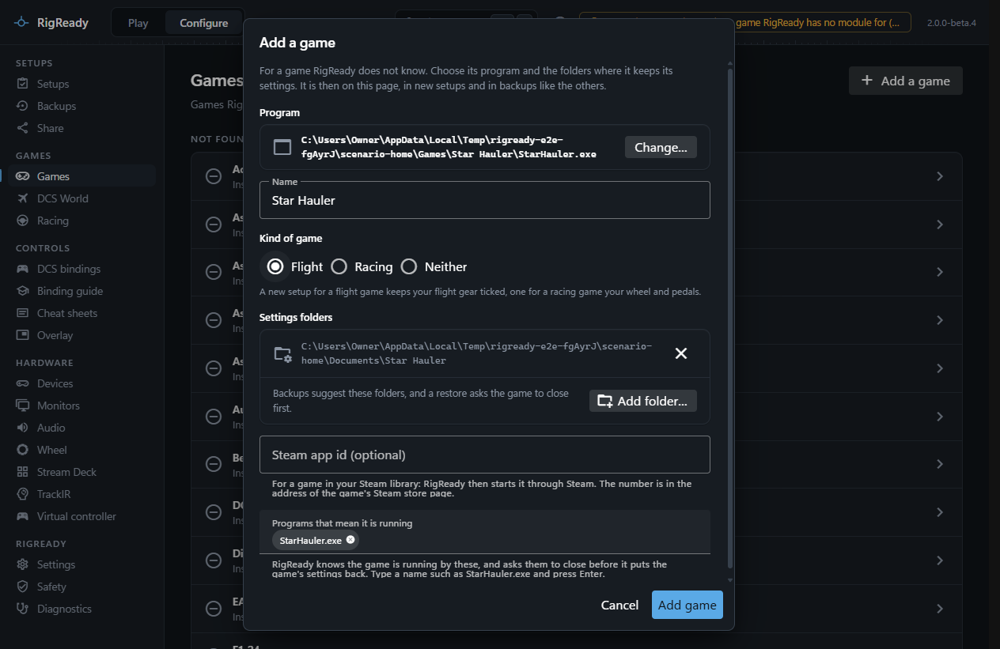
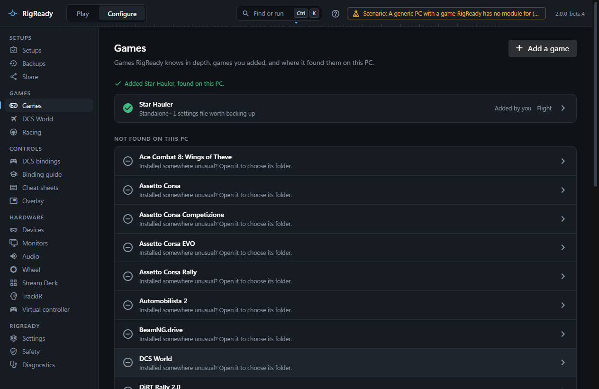
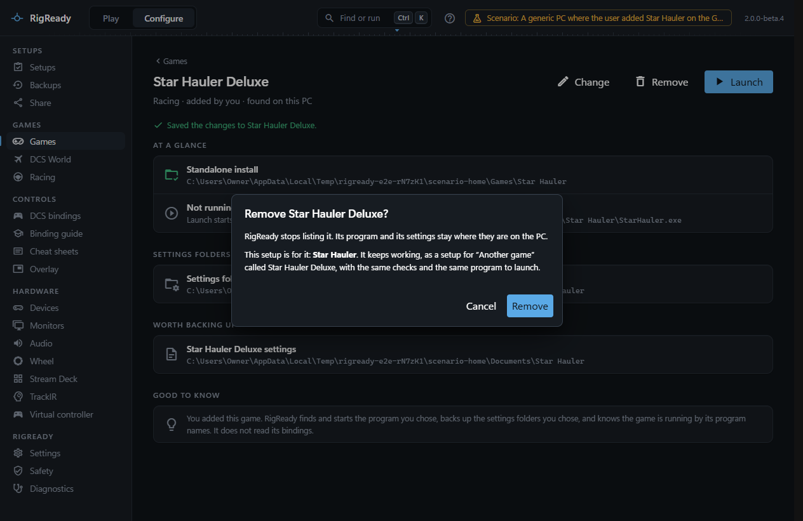
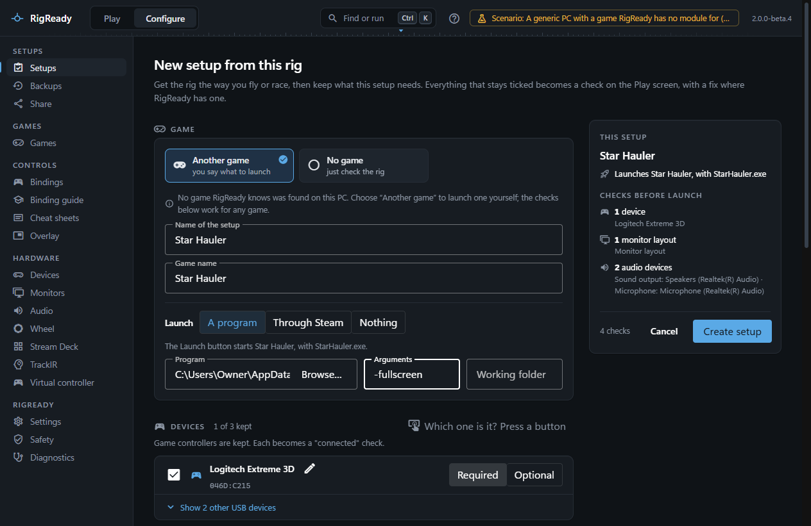
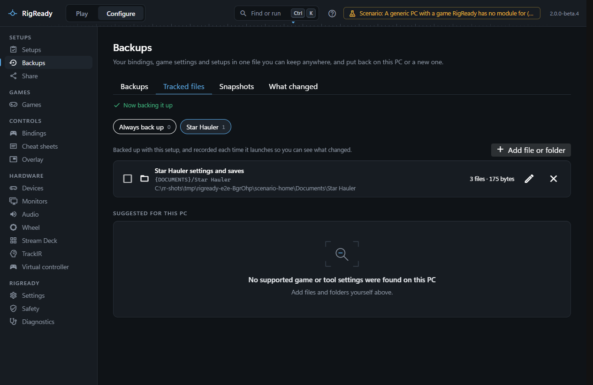

RigReady does not need to know a game to make a rig ready for it. There are two ways to use a game it does not ship with:

- **Add it to the Games page.** You choose its program and the folders where it keeps its settings, once. It is then listed with the other games, offered in every new setup, its folders are suggested on the Backups page, and RigReady knows when it is running.
- **Another game**, in one setup. The setup launches whatever you point it at and backs up whatever files you track for it, and nothing else knows about the game.

## Add it to the Games page

On **Configure > Games**, **Add a game** opens a dialog (it is also in the command palette, Ctrl+K):

- **Program**: **Choose program…** opens Windows' own file picker. RigReady names the game after the program's folder (you can change the name) and takes the program's file name as the program that means the game is running. **Launch** starts this program exactly as it is, with nothing added to it. A program inside Windows or RigReady's own folder, or RigReady itself, is refused.
- **Kind of game**: Flight, Racing or Neither. A new setup for a flight game keeps your flight gear ticked, one for a racing game your wheel and pedals; Neither keeps what the connected gear suggests.
- **Settings folders**: **Add folder…** opens Windows' folder picker. Pick the folder the game keeps its own settings in, such as `Documents\Star Hauler`. A folder that holds far more than one game is refused, with the reason: a whole drive, the Windows folder, Program Files, your whole user folder, the whole Documents, Saved Games or AppData folder, RigReady's own folder, or a whole Steam library.
- **Steam app id** (optional): for a game in your Steam library. RigReady then finds it through Steam and starts it through Steam. The number is in the address of the game's Steam store page.
- **Programs that mean it is running**: the program's own name to start with. Add a launcher or a second program by typing its file name and pressing Enter. Windows' own programs (such as `explorer.exe`), Steam (`steam.exe`: give a Steam game's app id instead) and RigReady are refused.

**Add game** saves it and says so only once RigReady has read it back. The game is then on the Games page marked **Added by you**, found where its program is, with its own page like any other game:

What the game then gets:

- A tile in every new setup, last of the games found, beside **Another game**, marked "added by you". Choosing it brings its program as the launch target. In the setup editor it is listed just above **Other game…**.
- Its settings folders listed on its page and suggested on the Backups page ([Tracked files](../protect/tracked-files.md)), and a restore of them asks the game to close first, by the program names you gave.
- A path variable for its first settings folder, named after the game: `{USER_STAR_HAULER}` for Star Hauler. Checks and tracked files that use it keep working on another PC that has the game added under the same name ([Path variables](../setups/path-variables.md)).

The games you add are kept in `games\custom.json` in RigReady's data folder. If that file is edited by hand, RigReady checks it again when it reads it: a folder or program name it would refuse in the dialog is left out, and the Games page says what was left out and why. A setup for a game whose entry was taken out of the file is shown as "Another game" until the game is added again under the same name.

### Change or remove it

The page of a game you added has **Change** and **Remove**. **Change** opens the same dialog with what the game has; its setups keep pointing at it.

**Remove** first says which setups are for the game. Those setups are not broken: each becomes a setup for "Another game" with the game's name, with the same checks and the same program to launch, and every path in them that used the game's folder variable is written out in full. The game's program and settings stay where they are on the PC.

### Shared setups

A setup for a game you added can be shared like any other. On a PC that has a game added under the same name, it stays a setup for that game. On a PC without it, the import report says "Added by hand on the other PC: the setup comes in for “Another game”", and the setup is imported for "Another game" with the game's name ([Sharing](../protect/sharing.md)).

## A setup for "Another game"

On the capture screen ([your first setup](../getting-started/first-setup.md)), the game tiles end with **Another game**, "you say what to launch". Choose it and type the **Game name**; it is used as the setup's name unless you change that. When no game RigReady knows is on the PC at all, the capture screen says so and points you to this tile.

The rest of the capture is the same as for a known game: every device, running app, the monitor arrangement and the audio defaults are proposed as checks, and you keep what this game needs. See [checks](../setups/checks.md).

In **Configure > Setups** ([The setup editor](../setups/editor.md)), editing the setup shows the game as **Other game…** with its name. Other setups can be given the same choice.

### The launch target

A known game brings its launch target with it. For another game you set it yourself: the program to start, its arguments and working folder, or a Steam game to ask Steam for. Launch is never built from a shell command, so arguments are a list, not a line. Steps to run before and after launch, and what [Stand down](../play/stand-down.md) closes, work the same as for every setup. See [launch](../setups/launch.md).

### Tracked files

Nothing is suggested for "Another game". Add the game's settings folder or files on the Backups page: they are then part of every full backup ([Tracked files](../protect/tracked-files.md)), restored with the [restore wizard](../protect/restore.md), and compared with the last time the game started under [What changed](../protect/what-changed.md).

## What is not there

For a game you added and for "Another game" alike:

- No **Bindings and controllers** page, no [cheat sheet](../dcs/cheat-sheets.md), no device ID repair. RigReady does not know the game's binding format.
- No version: "updated since you last verified" is offered only for a game you added with a Steam app id, from Steam's build number.

For "Another game" only:

- No "close the game before restoring" rule of its own. RigReady does not know which program writes the game's files, so close the game yourself before you restore them; or add the game on the Games page with its program names.
- It is not on **Configure > Games**, and there is no **Running** chip based on its process unless the setup has a check for it.
