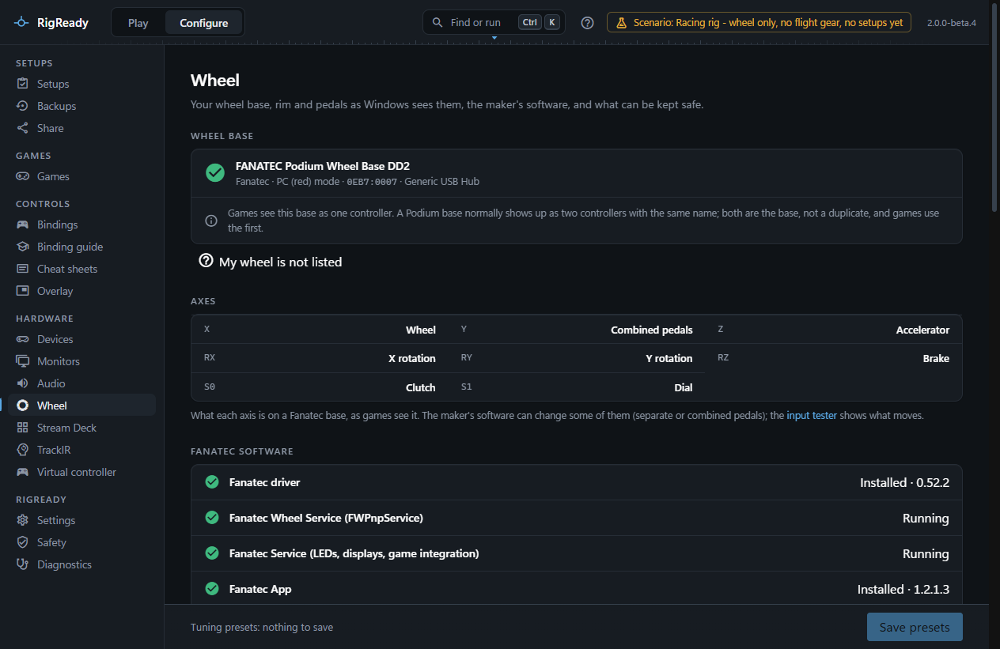
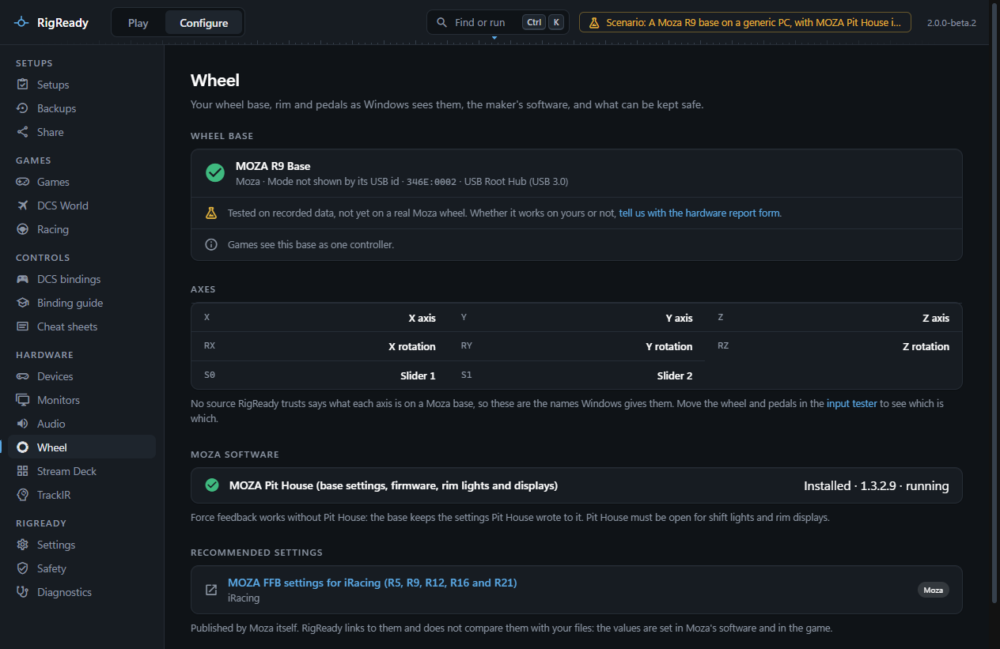
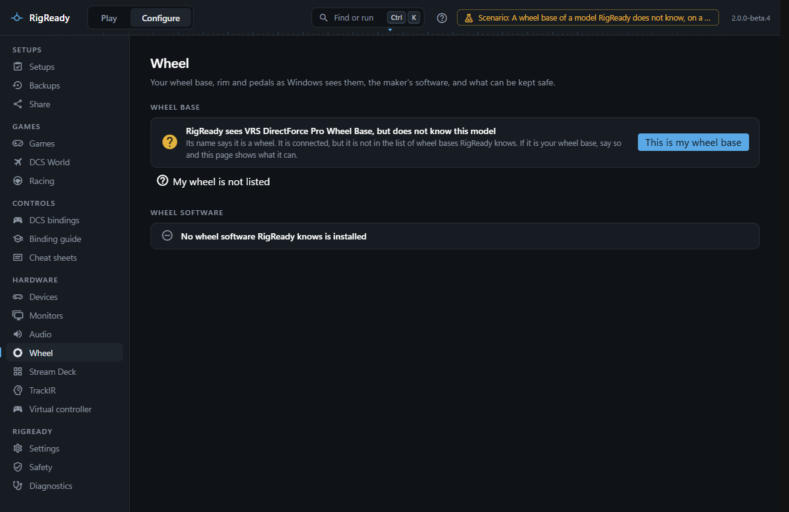
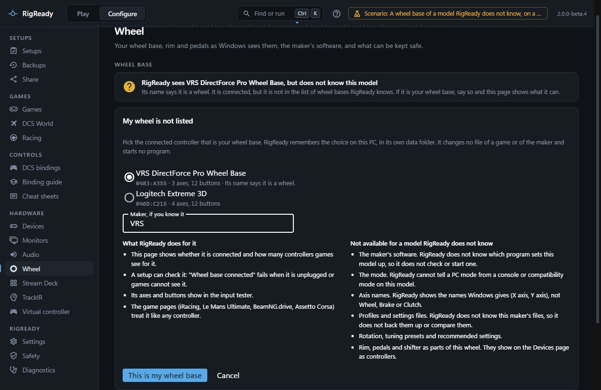
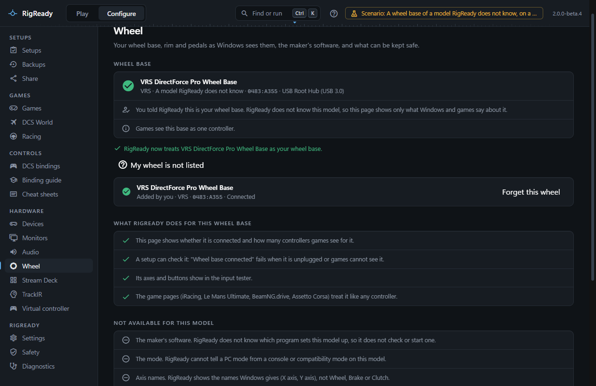
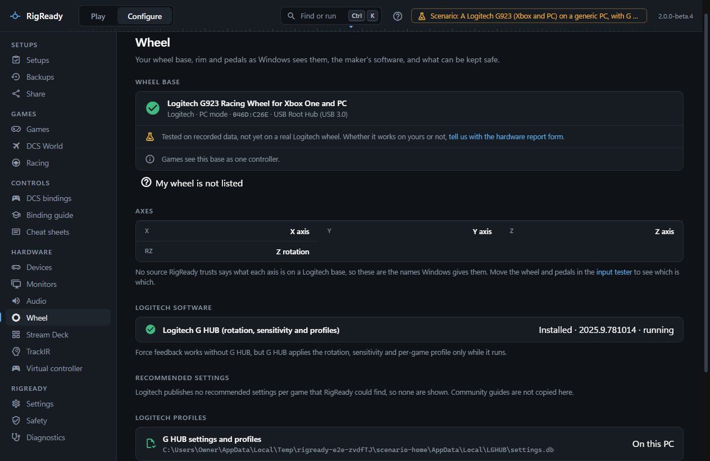
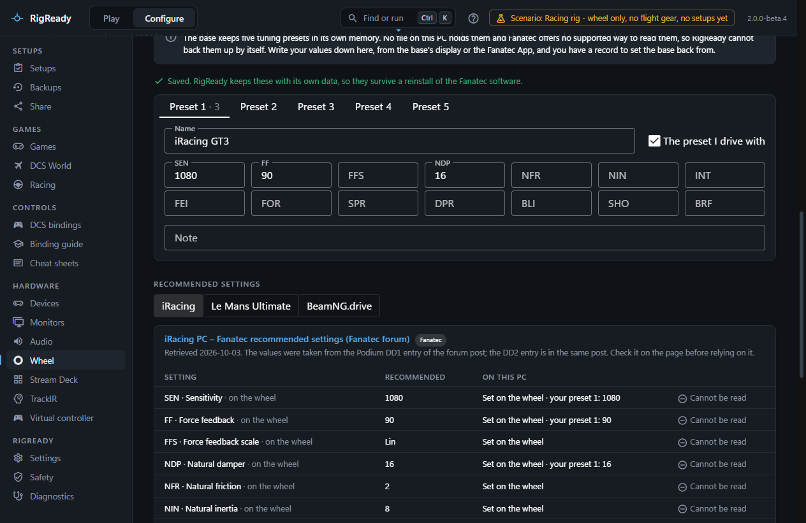
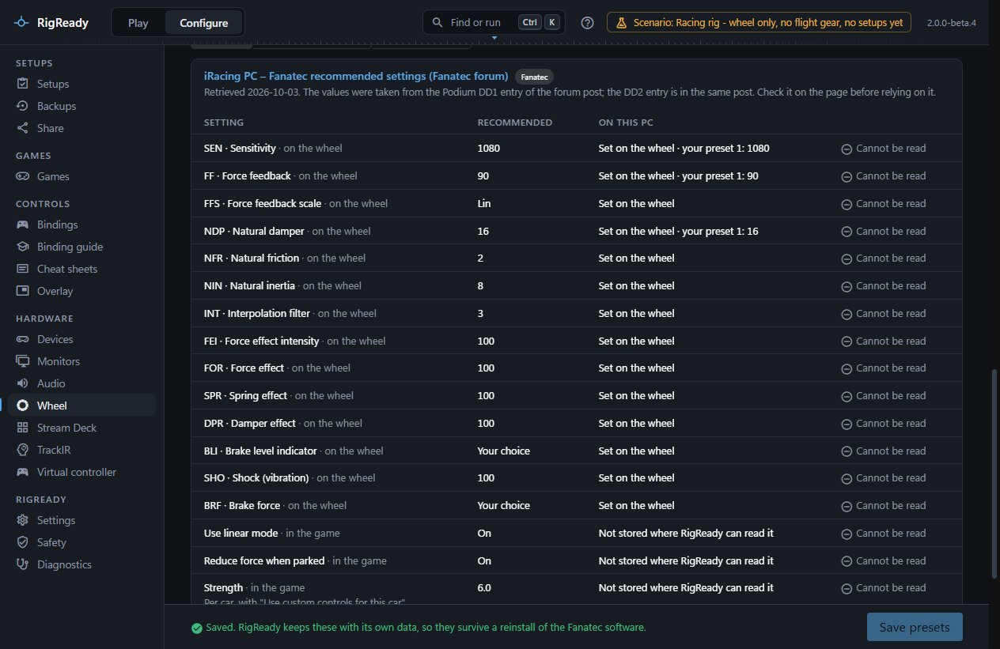

**Configure > Wheel** (under Hardware, and reached from the [Racing overview](index.md#configure-games-racing)) is the page for your wheel base, whatever its brand. RigReady recognises a base from its USB vendor and product ID and knows these brands: Fanatec, Moza, Logitech, Simagic, Thrustmaster, Simucube, Asetek SimSports and Cammus. The sources for every ID and file are in [docs/research/wheelbases.md](../../research/wheelbases.md) (Fanatec: [docs/research/racing.md](../../research/racing.md)).

## Tested on which wheels

RigReady was built on one rig, with a Fanatec Podium DD2. **Fanatec is the only brand tested on a real wheel.** For every other brand the page has been tested on recorded data only: synthetic device lists and files made from the published IDs, not a real Moza, Logitech, Simagic, Thrustmaster, Simucube, Asetek or Cammus wheel. The page says so under the base ("Tested on recorded data, not yet on a real Moza wheel") with a link to the [hardware report form](https://github.com/MCheli/RigReady/issues/new?template=hardware.yml). A report that it works on your wheel is as useful as one that it does not; the line goes away for a brand once someone confirms it.

## The wheel base

The top panel says which base is connected (the name you gave it on the [Devices page](../hardware/devices.md), with the name it reports), its brand, its mode, its vendor and product ID, and what it is connected through. Below it: how many controllers games see for the base, the brand's other parts on USB (pedals, a shifter or a handbrake with their own USB connection), and any base of another brand connected at the same time.

Whether the mode can be told depends on the brand:

| Brand | What the USB ID shows |
|---|---|
| Fanatec | **PC (red) mode**, or **compatibility (yellow) mode**: the base reports itself as a ClubSport Wheel Base V2.5 (0EB7:0004), and bindings saved in PC mode do not match it in [iRacing](iracing.md), [Le Mans Ultimate](le-mans-ultimate.md) or [BeamNG.drive](beamng.md). |
| Logitech | The G29's PS3/PS4 switch: the PS3 position (046D:C24F) is flagged, since Logitech advises the PS4 position on a PC. The G923 and PRO editions are told apart by name. |
| Thrustmaster | A belt wheel the driver has not switched yet shows as a generic "FFB Wheel" (044F:B65D), which means the driver is missing or did not take over. A T300 in PS4 mode or PS3 advanced (F1) mode is flagged too. |
| Moza, Simagic, Simucube, Asetek, Cammus | No mode in the ID. The page says "Mode not shown by its USB id" and claims nothing. Simagic's compatibility mode shows as the vJoy ID (1234:BEAD), which vJoy itself also uses, so RigReady does not call it a Simagic. |

Games see a Fanatec Podium base as two controllers with the same name; the page says both are the base, not a duplicate.

With no base that RigReady knows plugged in, the panel says "No wheel base RigReady knows is connected". It does not say the PC has no wheel base: RigReady knows a list of models, and a base outside that list can still be plugged in. See [My wheel is not listed](#my-wheel-is-not-listed).

## My wheel is not listed

RigReady recognises a wheel base by its USB ID, from a list of models. A base that is not in the list is still seen as a game controller. When such a controller looks like a wheel base, the panel says so: "RigReady sees <name>, but does not know this model", with the reason it takes it for a wheel. The reason is its name (it says wheel, steering or direct drive), or its USB vendor ID when that belongs to a maker of racing gear only. The [Racing overview](index.md#configure-games-racing) says the same on its wheel card.

Choose **This is my wheel base**, or **My wheel is not listed** under the panel, to tell RigReady which connected controller is your wheel base. The list shows every connected controller that RigReady does not know as a wheel base, with its USB ID and its count of axes and buttons. One that looks like a wheel base is chosen for you; anything else you pick yourself. You can add the maker's name if you know it. It is shown as a label and changes nothing else.

RigReady remembers the choice on this PC, in its own data folder (`racing\wheels.json`). It changes no file of a game or of the maker and starts no program. **Forget this wheel** takes the choice back.

What a base RigReady does not know gets:

- The Wheel page shows whether it is connected and how many controllers games see for it. When it is unplugged, the page says which base it waits for.
- A setup can check it: **Wheel base connected** fails when it is unplugged or games cannot see it.
- Its axes and buttons show in the [input tester](../hardware/input-tester.md).
- The game pages ([iRacing](iracing.md), [Le Mans Ultimate](le-mans-ultimate.md), [BeamNG.drive](beamng.md), [Assetto Corsa](assetto-corsa.md)) treat it like any controller.

What is not available for it, because each needs something only the maker's models in the list have:

- The maker's software. RigReady does not know which program sets the model up, so it does not check or start one, and the software panel is not shown.
- The mode. RigReady cannot tell a PC mode from a console or compatibility mode on a model it does not know.
- Axis names. The Axes panel shows the names Windows gives (X axis, Y axis), not Wheel, Brake or Clutch.
- Profile and settings files. RigReady does not know the maker's files, so it does not back them up or compare them.
- Rotation, tuning presets and recommended settings.
- Rim, pedals and shifter as parts of the wheel. They show on the [Devices page](../hardware/devices.md) as controllers.

The page lists both after you add the base, in the same words. This is true even when you type the name of a maker RigReady knows: the model is still not in the list, so nothing of that maker is assumed for it.

If your wheel base is not in the list, a [hardware report](https://github.com/MCheli/RigReady/issues/new?template=hardware.yml) with its name and USB ID is how it gets added.

## Axes

The **Axes** panel lists each axis of the base as games see it (X, Y, Z, RX, RY, RZ, sliders) and what it is. Only Fanatec's are named from a source (X wheel, Z accelerator, RZ brake, slider 1 clutch, slider 2 dial, Y combined pedals). No other maker publishes its axis map, so for them, and for a base you added yourself, the panel shows the names Windows gives and says so; move the wheel and pedals in the [input tester](../hardware/input-tester.md) to see which is which. For a Fanatec base the tester uses the same names and draws the base as a [wheel and pedals](../hardware/input-tester.md#a-wheel-base). Pedals plugged into the base (Logitech, Thrustmaster, Moza through the base, Simagic P1000 in CAN mode) are axes of the base, not devices of their own.

## The maker's software

The software panel lists what RigReady can see of the brand's software, installed or not, its version, and whether it is running, with one line on what it is needed for:

| Brand | Software | Needed for force feedback? |
|---|---|---|
| Fanatec | The driver (and its Fanatec Wheel Service), the Fanatec Service, the Fanatec App. Also the base firmware the driver ships, and the rim codes and rotation the driver last saw. | The driver, yes. |
| Moza | MOZA Pit House | No: the base keeps what Pit House wrote. Pit House is needed for shift lights and rim displays. |
| Logitech | Logitech G HUB | No, but G HUB applies the rotation, sensitivity and game profile only while it runs. |
| Simagic | SimPro Manager (2 for Alpha, Alpha Mini and Alpha U; 3 for EVO) | No, once settings are saved to the base. |
| Thrustmaster | The Thrustmaster FFB Racing Wheel driver (its Control Panel is in Windows Game Controllers) | Yes. |
| Simucube | Simucube Tuner (or the older True Drive) | No, but without Tuner the base drives with its default profile. |
| Asetek | RaceHub | Settings are saved to the base; RaceHub turns on high torque mode. |
| Cammus | Not known yet | Not known. |

When you [create a setup](../setups/capture.md) from the rig, the capture screen offers the maker's program as an item ("MOZA Pit House running", "Logitech G HUB running", "SimPro Manager running"), ticked when it is running now. Its fix starts the program, like any other app on the [Play screen](../play/index.md). It is never closed at Stand down.

## Checks a setup can hold

- **Wheel base in PC mode** (Fanatec, Logitech, Thrustmaster) or **Wheel base connected** (the brands whose ID shows no mode, and a base you added with [My wheel is not listed](#my-wheel-is-not-listed)): the base is on USB, games can see it, and it is not in a mode the ID gives away. For a base you added, no mode is checked.
- **<Software> running**: the maker's program is running, with a fix that starts it.
- **Wheel rotation** (optional, Fanatec only): the rotation the Fanatec driver last recorded is the one the setup expects. No other brand writes the rotation where RigReady can read it, so it is not offered for them.

See [Checks and fixes](../setups/checks.md).

## Profile files and backups

Where a brand keeps its profiles in plain files, the page lists them and whether they are on this PC, and the **Backups** section keeps copies:

- **Fanatec**: the Fanatec App's settings file (`shared_preferences.json`), and the Fanatec Service registry settings as a record. RigReady never writes the registry, so a restore puts back the App's file and shows the registry values for you to compare.
- **Logitech**: G HUB's `settings.db` in `%LOCALAPPDATA%\LGHUB`. G HUB keeps it open, so a restore closes G HUB first (when you agree) and starts it again.
- **Simucube**: Tuner's profiles in `Documents\Simucube 2\cachedprofiles`.

When the maker's program is open, the restore names it and offers **Close the app and restore**. RigReady asks it to close and never ends it by force. If it is still running afterwards, the dialog says why (for example, it only went to the tray) and nothing is restored: close it yourself, then press **Restore again**.

Moza Pit House, SimPro Manager, RaceHub and the Cammus software keep their presets in places nobody has documented yet, so nothing is offered for them rather than a backup that might miss them. The same items are offered for a full backup on the Backups page: see [backups](../protect/backups.md). [Restoring](../protect/restore.md) asks for the maker's program to be closed first.

## Fanatec: your tuning presets

A Fanatec base keeps five tuning presets in its own memory. No file on the PC holds them, and Fanatec offers no supported way to read them, so RigReady cannot back them up by itself. What it can do is keep the copy you write down.

Five tabs, **Preset 1** to **Preset 5**, each with a name, a note ("Which rim, which cars"), and a field for each tuning parameter: SEN, FF, FFS, NDP, NFR, NIN, INT, FEI, FOR, SPR, DPR, BLI, SHO and BRF. Type the values as the base shows them ("1080", "AUT", "Lin", "Off"); each field's hint says what the parameter is. Tick **The preset I drive with** on the one you normally use. **Save presets** stores them with RigReady's own data, so they survive a reinstall of the Fanatec software. A value you type while the save is still being written stays, and the bar says it is not saved yet. RigReady never writes tuning to the base.

## Recommended settings

**Fanatec**: a table for iRacing, Le Mans Ultimate and BeamNG.drive of recommended settings with their source and the date they were retrieved, and a caveat where there is one: the iRacing values are from the Podium DD1 entry of Fanatec's forum post, Fanatec publishes no recommendation for Le Mans Ultimate (the values are a community guide), and BeamNG.drive is not in Fanatec's game list (the values are Fanatec's general guide). Each row says whether the setting is **on the wheel** (always **Cannot be read**; your active preset's value is shown beside it) or **in the game** (compared when the game's files hold it: **As recommended** or **Differs**). The optional check **wheel settings as recommended** runs the same comparison on the Play screen.

**Other brands**: only where the maker itself publishes settings per game, the page links to them: Moza for iRacing, and Asetek for Le Mans Ultimate, iRacing, BeamNG.drive and Assetto Corsa EVO. RigReady does not copy those values or compare them with your files. Logitech, Simagic, Thrustmaster, Simucube and Cammus publish none that RigReady could find, so none are shown; community guides are not copied.
