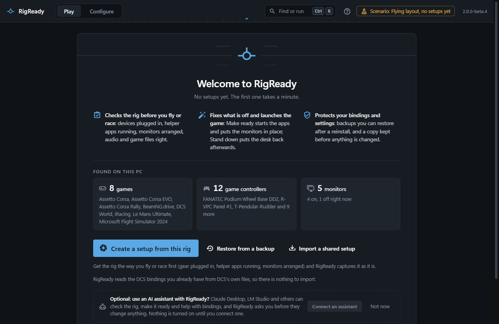
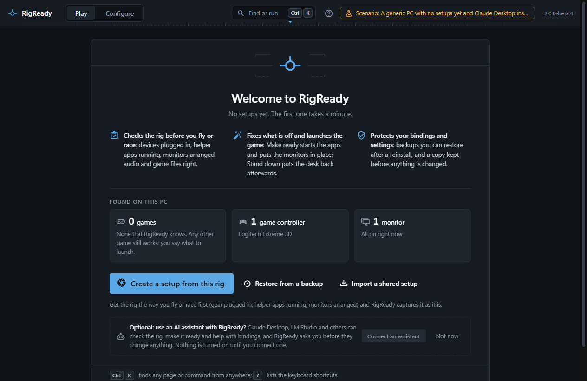

Open RigReady. With no setup yet, the [Play screen](../play/index.md) is a welcome: what the app does in three lines, what it found on this PC, and one button that leads into the first setup.

## Found on this PC

Three readings, taken while the screen opens.

- **Games**: the games RigReady knows that are installed here. It looks for DCS World, iRacing, Le Mans Ultimate, BeamNG.drive, Assetto Corsa, Assetto Corsa EVO, Assetto Corsa Rally and Microsoft Flight Simulator 2024. Any other game still works: in a setup you say what to launch.
- **Game controllers**: every game controller Windows sees, by name. If a stick, wheel or panel is missing, plug it in and open the Play screen again. The [Devices page](../hardware/devices.md) shows each one in detail.
- **Monitors**: how many are connected, and how many of them are on right now. The [Monitors page](../monitors-and-audio/index.md) draws them.

Nothing is changed by looking. If the PC could not be read just now, the screen says so; capturing a setup looks again.

## Three ways in

- **Create a setup from this rig** is the usual first step: it opens the capture page, described on [the next page](first-setup.md). Get the rig the way you fly or race first (gear plugged in, helper apps running, monitors arranged), because the setup is captured from the rig as it is.
- **Restore from a backup** goes to **Configure > Backups**, for a backup RigReady made on another PC or before a reinstall. See [Restore a backup](../protect/restore.md) and [Moving to a new PC](../protect/new-pc.md).
- **Import a shared setup** goes to **Configure > Share**, for a `.rigready` file somebody sent you. See [Share a setup](../protect/sharing.md).

On a PC with DCS World, a line under the buttons says that RigReady reads the DCS bindings you already have from DCS's own files, so there is nothing to import. [DCS bindings](../dcs/bindings.md) shows them.

## An AI assistant, if you want one

Under the three ways in, an optional line asks whether you want to use an AI assistant (Claude Desktop, LM Studio and others) with RigReady. **Connect an assistant** opens the list of assistants found on this PC, one button each; see [Connect an assistant](../ai/mcp-server.md). **Not now** puts the line away on this PC. Nothing is turned on until you connect one.

The line at the bottom holds on every screen: Ctrl+K opens [the command palette](../app/command-palette.md), which finds any page or command from anywhere, and ? lists the [keyboard shortcuts](../app/keyboard-shortcuts.md). [Play and Configure, the two modes](two-modes.md) explains them.
