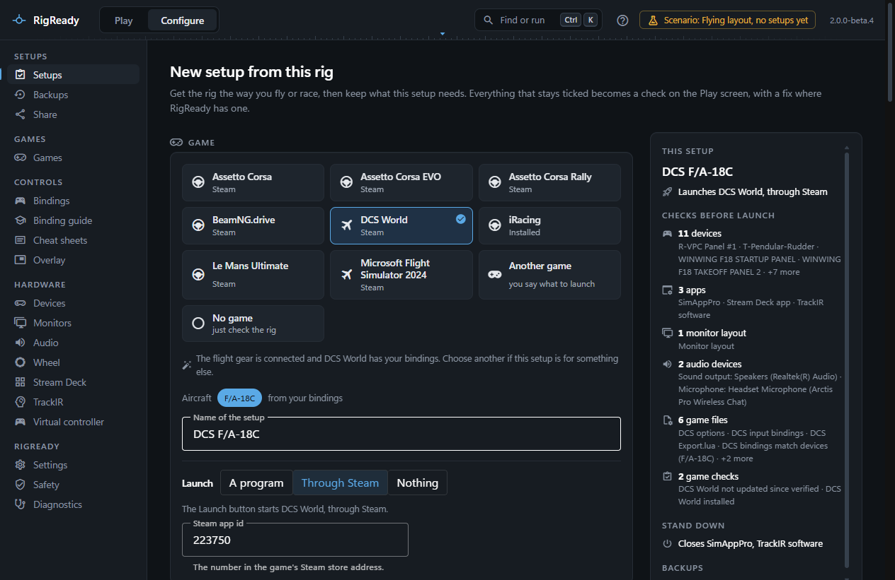
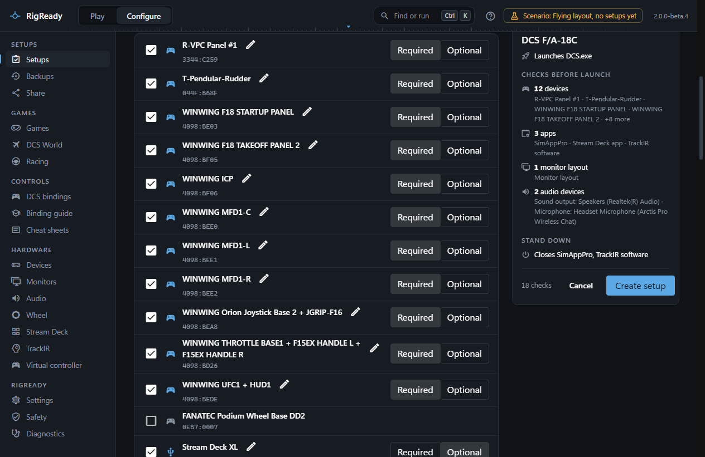
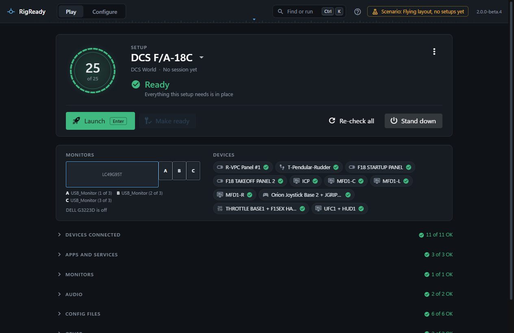

A setup is one ready state: one aircraft or car, with the devices, helper apps, monitor arrangement, audio devices and game files it needs. RigReady does not ask you to type it in. **Create a setup from this rig** reads the rig as it is and shows it in sections; everything that stays ticked becomes a check on the [Play screen](../play/index.md), with a fix where RigReady has one. This page walks through the capture once; the same page opens later from **Configure > Setups > New setup from this rig**, and [Creating a setup from the rig](../setups/capture.md) describes every part of it.

## The game

The first section shows every game found on this PC as a tile, with where it came from (Steam, installed, running now). If the rig says what it is for, the game is chosen already, with the reason ("The flight gear is connected and DCS World has your bindings"); choose another if this setup is for something else. **Another game** is for a game RigReady does not know: you name it and say what to launch. **No game** just checks the rig.

Where the game's own files say which aircraft or cars you use, they are offered as chips; the one you pick names the setup and brings its own checks. The name can be anything, and it is the only thing a setup must have.

The **Launch** section says what the Launch button will start: the program, its arguments and its working folder, filled in for a known game (DCS World through Steam, for example). Leave the program empty and the Play screen has no Launch button for this setup. If a game is installed more than once, you choose which install the setup uses. See [Launch targets and steps](../setups/launch.md).

## What is checked

Each section lists what RigReady found, ticked where a setup like this one usually keeps it, with **Required** or **Optional** beside each item that stays. A required item that is not met makes the rig Not ready; an optional one only warns. [Checks and fixes](../setups/checks.md) lists every kind of check and what its fix does.

- **Devices**: the game controllers, kept, each as a "connected" check. **Which one is it? Press a button** lights up the row of the controller you press, and the pencil renames a device for this setup (Left MFD rather than WINWING MFD1-L). Identical devices are separate rows, told apart by serial number or USB port; see [Devices](../hardware/devices.md).
- **Apps**: the sim helpers running now, kept. [Make ready](../play/make-ready-and-launch.md) starts the ones that are missing, and some are closed again at [Stand down](../play/stand-down.md) (the row says so). **Find an app** searches everything that is running.
- **Monitors**: the arrangement as it is right now, drawn to scale. Make ready puts it back. You can save the arrangement as a named layout here, shared by every setup that uses it; see [Monitor layouts](../monitors-and-audio/layouts.md).
- **Audio**: the default output and input devices as they are now. Make ready sets them again; see [Audio](../monitors-and-audio/audio.md).
- **Game files**: the game's files that are checked before every launch, so a missing or changed file shows before the game loads.
- **Game checks**: what only this game needs, such as DCS World not having updated since the setup was last verified. The [DCS World](../dcs/index.md) and [Games](../games/index.md) sections say what each game brings.

## What is backed up

**Back up with this setup** lists the files and folders the Backups page will keep copies of for this setup: the game's own first, what helper tools keep one click away. Nothing is copied now. See [Tracked files](../protect/tracked-files.md).

## Create it

The panel on the right is the setup so far: its name, what Launch starts, the checks by section, what Stand down closes, and what is backed up. **Create setup** writes it and returns to the Play screen, which checks it at once. On the rig it was captured from, the result is Ready.

The setup is a YAML file in `~/.rigready/profiles` ([Hand-editing the YAML](../setups/yaml.md)). Everything about it can be changed later in [the setup editor](../setups/editor.md) under **Configure > Setups**: the checks and their fixes, what Launch starts, steps to run before and after launch, and what Stand down closes. A setup can be cloned, and items copied from one setup to another ([Clone, copy and delete](../setups/clone-copy-delete.md)). The [Setups](../setups/index.md) section covers all of it.

From here on, a session starts on the Play screen with [Make ready and launch](../play/make-ready-and-launch.md), or with one double-click on a [desktop shortcut](../one-click/desktop-shortcut.md).
