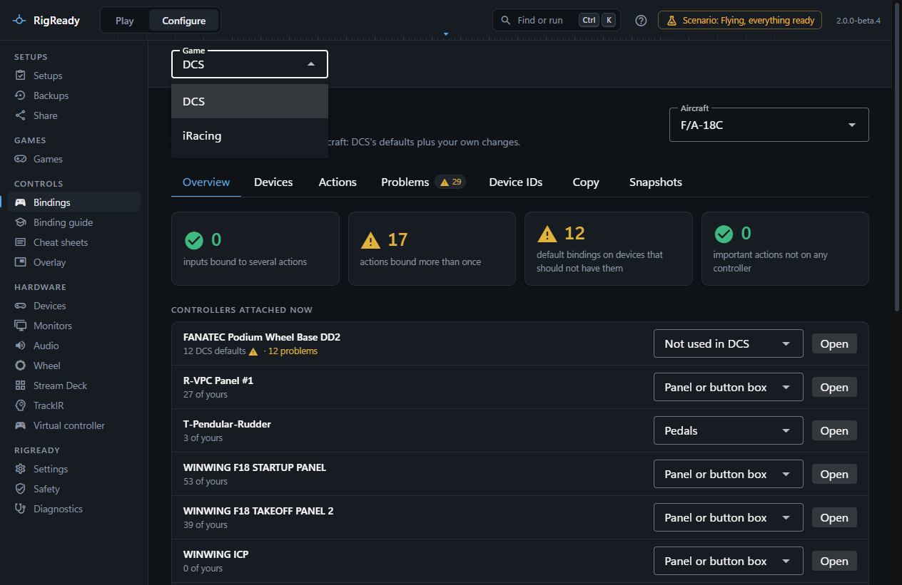
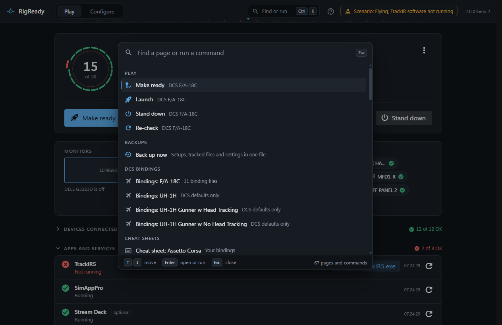
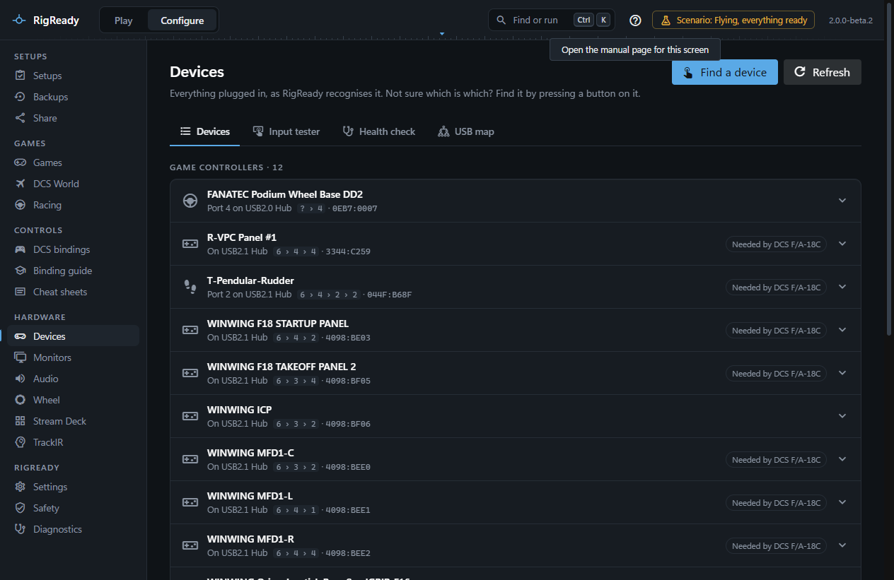

The window has two modes, switched at the top left or with Ctrl+1 and Ctrl+2.

- **Play** is one screen: is the rig ready for the setup you used last, fix what is not, launch. After the session, Stand down. See [The Play screen](../play/index.md).
- **Configure** is everything else, in five groups down the left side. Each page has its own page in this manual. The menu names no game: a page about one game opens from Games, and the bindings of every game from **Bindings**, which opens the game you looked at last (the first time, the game of the setup you use) and has a **Game** picker above the page for the others. Bindings offers only games found on this PC, and says so when there is none.

| Group | Pages |
|---|---|
| Setups | [Setups](../setups/index.md), [Backups](../protect/backups.md), [Share](../protect/sharing.md) |
| Games | [Games](../games/index.md), and from its cards the [DCS World](../dcs/index.md) and [Racing](../games/index.md#configure-games-racing) pages |
| Controls | Bindings, with a game picker: [DCS](../dcs/bindings.md) or [iRacing](../games/iracing-bindings.md); Binding guide for [DCS aircraft](../dcs/binding-guide-and-ai.md) and [iRacing](../games/iracing-binding-guide.md) (there when either is found), [Cheat sheets](../controls/cheat-sheets.md), [Overlay](../play/overlay.md) |
| Hardware | [Devices](../hardware/devices.md), [Monitors](../monitors-and-audio/index.md), [Audio](../monitors-and-audio/audio.md), [Wheel](../games/wheel.md), [Stream Deck](../hardware/stream-deck.md), [TrackIR](../hardware/trackir.md), [Virtual controller](../hardware/virtual-controller.md) |
| RigReady | [Settings](../app/settings.md), [Safety](../protect/safety-page.md), [Diagnostics](../app/diagnostics.md) |

## Find or run: Ctrl+K

Ctrl+K, or **Find or run** at the top right, opens the command palette: one field that finds every page and runs the common actions from wherever you are, such as Make ready, Launch, Stand down, switching to another setup, applying a saved monitor layout, Back up now, and finding a device by pressing a button on it. Type a few letters, press Enter, and you are there or it is done. [The command palette](../app/command-palette.md) has the whole list and how the result of an action is reported.

## Help for the screen you are on

The question mark at the top right, next to **Find or run**, opens the page of this manual about the screen you are on, in your browser. It knows the tab you are on as well: on **Backups > Tracked files** it opens [Tracked files](../protect/tracked-files.md), on a game's page that game's page. The command palette has the same as **Open the manual page for this screen**, and **Open the manual** for the front page; **About** and **Settings** link to the manual too.

A notice about something that went wrong (controllers that could not be read, a DCS file RigReady will not write, a setup file that cannot be read, a damaged data file) has a **What to do** link to its page under [Troubleshooting](../troubleshooting/index.md).

The manual is on the website, so these links need a connection; without one the browser says so and RigReady is not affected.

## Other keys

| Keys | What they do |
|---|---|
| Ctrl+1, Ctrl+2 | Go to Play, go to Configure |
| Ctrl+K | Find a page or run a command |
| ? | Show the keyboard shortcuts (outside a text field) |
| Enter | On the Play screen, the main action: Make ready and launch, or Launch once the rig is ready |

[Keyboard shortcuts](../app/keyboard-shortcuts.md) is the complete list; [Text size](../app/text-size.md) covers Ctrl and +, Ctrl and - and F11.

The version number at the top right opens **About**: the version, the licence, the data folder, and where to report a problem.
