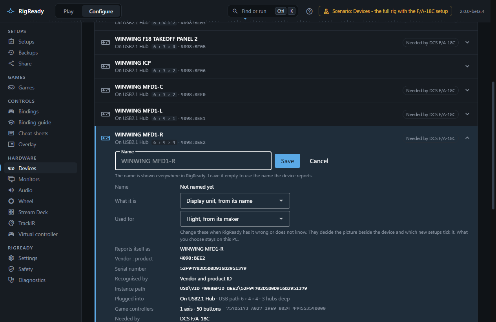
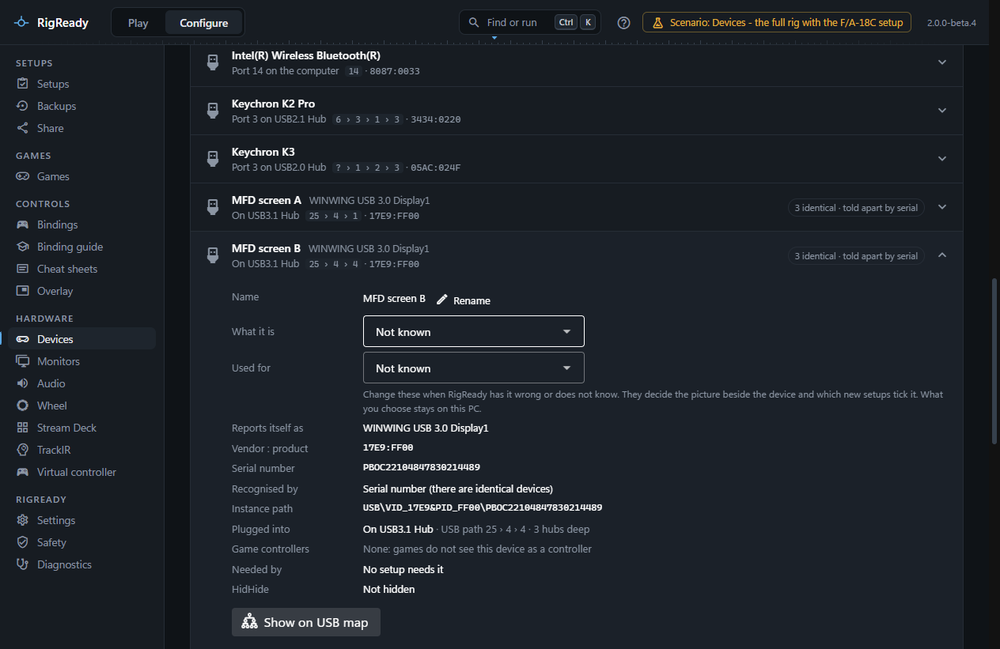
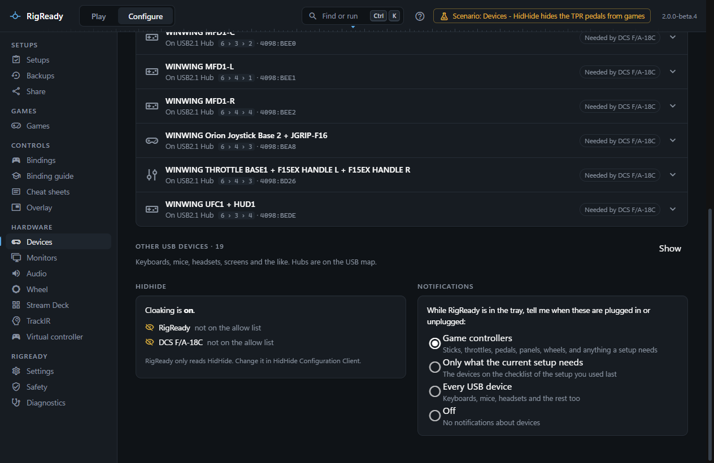

The **Devices** tab of **Configure > Devices** lists everything plugged in as RigReady recognises it. It is where you give devices names, find out which physical device is which, see where each is plugged in and which setups need it, and learn whether HidHide is hiding something from your game.

## The list

**Game controllers** come first: every USB device that Windows classes as a game controller, or that DirectInput lists. Each row shows the name (yours, or the one the device reports, with the reported name in smaller type when you have named it), where it is plugged in ("Port 2 on USB2.1 Hub") with the port numbers from the computer down ("6 › 4 › 2 › 2"), and the vendor and product ID. Chips mark a device that is **Hidden by HidHide**, one of several identical devices ("3 identical · told apart by serial"), and a device **Needed by** a setup.

**Other USB devices** (keyboards, mice, headsets, screens) are hidden until you choose **Show**. Hubs are on the [USB map](usb-map.md).

Between the two, **Needed by a setup, not connected** lists devices that some setup's checklist needs and that are not here, with which setups need them and, when RigReady has seen them before, when and where they were last plugged in.

Opening a row shows its details:

- **Name**, with **Name it** or **Rename**. A name is shown everywhere in RigReady: on the [Play screen](../play/index.md), in the [bindings pages](../dcs/bindings.md), on the USB map, on the [racing pages](../games/index.md) and in the [health check](health-check.md). Leave it empty to use the name the device reports.
- **Reports itself as**, the manufacturer, **Vendor : product**, the **Serial number** or "none", the **Instance path** Windows uses.
- **Recognised by**: vendor and product ID; the serial number when there are identical devices; the USB port when identical devices have no usable serial (moving it to another port then changes its identity); or the DirectInput instance ID for a controller with no USB device of its own.
- **Plugged into**, with how many hubs deep it is. At four hubs the row warns that it is one short of the USB limit; at five, that it may stop working.
- **Game controllers**: the DirectInput controllers that belong to this device, each with its axes, buttons and hats and its instance ID. A wheel base that Windows lists as two controllers with the same name is explained as built that way, not a duplicate.
- **Needed by**: the setups whose checklist has this device.
- **HidHide**, when it is installed: whether the device is on the hidden list.

Under the details: **Test inputs** opens the [input tester](input-tester.md) on this controller, **Show on USB map** selects it on the [USB map](usb-map.md), and for a device with DCS bindings, **DCS bindings** opens them. A device check in a setup is described under [Checks and fixes](../setups/checks.md).

## Find a device by pressing a button

**Find a device** at the top of the page listens to every game controller. Press any button, move a hat, or move an axis a long way (small wobbles are ignored) on the device you want to find. The banner says "That was <name>", the row is highlighted and scrolled into view, and when the device has just one unit the name field opens so you can name it on the spot. **Find another** repeats; **Cancel** stops listening.

The same thing is in the [command palette](../app/command-palette.md) (Ctrl+K, "Find a device"), from any screen: it listens for 20 seconds, names the device, and opens it on the Devices page.

## Identical devices

Several devices of one model are normal on a rig: three MFD frames, two identical panels. RigReady tells them apart by serial number when each unit has one that the others do not share. Some makers give every unit the same serial, often "0"; then the port the device is on is what identifies it, and the row says so. Keep such a device on its port.

When identical devices have no usable serial, Windows also does not say which DirectInput controller belongs to which unit, unless the controller itself reports its USB device. The detail then lists the controllers of all the twins under each of them and says "RigReady cannot tell which of these controllers is this one. Use Find a device and press a button on it."

Names follow the same rule: a name is stored with the model, a unique serial when there is one, and the port as a hint. A device keeps its name on any port when it has a unique serial; a port-identified device keeps it on that port; and a single unit of a model with a single stored name is matched even after it has moved port.

## Device history

RigReady records where and when each device was last seen, in its own data folder, whenever the list changes and when it quits. A device that a setup needs and that is not connected is shown with "last seen yesterday 21:14, port 2 on USB2.1 Hub (USB path 6 › 4 › 2 › 2)", both here and on the Play screen, so you know which cable to look for. When another unit of the same model is connected instead, the row says so, and whether the setup wants a particular serial or a particular port.

From the Play screen, **Diagnose** on a device item opens this page with that device, connected or not, and says which setup and which item it came from. [A device is not found](../troubleshooting/device-not-found.md) goes through what the check can say.

## Plug and unplug notifications

While RigReady is in the [tray](../one-click/tray.md) and its window is not on screen, it can show a Windows notification when a device is plugged in or unplugged. Events within a second are told as one notification ("5 devices connected"), and a device that drops out and comes back is told once as "dropped out", with a note that a loose cable or a busy hub can cause it, rather than once for every drop.

The **Notifications** panel on the Devices page, also in [Settings](../app/settings.md) under Device notifications, has four choices: **Game controllers** (the default; sticks, wheels, panels, and anything a setup needs), **Only what the current setup needs**, **Every USB device**, or **Off**.

## HidHide

HidHide can hide a device from every program that is not on its allow list. RigReady reads its state through HidHide's own command line tool and never changes it. The **HidHide** panel says whether HidHide is installed, whether cloaking is on (and whether inverse mode is on, where the listed programs are the ones that cannot see hidden devices), how many connected devices are on the hidden list, and for RigReady and for each setup's game whether it is on the allow list.

A device check on the Play screen fails with **Hidden by HidHide** when cloaking is on, the device is on the hidden list, and the game the current setup launches is not on the allow list. The details say to open HidHide Configuration Client and either untick the device on its Devices tab or add the game on its Applications tab. If cloaking is off, hidden devices do not matter and nothing is reported.

When the input tester shows nothing for a device that is hidden, the reason is usually that RigReady itself is not on HidHide's allow list; the panel shows that too.
