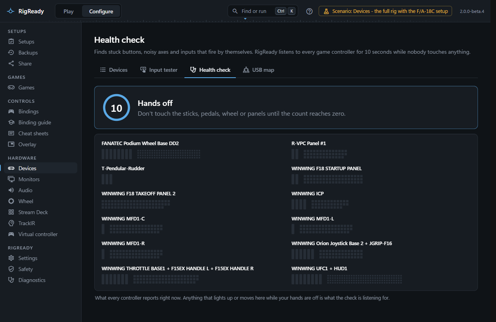
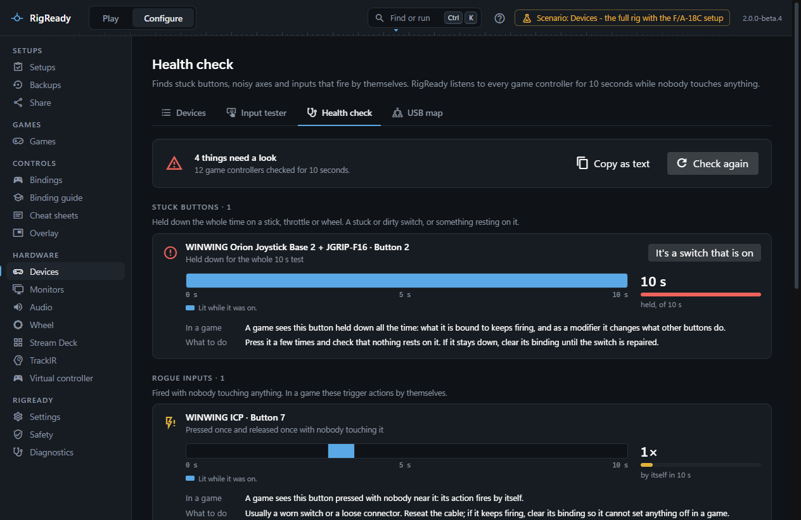
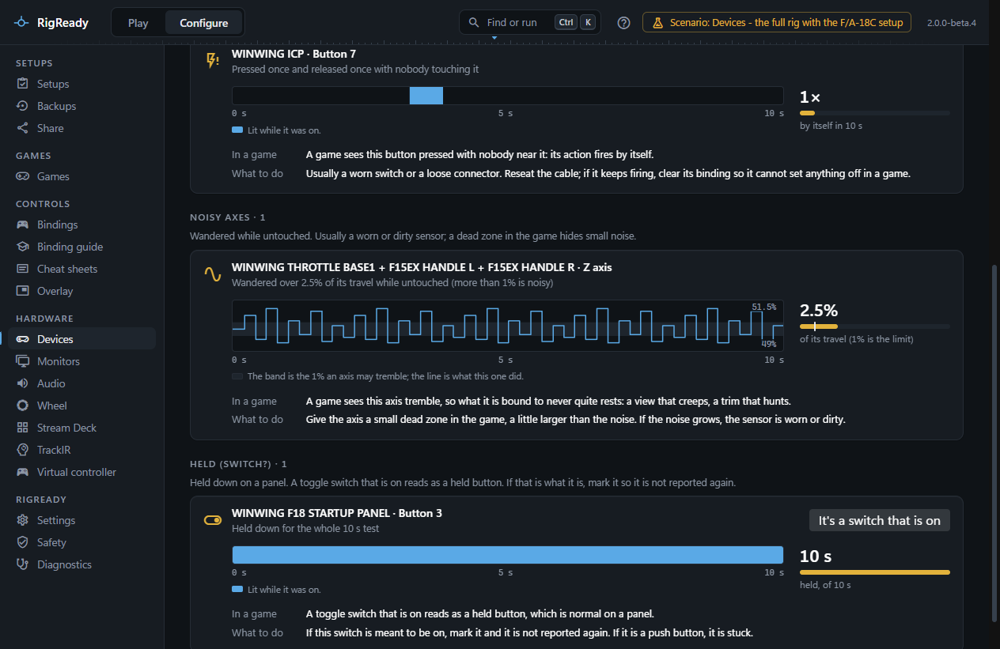

The **Health check** tab of **Configure > Devices** finds the faults that spoil a session without being obvious: a button that is always down, a switch that fires on its own, an axis that trembles so a view creeps or a trim hunts. It listens to every game controller for ten seconds while nobody touches anything and reports everything that moved anyway.

## Running it

Let go of everything, then press **Start the 10-second check**. A countdown shows **Hands off**: do not touch the sticks, pedals, wheel or panels until it reaches zero. While it counts, every controller is shown as a live strip, so a button that is down or an axis that trembles can be seen as it happens.

When the count ends the summary says **All quiet: nothing moved**, or how many things need a look, and how many controllers were checked. **Check again** runs it once more. **Copy as text** puts the whole report on the clipboard as plain text, to paste into a forum post or a support request; personal details such as your user name and serial numbers are removed from the text first.

## What it finds

Findings are grouped, worst first:

- **Stuck buttons**: a button on a stick, throttle or wheel held down for five seconds or more of the window, usually the whole of it. A stuck or dirty switch, or something resting on it.
- **Rogue inputs**: a button pressed or released, or a hat moved, with nobody touching anything. In a game these fire actions by themselves.
- **Noisy axes**: an axis whose values spread over more than one percent of its travel while untouched. An axis that covered a quarter of its travel or more is called out as more than noise: either something was touched, or it is drifting.
- **Held (switch?)**: a button held down on a device that looks like a panel (many buttons, at most two axes, no hat). A toggle switch that is on reads as a held button, which is normal on a panel, so these are listed apart from stuck buttons.

Each finding names the controller (by the name you gave it on the [Devices](devices.md) tab) and the input, says what was recorded ("Held down for the whole 10 s test", "Pressed 3 times and released 3 times with nobody touching it", "Wandered over 2.5% of its travel while untouched"), and shows how bad it is as a number with a bar: seconds held out of the window, how many times it fired, or the percent of travel with the one percent limit marked on the bar.

Under each finding is the evidence. For an axis it is the trace of the ten seconds, zoomed in on where the axis rested, with the band it is allowed to tremble in drawn behind the line and the highest and lowest values marked. For a button or a hat it is a time line with the stretches it was on lit. Then two lines in plain words: **In a game**, what the fault does there, and **What to do**, for example to give a noisy axis a dead zone a little larger than the noise ([DCS bindings](../dcs/bindings.md) has the curve settings), to reseat a cable, or to clear the binding of a button that keeps firing until the switch is repaired.

## Switches that are meant to be on

A panel switch that is on is not a fault. **It's a switch that is on** on a held or stuck button marks it as normally on: it moves to **Switches marked as normally on**, is not reported as a problem, and stays marked in later checks. RigReady remembers the mark by the controller's model and its position among controllers of that model, so it survives a restart and a change of DirectInput id. **Report it again** takes the mark away.

## What is recorded

The check records every state the [input reader](input-tester.md#when-nothing-shows) sends during the window, for every controller, and analyses it when the window ends. Nothing is stored except the marks for switches. The report shows the window length, the number of controllers checked and the findings; the copied text has the same, line by line, with the recorded ranges and times.
