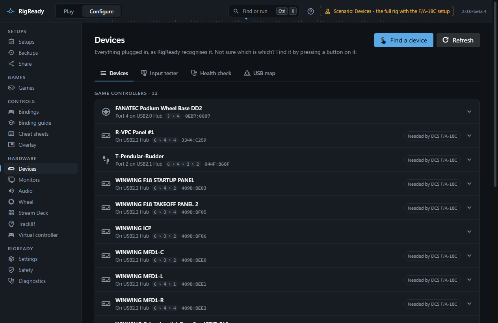

This section covers the hardware tools under **Configure**: every USB device and game controller, what each one reports when you touch it, whether anything moves by itself, and where everything is plugged in. Two more pages cover a Stream Deck and TrackIR, and the Fanatec wheel has [its own page](../games/wheel.md).

Every tool here works with any controller Windows sees. What is specific to a model (cheat-sheet drawings and layouts, the wheel page) so far covers the gear RigReady was built on: WinWing, the Thrustmaster TPR, a Virpil panel and Fanatec. Other brands work fully as controllers; reports and drawings for them are welcome.

## Configure > Devices

The Devices page has four tabs, each a tool:

- [Devices](devices.md): every controller and USB device, with the names you give them, found by pressing a button, with their place on the USB tree, the setups that need them, and [HidHide](devices.md#hidhide).
- [Input tester](input-tester.md): buttons, axes and hats as a game reads them, one controller in full or all at once, with an activity log.
- [Health check](health-check.md): ten seconds with your hands off, then a report of stuck buttons, inputs that fire by themselves and noisy axes.
- [USB map](usb-map.md): the tree from each USB controller of the computer through the hubs to every device, and what could be unplugged.

## Stream Deck, TrackIR and the virtual controller

- [Stream Deck](stream-deck.md): the profiles and plugins on this PC, health findings about them, backups in Stream Deck's own format, restore, and a guided setup for a new PC.
- [TrackIR](trackir.md): whether TrackIR is running and visible to games, its profiles and which profile each game gets.
- [Virtual controller](virtual-controller.md): a virtual Xbox 360 controller or DualShock 4 driven by your stick, wheel or pedals, for games and emulators that read only a gamepad.

## What Windows exposes

RigReady reads hardware from three sources and nowhere else:

- **The Windows device tree.** For every USB device that is present: its vendor and product ID, the name it reports, its manufacturer, its serial number when it has one, and the chain of hubs between it and the computer. Windows invents an id for a device without a serial number from the port it is on, which is why such a device changes identity when it is moved.
- **DirectInput, through RigReady's input reader.** The game controllers exactly as a game lists them: each one's instance ID, its name, and its axes, buttons and hats, with their live state. The reader is a small program shipped with RigReady; when it cannot start, the pages that need it say so and the other information is still shown.
- **HidHide's command line tool**, when HidHide is installed: whether cloaking is on, which devices are hidden and which programs are allowed to see them. RigReady only reads this, except while a [virtual controller](virtual-controller.md) runs with "hide the real controllers" on: then it adds those controllers and its own reader, and takes exactly that away again.

The Stream Deck and TrackIR pages add what those programs keep on disk: Stream Deck's profile and plugin folders and TrackIR's settings, profiles and game map.

## What RigReady can and cannot know

- A device is recognised by its vendor and product ID, narrowed by its serial number or, failing that, by the USB port it is on. Never by its name: two devices can share a name, and a name can change with a driver update.
- When several identical devices have no usable serial, RigReady cannot tell from the device tree which DirectInput controller belongs to which unit. The Devices page says so and offers **Find a device**: press a button, and the controller that answers is the one you pressed.
- A controller that Windows does not list as a USB device of its own (a virtual controller, or a wireless one) is shown by its DirectInput id only.
- Which of several identical devices a setup needs is a decision you make once, by naming them; see [Identical devices](devices.md#identical-devices). When a check still says Not connected, [A device is not found](../troubleshooting/device-not-found.md) goes through the causes.
- RigReady changes HidHide only for a virtual controller (above), does not write to the Fanatec base, and cannot switch TrackIR's profile. Each page says what to do instead.
- The names you give devices are shown everywhere in RigReady, but a check always matches on the identity, never on the name.
